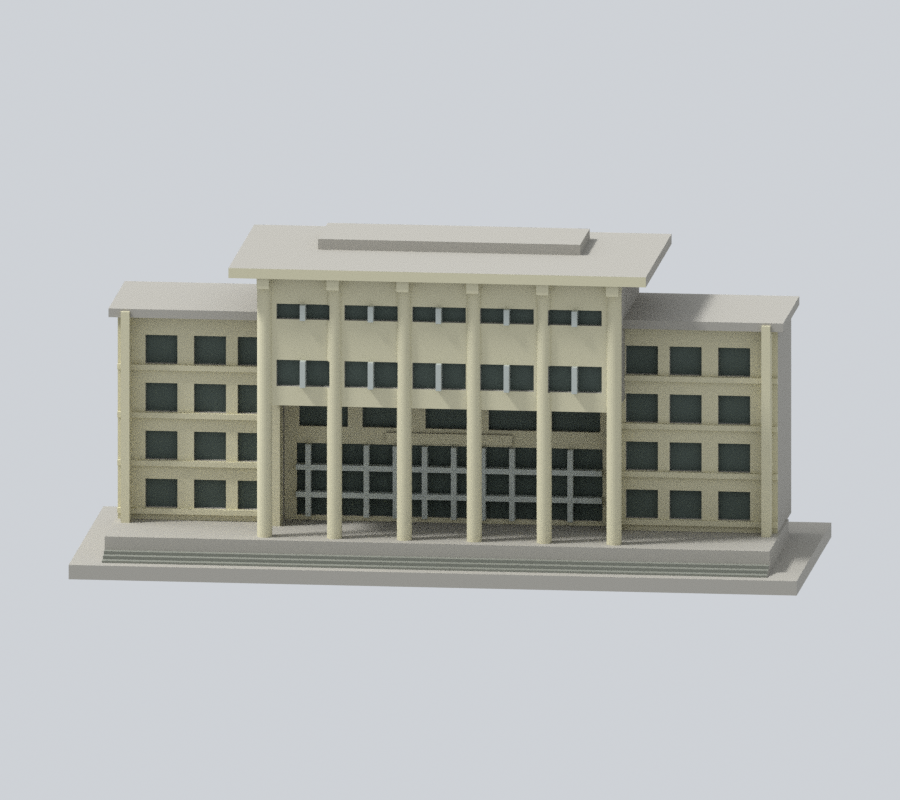
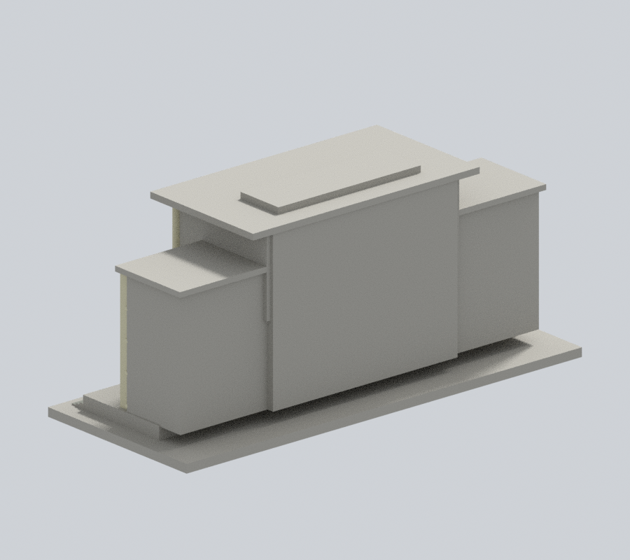
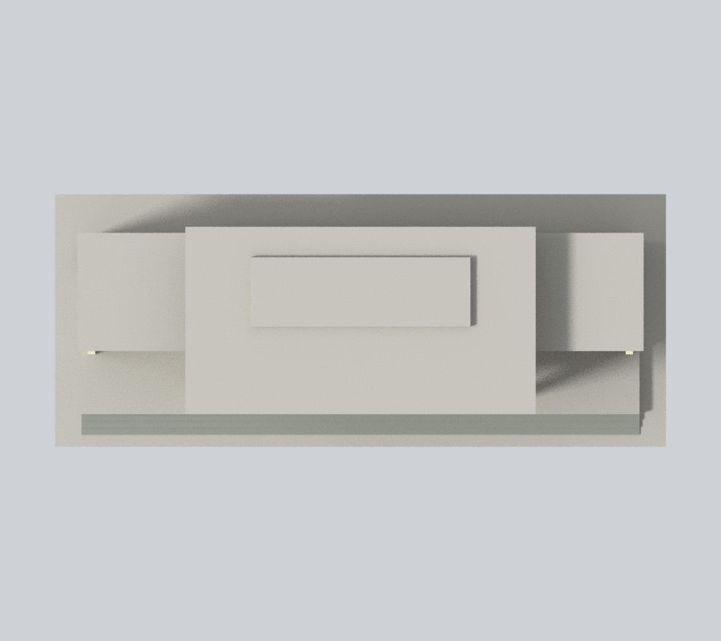

# 行政大樓前棟與柱廊段｜國立中興大學

## 模型預覽

| 新彩色正斜視 | 新彩色來源角度 | 新彩色立面 |
| :---: | :---: | :---: |
|  |  |  |
| 新彩色背向 | 新彩色上視 | 彩色下載 |
|  |  | [彩色3MF](appearance.3mf) · [Blender](appearance.blend) |

校本部公開外觀近似模型，局部建築段。含底座尺寸 150.00 × 62.00 × 66.30 mm，最長150mm。各件獨立縮放，不能直接組成等比例校園。

[正投影](appearance/elevation.png) / [頂面與退縮區](appearance/top.png)

### 新增有限實照材料（原四圖保留）

依2024年8月實照作前棟米黃灰牆柱、灰白原窗框、灰綠窗背及灰階梯的近似材料。背側是人為截斷，側大牆與屋頂未知區保持中性；不代表全館或2026現況。春聯紅帶、金字及簷口紅細帶缺原面界而省略，不將整根柱或整片屋頂染紅。

[材料來源與限制](APPEARANCE.md)。原STL、scene、幾何及四張鎖定預覽保留；只另加appearance，不重跑原列印QA，沒有實體試印。

## 保留特徵與範圍
六根圓形通高巨柱、柱後退縮的雙層入口、上部兩層前伸量體、兩側較低翼部、層間帶窗、前階梯及中央大挑簷。

僅前棟與柱廊，不包括整個行政大樓後半部或附屬部分。兩翼末端、進深及窗分格為視覺近似；模型後側是人為截斷面，不是現館背立面。

僅以公開建築外觀自建，並非測繪復刻；未使用他人3D網格或室內房間配置。未宣稱全館、全校完成。

## 來源與年代
[實拍 1](https://commons.wikimedia.org/wiki/File:NCHU_Administration_Bldg%2C_Taichung%2C_Aug_2024_%281%29.jpg) / [實拍 2](https://commons.wikimedia.org/wiki/File:NCHU_Administration_Bldg%2C_Taichung%2C_Oct_2024.jpg)。其他校方來源及每項支持特徵見 [sources.json](sources.json)。只依照片年代還原可見部分，不宣稱2026完整現況。原照片不随本模型重新散布。攝影日、相簿更新日、活動日期明確區分；未以效果圖代替已建實景。

## 檔案與數位檢查
- [model.stl](model.stl)：毫米制單一實體
- [scene.blend](scene.blend)：由交付STL匯入的可編輯網格；[build_model.py](build_model.py) 是參數重建來源
- [validation.json](validation.json)：原STL法向/繞序、正體積、水密、每邊兩面、vertex-link單環、單一連通表面、獨立重建SHA和Blend三角形幾何一致
- [valid-sections.json](valid-sections.json)：332個0.2mm層距斷面，起始z=0.071mm，每個輪廓及組合Polygon均閉合有效，未修補invalid
- [layer-check.json](layer-check.json)：閉合輪廓與向下表面數值
- [thin-feature-check.json](thin-feature-check.json)：0.8mm參考寬度形態opening輔助篩查，1.0mm層距、z=0.071mm；最大面積損失比例0.000753，無超過1%的取樣層

## 列印限制
底板朝下；可從0.4mm噴嘴、0.2mm層高開始檢查。獨立圓柱直徑3.1mm；附牆窗梃/線腳最小約1.1mm。挑簷與二層高柱廊需在真正切片器中評估支撐位置及拆除路徑。

以上是數位幾何QA，並非真正切片器工具路徑或實體試印；不能保證可印或免支撐。0.8mm形態篩查不是全面最小壁厚或橋接能力證明。縮小模型會改變所有細節厚度，應重新檢查。

## 重建與驗證
Python 3.12依 [requirements.txt](requirements.txt) 安裝依賴，執行 build_model.py。以Blender背景模式執行 render_preview.py，產生實際STL預覽和scene.blend。依序執行 validate_model.py、check_layers.py、check_valid_sections.py、thin_canonical_v2.py；各程式退出碼都應為0，validation.json全部checks需為true。任何失敗都停止發布。

STL SHA-256：069ecdedf410d0e7a8586c9ca5d17ffdda38708503fc936ba874c3b28564691b

[校區圖鑑](../../README.md) / [學校入口](../../../README.md)
