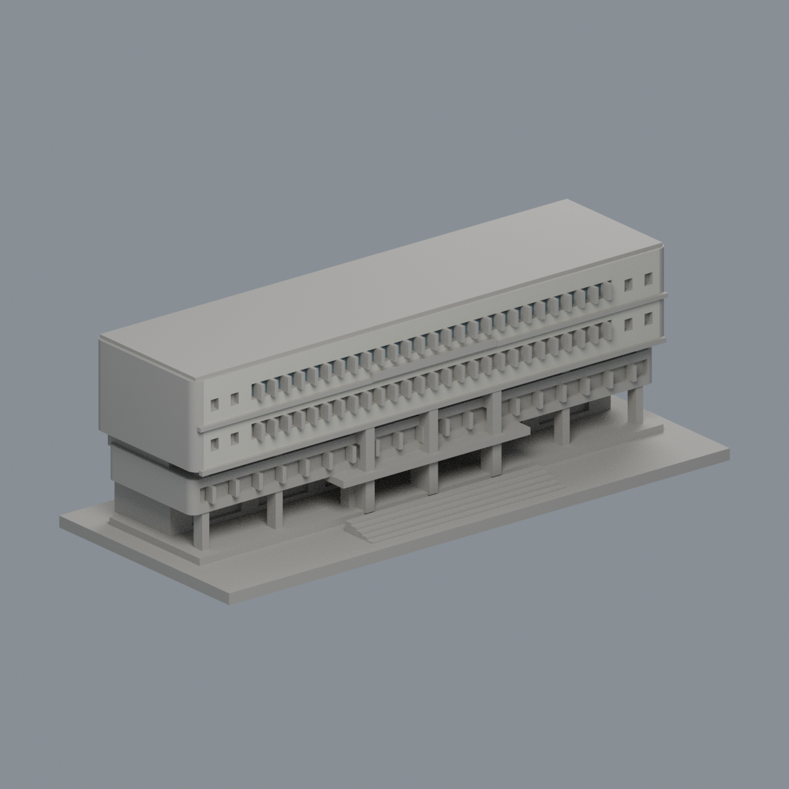
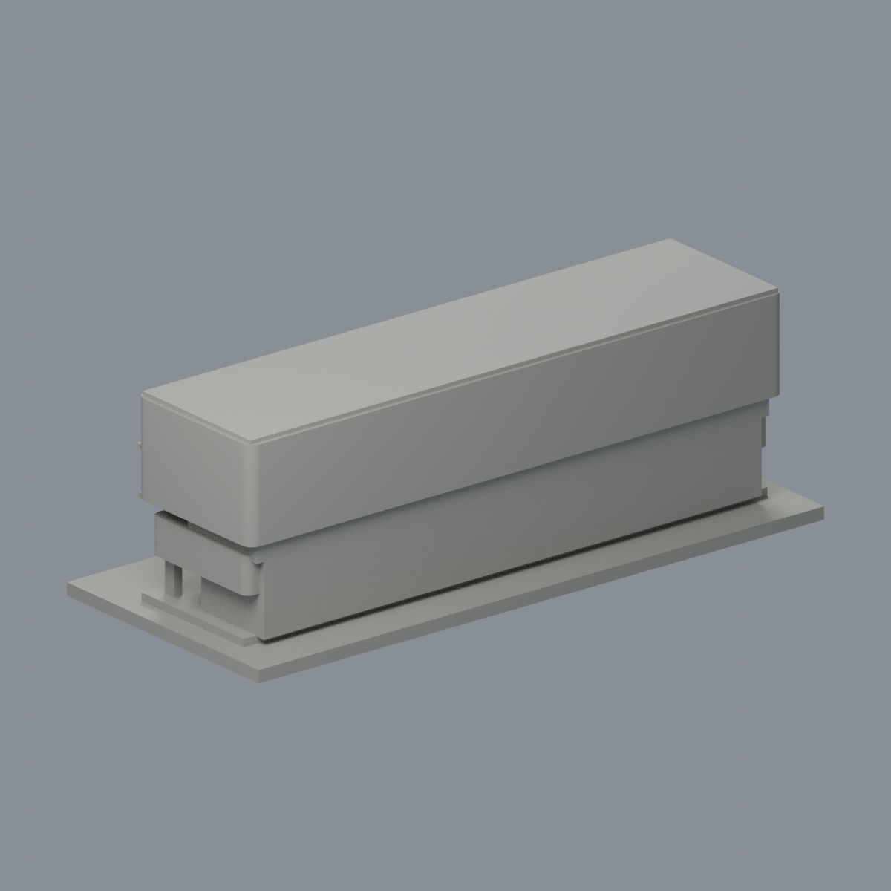
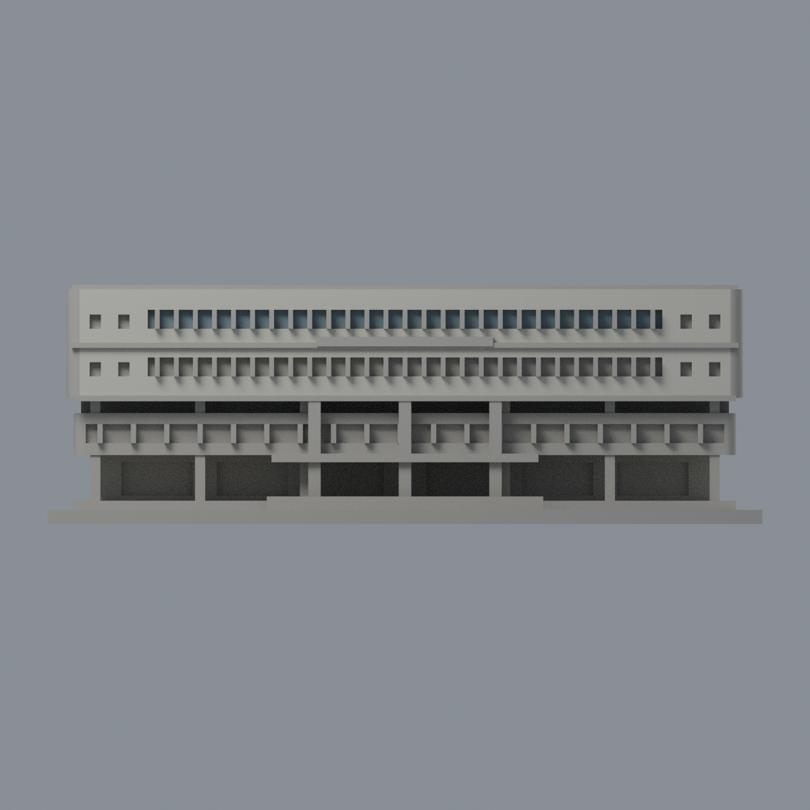
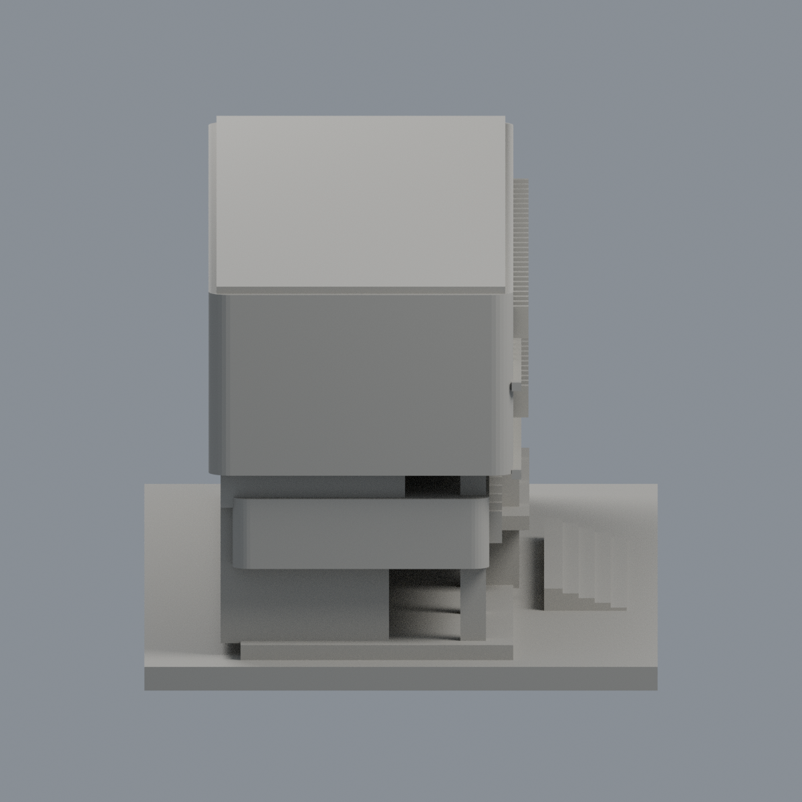
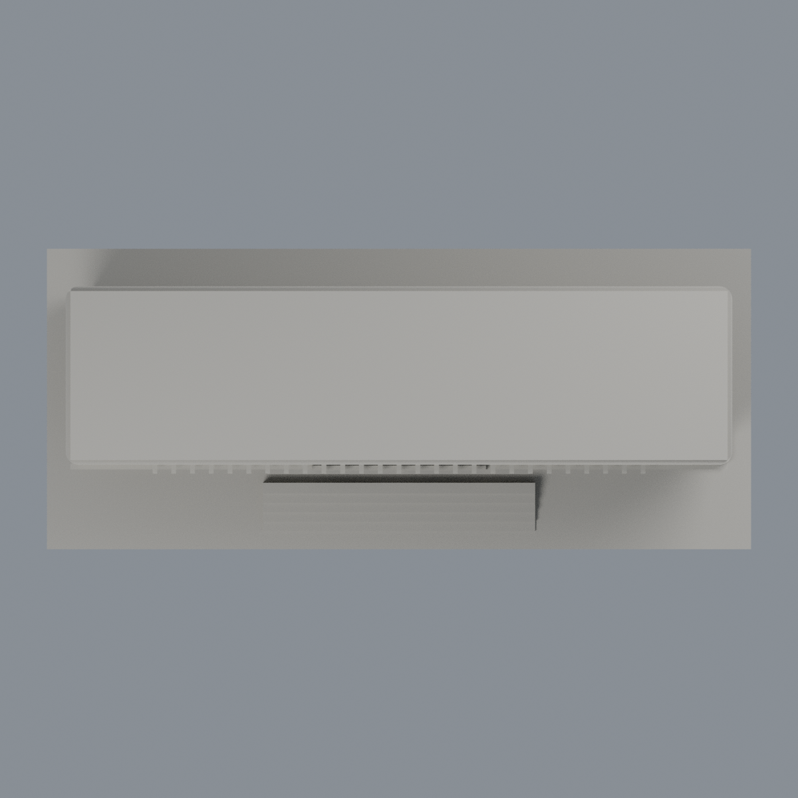

# 國立中興大學惠蓀堂西向前棟段：正面磁磚與上排玻璃限域外觀代理

[彩色3MF](nchu-huisun-front-appearance.3mf) · [可編輯Blend](scene.blend) · [面材質對照](face-materials.json) · [色盤](palette.json) · [來源](SOURCES.md) · [重建原始碼包](rebuild-source.zip)

| 模型預覽 | 模型預覽 | 模型預覽 |
| :---: | :---: | :---: |
| 正面  | 背面  |  |

[正立面](previews/elevation.png) · [側面](previews/side.png) · [俯視](previews/top.png)

| 模型預覽 | 模型預覽 | 模型預覽 |
| :---: | :---: | :---: |
| 正立面  | 側面  | 俯視  |

## 範圍與年代限制
這是1993年第二代惠蓀堂的**西向前棟段**，不是完整惠蓀堂；後方演藝廳、主廳屋頂、太陽能設備及後立面不包含。此次依官方完整實拍，只給既有平直主正面280完整三角指定乳白米灰磁磚近似 #C7C5B7、上排連續玻璃背平面2完整三角指定低飽和灰藍 #7C9198。不繪磁磚紋理、金字、雲影或倒影。其餘3140面中性 #AAA79F，不把中性當實際材色。

下排右端可見金屬防護格柵，原背板沒有與格柵分面，因此**下排及下層玻璃不整面染藍**。原前置窗梃、獨立凸框、窗洞側壁、圓角側背、屋面、人工後截面皆保持中性，沒有把正面證據推到未知朝向。

官方館訊2022.06 No.53〈必點！畢典〉圖說惠蓀堂（2018）攝影／蔡宗憲；E1-6、E1-9原JPEG的EXIF DateTimeOriginal、DateTimeDigitized及DateTime三欄均為2018-09-21（分別16:00:14、16:01:04）。照片未標時區，相機時鐘未獨立校準。**2022出版及2026-10-22研究不是拍攝日期**。原模型幾何依2021/2024照片，此次2018色彩依據跨年，不能宣稱同一時間狀態或2026現貌。色值為未校準目視近似，非精確測色或玻璃成分判定；玻璃用不透明實體表面代理。

原STL3422三角、1537頂點、150 × 64 × 約50.2 mm；原bytes、三角座標/繞序/面序不變，不切面、不新增面、不重拓撲。磁磚逐三頂點同時位於y=-14、x∈[-68.3,68.3]、z∈[26.5,49.3]；玻璃位於y=-12.25、x∈[-54,54]、z∈[41,45]；容差0.0002mm。不是中心點或bbox-only。磁磚1974.32024mm²、玻璃432mm²；[完整面邊界QA](qa/material-boundaries.json)。未做實際切片/試印，不承諾最小壁厚或免支撐，歷史製造QA未重算。各模型獨立縮放，不是等比例校園拼圖。

## 重建
Python安裝source/requirements.txt，同層上級放原model.stl。依序執行 python source/build_appearance.py、python source/verify_material_boundaries.py、python source/verify_exchange.py；再 blender -b -t 2 -P source/render_appearance.py 及 blender -b -t 2 -P source/verify_scene.py。交換strict零warning並真edit-save-reopen；Blend可編輯材質。乾淨第二目錄3MF/maps/palette/五PNG逐bytes一致，Blend語義一致，不宣稱二進位一致。

[交換QA](qa/exchange-validation.json) · [Blend QA](qa/scene-validation.json) · [獨立重建QA](qa/rebuild-validation.json) · [校驗碼](SHA256SUMS) · [權利說明](LICENSE-NOTICE.md)
