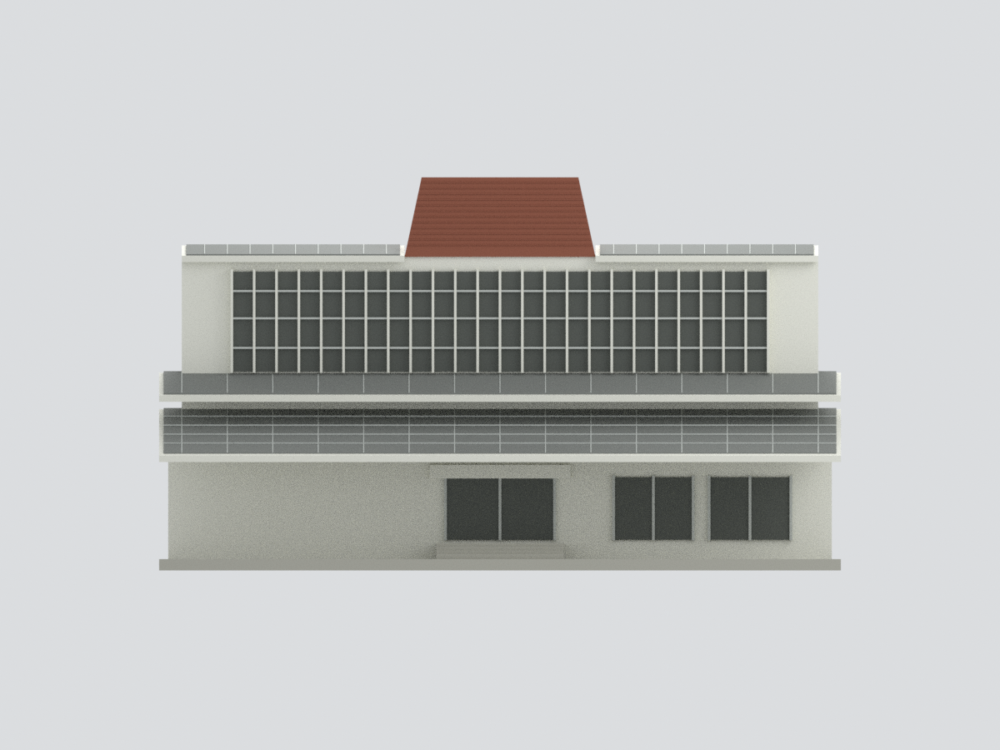
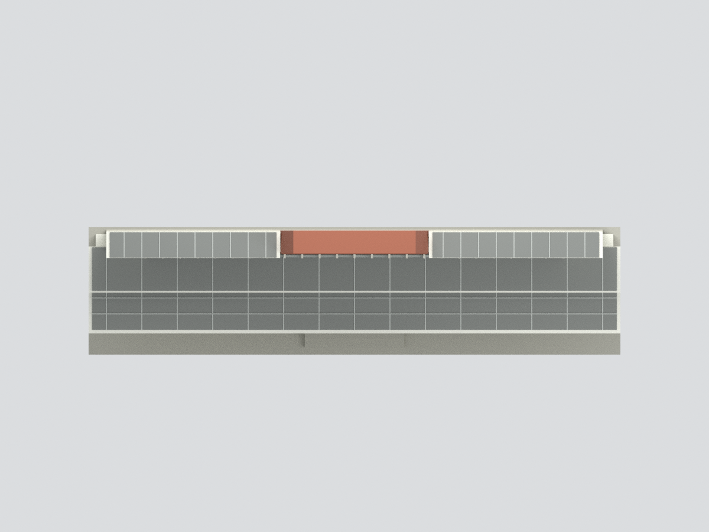

# 國立中興大學雲平樓｜2024中央正立面截段

依官方2024-07-31空拍封面建立的近似彩色模型。**僅中央正立面截段，不是整棟或測繪模型**。兩側斜翼、真實後側與完整屋頂平面不在範圍；棕紅塔只呈現前切片，背板及底座為人工封閉支撐。被樹遮蔽的左下部留空白支撐，不補猜窗門。來源年份不等於2026現況確認。

- `model.stl`：單色幾何；`model.3mf`：同網格逐面色材質。
- `scene.blend`：實際網格與隱藏可編輯原始零件，不含來源影像。
- 尺寸約150×36×86.5mm（模型尺寸，非真實建物比例尺）。未試印；薄框與斜屋面須依印表機能力評估支撐。
- `build_model.py`可無照片獨立重建；六張`previews/`均由實際網格Blender渲染，非生成式想像圖。
- 來源及已知限制：[SOURCES.md](SOURCES.md)。工程完整性測試不等於建築形制完整確認。
