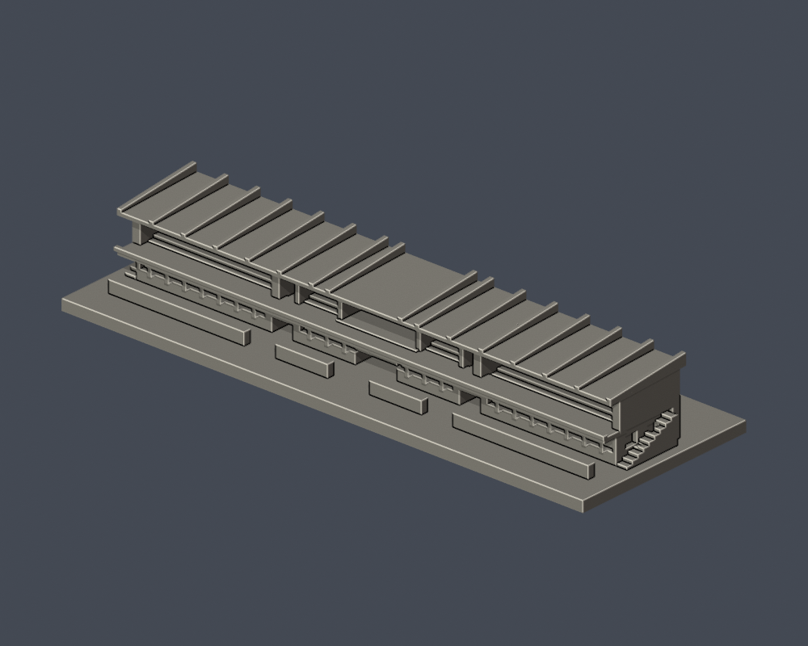
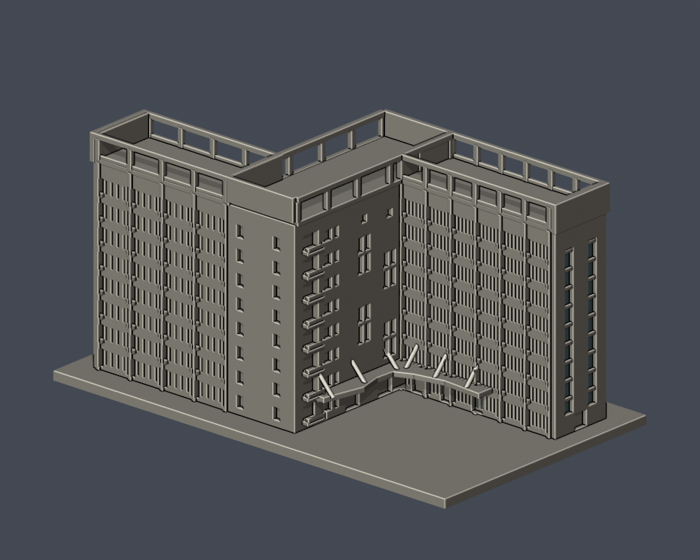

# 國立勤益科技大學｜校園建築3D列印模型

本批為依公開多角度照片、官方校圖與配置圖自行建立的外觀近似模型。每件含底座最長150 mm，各件獨立比例。沒有下載第三方3D網格，也未提供建築測繪或實體試印保證。

共有3件模型：工具機連體群1件、養浩C／D連體群1件、鹿鳴附屬看臺1件。這不是全校完成，也不是3棟實體建築的普查結論。

## 本批圖鑑

| 工具機學院大樓整體群 | 鹿鳴臺 | 養浩學舍 C／D 連體群 |
| --- | --- | --- |
|  [工具機學院大樓整體群](太平校本部/buildings/ncut-machine-tool-complex/README.md) 建築群整體近似模型 |  [鹿鳴臺](太平校本部/buildings/ncut-luming-grandstand/README.md) 附屬看臺模型 |  [養浩學舍 C／D 連體群](太平校本部/buildings/ncut-yanghao-dormitory/README.md) 建築群整體近似模型 |

[太平校本部入口](太平校本部/README.md) · [37項逐項研究續接](COVERAGE.md) · [機讀涵蓋範圍](coverage.json) · [模型與驗證清單](batch-manifest.json)

## 範圍與年代

太平校本部包含原校區及相鄰的原坪林營區新校區；本批三件集中在此，沒有宣稱校外據點全部查清。舊行政大樓2024年已拆，舊360照片只能當歷史證據。北側營舍、教師研究樓、舊工場及中科歷史據點分開保留狀態，不拿規劃圖當完工現況。精確來源及下一步見涵蓋清單。

## 使用與驗證

以毫米匯入、平底朝下。每件提供原創參數建模程式、STL、可編輯Blend、actual STL正背／頂視、來源與數位驗證。凹窗、懸簷、欄架、斜桿與橋接均需自行檢查切片和支撐；尚未實際試印。養浩屋頂及鹿鳴肋條存在明列的0.8mm opening提示，已補逐構件檢查，不是zero-warning或全面最小壁厚認證。

公開包只有自建模型、程式、預覽及来源連結，不重新散布第三方照片或PDF。凍結後的修訂另開新版本；模型凍結與GitHub發布是分開的狀態，發布須另經獨立幾何覆核。
