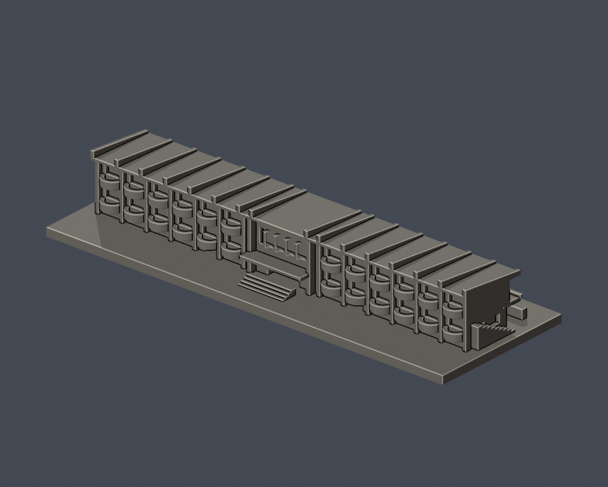
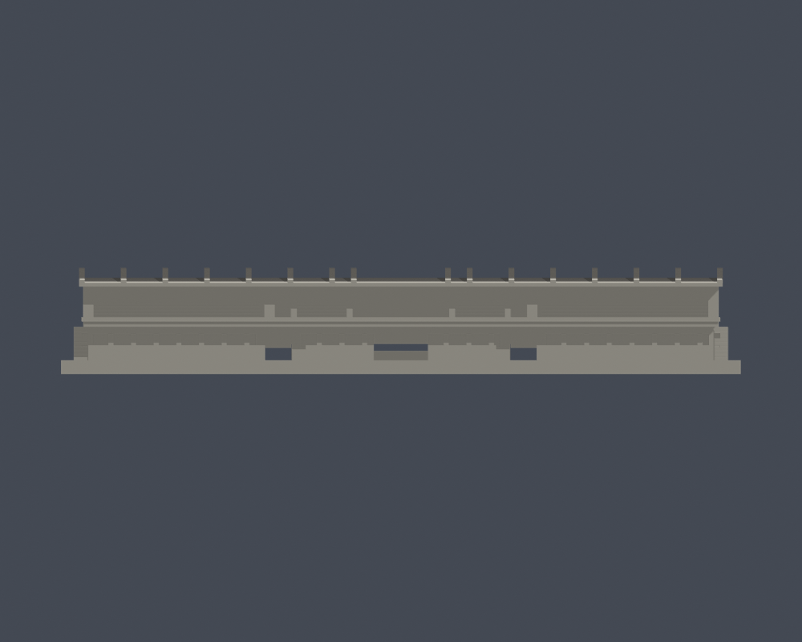
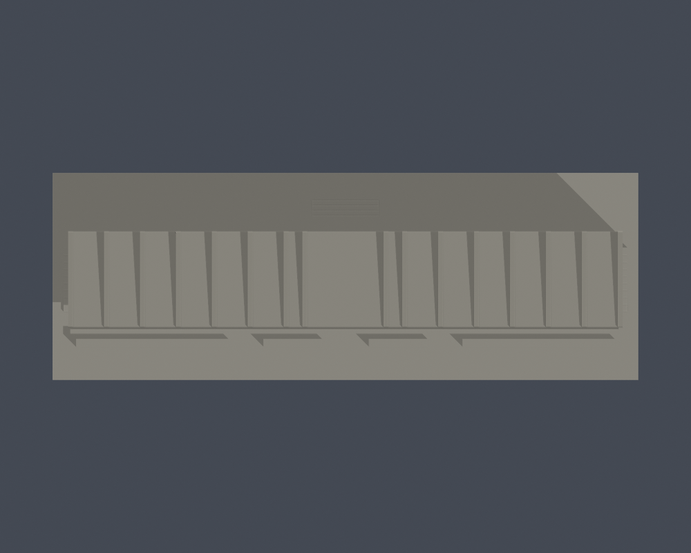

# 國立勤益科技大學｜鹿鳴臺

## 模型預覽

| 模型預覽 | 模型預覽 | 模型預覽 |
| :---: | :---: | :---: |
| 運動場／看臺側<br> | 背側入口<br> |  |

太平校本部原坪林營區（新校區）的**附屬看臺模型**。範圍包括長條運動看臺、下方露出地面的建築量體、前後立面及局部端部，合為一件；跑道、球場、樹木與其他棚架未納入。

模型含底座為 **150 × 53 × 23.376 mm**；底座厚 3 mm。它是按公開照片自行建模的外觀近似件，沒有完整測繪尺寸，也不與其他館舍共用固定比例。

## 實際 STL 預覽


[正立面](previews/elevation.png) · [屋頂與座區頂視](previews/top.png)

| 模型預覽 | 模型預覽 | 模型預覽 |
| :---: | :---: | :---: |
| 正立面<br> | 屋頂與座區頂視<br> |  |

正背兩面已完成來源外觀核對。上述皆由交付的 model.stl 渲染，渲染顏色只供辨識，沒有使用另一份高細節展示網格。

## 建築依據與保留特徵

主要依據是[總務處「鹿鳴臺新建工程之施工前後照片」](https://oga.ncut.edu.tw/var/file/54/1054/img/638/364023231.pdf)第 2 頁的兩張施工後空拍，分別看向背側與運動場側。PDF 建立／修改中繼日期為 2023-10-16，照片本身未標攝影日期。

[官方 111–114 學年度計畫](https://n058.ncut.edu.tw/var/file/58/1058/img/1438/531003455.pdf)印刷第 145 頁記載，鹿鳴臺於 **2022 年 2 月**完工。[內政部建築案件資料](https://ws.moi.gov.tw/001/Upload/436/relfile/12465/257170/6abeb6ca-d551-40cc-be10-066a349abb76.pdf)列地下 1 層、地上 2 層；本件只呈現地面可見外觀，不把地下室額外堆成地上樓層。名稱及運動場旁的位置並以[官方校圖](https://www.ncut.edu.tw/var/file/0/1000/img/ncutMap20260212a.jpg)與[總務處配置圖](https://oga.ncut.edu.tw/var/file/54/1054/img/637/693853712.pdf)核對。

- 長而低的覆頂看臺、前方外挑步道、四個座區與開放的中央臺區；座區保留六級階梯式量體。
- 屋面以兩端各六個寬區、中央兩側各一個窄區、中央一個寬區組成 15 區，16 道肋界定分區。這是影像分區判讀，不將屋頂肋數、立面主柱數與門窗小框數混為一談。
- 前側寬牆柱、較細中央支柱、下層四組水平窗帶與中央／兩側深通道分開處理，避免通用窗陣。
- 背側保留左右各六組半圓形外挑，上下兩列；中央留寬入口與玻璃凹面，沒有把整面改成平牆。
- 屋面稍向背側升高，最高屋頂肋與低長看臺有可辨高差；兩側短端保留簡化外露樓梯。

底座上部以照片比例調整，草模 z 以 `3 + (z − 3) × 0.72` 轉為最終模型標高，底座 3 mm 不變。最終屋面上緣由 20.28 升至 21.216 mm，最高肋頂 23.376 mm。0.72 是建模比例調整，並非由實景測得的工程尺寸。

## 局部不確定與簡化

背側上排外挑可清楚辨識；下排部分被樹冠遮住，因此按上排節奏推定其位置，並非逐個單元均取得完整照片。短端正立面、外露樓梯細節、精確進深、窗高與外挑深度也缺乏測繪資料，局部採對稱近似。

屋面厚度、坡度、半圓邊牆與框線為縮尺作近似及加厚。細欄杆改成連續厚帶；未建逐張座椅、細扶手、標誌文字、地下室、室內隔間與結構。詳細差異逐項列於 [feature-evidence.json](feature-evidence.json)。

## 列印方向與細部警示

- 以 **毫米** 匯入切片軟體；150 × 53 mm 平底座朝下，z=0 貼平台。STL 本身不儲存單位。
- 長屋簷、看臺頂板、前走道、半圓外挑與背側雨遮下方須評估橋接／支撐；留意支撐是否能從座區與外挑凹處安全取出。
- 16 道屋頂肋雖與屋面相連，仍須小心搬運、縮放與拆支撐。極細欄杆已省略；不要僅以支撐補救縮小後無法解析的細節。

本資料夾現有報告：原始網格 16,062 個三角形、1 個連通表面殼，所有硬檢查均為 true；0.2 mm 輪廓取樣 117 層均閉合有效。

薄特徵篩檢取樣 24 層，其中 **1 層超過 1% opening 面積損失**：z=23.071 mm 的最高屋頂肋尖／角部取樣，截面約 61.050 mm²，opening 未保留約 2.214 mm²，比例 **3.627%**。這是高處狹窄尖角的局部警示，保留於報告供切片檢查；它不等於整件模型不通過，也不等於已保證可印或所有壁厚達 0.8 mm。

### 屋頂尖端分構件補檢

z=23.071 mm 的 16 個屋頂肋條截面逐一做 0.8 mm opening，全部保留，沒有消失或分裂；各截面至少保留 96.379% 面積。最窄外包短邊為 1.25 mm，與建模肋條寬度一致。所有面積損失均位於原輪廓角點 0.41 mm 鄰域內。這是該層的構件核對，不是全模型最小壁厚保證。見 [補檢程式](check_roof_components.py) 與 [逐構件結果](roof-component-check.json)。

## 檔案與重建

- [model.stl](model.stl)：交付的二進位 STL，單位為毫米（mm）。
- [scene.blend](scene.blend)：由同一 STL 匯入的可編輯三角網格，含預覽材質與相機；不是實景材質或參數式 CAD。
- [build_model.py](build_model.py)：獨立參數建模來源；[requirements.txt](requirements.txt) 固定 Python 套件版本。
- [render_preview.py](render_preview.py)：直接匯入交付 STL 渲染正面、背面、正立面與頂視圖；未以另一份較精細外觀檔代替。
- [sources.json](sources.json)：公開來源、日期性質與各來源支持的特徵。
- [feature-evidence.json](feature-evidence.json)：逐項特徵、建模處理、可見證據及局部推定。
- [validation.json](validation.json)、[contour-validity-check.json](contour-validity-check.json)、[thin-feature-check.json](thin-feature-check.json)：原始網格、逐層輪廓及薄特徵篩檢結果。

請先複製整個模型資料夾再重建，避免覆寫已下載的交付版本。需安裝 Python 與 Blender（渲染程式以 Blender 4.3.2+ 使用方式撰寫），在副本目錄執行：

```sh
python -m pip install -r requirements.txt
python build_model.py
blender -b -t 4 -P render_preview.py
python validate_model.py --output validation.json
python check_contour_validity.py
python check_thin_features.py
```

三份驗證程式依次為 [validate_model.py](validate_model.py)、[check_contour_validity.py](check_contour_validity.py) 與 [check_thin_features.py](check_thin_features.py)。任一步非零退出或任何硬檢查為 false，就不能視為完成驗證。重新建模或修改 Blender 網格後，必須重新渲染、驗證並另存修訂版；不要沿用舊報告或雜湊。

## 驗證方法與限制

原始 STL 的已存法向量、繞序、非退化三角形、水密性、每邊恰有兩面、頂點 link 為單一環、正體積、單一連通表面殼與最大尺寸均納入硬檢查。驗證器在暫存目錄獨立重建，比對 STL 的 SHA-256，並讀取已儲存的 Blender 網格比對幾何。沒有先修補原始 STL 再宣稱原檔通過。

- 逐層輪廓：從 z=0.071 mm 起，每 0.2 mm 檢查一次，共用邊以一致方式求交點；所有節點 degree=2、每條輪廓閉合、個別 Polygon 與合成 Polygon 均須有效。固定起始高度用於避開共面退化。
- 薄特徵輔助篩檢：從同樣的 z=0.071 mm 起，每 1.0 mm 取樣；以半徑 0.4 mm 的形態 opening 觀察低於 0.8 mm 參考寬度的尖角／窄區。
- 薄特徵程式使用 canonical fail-closed v3，SHA-256 為 `059f7378c74a1400dcf010365ebf35df3027fd853f1c960462a233dc68ce8915`。無效輪廓直接失敗，不用 `buffer(0)`、`make_valid` 等修補後繼續。正常用於量測的收縮／膨脹 opening 不屬於輪廓修復。

這些是數位幾何檢查，不是全面最小壁厚、窮盡式自交檢查，也不是 Cura／PrusaSlicer 的實際工具路徑測試。尚未實體試印；不能保證任何機器／材料均可印，也不宣稱不用支撐。正式版本仍應以批次的最終驗證與凍結紀錄為準。

## 來源使用與版本界限

本模型的幾何由參數程式原創建立，未擷取未授權的第三方 3D 網格。原建築照片、官方 PDF 與來源對照資料僅供查證，不隨公開模型包重新散布；來源連結不表示取得照片再授權。示意校圖、網頁更新日、檔名日期、PDF 建立日期與照片攝影日分開記錄。

本件是校園建築系列中的一項，不能據此聲稱全校、所有校區或全部建物已完成。模型件數也不是實體建物的普查棟數。
