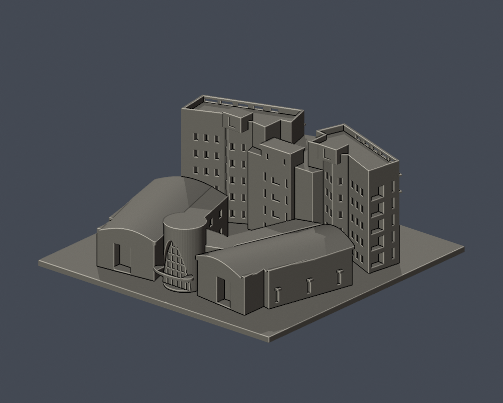

# 國立勤益科技大學｜工具機學院大樓整體群

太平校本部（原校區）的照片導向外觀近似模型。主教學樓、兩側多功能實習廠房、低翼、入口及院落合為**一件整體群模型**，不拆算成三件，也不包含鄰近復通樓或舊綜合實習／焊工工廠。

模型含底座為 **150 × 150 × 61.8 mm**；底座厚 3 mm。各件採獨立模型比例，未取得足以確定 1:n 的完整實測尺寸，不能當作建築測繪模型。

## 實際 STL 預覽

| 教學樓前側 | 廠房背側 |
| --- | --- |
|  |  |

[正立面](previews/elevation.png) · [院落與屋頂頂視](previews/top.png)

頂視中的高度色階只協助辨識院落地坪與不同屋頂標高，不代表實景塗色。正背面與院落頂視已完成外觀核對。

## 建築依據與保留特徵

[AHA 洪清安建築師事務所作品頁](https://aha0.webnode.tw/%E5%9C%8B%E7%AB%8B%E5%8B%A4%E7%9B%8A%E7%A7%91%E6%8A%80%E5%A4%A7%E5%AD%B8%E5%B7%A5%E5%85%B7%E6%A9%9F%E5%A4%A7%E6%A8%93/)的 15 張實拍是主要影像依據，其中 13 張室外多視角、2 張室內輔助。逐圖 URL 與用途列於 [sources.json](sources.json)。來源未標攝影日，不將下載日或網站日期當作拍攝日期。

[官方 114–117 學年度計畫](https://n058.ncut.edu.tw/var/file/58/1058/img/1438/183565445.pdf)記載大樓於 2018 年啟用，主樓地下 1 層、地上 5 層，並有地上 2 層多功能實習工廠；實際可見窗列另以照片核對。名稱與位置以[官方校圖](https://www.ncut.edu.tw/var/file/0/1000/img/ncutMap20260212a.jpg)及[總務處平面配置圖](https://oga.ncut.edu.tw/var/file/54/1054/img/637/693853712.pdf)交叉確認。校圖檔名的 2026-02-12 是檔名日期，不能據此宣稱每張外觀照片拍攝於 2026 年。

- 折轉教學雙翼及中央較低露臺；同時保留平面退縮與真正的 z 高差。
- 前側五列主要窗群，依列交替寬窗／高窄窗；側端保留五層凹入陽臺。門片小框不混算為主柱或窗跨。
- 高屋頂女兒牆的五組漸變長孔、水平遮簷、後側服務核心與屋頂突出塊。
- 前側曲面入口、拱形玻璃凹面及橢圓雨遮；背側獨立圓形入口塔保留與低翼的高差。
- 兩側廠房的長曲面屋頂、折角平面、大型門洞與局部側窗，和教學立面使用不同開口節奏。
- 上方開放的近三角形院落、兩側內低翼及有頂短連廊，不以完整實心盒填平院落。

屋頂層次以模型底面 z=0 計：內低翼 25.0 mm、背側圓塔蓋頂 37.1 mm、教學樓中央露臺 45.0 mm、兩翼屋面蓋頂 55.1 mm、女兒牆頂 58.3 mm、局部服務塊最高 61.8 mm。這些是照片比例推定後的模型標高，不是實景公尺尺寸。

## 局部不確定與簡化

背側並非全無資料：廠房端立面及教學樓院落側有空拍支持。仍不清楚的是被前景廠房、低翼遮住的下層窗、內角局部、精確進深與設備細節。這些區域用簡化窗槽和量體表示，部分雙翼細節採對稱近似；不宣稱逐扇窗與每一機電設施均準確。

玻璃用有背靠的浮雕／凹面呈現；細拉索、細欄杆、屋頂管線、空調、盆栽、標誌字與周邊雕塑略去。女兒牆、框線和屋頂邊緣為連接與縮尺辨識加厚，屋面厚度與曲率近似。地下室、室內隔間及機台沒有建模。

## 列印方向與注意事項

- 在切片軟體以 **毫米** 匯入，將 150 × 150 mm 平底座朝下、z=0 貼平台；STL 本身不儲存單位。
- 前後橢圓雨遮、低連廊底部、凹入陽臺與屋簷等懸垂，應逐層檢查橋接與支撐。支撐接點需避開拱形格線及細女兒牆，拆除時避免折斷。
- 加粗框線／簷口仍是細件。再縮小會降低細部厚度與凹槽可解析性；不能只靠「加支撐」補救無法解析的細節。

本資料夾現有報告：原始網格 9,662 個三角形、1 個連通表面殼，所有硬檢查均為 true；0.2 mm 輪廓取樣 309 層均閉合有效；薄特徵篩檢 62 層，無取樣層 opening 面積損失超過 1%，最大約 0.586%。opening 的面積損失包含尖角，不是全面壁厚結論。

## 檔案與重建

- [model.stl](model.stl)：交付的二進位 STL，單位為毫米（mm）。
- [scene.blend](scene.blend)：由同一 STL 匯入的可編輯三角網格，含預覽材質與相機；不是實景材質或參數式 CAD。
- [build_model.py](build_model.py)：獨立參數建模來源；[requirements.txt](requirements.txt) 固定 Python 套件版本。
- [render_preview.py](render_preview.py)：直接匯入交付 STL 渲染正面、背面、正立面與頂視圖；未以另一份較精細外觀檔代替。
- [sources.json](sources.json)：公開來源、日期性質與各來源支持的特徵。
- [feature-evidence.json](feature-evidence.json)：逐項特徵、建模處理、可見證據及局部推定。
- [validation.json](validation.json)、[contour-validity-check.json](contour-validity-check.json)、[thin-feature-check.json](thin-feature-check.json)：原始網格、逐層輪廓及薄特徵篩檢結果。

請先複製整個模型資料夾再重建，避免覆寫已下載的交付版本。需安裝 Python 與 Blender（渲染程式以 Blender 4.3.2+ 使用方式撰寫），在副本目錄執行：

```sh
python -m pip install -r requirements.txt
python build_model.py
blender -b -t 4 -P render_preview.py
python validate_model.py --output validation.json
python check_contour_validity.py
python check_thin_features.py
```

三份驗證程式依次為 [validate_model.py](validate_model.py)、[check_contour_validity.py](check_contour_validity.py) 與 [check_thin_features.py](check_thin_features.py)。任一步非零退出或任何硬檢查為 false，就不能視為完成驗證。重新建模或修改 Blender 網格後，必須重新渲染、驗證並另存修訂版；不要沿用舊報告或雜湊。

## 驗證方法與限制

原始 STL 的已存法向量、繞序、非退化三角形、水密性、每邊恰有兩面、頂點 link 為單一環、正體積、單一連通表面殼與最大尺寸均納入硬檢查。驗證器在暫存目錄獨立重建，比對 STL 的 SHA-256，並讀取已儲存的 Blender 網格比對幾何。沒有先修補原始 STL 再宣稱原檔通過。

- 逐層輪廓：從 z=0.071 mm 起，每 0.2 mm 檢查一次，共用邊以一致方式求交點；所有節點 degree=2、每條輪廓閉合、個別 Polygon 與合成 Polygon 均須有效。固定起始高度用於避開共面退化。
- 薄特徵輔助篩檢：從同樣的 z=0.071 mm 起，每 1.0 mm 取樣；以半徑 0.4 mm 的形態 opening 觀察低於 0.8 mm 參考寬度的尖角／窄區。
- 薄特徵程式使用 canonical fail-closed v3，SHA-256 為 `059f7378c74a1400dcf010365ebf35df3027fd853f1c960462a233dc68ce8915`。無效輪廓直接失敗，不用 `buffer(0)`、`make_valid` 等修補後繼續。正常用於量測的收縮／膨脹 opening 不屬於輪廓修復。

這些是數位幾何檢查，不是全面最小壁厚、窮盡式自交檢查，也不是 Cura／PrusaSlicer 的實際工具路徑測試。尚未實體試印；不能保證任何機器／材料均可印，也不宣稱不用支撐。正式版本仍應以批次的最終驗證與凍結紀錄為準。

## 來源使用與版本界限

本模型的幾何由參數程式原創建立，未擷取未授權的第三方 3D 網格。原建築照片、官方 PDF 與來源對照資料僅供查證，不隨公開模型包重新散布；來源連結不表示取得照片再授權。示意校圖、網頁更新日、檔名日期、PDF 建立日期與照片攝影日分開記錄。

本件是校園建築系列中的一項，不能據此聲稱全校、所有校區或全部建物已完成。模型件數也不是實體建物的普查棟數。
