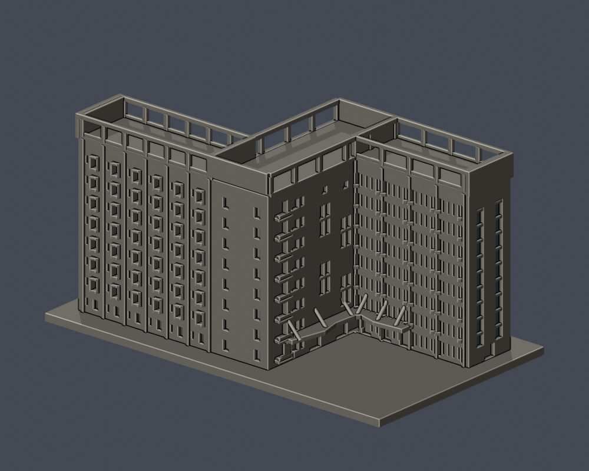

# 國立勤益科技大學｜養浩學舍整體群

太平校本部新校區（原坪林營區）的照片導向外觀近似模型。養浩學舍又稱第二學生宿舍，C、D 棟由交誼廳連接，本件將兩翼與中央連接部視為**一件 Z 形整體群模型**；不拆成兩件計數，也不包括鄰近的勤益學舍 A、B 棟。

模型含底座為 **150 × 87 × 75.65 mm**；底座厚 3 mm。各館獨立縮放，本件未取得完整實測尺寸，不能據此推算可靠的 1:n 比例或當作建築測繪成果。

## 實際 STL 預覽

| 正側斜視 | 反側斜視 |
| --- | --- |
|  |  |

[正側正立面](previews/elevation.png) · [反側正立面](previews/back_elevation.png) · [Z 形平面與屋頂頂視](previews/top.png)

預覽由本資料夾的實際 STL 匯入渲染。正背名稱只是相機視角，未主張經測量的地理方位。頂視高度色階用於辨識屋面與開放空間；窗槽的深灰與外端玻璃凹面的局部藍色也是預覽材質，僅標示實際幾何中的凹面。這些色彩不代表建築完整實景配色，STL 本身無色。

## 來源、年代與模型範圍

[官方宿舍簡介](https://osca.ncut.edu.tw/p/404-1010-17831.php?Lang=zh-tw)記載養浩學舍於 **2023-08-02 舉行落成典禮、2023-08-16 正式啟用**，為地上八層的 Z 字形 C、D 棟，以交誼廳連接。樓層用途數與照片窗列分別核對，不以寢室或床位數倒推窗數。

主要外觀依據是總務處[「養浩學舍新建工程之施工前後照片」PDF](https://oga.ncut.edu.tw/var/file/54/1054/img/638/514047131.pdf)第 2 頁兩張「施工後」相反方向空拍；另以[校園配置平面圖](https://oga.ncut.edu.tw/var/file/54/1054/img/637/693853712.pdf)核對 Z 形輪廓。[官方校圖](https://www.ncut.edu.tw/var/file/0/1000/img/ncutMap20260212a.jpg)用來核對名稱與周邊關係。施工後照片未標明攝影日，PDF 建立日、網頁日期與校圖檔名的 2026-02-12 均不作為照片拍攝日。

[校方轉載的 2023-08-03 國立教育廣播電臺報導](https://pr.ncut.edu.tw/p/406-1001-74867%2Cr1174.php?Lang=zh-tw)記載建築師石昭永、白色外牆、不規則紅色入口雨遮與外推三角窗；[2023-08-02 經濟日報報導](https://pr.ncut.edu.tw/p/406-1001-74854%2Cr1174.php?Lang=zh-tw)補充深陽臺與通透交誼空間。這些文字支持特徵辨識，外形比例仍以照片判讀。逐項來源見 [sources.json](sources.json)。

## 保留的主要外觀特徵

- 長短兩翼錯開，中央交誼廳連接部形成 Z 形；兩側向外開放，不填成封閉院落或 H 形量體。
- 短翼 **4 跨**、長翼 **6 跨**主要立面分組，各以 **8 列**窗／陽臺層次表示；一樓部分是入口與開放空間。主分組不等於寢室間數；短翼旁大片白色樓梯端牆不列入主跨，門片細框也不當作主柱跨。
- 短翼內外兩面及長翼內側，各主跨以四個窄窗槽與兩側較寬陽臺凹槽區分節奏，上層保留三角外挑的簡化板片。長翼外側獨立建模為大片白牆、每跨一個主要凸窗及分開的小窄窗，沒有鏡像套用另一面的密窗網；凸窗位置和突深因斜視解析度而局部近似。
- 中央部保留八層堆疊的轉角陽臺、較厚白色樓板帶、交錯雙層高玻璃凹面及相連的加粗格線。
- 兩翼外端保留兩條高直玻璃帶及下方出入口；玻璃橫框節奏簡化。
- 地面入口保留沿中央核心及翼部延伸、連成 L 形轉折的裙帶狀雨遮與加粗斜支桿。單色 STL 保留其幾何，未以紅色貼圖代替。
- 屋頂保留平屋面、開放高框及真正穿空的矩形缺口；中央露臺略低於翼部屋面，不加成另一層完整住宿樓。

以底面 z=0 計，中央露臺蓋頂約 68.0 mm、兩翼屋面蓋頂約 68.1 mm，屋頂高框最高 75.65 mm。這些是模型參數，並非建築實景公尺尺寸；屋頂穿空是框架空隙，下方仍保留實體屋面。

## 局部不確定與縮尺簡化

兩張相反方向空拍已支持主要正反立面、轉角與屋頂外框，不能把整個背面稱為無資料。真正缺口是樹冠遮住的地面門窗、深凹內角、精確進深、細部欄杆／窗框及屋頂設備配置；這些部分採局部近似或省略。可見的分組數與比例仍是照片判讀，不宣稱逐室、逐窗的完整清冊。

玻璃以有實體背靠的凹面與框線表示，不是透明材料或可穿越整棟的空洞。宿舍內部、地下室、家具、機電管線、空調、屋頂機組、太陽能設備、文字、植栽及周邊地景不在模型範圍。

四窄窗加雙凹槽的立面為保留主分組數，並維持局部相鄰窗槽間約 **0.8 mm** 的實體牆肋，窄窗槽縮為 **0.50 mm** 寬；較寬陽臺槽為 **1.15 mm**。這是列印尺度的幾何折衷，並非實景窗寬比例。長翼外側另用 **0.70 mm** 寬的小窄窗槽；這些 0.50／0.70 mm 小槽可能被切片軟體或熔融擠出填平，應在實際設備設定下檢查。雨遮斜支桿直徑加粗至 **1.36 mm**；屋頂框、陽臺板和欄牆也有相連加厚處，不是原尺寸還原。

## 列印方向與注意事項

- 以 **毫米** 匯入切片軟體，150 × 87 mm 平底座朝下、底面 z=0 貼平台；STL 本身不存單位。
- 折轉雨遮、三角外挑板、陽臺凹槽與屋頂高框的水平跨越處需逐層檢查橋接及支撐。支撐拆除時尤其留意斜支桿、屋頂高框和薄板。
- 保留的窄窗槽未必能在一般噴嘴與線寬下解析。再縮小會同步削弱牆肋與框線，不能以增加支撐代替必要的細件解析能力。

尚未實體試印，也未完成 Cura／PrusaSlicer 的實際工具路徑測試，不宣稱保證可印或不用支撐。

## 檔案與重建

- [model.stl](model.stl)：原創幾何的交付 STL，建模單位為毫米。
- [scene.blend](scene.blend)：由同一 STL 匯入的可編輯三角網格，含預覽材質與相機；參數化重建來源是 Python 腳本。
- [build_model.py](build_model.py) 與 [requirements.txt](requirements.txt)：獨立建模程式及固定 Python 套件版本。
- [render_preview.py](render_preview.py)：直接匯入實際 STL，輸出正面、反面、兩側正立面與頂視，不用另一份精細展示模型替代。
- [sources.json](sources.json) 與 [feature-evidence.json](feature-evidence.json)：來源日期性質、逐項證據、建模處理與不確定性。
- [validation.json](validation.json)、[contour-validity-check.json](contour-validity-check.json)、[thin-feature-check.json](thin-feature-check.json)：原網格、逐層輪廓及薄特徵篩檢報告。
- [roof-component-check.json](roof-component-check.json)：屋頂薄區的逐構件截面、opening 保留率及尺寸性質補充檢查。

需 Python 與 Blender（渲染程式以 Blender 4.3.2+ 使用方式撰寫）。先複製完整資料夾，在副本目錄重建，避免覆寫已下載的交付檔：

```sh
python -m pip install -r requirements.txt
python build_model.py
blender -b -t 4 -P render_preview.py
python validate_model.py --output validation.json
python check_contour_validity.py
python check_thin_features.py
python check_roof_components.py
```

驗證程式為 [validate_model.py](validate_model.py)、[check_contour_validity.py](check_contour_validity.py)、[check_thin_features.py](check_thin_features.py) 與 [check_roof_components.py](check_roof_components.py)。任一程式非零退出或任何硬檢查為 false，都不能視為完成驗證。修改後須重新渲染、驗證與產生雜湊，另存修訂版，不沿用舊報告。

## 數位驗證方法與狀態

本資料夾的數位報告記錄：原 STL 共 **27,290 個三角形、1 個連通表面殼**，16 項硬檢查均為 true；0.2 mm 輪廓取樣 **378 層**均閉合有效。薄特徵篩檢共 **76 層**，最大 opening 面積損失約 **1.214%**；超過 1% 的僅 z=70.071、71.071、72.071、73.071 mm 四層。

[屋頂薄特徵例外補充報告](roof-component-check.json)及其[可重跑程式](check_roof_components.py)另對這四個屋頂高度逐構件核對：各層 **26 個截面構件**在 0.8 mm 參考 opening 後皆保留，無整件消失、無分裂，個別構件面積保留率最低約 **94.429%**。最小構件旋轉外包矩形短邊約 **1.55 mm**；這是外包尺度，不是全模型最小壁厚。建模參數中的獨立翼部柱為 1.60 × 1.55 mm、中央柱為 1.55 × 1.70 mm、端框牆寬 1.60 mm。程式另核對所有損失皆落在原轉角 0.41 mm 鄰域內，而非僅憑總面積猜測。此補充檢查仍不能保證每一局部壁厚或實際噴嘴工具路徑。

本輪 STL SHA-256：`6efc4133d359b70fab35aaeec47dd77bf6dffe53e48b93e6aa7183facbd16879`，與獨立重建值一致；已存 Blender 網格亦與 STL 幾何相符。本輪正反立面、短翼4跨／長翼6跨、長翼外側的獨立疏窗配置及屋頂分構件說明已通過外觀覆核，可進入版本凍結流程。上述四個屋頂取樣層的薄特徵提示保留為有條件的已說明例外，並非零警告。正式發布仍待獨立幾何重驗與最終凍結紀錄，本段不宣稱已完成獨立審核。

原 STL 檢查包括已存法向、繞序、非退化三角形、水密、每邊恰有兩面、頂點 link 為單一環、正體積、單一連通表面殼、底面及最大尺寸。驗證器另於暫存目錄獨立重建，比對 STL SHA-256，並核對已存 Blender 網格與 STL 幾何。沒有先修補 STL 再宣稱原檔通過。

- 輪廓檢查：固定從 z=0.071 mm 起，每 0.2 mm 取樣；所有節點 degree=2、輪廓閉合、個別及合成 Polygon 有效。固定偏移用於避開共面退化。
- 薄特徵輔助篩檢：同樣從 z=0.071 mm 起，每 1.0 mm 取樣，以半徑 0.4 mm 的形態 opening 觀察 0.8 mm 參考寬度附近的窄區及尖角。
- 薄特徵程式為 canonical fail-closed v3，SHA-256：`059f7378c74a1400dcf010365ebf35df3027fd853f1c960462a233dc68ce8915`。無效原輪廓直接失敗，不以 `buffer(0)` 或 `make_valid` 修補後繼續；量測用的收縮／膨脹 opening 不屬於修補。

以上並非全面最小壁厚量測、窮盡式自交檢查或切片工具路徑；opening 面積損失也包含尖角，不能單憑該數字下可印保證。

## 來源使用與版本界限

模型由獨立參數程式原創建立，未擷取未授權第三方 3D 網格。公開包僅列來源連結，不重新散布原建築照片、官方 PDF 或來源對照資料；公開可瀏覽不等於照片已取得再授權。

本件只代表養浩學舍的外觀近似模型，不代表全校、所有校區或全部建物已完成；模型件數也不等同普查棟數。
