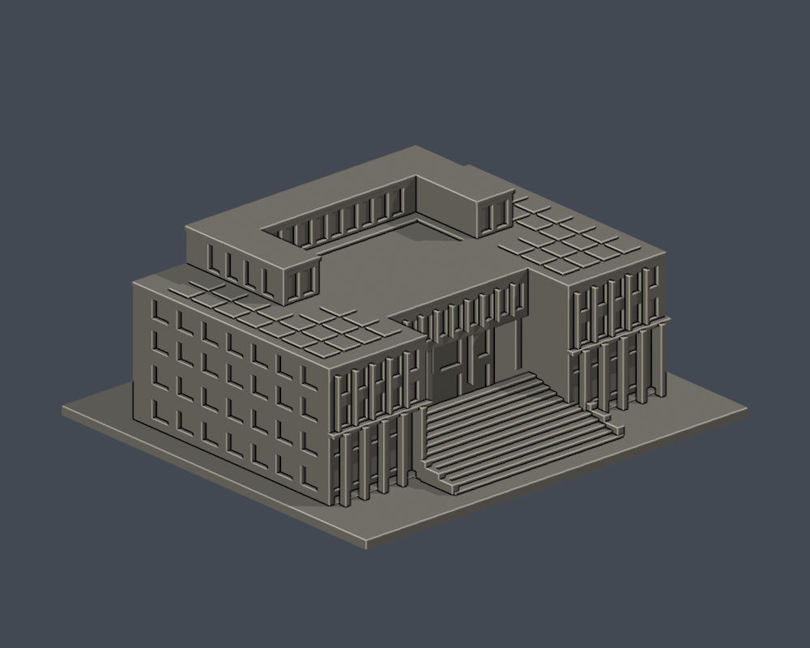
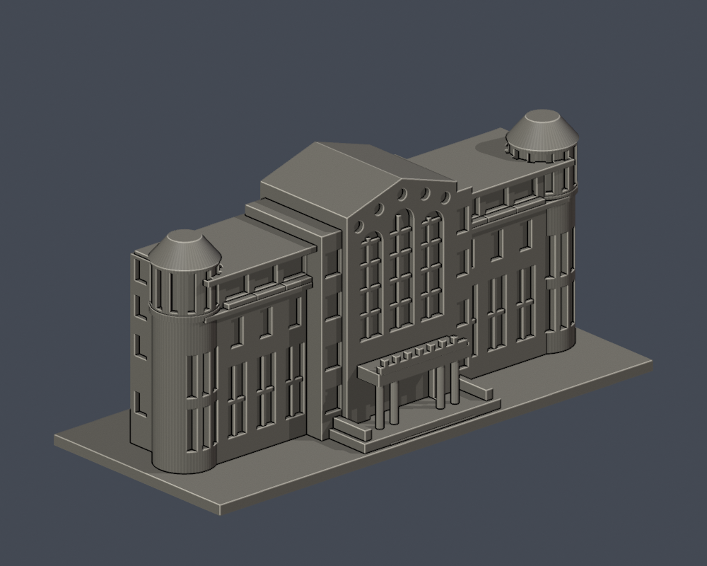
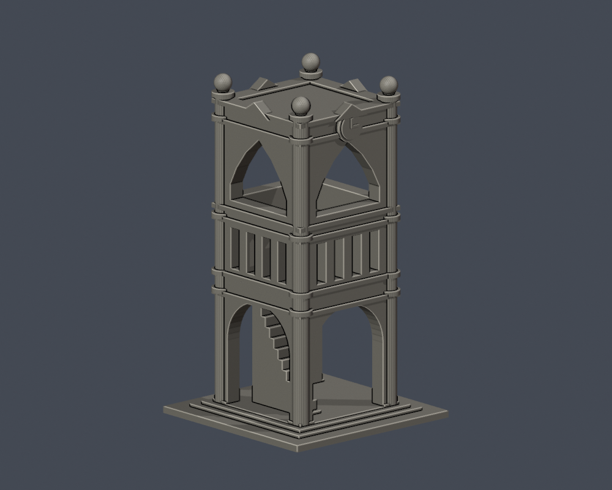

# 國立嘉義大學｜校園外觀3D列印模型

目前提供4件：行政中心外觀近似、圖書資訊館前棟截段、嘉農鐘樓附屬地標，以及民雄校區大學館外殼近似。這不是全校完成，也不是精密測繪；每件含底座最長150mm，比例各自獨立。

## 蘭潭校區圖鑑

| 行政中心（中正樓） | 圖書資訊館前棟段 | 嘉農鐘樓 |
| --- | --- | --- |
|  |  |  |
| 全外殼近似；後立面簡化 | 僅前棟截段，不含完整後部 | 附屬地標構造物，非教學館 |

## 民雄校區圖鑑

[大學館](民雄校區/buildings/ncyu-minxiong-university-hall/)：切角前廳、採光屋頂及不對稱高低量體；高度近似、部分立面簡化。

每個資料夾包含STL、參數重建來源、可編輯Blend、actual STL正背／頂視圖、來源URL及數位驗證。原照片／PDF不隨包散布。

## 範圍

[蘭潭校區](蘭潭校區/)已有3件，[民雄校區](民雄校區/)已有1件。兩校區其他建物、新民與林森校區，以及校外宿舍、農林場域，仍須持續逐棟查核、建模與驗證。

[範圍清單](coverage.json)記錄的是校圖條目、用途及場域，不是建築總棟數。已把未研究、找到部分實拍、局部建模、群場域待拆分、歷史拆除與未建成分開；「未研究」不表示公開資料不足。

[續接說明](SOURCE-CONTINUATION.md)列出別名、棟界陷阱、新建拆除和下一步。

## 使用前

STL單位mm，底座朝下。柱廊、挑簷等須自行在切片器檢查支撐。原STL拓樸、重建與Blend一致性、0.2mm轮廓和0.8mm参考寬度輔助篩檢是數位QA，不等於Cura／Prusa工具路徑或實體試印，不保證可印／免支撐。
