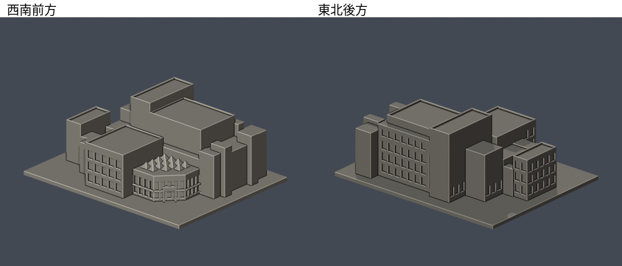

# 國立嘉義大學｜民雄校區大學館

## 白前牆與紅磚前簷限域配色（2026-10-22）

[五視角、來源與限制](appearance/README.md) · [彩色3MF](appearance/ncyu-minxiong-university-hall-appearance.3mf) · [可編輯Blender](appearance/scene.blend)

僅主館白色前牆8個完整原面與前廳紅磚簷帶38面配色，其餘2490面中性。跨界面拒選、不切面；理論矩形與完整選面積差約10.62507mm²包含跨界拒選與無對應共面外表面缺口，不全是跨界面積。玻璃框、水平頂面、灰薄唇、側背與未知部分不擴塗。官照一三個EXIF時間皆2019-02-10 12:08:04，官照二拍攝日未知；原幾何包含2011年街景，跨年資料非2026現貌。未校準目視近似，不是精確測色或材料鑑定。原2536面座標/面序/STL與歷史QA不變、不增套；未實體試印，照片不分發。

B02大學館的整體外殼近似模型，依官方一樓全圖、前廳實照、衛星俯視及2011年東／西側街景自建。不是現況測繪或精密比例模型，也沒有重建內部空間。

## 建模範圍與限制
- 保留不對稱平面、切角玻璃前廳、寬簷帶、多座金字塔採光頂，以及演藝廳、演講廳和周邊量體的高低層次。
- 官方圖面的一樓外輪廓支持進深和相鄰量體位置；高度及屋頂段落依照片推估，不代表正式標高。圖中未命名的房間不擅自指認用途。
- 官方平面順時針轉約90°後與北向衛星對照：圖面上緣是東側，圖面下緣是西側；東側窗帶已按實景置於東側長翼。
- 北側受遮擋、南侧未清楚實拍的細節簡化為實牆，沒有填滿通用窗陣。與創意樓相連的廊道只保留館側段，不包含創意樓本體。
- 前方獨立藝術雕塑、行道樹、車輛、文字及細欄杆不包含在建物模型中；門窗為有背襯的縮尺凹面，玻璃不透明。
- 官方前廳圖集2023年上架，攝影日期未提供；東／西街景攝於2011年2月，不能單凭它斷言2026全部細節未改。衛星版權年份也不等於拍攝日期。
- 地圖商家頁部分全景實為鄰館或走廊，已排除；演藝廳座位表不是整館外輪廓，未拿它當總平面。[精確來源與支持特徵](sources.json)。
- 原始照片、街景截圖與圖面僅留私人核對，不隨公開包散布；未擷取現成3D mesh。

## 尺寸與列印注意
- 單位mm，含底座150 × 118 × 約57.1mm。每館獨立縮尺，不宜直接拼接作同一比例校園。
- 底座朝下。前廳窗楣、入口門框、屋頂尖角可能需要支撐或較慢列印，請先在實際切片器檢查。
- 數位QA不等於Cura／Prusa等實際工具路徑，也未實體試印；不保證可印或免支撐。

## 交付與驗證
[model.stl](model.stl)、[scene.blend](scene.blend)、[build_model.py](build_model.py)、[requirements.txt](requirements.txt)。Blend是由交付STL匯入的可編輯網格，參數腳本為重建來源。

actual STL預覽：[西南前方](previews/front.png)、[東北後方](previews/rear.png)、[前立面](previews/elevation.png)、[頂視](previews/top.png)。頂視原圖依建模座標，不能直接當北向圖。

Python3.12安裝requirements.txt後，依序執行build_model.py、Blender背景執行render_preview.py、validate_model.py、check_contour_validity.py、check_thin_features.py。任何程式exit非0、JSON passed非true或checks含false，立即停止；不用repair掩蓋無效原網格或輪廓。

- [validation.json](validation.json)：原法向與繞序、每邊兩面、頂點單環、單一連通殼、150mm、scratch獨立重建SHA、saved Blend幾何一致。
- [contour-validity-check.json](contour-validity-check.json)：z=0.071mm起，每0.2mm共286層，degree2閉合且各別與組合Polygon有效。
- [thin-feature-check.json](thin-feature-check.json)：canonical共同邊插值、每1mm抽層0.8mm opening輔助篩檢；invalid直接assert，不用buffer(0)。不是全面最小壁厚分析。
- [SHA256SUMS.txt](SHA256SUMS.txt)：逐檔SHA256。

本件不代表民雄校區或學校已全部完成。獨立發布核驗另見總清單。
