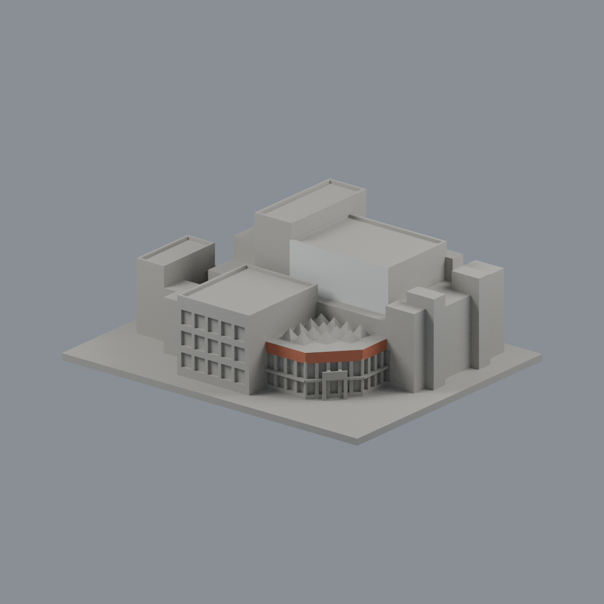

# 嘉大民雄大學館：限域外觀配色

新增外觀研究，不改原 STL 的2536個完整三角、座標或面序，不改歷史幾何/QA；不是新增一套建物。主館露出的白色前牆8面、前廳紅磚簷帶38面配色，其餘2490面中性。原單色預覽不作材料證據。

## 範圍與限制
- 主館白前牆：y=0、x[-6.25,43.75]、z[29.8,50.1]mm，8面、1014.99996mm²。包含同平面女兒牆，僅垂直前面。
- 前廳紅磚：三條原立面邊線 (47.875,-4.75)→(47.875,-21.375)→(32.25,-38.375)→(11.875,-38.375)，z[18.2,22.9]mm，38面、271.79717mm²。
- 每三角**所有頂點**必須位於精確平面及有限域，容差0.0002mm。理論三矩形面積與完整選面積相差約10.62507mm²，包含跨界原面拒選，以及沒有對應共面外表面的缺口；不能把此差額全部當成被拒跨界面積。不切面補色。這是粗化表面代理，不是逐磚貼圖。
- 玻璃、白門框、金字、採光錐頂、水平屋頂、側背及照片未證實部分均維持中性，不能將中性理解為實際灰色。簷頂薄深灰收邊未獨立建模，省略而不新增或將頂面塗紅。前方雕塑不在模型內。
- 兩官方照片支持前方兩角度。第一張三個EXIF日期皆2019-02-10 12:08:04；第二張無拍攝日期，不能套用第一張年份。原幾何含2011年街景，和2019/未定年配色跨年，**不是2026現況測繪**。色票是未校準視覺近似，不是色度測量或精確材質成分鑑定。

## 交付與重建
[可編輯3MF](ncyu-minxiong-university-hall-appearance.3mf)、[Blend](scene.blend)、[逐面材料](face-materials.json)、[色票](palette.json)、[來源](SOURCES.md)、[授權說明](LICENSE-NOTICE.md)、[可攜重建包](rebuild-source.zip)。

[正面](previews/front.png)／[後方](previews/rear.png)／[前立面](previews/elevation.png)／[側面](previews/side.png)／[頂視](previews/top.png)。頂視依模型座標，不是地理北向圖。

將重建包解壓後於 appearance/source 安裝 requirements.txt，依序執行 build_appearance.py、verify_exchange.py、verify_material_boundaries.py；Blender 4.3.2以 `blender -b -t 2 -P appearance/source/render_appearance.py` 產生Blend與五圖，再同法執行 verify_scene.py。原STL在appearance上一層。固定環境下乾淨重建3MF/maps/五PNG逐bytes一致；Blend作幾何/材料/編輯語義驗證，不宣稱二進位一致。

3MF嚴格匯入與材質編輯另存重開、Blend材質編輯另存重開、完整面域及乾淨重建驗證見qa。未做實際切片/實體試印，不新增可印保證。多材料匯入與映射取決於切片器，請檢查單位及材料分配。
