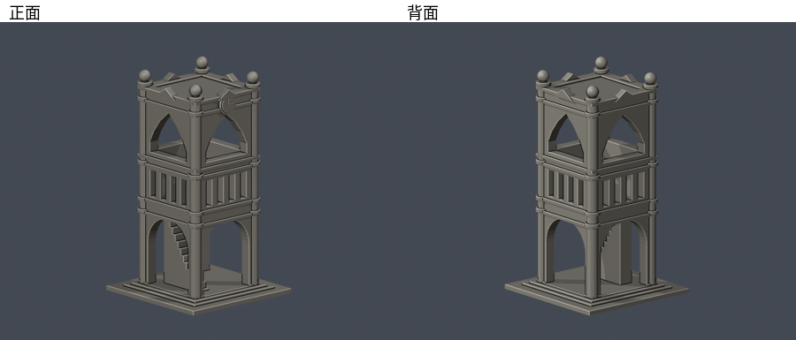
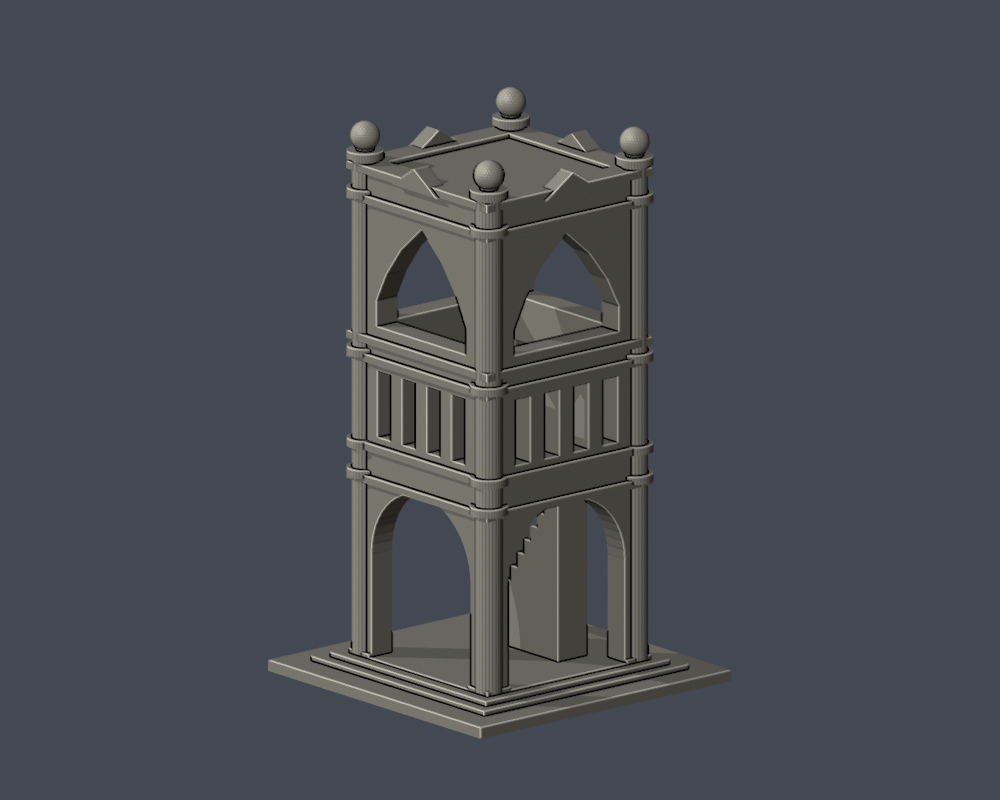
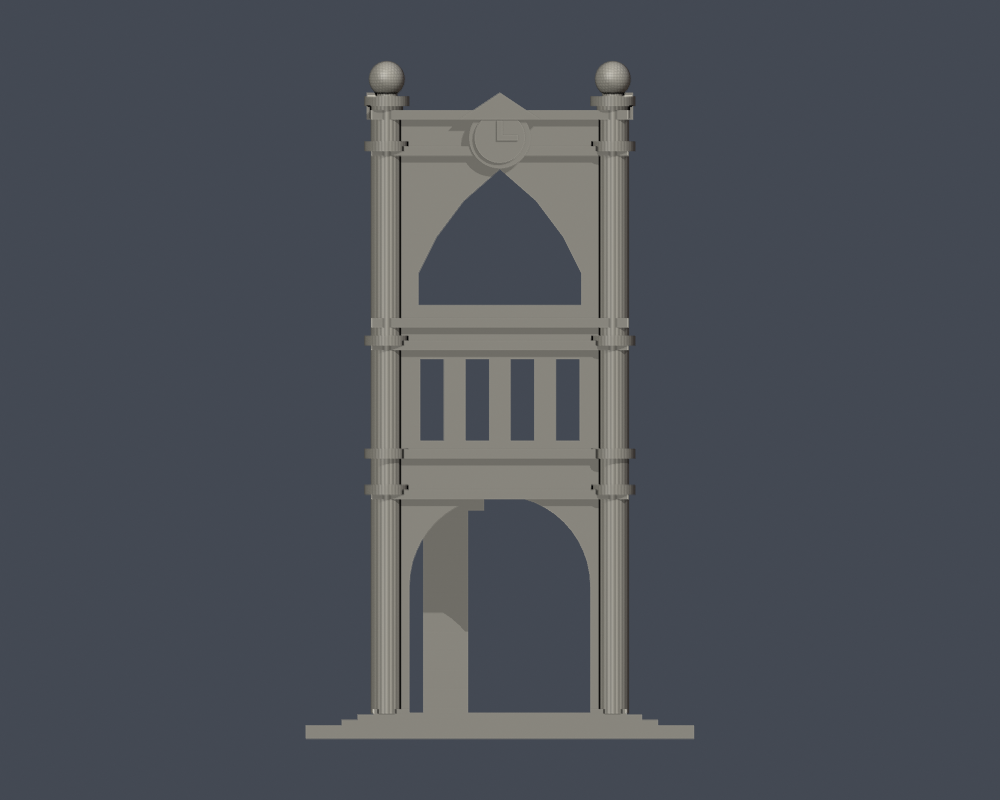
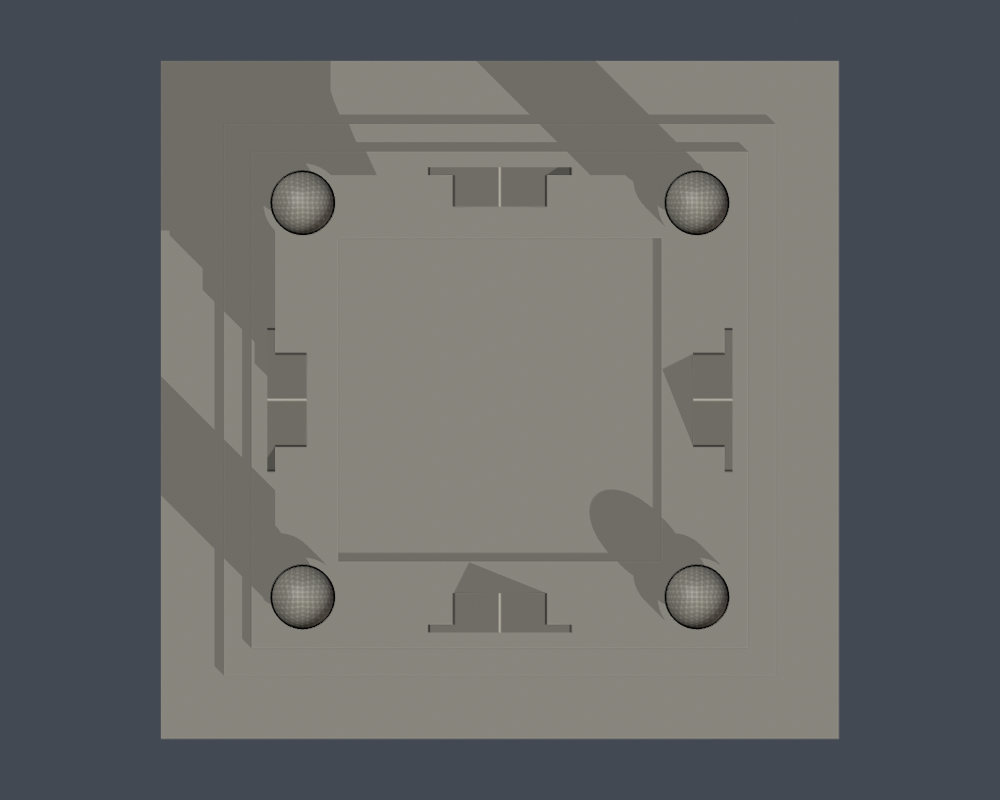

# 國立嘉義大學｜蘭潭校區嘉農鐘樓

這是校園附屬地標構造物的外觀近似模型，不是教學館，不增加教學館完成棟數。依官方斜角實拍自建幾何；四方塔身由可見相鄰兩面推估，其餘面保留簡化。

| 模型預覽 | 模型預覽 | 模型預覽 |
| :---: | :---: | :---: |
|  |  |  |

## 已見與未知
- 保留底層拱口、中段欄孔、上段尖拱、角柱與球飾。拱口和欄孔真正貫通，沒有以凹刻取代主要挑空。
- 照片可見內梯，縮尺為加厚實體階梯並接到底座／塔身；非完整室內階梯測繪。
- 背面銘文未有清楚實拍，省略而不臆造；鐘盤與指針僅示意，不代表拍攝時間。頂面細節、背部与精確高度未知，屬外觀推估。
- 細天線、文字與鐘機省略。角球／柱飾加粗以適合縮尺，但仍可能脆弱。
- 秘書室與英文校景頁使用同幅鐘樓照片，不當作兩個独立角度；照片拍攝日期未提供。[來源與支持特徵](sources.json)。
- 原照片及PDF僅用於私人核對、不隨包散布；未擷取現成3D mesh。

## 尺寸與列印注意
- 單位mm，含底座86 × 86 × 150mm；與其他模型比例不同。
- 底座朝下。拱頂、欄孔、內梯及裝飾可能需要支撐；請先切片檢查，留意移除支撐時不要扭斷角球與細柱。
- 數位QA不等於Cura／Prusa等實際工具路徑，也未實體試印；不能保證可印或免支撐。

## 交付與驗證
[model.stl](model.stl)、[scene.blend](scene.blend)、[build_model.py](build_model.py)、[requirements.txt](requirements.txt)。Blend由交付STL匯入可編輯網格，參數腳本是幾何重建來源。

actual STL預覽：[正面](previews/front.png)、[背面](previews/rear.png)、[正立面](previews/elevation.png)、[頂視](previews/top.png)。

| 模型預覽 | 模型預覽 | 模型預覽 |
| :---: | :---: | :---: |
| 正面  | 背面  | 正立面  |
| 頂視  |  |  |

Python3.12安裝requirements.txt後，依序執行build_model.py、Blender背景執行render_preview.py、validate_model.py、check_contour_validity.py、check_thin_features.py。每個命令需exit0且JSON checks全true，失敗立即停止，不用repair掩蓋原STL問題。

- [validation.json](validation.json)：原法向／繞序、每邊兩面、頂點環、單一連通殼、150mm、獨立重建SHA、Blend幾何比對。
- [contour-validity-check.json](contour-validity-check.json)：z=0.071mm起、每0.2mm，共750層；degree2閉合與各別／組合Polygon有效。
- [thin-feature-check.json](thin-feature-check.json)：canonical共同邊插值、每1mm抽層0.8mm opening輔助檢查；不是全面最小壁厚分析。
- [SHA256SUMS.txt](SHA256SUMS.txt)：逐檔SHA256。

2026-10-13外觀覆核通過。獨立幾何與發佈檢查另見總清單。本件不代表學校或校區建築已全部完成。
