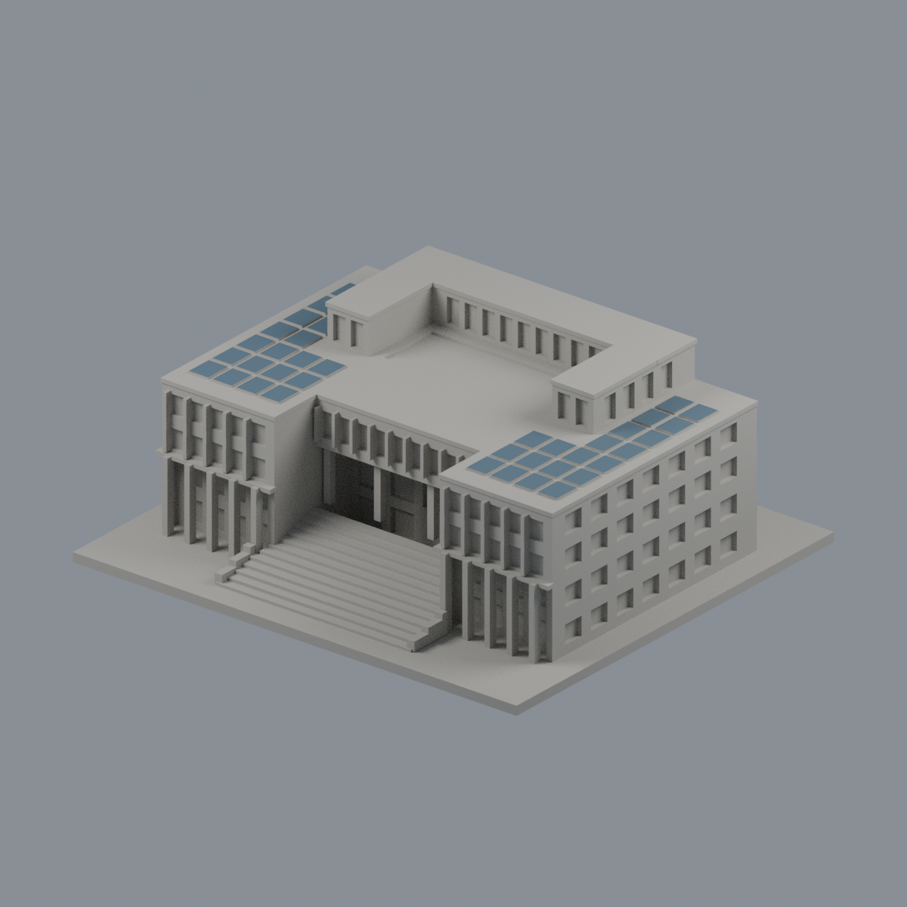
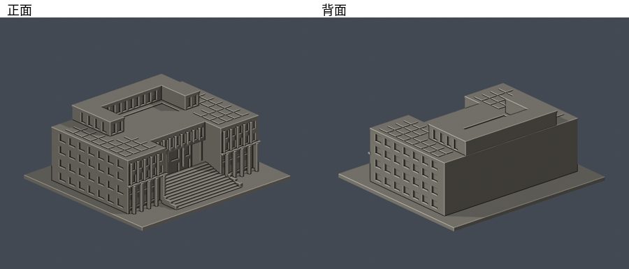

# 國立嘉義大學｜蘭潭校區行政中心（中正樓）

## 光電頂面限域配色（2026-10-22）

[五視角、來源與限制](appearance/README.md) · [彩色3MF](appearance/ncyu-lantan-administration-appearance.3mf) · [可編輯Blender](appearance/scene.blend)

只為原40個粗化光電凸片的80個完整頂面配藍灰，合2210 mm²；40不是實景板片數。薄側、板間、白屋頂、中央露臺、高U屋頂與立面等4168面皆中性。原4248面座標、面序與STL bytes不變，不增套。官方空拍EXIF原拍/數位化2019-10-25 08:10:25、修改2019-11-15 15:34:17；XMP建立/修改2019-10-25，與檔名1081024差一天並列保留，時鐘未校準。2023頁日期不是拍攝日；不是2026現況。此日期補核只適用空拍，不套到入口照。原幾何近似、背面未知、屋頂凹庭非通天庭及未實體試印限制不變。照片不分發。

依國立嘉義大學官方實拍正面及空拍手工參數建模的外觀近似縮尺件。這是 A01 行政中心一件模型，不代表蘭潭校區或全校已完成。

## 範圍與證據
- 保留寬階梯、退縮前庭、雙層挑高方柱廊、密集直窗帶、左右低屋頂光電板，以及後段較高 U 形窗帶。
- 空拍的中央白色底部按「屋頂凹庭／露臺」處理，沒有挖成通到底層的院落。
- 官方圖集發布於 2023-04-28，照片拍攝日期未提供。網頁更新日不能證明照片為當日現況。
- 高差、進深、窗寬及屋頂細節均由照片估計，沒有測繪、設計圖或室內資料。後立面缺少清楚實拍，保留簡化外殼，沒有虛構通用窗陣。模型後面並非已完整考證的立面。
- 原照片僅私下用於比對，未隨本包再散布。來源及每項支持特徵見 [sources.json](sources.json)。沒有抓取現成 3D mesh。

## 尺寸與列印注意
- 單位：毫米（mm）。含底座約 150 × 135 × 58.9 mm；各件各自縮尺，不能用來拼接實際校園比例。
- 請底座朝下。主入口柱廊與挑簷可能需要支撐，先在切片器檢查。
- 直窗格、細柱、屋頂板片已作縮尺加粗與實體相接；仍須按噴嘴、層高、材料與方向調整。
- 數位 QA 並非 Cura／Prusa 等軟體的實際工具路徑檢查，也沒有實體試印，不能保證可印或不需要支撐。

## 檔案
- [model.stl](model.stl)：實際交付三角網格，含底座。
- [scene.blend](scene.blend)：由交付 STL 匯入的可編輯網格與相機；原生 Blender 參數物件不另造一套。
- [build_model.py](build_model.py) 與 [requirements.txt](requirements.txt)：獨立可重建參數來源。
- [正面](previews/front.png)、[背面](previews/rear.png)、[正立面](previews/elevation.png)、[頂視](previews/top.png)：由交付 STL 實際渲染。
- [validation.json](validation.json)：原 STL 法向、邊、頂點環、單一連通殼、尺寸、獨立重建 SHA、Blend 幾何比對。
- [contour-validity-check.json](contour-validity-check.json)：從 z=0.071mm 開始、每0.2mm的原 STL 輪廓閉合與各別／組合多邊形有效性。
- [thin-feature-check.json](thin-feature-check.json)：canonical 共同邊插值、每1mm抽層之0.8mm opening輔助檢查；不是全面最小壁厚分析。

## 重建及驗證
Python 3.12 安裝 requirements.txt 後，依序執行 build_model.py、Blender背景執行render_preview.py、validate_model.py、check_contour_validity.py、check_thin_features.py。每個命令成功且所有 checks 為 true 才視為數位驗證通過；任何失敗立即停止，不修補交付輸入來掩蓋失敗。

高差外觀覆核：2026-10-13 修訂後通過。獨立幾何審核另記於發佈總清单；此件完成數位驗證不等於實體試印。
