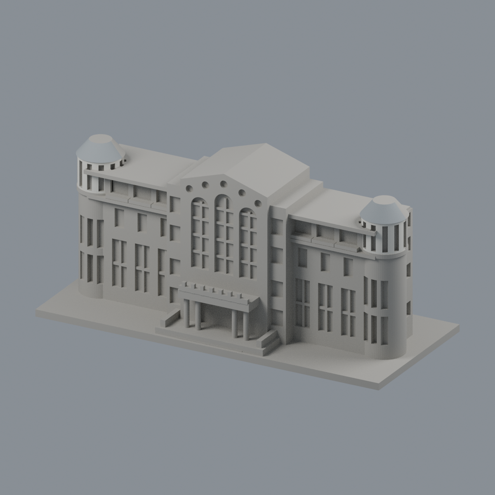
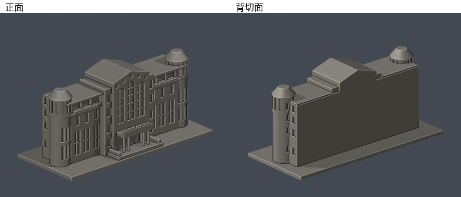
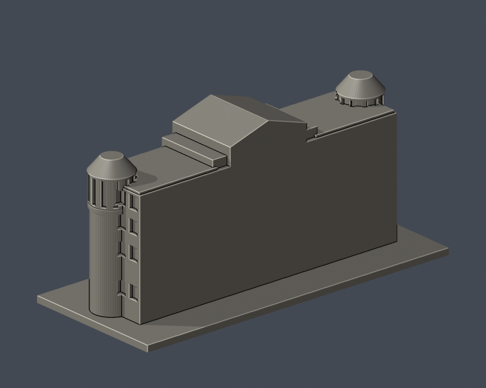

# 國立嘉義大學｜蘭潭圖書資訊館前棟段

## 模型預覽

| 模型預覽 | 模型預覽 | 模型預覽 |
| :---: | :---: | :---: |
|  |  |  |

## 雙端上圓筒與錐頂前半限域配色（2026-10-23）

[五視角、來源與限制](appearance/README.md) · [彩色3MF](appearance/ncyu-lantan-library-front-section-appearance.3mf) · [可編輯Blender](appearance/scene.blend)

僅對雙端上圓筒前半外皮264面暖白、錐屋面前半128面銀灰，共392完整原面約688.827664mm²；窗洞、灰圈、水平頂盤、背半及主牆皆中性。原6510面座標、面序及STL bytes不變，不切面、不增套。仍是前棟截段，不是完整館舍；半面色界為證據範圍，不是真實材料接縫。正面官照拍攝日未知，斜角EXIF與XMP原拍2018-05-30、修改2018-10-11，不稱2026現況。照片不分發，原幾何近似與未實體試印限制保留。

依官方正面及西側斜角實拍自建的局部外觀模型。僅涵蓋整體正立面與近側轉角，後緣是人為截斷面，不是館舍真實後牆；整館進深、後棟與屋頂全貌仍未還原。本件不可當作整個圖書資訊館已完成。

| 模型預覽 | 模型預覽 | 模型預覽 |
| :---: | :---: | :---: |
|  |  |  |

## 證據與取捨
- 保留兩端圓筒轉角、上層直柵、三高拱窗、五圓窗、中央淺山牆、翼部不同層窗形與入口挑空柱廊。
- 圖書資訊館與電算中心屬同館，不能因使用單位不同拆算兩棟。官方說明2006-06-11落成啟用，地下1層、地上5層；本件是外觀截段，未建內部楼層。
- 第三方照片只用於私人核對，不隨模型重新散布。來源URL及支持特徵見 [sources.json](sources.json)。沒有擷取現成3D mesh。
- 比例、高度與進深皆為照片估計，中央山牆後部是截段封背，並非推定整館屋頂形狀。玻璃以淺凹表現，縮尺窗框已加粗；省略小字、玻璃透明度、植栽及前方公共藝術。
- 官方秘書室圖集發布於2023-04-28；正面來源拍攝日未知；斜角照片 EXIF Original/Digitized 與 XMP CreateDate 為 2018-05-30，Modify 為 2018-10-11，不能視為2026現況測繪。

## 尺寸與列印
- 單位：毫米。含底座150 × 65 × 70mm；獨立縮尺，不能与其他館按同一比例拼接。
- 底座朝下。圓筒頂帽、入口雨遮及窗框可能需要支撐；請在切片器檢查再列印。
- 數位QA並非Cura／Prusa實際工具路徑，也未實體試印，不能保證可印或不需支撐。

## 交付與重建
[model.stl](model.stl)、[scene.blend](scene.blend)、[build_model.py](build_model.py)、[requirements.txt](requirements.txt)。Blend由交付STL匯入為可編輯網格，參數腳本是重建來源。

預覽為actual交付STL渲染：[正面](previews/front.png)、[背切面](previews/rear.png)、[正立面](previews/elevation.png)、[頂視](previews/top.png)。

| 模型預覽 | 模型預覽 | 模型預覽 |
| :---: | :---: | :---: |
| 正面  | 背切面  | 正立面  |
| 頂視  |  |  |

Python3.12安裝requirements.txt後，依次執行build_model.py、Blender背景執行render_preview.py、validate_model.py、check_contour_validity.py、check_thin_features.py。每個命令需exit0且所有checks為true；失敗立即停止，不repair原STL掩蓋問題。

- [validation.json](validation.json)：原STL法向／繞序、每邊兩面、頂點環、單一連通殼、150mm、獨立重建SHA、saved Blend幾何比對。
- [contour-validity-check.json](contour-validity-check.json)：z=0.071mm起，每0.2mm；逐層degree2闭合、個別與組合Polygon有效。
- [thin-feature-check.json](thin-feature-check.json)：canonical共邊插值，每1mm抽層0.8mm opening輔助篩檢；非完整最小壁厚分析。
- [SHA256SUMS.txt](SHA256SUMS.txt)：交付逐檔SHA256。

外觀覆核：2026-10-13通過，範圍為前棟截段。獨立幾何與發佈審核另見學校總清單。
