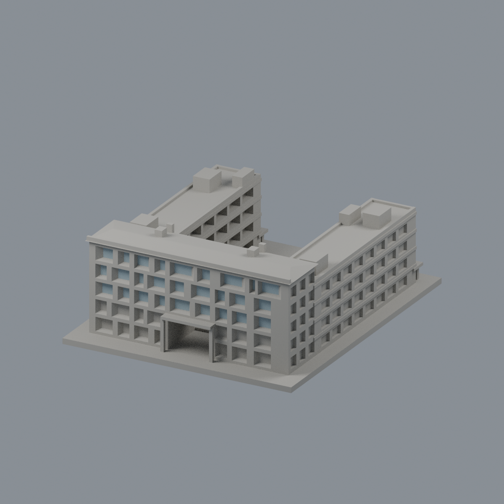
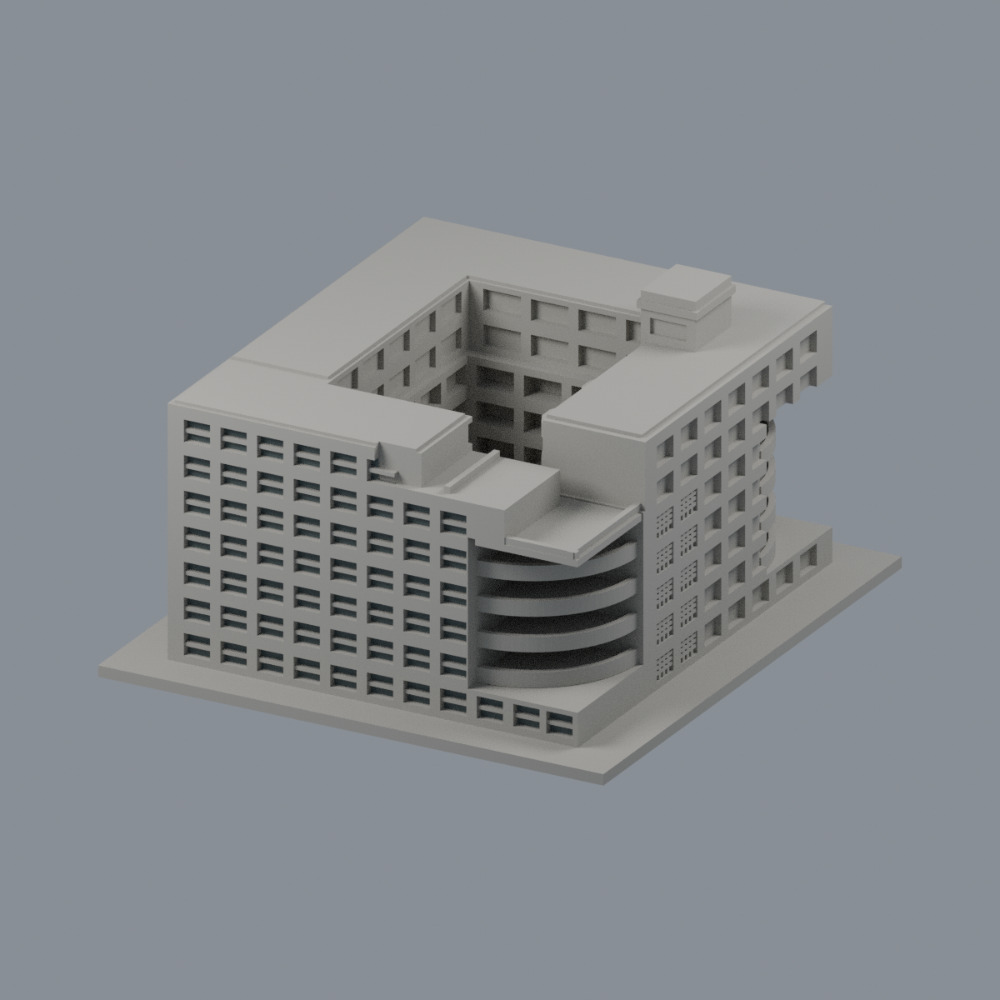
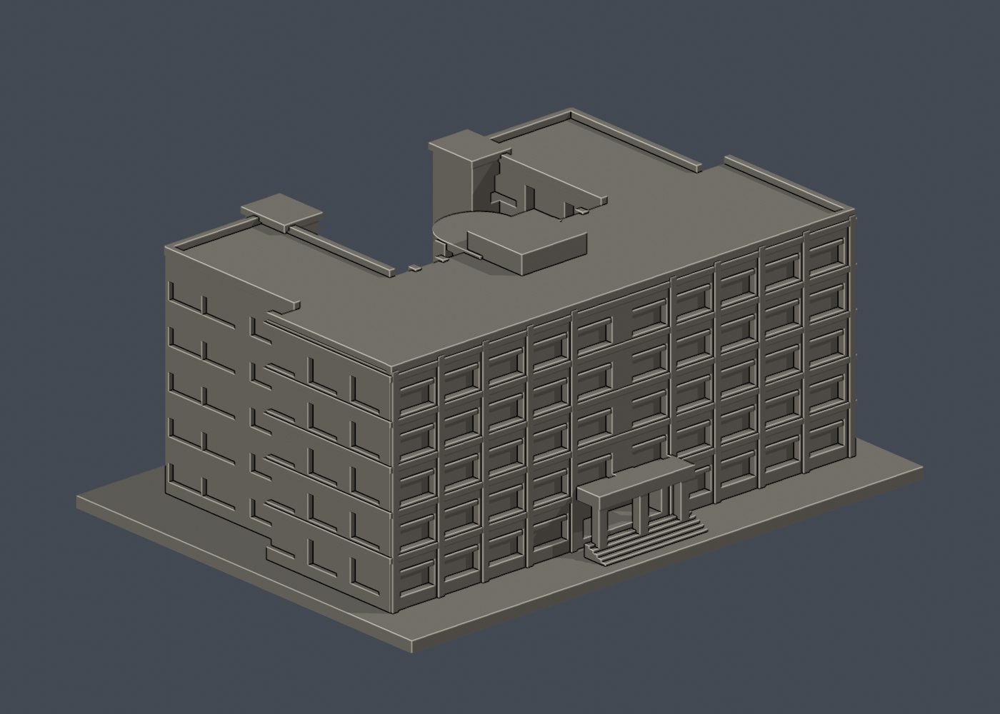
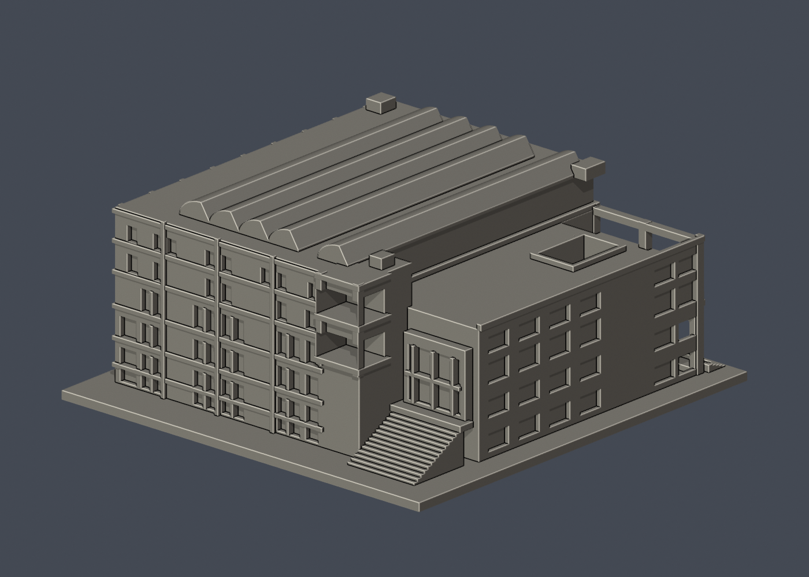
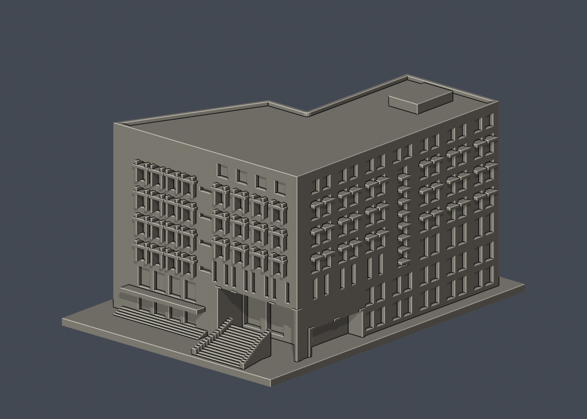
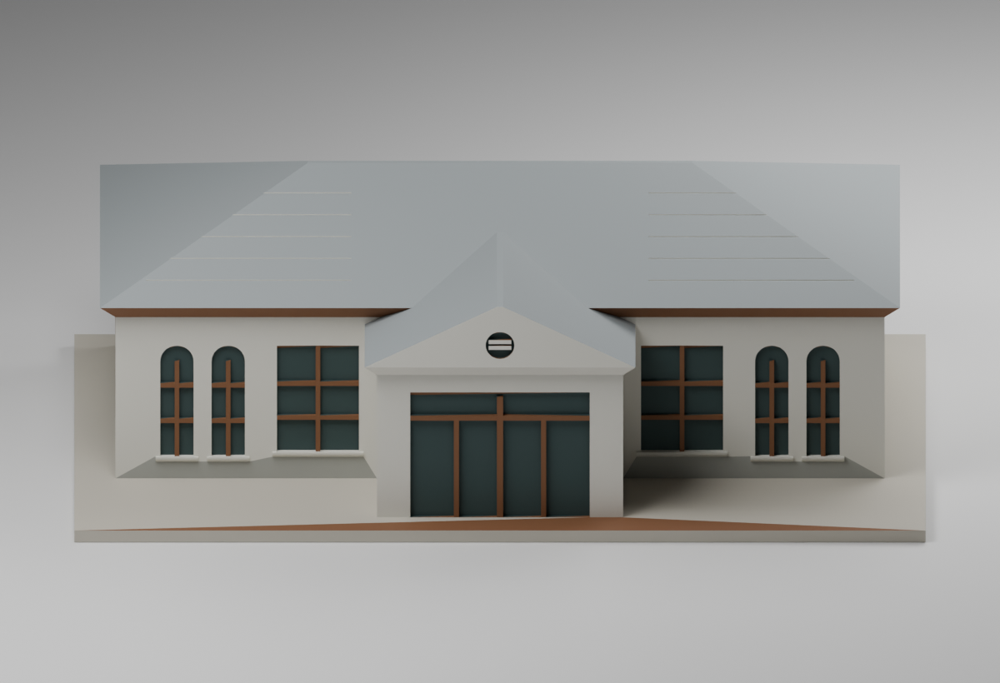

# 神農校總區

[返回國立宜蘭大學](../README.md)

本批新增農林修養室1件，累計6件外觀近似模型；既有5件附件原樣保存。各館獨立比例、毫米；既有五件含底座最長150mm，修養室166mm。全校與全國仍未完成，研究項目不能視為精確棟數。

| 建築模型 | 建築模型 | 建築模型 |
| :---: | :---: | :---: |
| [綜合行政教學大樓](buildings/niu-administration-teaching-complex/README.md)  | [經德大樓](buildings/niu-jingde-building/README.md)  | [時習大樓](buildings/niu-shixi-building/README.md)  |
| [體育館（校史近似）](buildings/niu-gymnasium/README.md)  | [圖書資訊大樓](buildings/niu-library-information-building/README.md)  | [農林修養室（2016修復後近似）](buildings/niu-cultivation-hall-restored/README.md)  |

[全校逐項續接](../FOLLOW-UP.md) · [屋頂年代補充](../ROOF-STATUS-NOTE.md)

體育館屬校史主形態近似，2025已裝光電尚未建入；圖資背窗/屋突仍估計。其他館也不能把舊照推定為2026全貌。既有五件有actual STL正背、頂視、可編輯Blend及fail-closed數位QA；支撐和工具路徑仍須实际切片/試印。

修養室新增一套，採2016修復後低細節外觀、166mm長單件，已有PrusaSlicer數位QA並有支撐，尚未試印／實拆；4.72mm封頂、8.1mm淺凹走線、5條邊界差異及304條探入受阻見模型頁。舊gallery.png為既有五件合覽。Library未回驗，依使用者取消額外備份門檻而不作本次發布阻擋。既有五件的尺寸／未切片說明不套用到新增修養室。

[經德大樓有限教室窗背配色／五視角](buildings/niu-jingde-building/appearance/README.md)（230完整原面，其餘中性；拍攝年代未知，非現況全彩復原）。

[綜合行政教學大樓有限窗背配色／五視角](buildings/niu-administration-teaching-complex/appearance/README.md)（54完整原面，其餘中性；拍攝年代未知，非現況全彩復原）。
