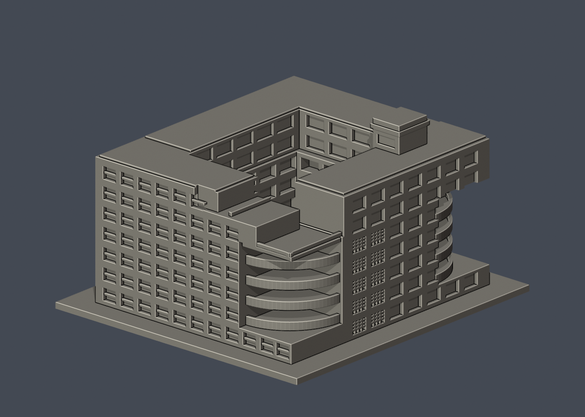

# 神農校總區

[返回國立宜蘭大學](../README.md)

第二批新增體育館及圖書資訊大樓，共累計5件；首批3件附件原樣保存。各館独立比例、毫米、含底座最長150mm。全校與全國仍未完成，館內單位不拆算建物。

| [綜合行政教學大樓](buildings/niu-administration-teaching-complex/README.md) | [經德大樓](buildings/niu-jingde-building/README.md) | [時習大樓](buildings/niu-shixi-building/README.md) |
|---|---|---|
|  |  |  |

| [體育館（校史近似）](buildings/niu-gymnasium/README.md) | [圖書資訊大樓](buildings/niu-library-information-building/README.md) | 尚有建築待續作 |
|---|---|---|
|  |  | 全校尚未完成 |

[全校逐項續接](../FOLLOW-UP.md) · [屋頂年代補充](../ROOF-STATUS-NOTE.md)

體育館屬校史主形態近似，2025已裝光電尚未建入；圖資背窗/屋突仍估計。其他館也不能把舊照推定為2026全貌。各件有actual STL正背、頂視、可編輯Blend及fail-closed數位QA；支撐和工具路徑仍須实际切片/試印。
