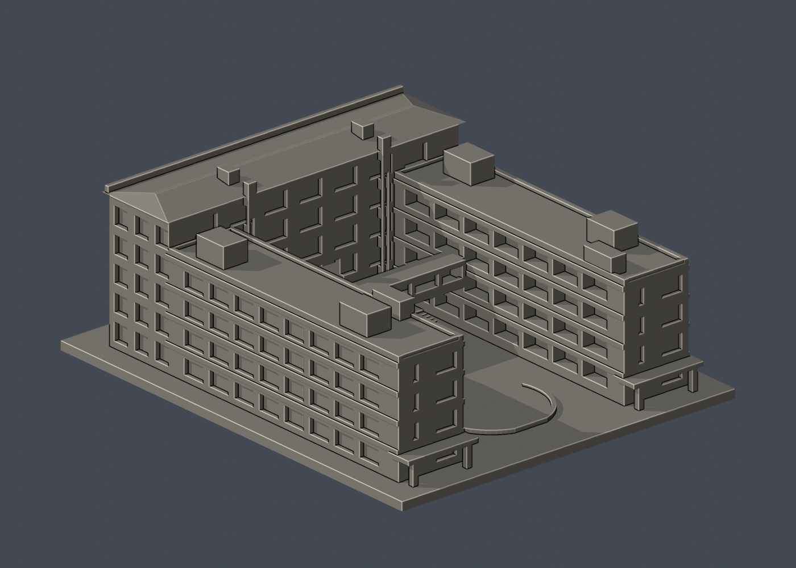

# 國立宜蘭大學｜綜合行政教學大樓

公開資料自建的近似外觀縮尺模型，單位為毫米（mm），含底座最長150mm。不是測繪、竣工圖、結構模型或保證可列印的成品。

## 模型與預覽

| 正面（actual STL） | 背面（actual STL） |
|---|---|
|  |  |

[頂視圖](previews/top.png) · [正立面](previews/elevation.png) · [STL下載](model.stl) · [可編輯Blender](scene.blend) · [原始網格OBJ](model.obj)

- 尺寸：124 × 150 × 56.1 mm（包含3mm底座；STL實測值以validation.json為準）
- 範圍：本件把行政大樓與綜合教學大樓南、北翼視作相連的建築群建模；萬斌廳位在地下，不另計模型件數。不是三件獨立建物。
- 保留特徵：U形開放院落、南北教學翼內廊、四層教學翼與五層行政棟的高度差、跨院步橋、行政中央穿堂、逐列不同寬度與交錯位置的偏心斜凹窗、低坡屋頂與樓梯屋突。
- 每件獨立比例，不可直接和其他模型組成同一真實比例校園。

## 列印提示

- STL採毫米，底座朝下。先於切片器確認模型尺寸、平台接觸及支撐。
- 可用0.2mm層高與約0.4mm噴嘴作切片起點，但未完成Cura/Prusa等工具路徑或實體試印。
- 跨院橋、中央穿堂頂、長出簷及入口雨棚可能需要支撐；請在實際切片器檢視橋接長度與支撐可移除性。
- 設計明示連橋細柱1.5mm、欄牆1.5–1.7mm；最高屋突的小面積方角使54.071mm層opening損失約1.027%，屬角部量測損失而不是分離浮件，已檢視屋突與下方實體連接。
- 切片器、材料、機器設定及縮放都會影響成果；縮小後需重新檢查薄件。

## 來源與不確定性

詳細來源及照片年代見[sources.json](sources.json)。取閱日2026-10-13。公開包不含來源原照片/PDF。

- 採公開照片目測和教學翼逃生圖推估整體比例；不是測繪或BIM。
- 行政前立面以p173可見窗洞逐列取相對寬度與偏心方向；下方兩排及側邊樹木遮蔽處為保守估計。
- 行政背面部分窗格、設備屋突進深與連橋細部經簡化；未取得完整行政棟施工平面。
- 館內房間與地下萬斌廳未重現，模型內部實心；大院落、穿堂及橋下空间保持開放。

## 重建與數位QA

1. Python 3.12環境安裝 [requirements.txt](requirements.txt)。
2. 執行 python build_model.py，自建[STL](model.stl)和[OBJ](model.obj)。
3. Blender 4.3.2 執行 blender -b -t 2 -P render_preview.py，從actual STL匯入、渲染並儲存scene.blend。
4. 執行 python run_all_checks.py。任何驗證非零退出或checks不全為true都停止，不能發布。

- [生成腳本](build_model.py) · [STL渲染腳本](render_preview.py)
- [原始STL/獨立重建/Blend檢查](validation.json)：水密、原始法向、每邊兩面、頂點link單環、單一連通外表面、正體積；未修補輸入。
- [0.2mm逐層檢查](layer-check.json)：281層，固定z=0.071mm起點，degree2閉合，個別和合成Polygon都必須valid；禁止repair後繼續。
- [薄特徵輔助檢查](thin-feature-check.json)：1mm層距、0.8mm參考寬度opening；不是全域最小壁厚保證。使用已核SHA的canonical fail-closed v3原腳本。
- [綜合QA](qa-summary.json) · [驗證入口](run_all_checks.py) · [逐檔SHA256](SHA256SUMS)

幾何QA不等於工具路徑驗證或實體試印。正確處理的source_rebuild_hash_matches及blend_stl_geometry_agree見validation.json。

全校及全國尚未完成。本件不能表示全校建築已製作。

## 有限窗背外觀層

[雙材質3MF、可編輯Blend與五視角預覽](appearance/README.md)：僅 -Y 上三排 27 窗、54 面；下兩排與其他全部維持中性，非整棟全彩復原。
