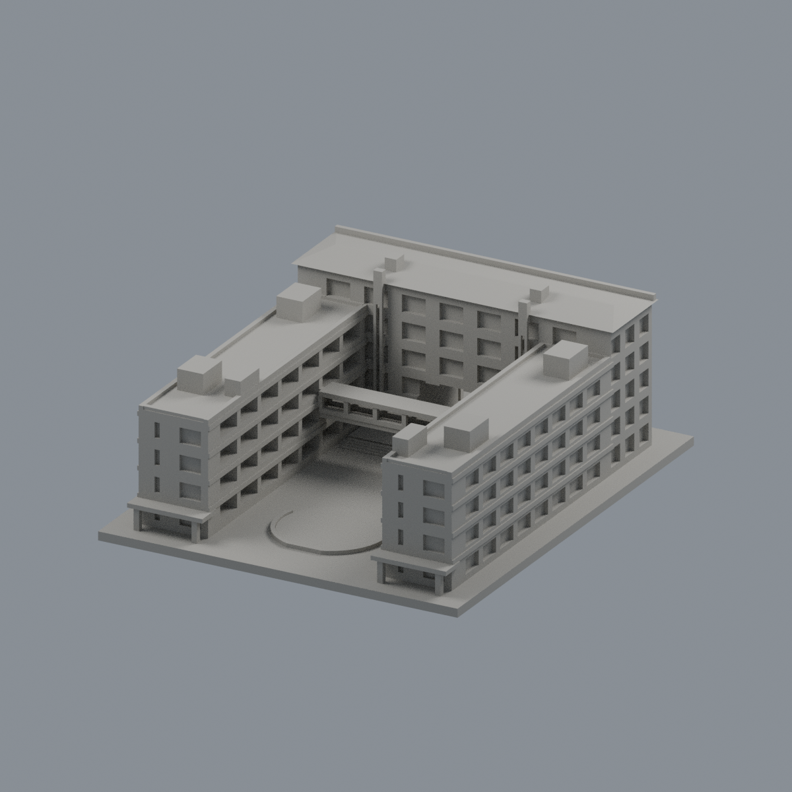
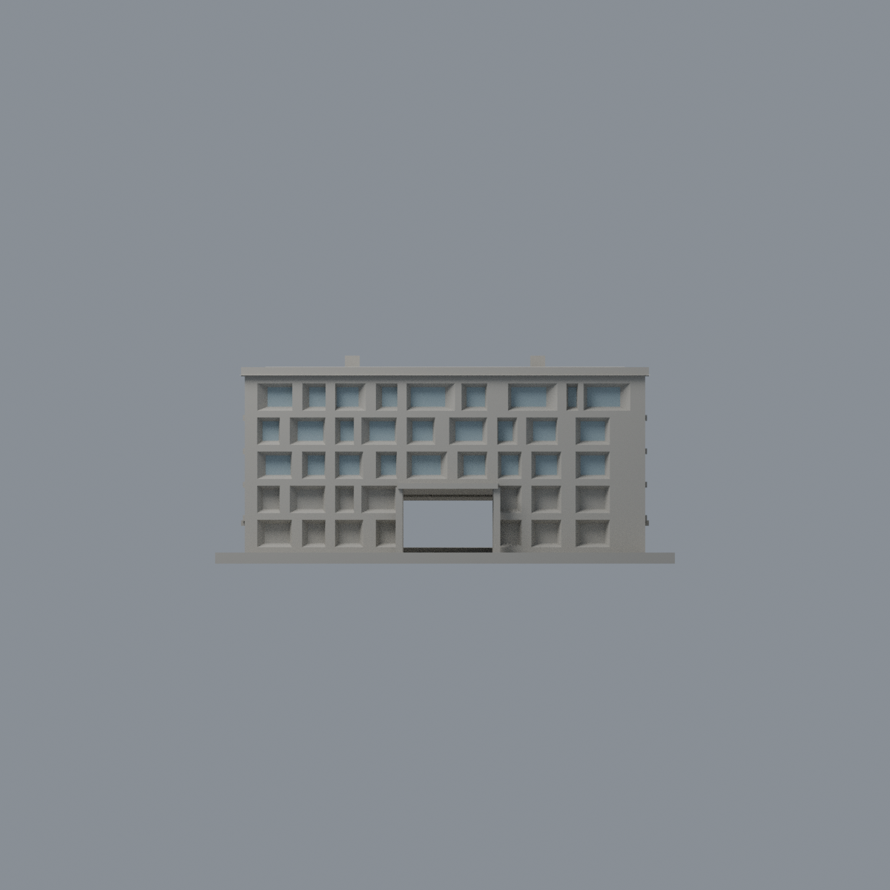
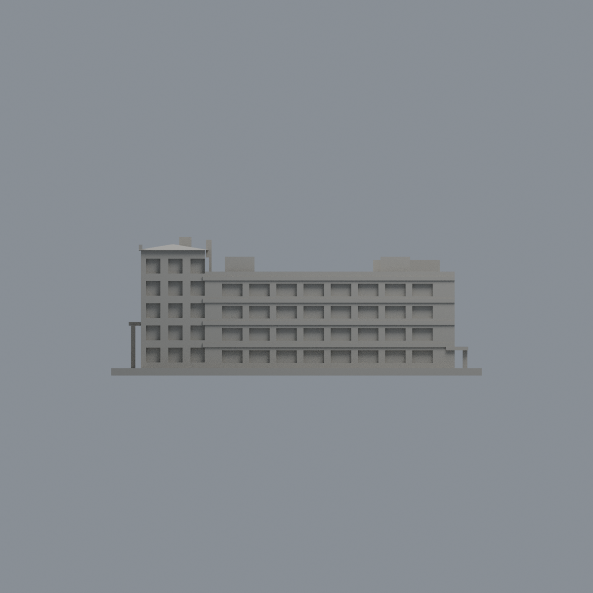
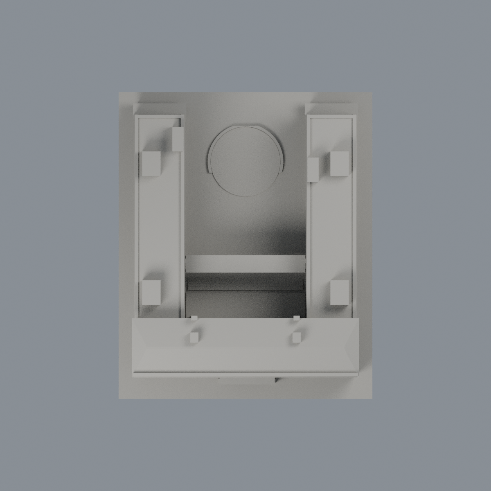

# 宜蘭大學綜合行政教學大樓：有限窗背外觀層

僅正面 -Y 上方三排、27 個既有偏心斜凹窗的窗背 54 個完整三角面，使用低飽和淺灰藍色 #98ABB2（不透明玻璃／窗簾代理色，方便交換）；其餘 6600 面維持中性。這不是整棟彩色復原、透明玻璃模擬或現況色彩量測。

下方兩排 28 個窗背三角面受遮擋且原幾何明示近似，維持中性；斜窗框、窗台、opaque 牆體、其他立面、屋頂、教學翼、內院開廊均不套玻璃色。作者 YLUS01/06 支持上三排窗背分類；YLUS04/05/07 證明內廊開放，不能塗成玻璃。原有簡化樓梯塔、屋頂、連橋與所有近似幾何保持不變。拍攝日期未知，專案標題 2010 及檔案目錄 2020 都不是拍攝年份證據。

- [可編輯 Blend](scene.blend)、[雙材質 3MF](niu-administration-teaching-complex-appearance.3mf)
- [材質表](palette.json)、[逐面對照](face-materials.json)
- [正面](previews/front.png)、[背面](previews/rear.png)、[立面](previews/elevation.png)、[側面](previews/side.png)、[頂面](previews/top.png)
- [來源](SOURCES.md)、[權利](LICENSE-NOTICE.md)

| 模型預覽 | 模型預覽 | 模型預覽 |
| :---: | :---: | :---: |
| 正面  | 背面  | 立面  |
| 側面  | 頂面  |  |

原 STL bytes、三角面順序與各面三頂點座標不變。native polygon IDs 使用精確三頂點集合雙射轉換到 canonical STL IDs；每面三頂點皆位在 y=-60.32 有限窗背矩形且朝 -Y，總面積 827.71692042 mm²。不使用 centroid 選取、不細分、不加厚。原件仍是一件相連建築群，模型數不增加。

## 重建
原 model.stl 放在 appearance 上一層，Python 安裝 source/requirements.txt，順序執行 source/build_appearance.py、source/verify_exchange.py、source/verify_material_boundaries.py；Blender 4.3.2 執行 source/render_appearance.py、source/verify_scene.py。五張圖皆來自真實逐面材質，沒有貼圖補畫。交換／存讀檢驗不代表切片或實體試印，原幾何不確定性及歷史製造 QA 不被本層覆寫。
