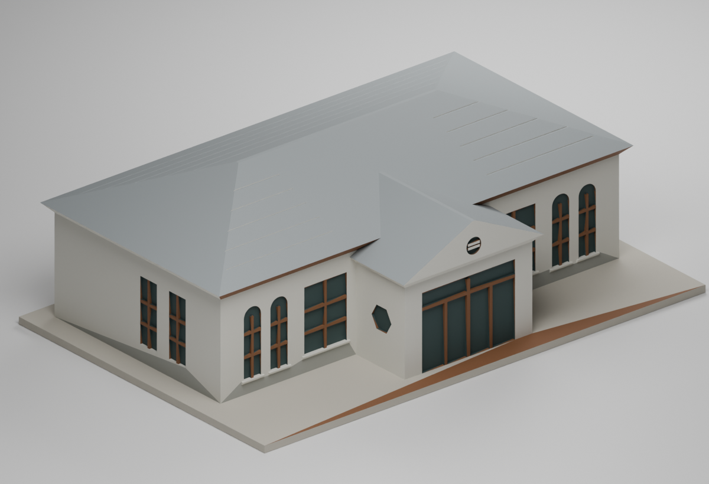
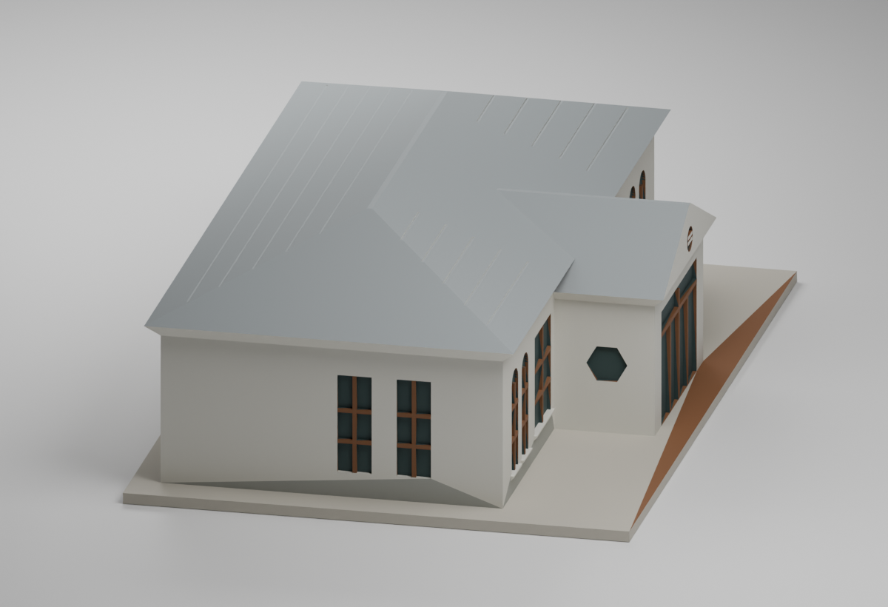
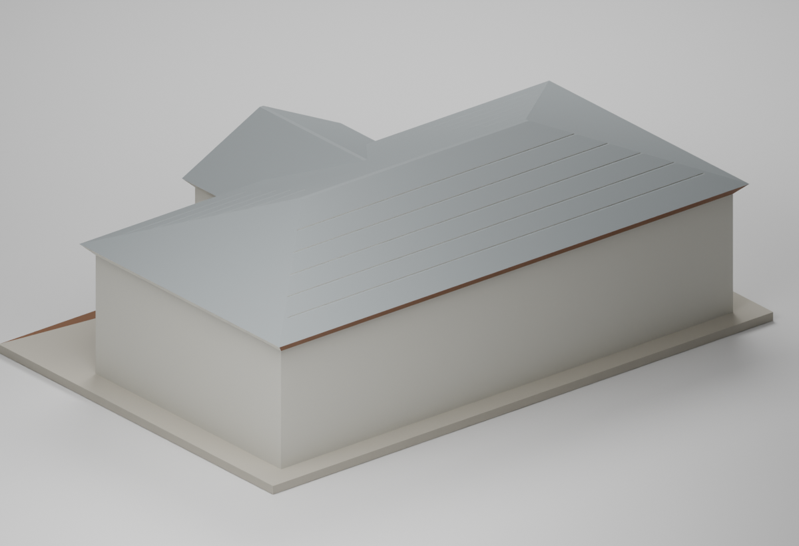
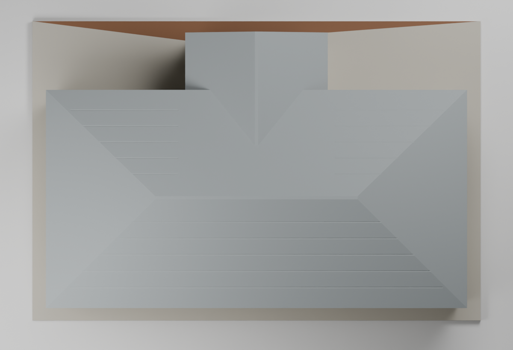
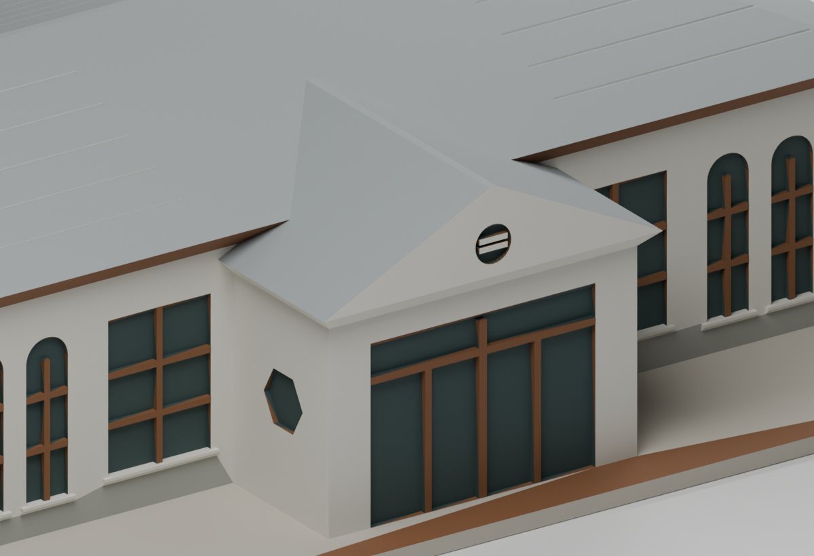

# 國立宜蘭大學農林修養室｜修復後外觀候選

## 模型預覽

| 模型預覽 | 模型預覽 | 模型預覽 |
| :---: | :---: | :---: |
|  |  |  |

本件是 **2016 修復後一層主體的低細節外觀近似**。固定 STL 已獨立有條件 GO，毫米場景增量亦獨立 GO；尚未實體試印或拆支撐。Library 身分寫回／官方回驗未完成，依使用者取消額外備份門檻，已不再作為本次 GitHub 發布阻擋；未宣稱 Library 已驗證。它不是 1934 原狀復原或 2026 測繪復刻；沒有官方米制尺寸或可靠比例尺。發布範圍與歷史判定見 [發布說明](PUBLICATION.md)。


主屋身採橫向四披屋頂；中央較低凸入口有自己的雙坡山牆與圓通風窗。正面大矩形木窗和兩側成組拱窗有修復後實照支持；六角窗只置於照片確認的入口左側壁。未見背面及右端的開口予以省略。文獻所述東北截角尚未精確定位與量化，局部未細刻，不能把這個近似包絡稱為完全精確的矩形平面。

## 列印方案

推薦檢查對象為 [單件 STL](models/v1/model.stl)，以底座平放列印，整件約 **166 × 111 × 54.4 mm**。本體為單一實心外殼，切片以 20% 填充處理；入口門廊簡化為深 0.9 mm 的淺凹門面與一體寬柱，並沒有開放門廊空間。瓦面以粗略刻線表示，屋脊加寬為 1.2 mm 小平頂以改善最末層薄尖端。這些是列印簡化，並非實測細節。

實際使用 PrusaSlicer 2.9.6，以 0.4 mm 噴嘴、0.2 mm 層高、0.45 mm 線寬、3 道外牆、20% 填充及自動支撐進行 QA。**切片實際產生支撐，並非免支撐模型。** 檢測結果與數位支撐可達性的適用範圍見 [QA 摘要](qa/AUTHOR-QA.md) 及 [製造限制](PRINTING-LIMITS.md)。沒有試印、支撐拆除或表面品質的實物證據。

獨立切片覆核定位約 **4.72 mm** 底板內部封頂自由跨度，以及入口淺凹橫框約 **8.1 mm** 未承托沿牆中心線；設備需能處理這些走線，否則調整局部支撐、填充／實心層或橋向後重新切片。保留 5 條嚴格截面邊界差異與 304 條 1 mm 探入受阻，支撐須分段剪剝並逐條清理淺凹 interface，不可整塊硬拔。完整證據及有限條件見 [獨立覆核整合](qa/INDEPENDENT-REVIEW-INTEGRATION.md)。

## 檔案與重建

- [參數與估計](parameters.json)、[來源與採用特徵](SOURCE-CREDITS.md)、[幾何估計／簡化](ESTIMATES-AND-SIMPLIFICATIONS.md)。
- [原創生成程式](source/build_model.py)、[OBJ](models/v1/model.obj)、[可編輯 Blender 場景](models/v1/scene.blend)。
- 場景明設 `METRIC`、`scale_length=0.001`、`MILLIMETERS`；網格與物件未縮放。166 × 111 × 54.4 的座標按 mm 解讀，已檢查實際物理尺寸及 evaluated 世界三角形與 STL 相同。
- [正面](previews/v1/front.png)、[左端](previews/v1/left.png)、[背面](previews/v1/rear.png)、[頂視](previews/v1/top.png)、[入口細節](previews/v1/entry-detail.png)。預覽重新載入實際 STL；色彩只供辨識，STL 不含色彩。
- [最初尖屋脊及真實失敗記錄](qa/initial-tip-check/README.md) 僅供追溯，不是建議列印檔。

| 模型預覽 | 模型預覽 | 模型預覽 |
| :---: | :---: | :---: |
| 正面<br> | 左端<br> | 背面<br> |
| 頂視<br> | 入口細節<br> |  |

在安裝 [依賴版本](requirements.txt) 的 Python 環境，從本模型包目錄執行：

```powershell
python source/build_model.py
python qa/check_geometry.py
python source/render_preview.py
python source/contact_sheet.py
python qa/verify_scene.py
python qa/verify_rebuild.py --output-dir "C:/your-own-rebuild-directory"
python source/slice_candidate.py --slicer "C:/path/to/prusa-slicer-console.exe" --output-dir "C:/your-own-qa-directory"
python qa/check_slicer.py --gcode "C:/your-own-qa-directory/candidate-support-auto.gcode"
```

生成程式不需讀取參考照片。Blender 渲染需可載入 `bpy` 5.2.2。切片必須使用自己的輸出與設定目錄；所附設定只供數位 QA。若只核對包內保留的壓縮切片，可直接執行 `python qa/check_slicer.py`。壓縮 G-code 僅供覆核，不是機器就緒檔，請依實際機器、材料與安全參數重新切片。

本候選原以 main `1976d60d5e1621dac2ce6a5d904e74796c38be0e` 為基線；發布前已刷新 main `4923f28803b51be6da8c4017f412be9592719c14`，全庫路徑與宜大既有五套模型均未見修養室重複包，見 [本次去重稽核](qa/publication/main-and-duplicate-audit.json)；[原始候選稽核](qa/main-and-duplicate-audit.json) 保留。本次新增一套，既有五套不改；仍不表示全校或全國完成。原始照片只作私人參考，公開包不重發照片、PDF 頁面或其描圖。
