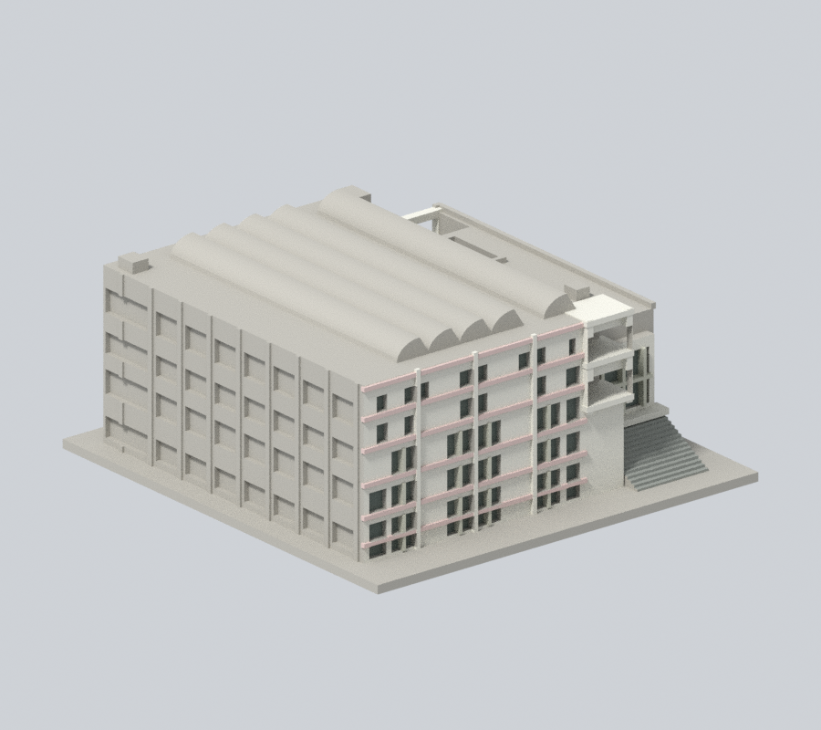
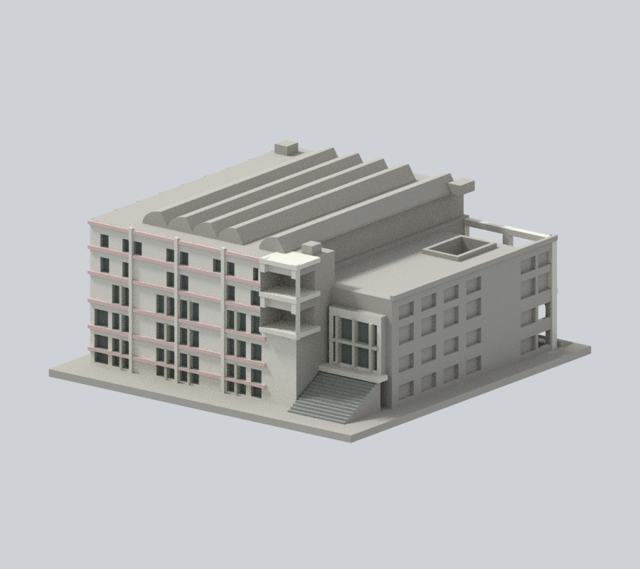
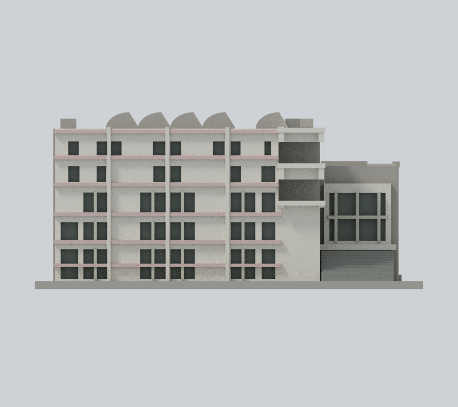
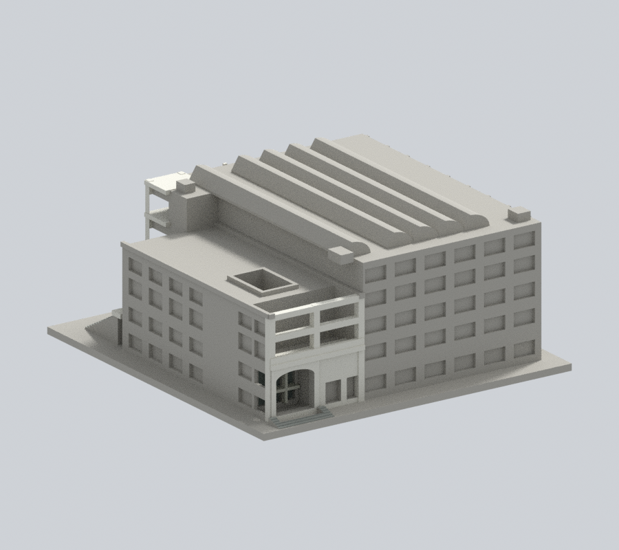
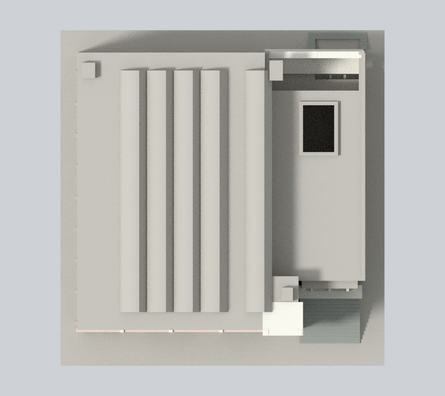

# 國立宜蘭大學｜體育館（校史主形態近似）

## 模型預覽

| 新彩色正斜視 | 新彩色來源角度 | 新彩色立面 |
| :---: | :---: | :---: |
|  |  |  |
| 新彩色背向 | 新彩色上視 | 彩色下載 |
|  |  | [彩色3MF](appearance.3mf) · [Blender](appearance.blend) |

公開資料自建的近似外觀縮尺模型，單位為毫米（mm），含底座最長150mm。不是測繪、竣工圖、結構模型或保證可列印的成品。

### 新增有限校史實照材料（原五張PNG保留）

依校史印159–161頁實拍的既有主形態，僅支持的前牆/入口白灰磁磚、原可分淡粉樓帶、灰綠混合窗背與灰階梯補色。長側/高館後牆、未證天井與長屋蓋中性；不加壁畫、字、細欄杆或後加光電。不宣稱2018整修後或2026完整現況。

[材料來源與限制](APPEARANCE.md)。原幾何、STL、OBJ、scene、五張PNG及原QA保留；原薄特徵約0.153%記錄不變，本輪未重跑列印QA、未實體試印。

## 模型與預覽

[頂視圖](appearance/top.png) · [正立面](appearance/elevation.png) · [STL下載](model.stl) · [可編輯Blender](scene.blend) · [原始網格OBJ](model.obj)

- 尺寸：145 × 150 × 66.1 mm（包含3mm底座；STL實測值以validation.json為準）
- 範圍：神農校總區體育館本體與相連行政翼為一件；不包括西側另建的半戶外多功能運動廣場、戶外田徑場，亦不是宜蘭運動公園體育館或城南擬議小巨蛋。
- 保留特徵：場側逐列不等寬窄窗組、六個可見高度帶（含低位露出玻璃）、中央寬窗带與兩片壁畫位置的實牆、兩段角落退台、z60高館與z46較低側翼、5個拱鋸齒形屋頂輪廓、側翼透空天井、另一入口淺弧高拱門及後退玻璃、上方兩層開放框架與寬階梯。
- 每件獨立比例，不可直接和其他模型組成同一真實比例校園。

## 列印提示

- STL採毫米，底座朝下。先於切片器確認模型尺寸、平台接觸及支撐。
- 可用0.2mm層高與約0.4mm噴嘴作切片起點，但未完成Cura/Prusa等工具路徑或實體試印。
- 拱門、上兩層開框、露台與玻璃入口出簷可能需要支撐；高拱的薄水平區需實際工具路徑檢查，並確認支撐能由門洞移除。
- 入口主柱2.8mm、弧拱門框進深3.8mm、露台欄緣1.7mm；細窗條1.1–1.2mm均接實體背板/框緣。v3 opening最高損失約0.153%，本件無>1%抽樣層；此值不代表全面最小壁厚或實體試印通過。
- 切片器、材料、機器設定及縮放都會影響成果；縮小後需重新檢查薄件。

## 來源與不確定性

詳細來源及照片年代見[sources.json](sources.json)。取閱日2026-10-13。公開包不含來源原照片/PDF。

- 以校史p159–161多方向實拍和官方B1–5F逃生圖自建；照片個別攝影日期未知，PDF建立於2020。不是2026現況測繪。
- 運動空間用途的1–3樓不能當作外觀窗排；依完整場側實拍建立六個可見高度帶，低位玻璃及樹遮部分仍為估計。
- p160原始實拍有4個相連拱鋸齒輪廓與右方間隔後1個；5個沿進深的延伸長度、屋頂後端與隱藏設備按平面比例近似，未取得完整屋頂施工圖。
- 2018年體育館百葉窗與牆面更換已完工。2025預算資料證實體育館有屋頂光電；本模型未重現後加光電板與其支架，因此不可宣稱2026屋頂設備已完整重現。
- 2024節能PDF拱面旁太陽能板照片未標棟名，不能單靠此圖斷定本館精確板陣位置；待有具棟別的新空拍再另作屋頂修訂。
- 長背牆和部分侧翼窗列缺完整新照片，主要按平面及可見短立面推估；大空間以實心量體表現，沒有室內球場、管線或金屬細欄杆。

## 重建與數位QA

1. Python 3.12環境安裝 [requirements.txt](requirements.txt)。
2. 執行 python build_model.py，自建[STL](model.stl)和[OBJ](model.obj)。
3. Blender 4.3.2 執行 blender -b -t 2 -P render_preview.py，從actual STL匯入、渲染並儲存scene.blend。
4. 執行 python run_all_checks.py。任何驗證非零退出或checks不全為true都停止，不能發布。

- [生成腳本](build_model.py) · [STL渲染腳本](render_preview.py)
- [原始STL/獨立重建/Blend檢查](validation.json)：水密、原始法向、每邊兩面、頂點link單環、單一連通外表面、正體積；未修補輸入。
- [0.2mm逐層檢查](layer-check.json)：331層，固定z=0.071mm起點，degree2閉合，個別和合成Polygon都必須valid；禁止repair後繼續。
- [薄特徵輔助檢查](thin-feature-check.json)：1mm層距、0.8mm參考寬度opening；不是全域最小壁厚保證。使用已核SHA的canonical fail-closed v3原腳本。
- [綜合QA](qa-summary.json) · [驗證入口](run_all_checks.py) · [逐檔SHA256](SHA256SUMS)

幾何QA不等於工具路徑驗證或實體試印。正確處理的source_rebuild_hash_matches及blend_stl_geometry_agree見validation.json。

全校及全國尚未完成。本件不能表示全校建築已製作。
