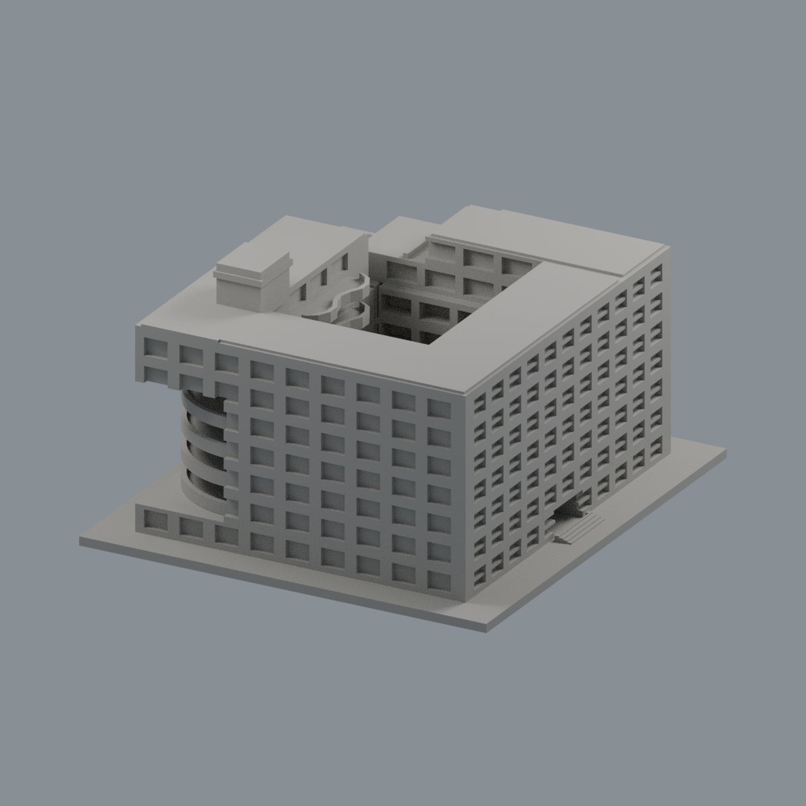
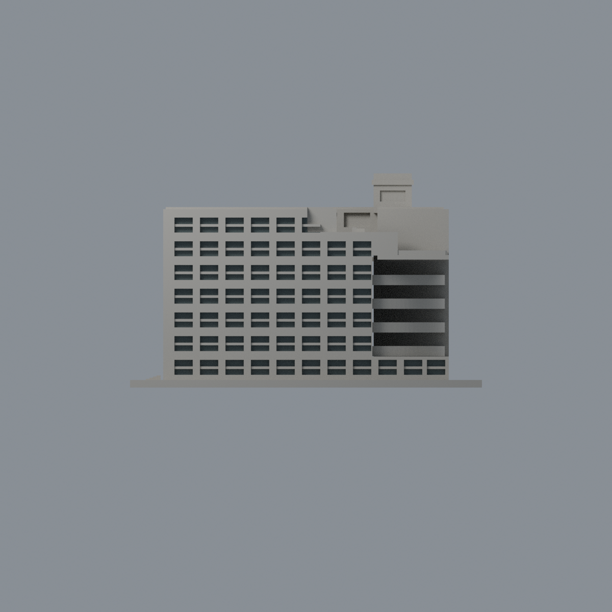
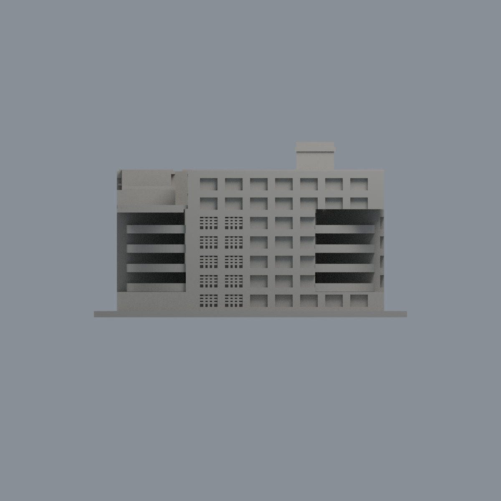
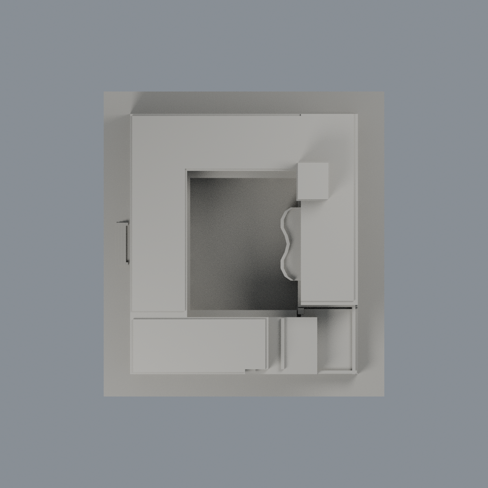

# 國立宜蘭大學｜經德大樓

## 模型預覽

| 新版模型預覽 | 新版模型預覽 | 新版模型預覽 |
| :---: | :---: | :---: |
|  |  |  |
|  |  |  |

公開資料自建的近似外觀縮尺模型，單位為毫米（mm），含底座最長150mm。不是測繪、竣工圖、結構模型或保證可列印的成品。

## 模型與預覽

頂視圖（歷史檔案留存，不作本頁預覽） · 正立面（歷史檔案留存，不作本頁預覽） · [STL下載](model.stl) · [可編輯Blender](scene.blend) · [原始網格OBJ](model.obj)

- 尺寸：138 × 150 × 84 mm（包含3mm底座；STL實測值以validation.json為準）
- 範圍：經德大樓為一件；空中大學所用樓層屬同一建物，不額外計件。保留中庭上部大開口，並以低位薄板表現2021建築師記述的新增遮雨棚。
- 保留特徵：中央天井、低層遮雨棚、七層量體與第五/六/七層真實高度退台、轉角通風大開口、曲面轉角廊台、內側波浪廊台、深凹雙段窗、東側空心磚格柵及高梯間屋突。
- 每件獨立比例，不可直接和其他模型組成同一真實比例校園。

## 列印提示

- STL採毫米，底座朝下。先於切片器確認模型尺寸、平台接觸及支撐。
- 可用0.2mm層高與約0.4mm噴嘴作切片起點，但未完成Cura/Prusa等工具路徑或實體試印。
- 曲廊、轉角風口上方與天井低位遮雨棚均有懸空跨度，可能需要支撐；尤其注意棚下支撐移除，建議先在切片器確認。
- 曲廊欄緣約1.5–1.7mm、板厚1.7–1.8mm；格柵細橫條0.9mm、直條1.0mm均有實牆背板連接，不是独立細柱。
- 切片器、材料、機器設定及縮放都會影響成果；縮小後需重新檢查薄件。

## 來源與不確定性

詳細來源及照片年代見[sources.json](sources.json)。取閱日2026-10-13。公開包不含來源原照片/PDF。

- 外觀依官方平面、建築師原文所附實拍（拍攝年代未證）及歷史實拍自建；尺寸與樓高為視覺估計。
- 上層屋頂主高度z=52、61、70mm，屋面蓋板最高另加1.1mm；不是只做平面退縮。
- 背立面未獲連續完整新照片，窗組與屋突進深按平面及局部照片簡化推估；不可稱四面精密復刻。
- 曲面樓梯/廊台以可列印平台表現，沒有內部梯級；格柵簡化成實底浮雕，非逐塊空心磚精密重現。
- 歷史照片的中庭大樹不當作2026現況；2021文本證實後加遮雨棚，本模型採低位棚，不把整個天井封死至屋頂。

## 重建與數位QA

1. Python 3.12環境安裝 [requirements.txt](requirements.txt)。
2. 執行 python build_model.py，自建[STL](model.stl)和[OBJ](model.obj)。
3. Blender 4.3.2 執行 blender -b -t 2 -P render_preview.py，從actual STL匯入、渲染並儲存scene.blend。
4. 執行 python run_all_checks.py。任何驗證非零退出或checks不全為true都停止，不能發布。

- [生成腳本](build_model.py) · [STL渲染腳本](render_preview.py)
- [原始STL/獨立重建/Blend檢查](validation.json)：水密、原始法向、每邊兩面、頂點link單環、單一連通外表面、正體積；未修補輸入。
- [0.2mm逐層檢查](layer-check.json)：420層，固定z=0.071mm起點，degree2閉合，個別和合成Polygon都必須valid；禁止repair後繼續。
- [薄特徵輔助檢查](thin-feature-check.json)：1mm層距、0.8mm參考寬度opening；不是全域最小壁厚保證。使用已核SHA的canonical fail-closed v3原腳本。
- [綜合QA](qa-summary.json) · [驗證入口](run_all_checks.py) · [逐檔SHA256](SHA256SUMS)

幾何QA不等於工具路徑驗證或實體試印。正確處理的source_rebuild_hash_matches及blend_stl_geometry_agree見validation.json。

全校及全國尚未完成。本件不能表示全校建築已製作。

## 有限窗背外觀層

[雙材質3MF、可編輯Blend與五視角預覽](appearance/README.md)：僅 -Y 57 灣上下窗背 230 面；其他面中性，非整棟全彩復原。

