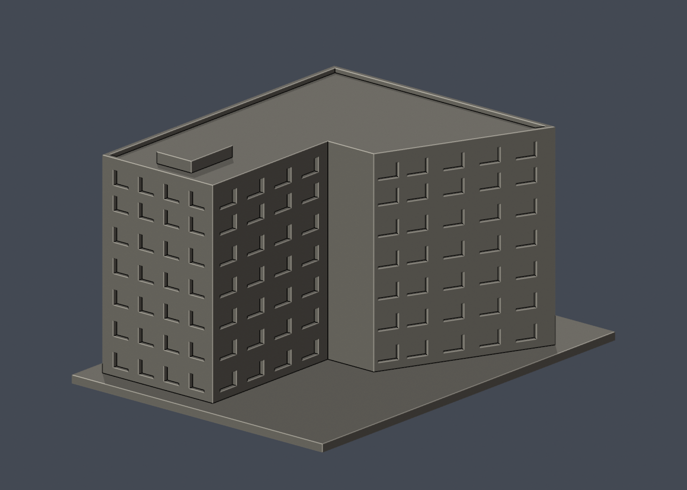

# 國立宜蘭大學｜圖書資訊大樓

公開資料自建的近似外觀縮尺模型，單位為毫米（mm），含底座最長150mm。不是測繪、竣工圖、結構模型或保證可列印的成品。

## 模型與預覽

| 正面（actual STL） | 背面（actual STL） |
|---|---|
|  |  |

[頂視圖](previews/top.png) · [正立面](previews/elevation.png) · [STL下載](model.stl) · [可編輯Blender](scene.blend) · [原始網格OBJ](model.obj)

- 尺寸：109 × 150 × 82.1 mm（包含3mm底座；STL實測值以validation.json為準）
- 範圍：圖書資訊大樓／圖書資訊館為一件；崇發廳、宜大記憶庫、黃春明行動體驗館與資訊教室均為館內空間，不各算一棟；不包含旁邊原圖書館/人管院。
- 保留特徵：左側四排與右側三排遮陽格柵窗、中央窄橫窗、右側下排8個不等距直縫、最高層僅右側4窗、右長側七個雙窗跨與中段連續玻璃帶、高入口穿廊和退縮玻璃、外伸大階梯及較低左入口、左斜側輪廓與向後收窄長翼。
- 每件獨立比例，不可直接和其他模型組成同一真實比例校園。

## 列印提示

- STL採毫米，底座朝下。先於切片器確認模型尺寸、平台接觸及支撐。
- 可用0.2mm層高與約0.4mm噴嘴作切片起點，但未完成Cura/Prusa等工具路徑或實體試印。
- 雙層入口穿廊、左入口雨棚、窗上遮陽水平檐可能需要支撐。請確認深穿廊內的支撐可移除；底座朝下。
- 階梯扶牆2.0mm並与踏步實際重疊、入口主柱3.0mm、屋頂女兒牆1.7mm；格柵直片1.1mm、水平片1.15–1.2mm均與背牆/窗緣相接。v3 opening最高損失約0.0502%，本件無>1%抽樣層；仍非全面最小壁厚證明。
- 切片器、材料、機器設定及縮放都會影響成果；縮小後需重新檢查薄件。

## 來源與不確定性

詳細來源及照片年代見[sources.json](sources.json)。取閱日2026-10-13。公開包不含來源原照片/PDF。

- 校史p162–163是同張跨頁兩面高角度實拍，個別攝影年未註；現行國際處照片只證明主入口梯道與窗形，不是完整背面新照。
- 官方1–6F館舍用途頁與消防表的7層表述不同；本模型依可見立面建立左4/右3格柵窗排及下方低層，不把7層直接改成7排規則窗。
- 官方2F、6F平面支持左側斜線與後方狹翼，本模型未有測量尺度；高度與窗距為近似。
- 未知背牆、斜側的開窗與屋突採保守估計，未取得完整現況屋頂空拍；不能稱四面精密復刻。
- 入口梯級與扶牆已加厚相交，避免相切零寬特徵；側面玻璃帶簡化為連續深凹帶和貼牆細橫條，沒有逐格細金屬框。
- 彩繪階梯、招牌文字、細窗格與內部書架未重現；模型材料顏色只是預覽，不是現況材質測量。

## 重建與數位QA

1. Python 3.12環境安裝 [requirements.txt](requirements.txt)。
2. 執行 python build_model.py，自建[STL](model.stl)和[OBJ](model.obj)。
3. Blender 4.3.2 執行 blender -b -t 2 -P render_preview.py，從actual STL匯入、渲染並儲存scene.blend。
4. 執行 python run_all_checks.py。任何驗證非零退出或checks不全為true都停止，不能發布。

- [生成腳本](build_model.py) · [STL渲染腳本](render_preview.py)
- [原始STL/獨立重建/Blend檢查](validation.json)：水密、原始法向、每邊兩面、頂點link單環、單一連通外表面、正體積；未修補輸入。
- [0.2mm逐層檢查](layer-check.json)：411層，固定z=0.071mm起點，degree2閉合，個別和合成Polygon都必須valid；禁止repair後繼續。
- [薄特徵輔助檢查](thin-feature-check.json)：1mm層距、0.8mm參考寬度opening；不是全域最小壁厚保證。使用已核SHA的canonical fail-closed v3原腳本。
- [綜合QA](qa-summary.json) · [驗證入口](run_all_checks.py) · [逐檔SHA256](SHA256SUMS)

幾何QA不等於工具路徑驗證或實體試印。正確處理的source_rebuild_hash_matches及blend_stl_geometry_agree見validation.json。

全校及全國尚未完成。本件不能表示全校建築已製作。
