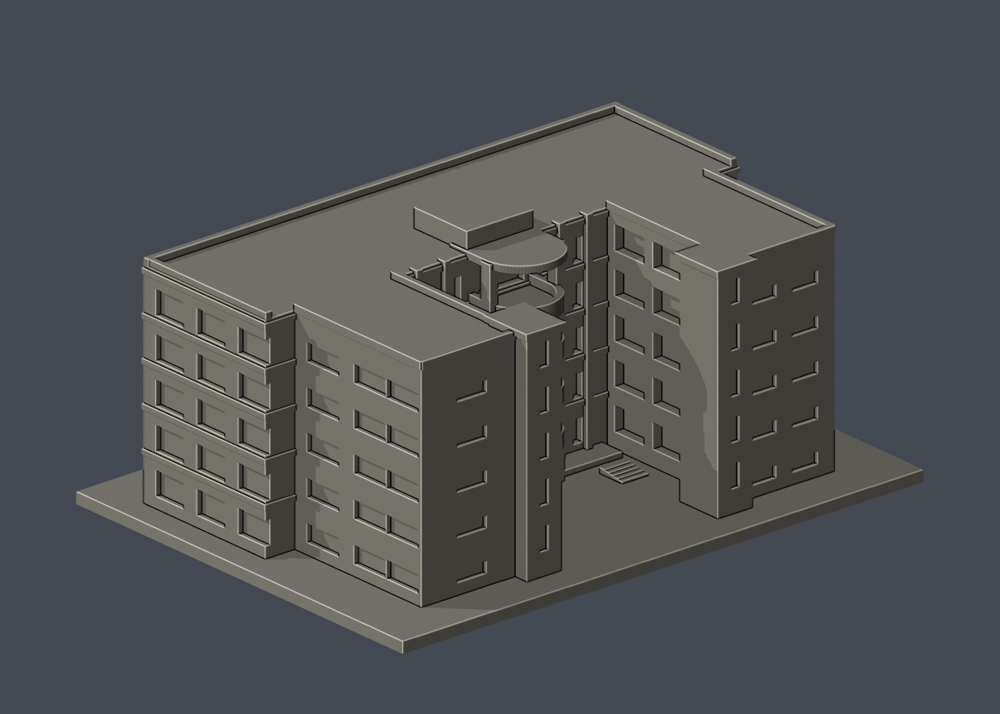
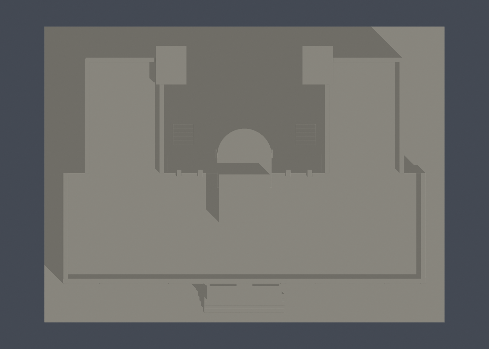
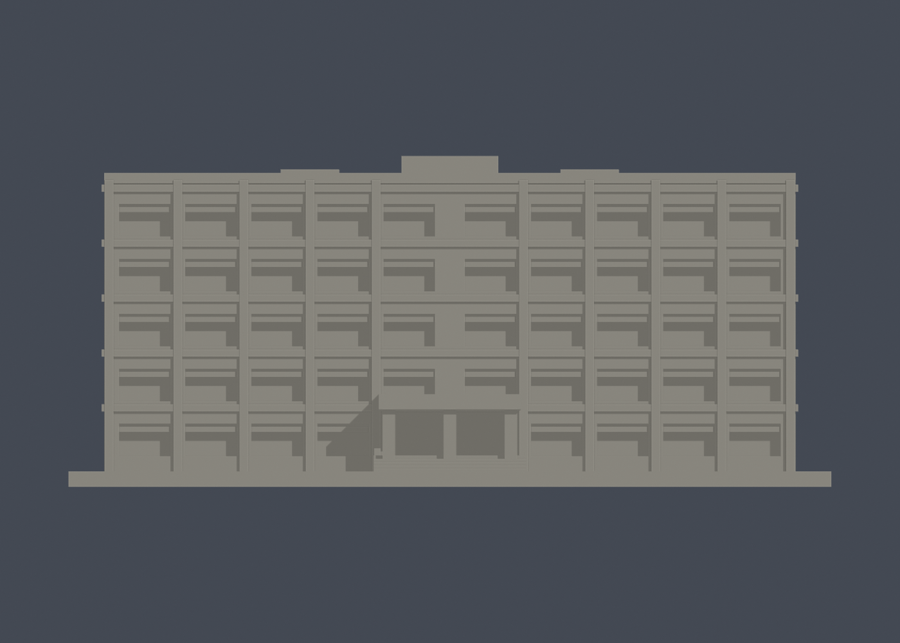

# 國立宜蘭大學｜時習大樓

公開資料自建的近似外觀縮尺模型，單位為毫米（mm），含底座最長150mm。不是測繪、竣工圖、結構模型或保證可列印的成品。

## 模型與預覽

| 模型預覽 | 模型預覽 | 模型預覽 |
| :---: | :---: | :---: |
| 正面（actual STL）  | 背面（actual STL）  |  |

[頂視圖](previews/top.png) · [正立面](previews/elevation.png) · [STL下載](model.stl) · [可編輯Blender](scene.blend) · [原始網格OBJ](model.obj)

| 模型預覽 | 模型預覽 | 模型預覽 |
| :---: | :---: | :---: |
| 頂視圖  | 正立面  |  |

- 尺寸：150 × 111 × 65 mm（包含3mm底座；STL實測值以validation.json為準）
- 範圍：時習大樓為一件。照片中旁邊的其他大樓不納入；不同實驗室為同館使用單位，不拆算。
- 保留特徵：五層量體、深U形開放院落、四層D形外挑露台與圓弧頂蓋、兩側通高直柱/窄窗、非對稱細橫窗、兩側梯間量體、平直入口門廊及寬階梯、相異的正面寬窗和院落侧細橫窗。
- 每件獨立比例，不可直接和其他模型組成同一真實比例校園。

## 列印提示

- STL採毫米，底座朝下。先於切片器確認模型尺寸、平台接觸及支撐。
- 可用0.2mm層高與約0.4mm噴嘴作切片起點，但未完成Cura/Prusa等工具路徑或實體試印。
- D形露台、門廊頂、外挑檐口可能需要支撐；請以底座朝下，在實際切片器確認支撐位置與可移除性。
- 露台側牆約1.7mm、板厚1.7mm、弧廊直柱2.3mm，入口柱2.5mm，屋頂女兒牆1.7mm；小型貼牆橫框有實牆背板。
- 切片器、材料、機器設定及縮放都會影響成果；縮小後需重新檢查薄件。

## 來源與不確定性

詳細來源及照片年代見[sources.json](sources.json)。取閱日2026-10-13。公開包不含來源原照片/PDF。

- 官方校史p154同時收錄舊正背照片和較新入口照片，個別攝影年月不明；不稱2026全館實拍。
- 樓層依舊完整照片可見五排窗與官方1–5F平面交叉核對；主入口近照不是唯一樓層依據。
- 以公開平面核U形庭院與D形露台，未取得立面測量，窗距、屋頂設備和左右細節為近似。
- 2025工程紀錄列時習新設防墜欄杆；本模型不精刻無法確定當期形式的細欄杆。

## 重建與數位QA

1. Python 3.12環境安裝 [requirements.txt](requirements.txt)。
2. 執行 python build_model.py，自建[STL](model.stl)和[OBJ](model.obj)。
3. Blender 4.3.2 執行 blender -b -t 2 -P render_preview.py，從actual STL匯入、渲染並儲存scene.blend。
4. 執行 python run_all_checks.py。任何驗證非零退出或checks不全為true都停止，不能發布。

- [生成腳本](build_model.py) · [STL渲染腳本](render_preview.py)
- [原始STL/獨立重建/Blend檢查](validation.json)：水密、原始法向、每邊兩面、頂點link單環、單一連通外表面、正體積；未修補輸入。
- [0.2mm逐層檢查](layer-check.json)：325層，固定z=0.071mm起點，degree2閉合，個別和合成Polygon都必須valid；禁止repair後繼續。
- [薄特徵輔助檢查](thin-feature-check.json)：1mm層距、0.8mm參考寬度opening；不是全域最小壁厚保證。使用已核SHA的canonical fail-closed v3原腳本。
- [綜合QA](qa-summary.json) · [驗證入口](run_all_checks.py) · [逐檔SHA256](SHA256SUMS)

幾何QA不等於工具路徑驗證或實體試印。正確處理的source_rebuild_hash_matches及blend_stl_geometry_agree見validation.json。

全校及全國尚未完成。本件不能表示全校建築已製作。
