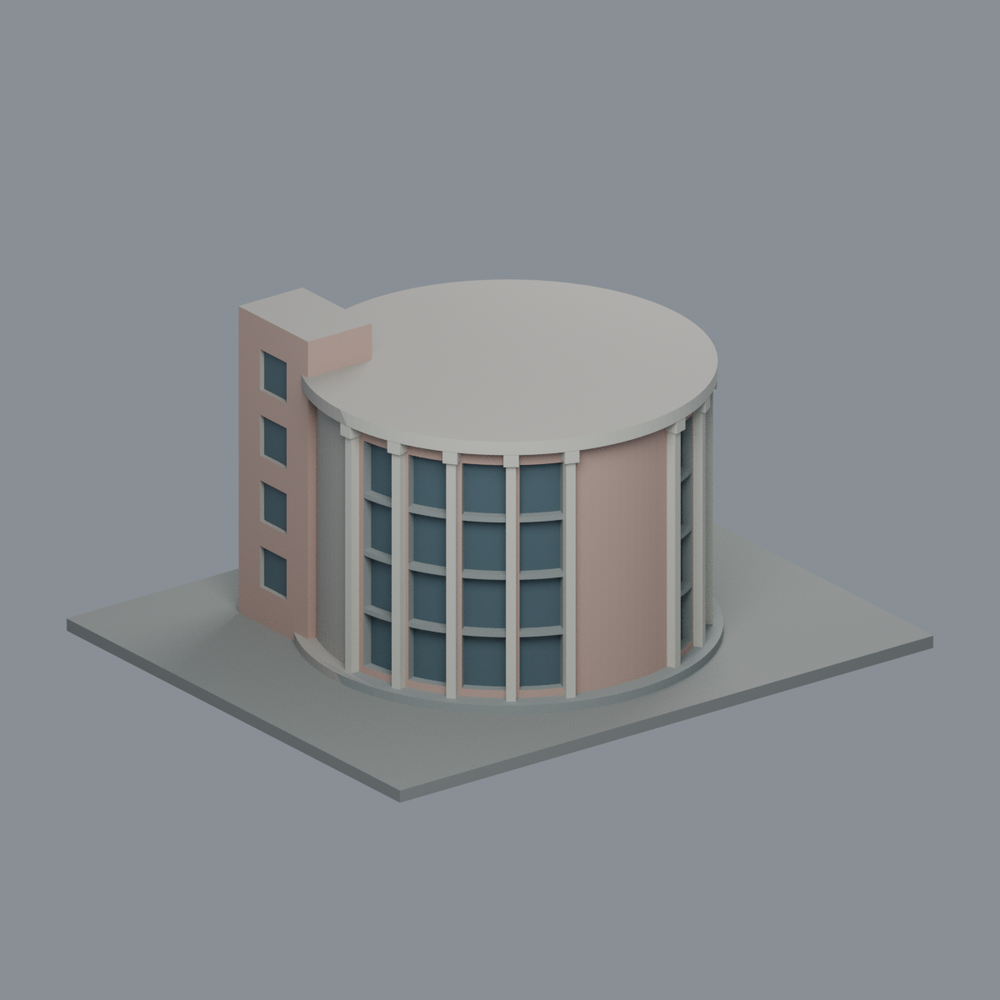
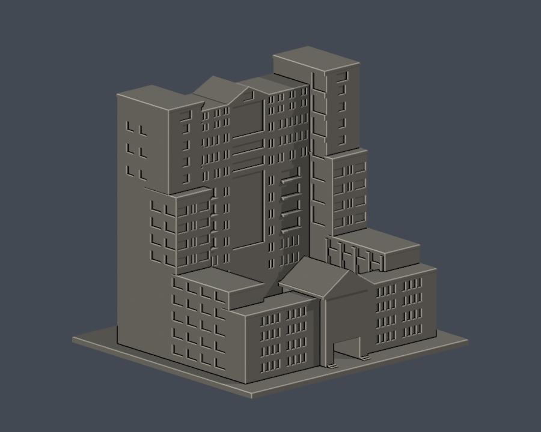

# 國立屏東大學建築外觀模型

現收錄5件獨立模型，分布於民生、屏師與屏商校區。本次新增民生校區2件：五育樓主體與中庭、學習輔助犬訓練教室主屋；原3件模型附件保持不變。**全校尚未完成；模型數不是完整建物棟數。**每件含底座最長150mm、單位毫米，各自按公開照片估算比例。

## 建築圖鑑

| 圖鑑 1 | 圖鑑 2 | 圖鑑 3 |
|---|---|---|
|  [圖資大樓主塔段](屏商校區/buildings/nptu-library-tower-segment/README.md) 屏商校區 |  [學生活動中心入口段](屏商校區/buildings/nptu-student-center-entrance-segment/README.md) 屏商校區 |  [音樂館圓廳段](屏師校區/buildings/nptu-music-hall-rotunda-segment/README.md) 屏師校區 |
|  [五育樓主體與中庭](民生校區/buildings/nptu-wuyu-courtyard-complex/README.md) 民生校區 |  [學習輔助犬訓練教室主屋](民生校區/buildings/nptu-learning-assistance-dog-classroom/README.md) 民生校區 |  |

## 校區入口

- [民生校區](民生校區/README.md)：五育樓主體與中庭、學習輔助犬訓練教室主屋。
- [屏師校區（舊林森）](屏師校區/README.md)：音樂館圓廳段。
- [屏商校區](屏商校區/README.md)：圖資大樓主塔段、學生活動中心入口段。
- [車城校區](車城校區/README.md)：生態教學場域；2025官方校舍面積表列0，仍需逐設施查核。
- [校外場域](校外場域/README.md)：校外職員宿舍存在於官方面積表，但棟別待確認。

## 範圍、沿革與續接

[官方校史](https://www.nptu.edu.tw/p/412-1000-3310.php?Lang=zh-tw)確認本校於2014年由國立屏東教育大學、國立屏東商業技術學院合併，與「國立屏東科技大學」分屬不同學校。屏師校區是舊林森校區。五育樓中的圖書館民生總館與行政／系所用途不另計一棟；屏商分館亦為圖資大樓內用途。輔助犬中心／犬舍／教室圖說經屋形與官方介紹核對，於本批作同一主屋收錄，未重複做成三棟。

[逐項續接清單](CONTINUE.zh-TW.md)與[研究清冊](building-research-inventory.json)保留47筆研究項，區分已建範圍、未研究與真正資料缺口。研究項、地圖標號、使用單位與群棟皆不可直接換算棟數。新舊差異包含屏商舊女生第二宿舍拆除與2019新舍替代、民生舊看台拆除與光電球場。

## 檔案、限制與驗證

每件資料夾含獨立參數腳本、STL、可編輯Blender網格場景、實際STL正背頂預覽、繁中說明、來源URL與SHA。只用自建幾何，未取得第三方3D mesh；公開包不轉載來源照片。

原STL、獨立重建SHA、保存Blend幾何、0.2mm逐層輪廓與canonical fail-closed v3的0.8mm參考薄特徵篩檢均已各件通過。任一invalid Polygon即失敗，沒有repair fallback。各件README說明未見背面、簡化範圍與懸挑；底座朝下列印，需自行檢查支撐及切片工具路徑。數位QA不是實體試印或Cura／Prusa驗證，也不等於免支撐保證。

官方圖庫照片多未標攝影日期，不能以頁面更新／抓取時間聲稱2026年的完整實測現況。

[完整模型映射](model-index.json)｜[全校檔案SHA](SHA256SUMS.txt)

公開資料查核：2026-10-13。全校工作仍待逐項續接。

[學習輔助犬訓練教室主屋有限配色外觀與來源界線](民生校區/buildings/nptu-learning-assistance-dog-classroom/appearance/README.md)
