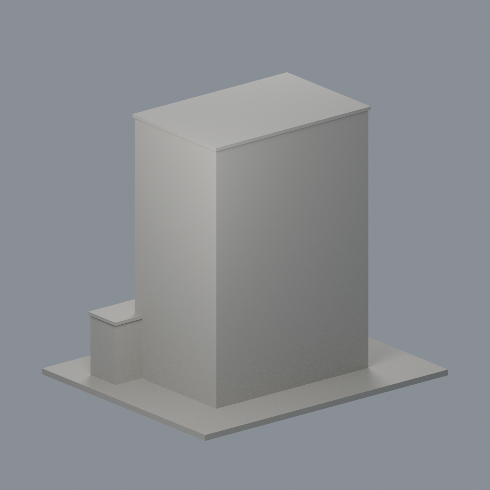
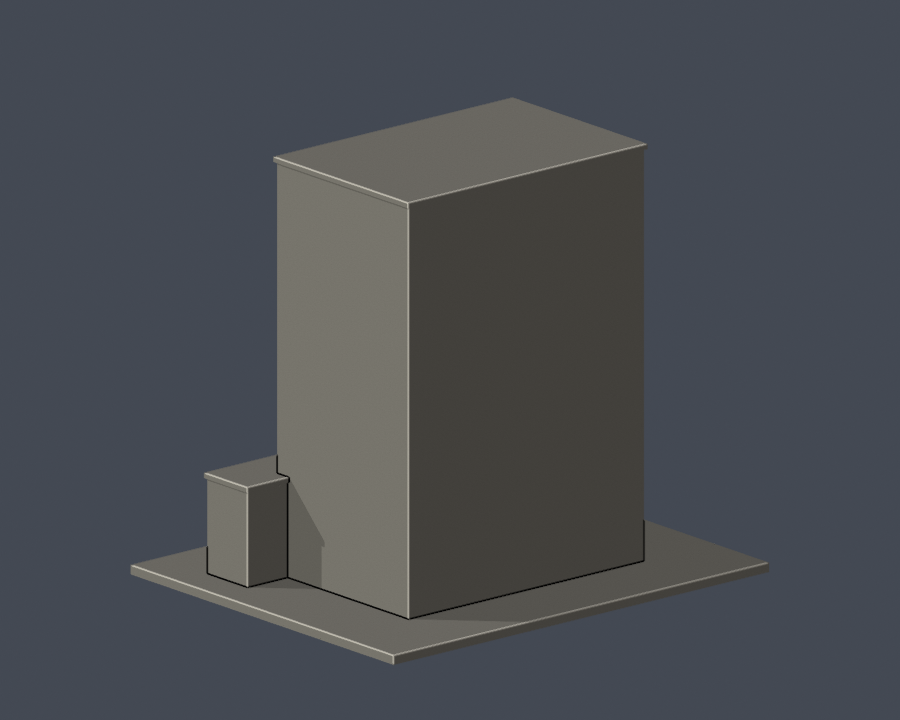

# 國立屏東大學｜屏商校區｜圖資大樓主塔段

## 5 材質外觀版（2026-10-21）

| 正面與來源支持區域 | 未見外側背面中性 |
|---|---|
|  |  |

[來源界線與四視角](appearance/README.md) · [表面色 3MF](appearance/nptutower-appearance.3mf) · [可編輯場景](appearance/scene.blend)

來源支持正面白牆、離散窗凹底、頂層及中央高槽藍綠窗、前左頂冠棕簷；未分界的左牆、低裙樓、入口及最低遮屏保持中性，未知屋頂右側與背面不推色。 原 STL 與歷史 QA 不變；這是外觀改善，不是新增幾何。[原單色正面](previews/front.png)／[原單色背面](previews/rear.png)

這是依公開完成照片自建的局部外觀模型，非全館測繪、全校模型或精確比例復原。所屬實體建物：**圖資大樓**。

| 實際 STL 正面 | 實際 STL 背面 |
|---|---|
|  |  |

## 外觀範圍

- 十二層主塔的垂直比例、頂層分組玻璃帶
- 朝中央草坪的多層深凹與凹內水平窗帶
- 左側小方窗、局部低樓與入口雨遮

## 未知與簡化

- 背面與右側詳細立面未有足夠實拍，保留素面，不把前面窗格鏡像過去
- 主塔進深、凹槽深度與低樓平面為照片估算
- 僅含可見低樓段；不包含全部附屬低樓、內部樓層及地下室
- 照片攝影日期未標，不能當作2026年竣工實測或完整現況紀錄

## 下載與重建

- [可列印 STL](model.stl)，單位為**毫米**；含底座 150.00 × 124.00 × 135.90 mm，最長150mm。各件獨立估算比例，不可直接拼成等比例全校。
- [可編輯 Blender 場景](scene.blend)：由交付STL匯入的一個網格，不是完整建築CAD/BIM；參數建模來源為 [build_model.py](build_model.py)。
- [套件版本](requirements.txt)、[渲染腳本](render_preview.py)、[來源與限制](sources.json)、[檔案SHA](SHA256SUMS.txt)。
- Python 3.12：pip install -r requirements.txt，接著 python build_model.py。
- Blender 4.3.2：blender -b -t 2 -P render_preview.py。圖像皆從實際交付STL渲染，沒有示意mesh替代。

## 列印與驗證

底座朝下放置。主塔大凹槽上緣為長跨距懸挑，入口雨遮亦有懸空，需在切片軟體檢查支撐。 使用0.4mm噴嘴、0.2mm層高只能作初始評估，仍要自行預覽工具路徑與支撐；數位驗證不等於Cura/Prusa實際切片或實體試印，沒有保證可印、強度或免支撐。

- [原始STL、獨立重建、Blend幾何驗證](validation.json)：全部checks為true；水密、每邊兩面、vertex link單一環、單一連通表面、原檔法向／繞序、正體積、底面與150mm尺寸均通過。
- [0.2mm逐層輪廓](contour-validity-check.json)：680層，起始z=0.071mm，degree2閉合、個別及合成Polygon valid均通過；invalid即失敗，不作repair。
- [canonical v3 0.8mm參考薄特徵篩檢](thin-feature-check.json)及[嚴格摘要](strict-thin-check.json)：1mm取樣，最大opening損失比例 0.1295%，每層均小於1%。這只是XY形態篩檢，非全面最小壁厚。
- [原檔驗證程式](validate_model.py)、[輪廓驗證程式](check_contour_validity.py)、[canonical v3](check_thin_features.py)、[strict執行程式](check_thin_strict.py)。依序執行python validate_model.py、python check_contour_validity.py、python check_thin_strict.py，任一非零退出都不能判通過。
- canonical v3 SHA256：059f7378c74a1400dcf010365ebf35df3027fd853f1c960462a233dc68ce8915。
- 原始與獨立重建STL SHA256：b9531e63c0c7e15bb7afae6539beddd60f06cfd4103f2b98076ea532c9a3f207。

資料查核：2026-10-13。官方原照片版權屬各權利人，本包不重新散布。
