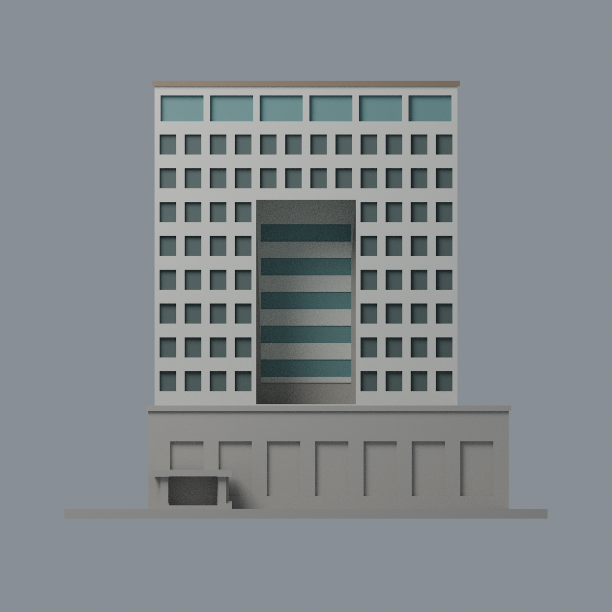
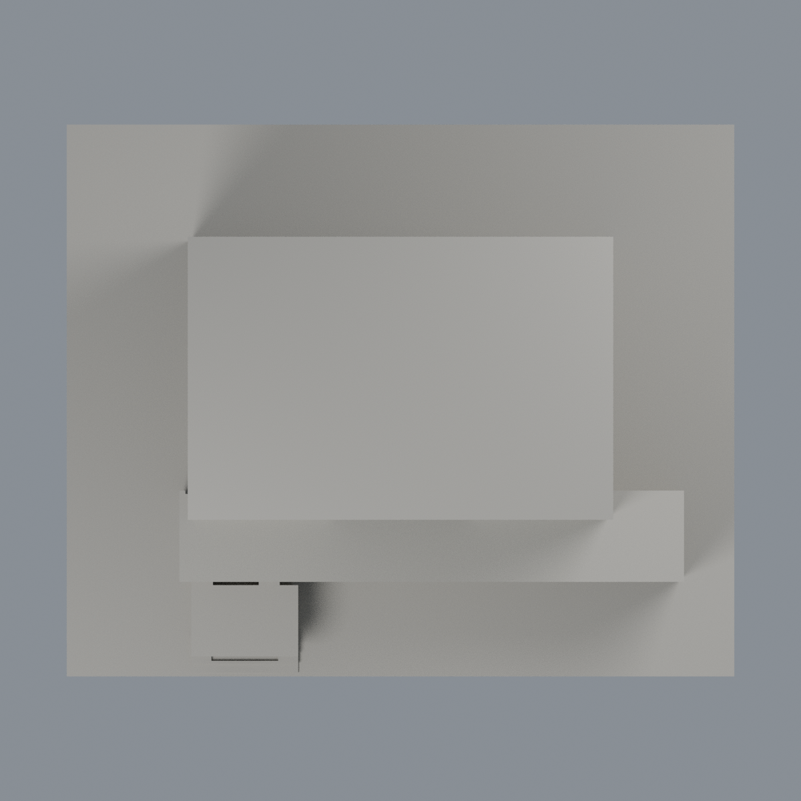

# 屏東大學屏商圖資大樓主塔段限定配色：五材質外觀版

沿用原 **3,066 三角面／1,535 頂點**，不改原 STL 位元、座標、面序或幾何；這是既有模型外觀改版，不增加模型包數。

| 模型預覽 | 模型預覽 | 模型預覽 |
| :---: | :---: | :---: |
| 正面  | 背面保持中性  |  |
|  |  |  |

[表面色 3MF](nptutower-appearance.3mf) · [可編輯 Blender](scene.blend) · [材質色表](palette.json) · [逐面指派與依據](face-materials.json) · [原 STL](../model.stl)

## 來源與配色邊界

親看屏東大學官方三張完整圖資大樓照片、原單色網格與生成器。[精確 URL、SHA 與日期欄](qa/source-review.json)。相機 Original 為 2019-06-28 12:18:43／12:16:15、2019-06-11 11:14:57；根修改欄 2019-07-05／06-21 不是攝影日期。不宣稱 2026 現況。照片僅私有研究，不入公開包。

- 模型是主塔與部分低裙樓，不是整個圖資複合館。正面原獨立白牆、明確離散的高層前／左窗凹底、頂層藍綠玻璃與中央高凹槽玻璃條採低飽和代理。粗化窗凹未畫實景細窗梃，不宣稱完整玻璃材質或透光度。
- 中央凹槽最低一條是遮屏／實面，不染玻璃；高層凹槽白牆與頂底面不是玻璃。僅五排明確高窗凹底與其轉角回面著色。
- 頂冠僅照片支持的前與左垂直棕色簷邊著色，未知頂面、右邊及背邊中性，不將整屋頂染棕。
- 左側大牆三角跨上部白牆與下部棕白帶，保留整片中性；低裙樓、入口、雨棚含未分界的棕白及遮擋，全部中性。中性不是實景灰色還原，不能由窗口顏色推遍牆身。未見背面及右側同樣中性。
- 不加細灰磚縫、文字招牌、細玻璃網格、植栽或其他建物。不改三角面、外形、STL 或歷史 QA，未做實體列印測試。

[原幾何與歷史來源限制](../README.md)

## 重建與核驗

安裝 [依賴](source/requirements.txt)，Blender 使用 4.3.2。由本資料夾上層提供原 model.stl：

1. `python appearance/source/build_appearance.py`
2. `python appearance/source/verify_exchange.py`
3. `blender -b -t 3 --python-exit-code 1 -P appearance/source/render_appearance.py`
4. `blender -b -t 3 --python-exit-code 1 -P appearance/source/verify_scene.py`

[獨立重建 ZIP](rebuild-source.zip)含原 STL、四支程式及依賴，不含第三方照片；不取代原建模腳本。[逐檔 SHA256](SHA256SUMS)

[交換／拓撲 QA](qa/exchange-validation.json)核對原座標與面序、全部面材質、單連通、有向水密邊、頂點 link 單環、正體積與零退化／重複面；lib3mf 嚴格讀取零警告，實際編輯單材質再存讀，其他材質及面指派不變。SDK 六位小數量化誤差另列。

[Blender 存讀與編輯](qa/scene-validation.json) · [渲染記錄](qa/render-manifest.json) · [獨立重建](qa/rebuild-validation.json)

## 製造限制照舊

尺寸仍為 150 × 124 × 135.9 mm；原 STL、建模程式、場景及歷史 QA 保留。原層檢與薄特徵檢查本次未重跑，不能由材質 QA 代替。

3MF 是同一網格的表面色，不是各材質各自封閉的分色實體、切片專案、噴頭映射或 G-code。切片 GUI、多材料路徑與實體列印未測；柱頭、屋簷、窗框及薄邊仍須評估材料、支撐及拆除風險，沒有保證可印或免支撐。
