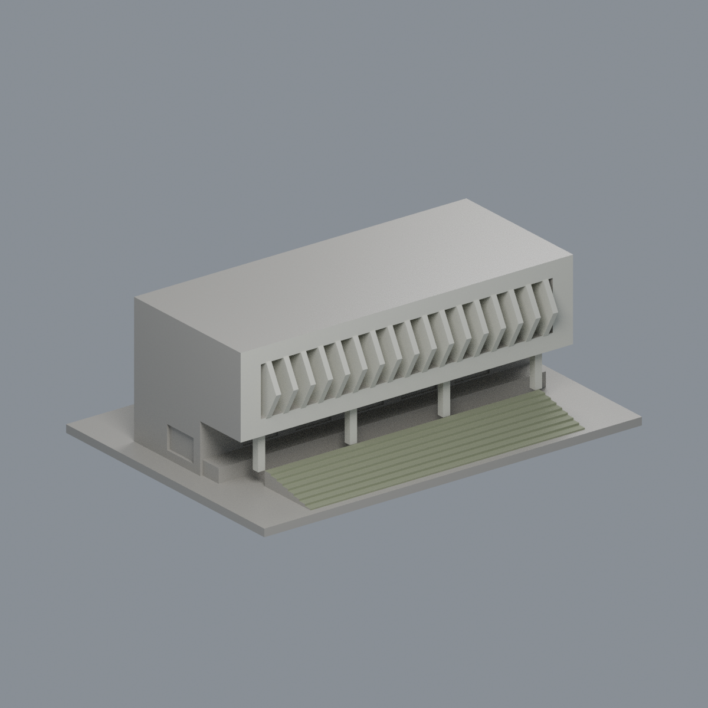
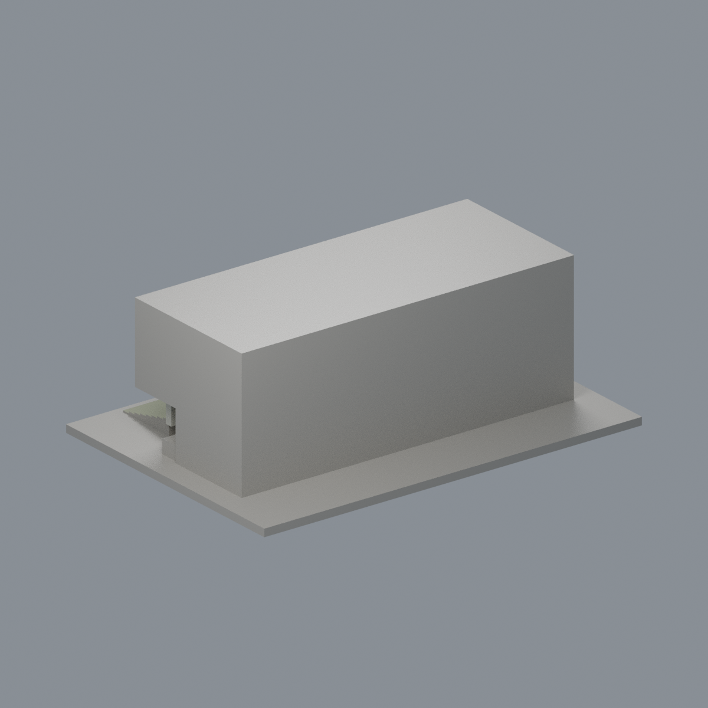
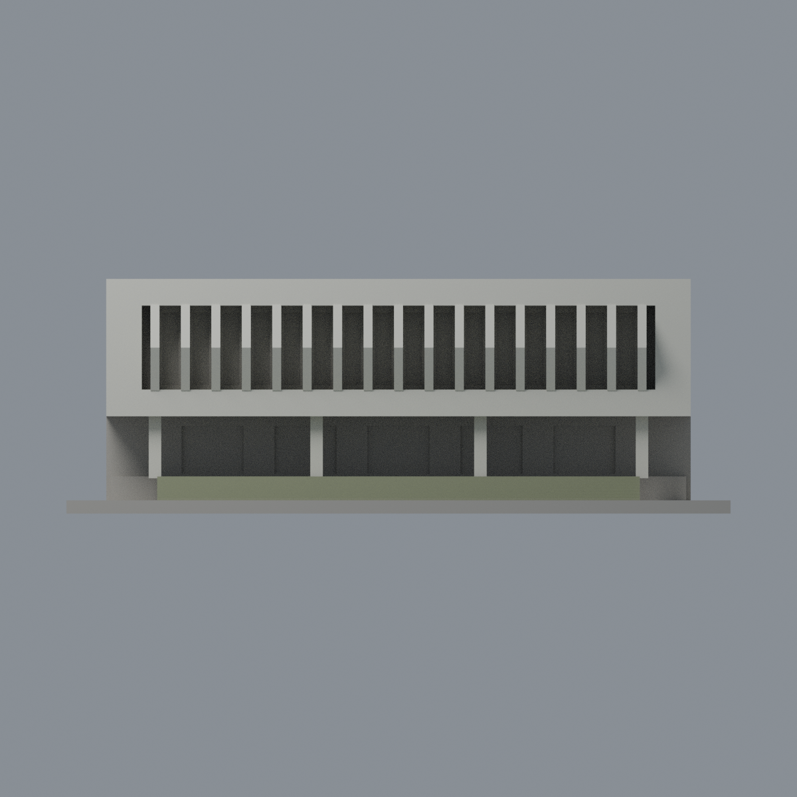
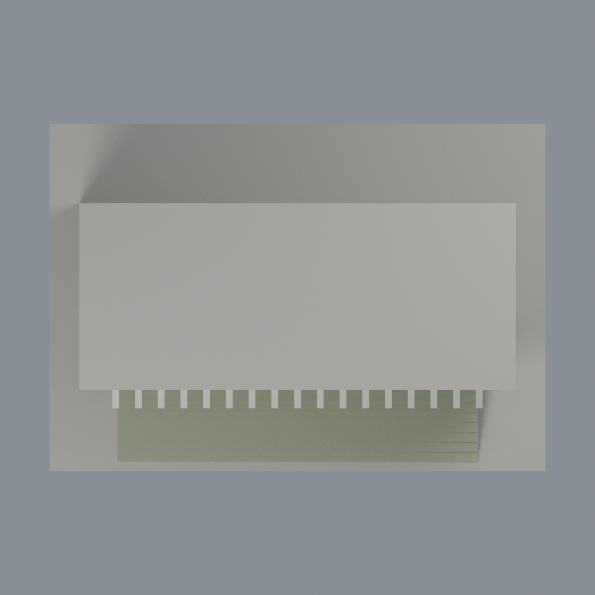

# 屏商學生活動中心入口段折板與階梯限定配色：三材質外觀版

沿用原 **1,300 三角面／618 頂點**，不改原 STL 位元、座標、面序或幾何；這是既有模型外觀改版，不增加模型包數。

| 正面 | 未知後截面保持中性 |
|---|---|
|  |  |
|  |  |

[表面色 3MF](nptustudententry-appearance.3mf) · [可編輯 Blender](scene.blend) · [材質色表](palette.json) · [逐面指派與依據](face-materials.json) · [原 STL](../model.stl)

## 來源與配色邊界

親看屏東大學官方兩張完整正面／左斜照片，以及原單色網格、生成器。[精確 URL、SHA 與日期](qa/source-review.json)。近照相機 Original 為 2010-01-15 11:00:24，修改於 2014-05-31；遠照 Original 為 2019-06-28 12:21:46，修改於 2019-07-05。不能以修改時間當攝影日；這是跨年照片支持的限定入口外觀，不宣稱 2026 現場狀態。日期是檔案中繼資料，未獨立鑑定。原照片私有研究，不入包。

- 僅既有入口段，並非完整學生活動中心或禮堂屋頂。17 片折板、前框垂直面與 4 根入口柱採米白色；折板兩斜面同色，深淺由幾何光影形成，不畫假灰白箭頭。
- 原 8 階踏面與正向踢面依近照採低飽和橄欖灰綠瓷磚代理，不畫磁磚細縫／污漬，也不是把草地綠色移到建物。階梯側面未明見，保持中性；不把整片底板或低 z 面全部塗綠。
- 上方窄暗窗背未充分辨清玻璃／遮板／開口混合，全部中性；底層門廊凹背混牆、櫃檯與門，也不當整片玻璃。左側淺格是金屬通風口而非玻璃，未另外染窗色。
- 左大牆上下色差、其他低牆、未知屋頂與後截面、地板均中性。中性不是實景灰色還原，不以近照樹影／陰影作材質。不補欄杆細絲、文字、空調、棕櫚或禮堂後部。
- 色面由原三角完整三頂點與原折板剖面／構件範圍定位，不改 STL、面序、外形及歷史 QA；未做實體列印測試。

[原幾何與歷史來源限制](../README.md)

## 重建與核驗

安裝 [依賴](source/requirements.txt)，Blender 使用 4.3.2。由本資料夾上層提供原 model.stl：

1. `python appearance/source/build_appearance.py`
2. `python appearance/source/verify_exchange.py`
3. `blender -b -t 3 --python-exit-code 1 -P appearance/source/render_appearance.py`
4. `blender -b -t 3 --python-exit-code 1 -P appearance/source/verify_scene.py`

[獨立重建 ZIP](rebuild-source.zip)含原 STL、四支程式及依賴，不含第三方照片；不取代原建模腳本。[逐檔 SHA256](SHA256SUMS)

[交換／拓撲 QA](qa/exchange-validation.json)核對原座標與面序、全部面材質、單連通、有向水密邊、頂點 link 單環、正體積與零退化／重複面；lib3mf 嚴格讀取零警告，實際編輯單材質再存讀，其他材質及面指派不變。SDK 六位小數量化誤差另列。

[Blender 存讀與編輯](qa/scene-validation.json) · [渲染記錄](qa/render-manifest.json) · [獨立重建](qa/rebuild-validation.json)

## 製造限制照舊

尺寸仍為 150 × 105 × 53 mm；原 STL、建模程式、場景及歷史 QA 保留。原層檢與薄特徵檢查本次未重跑，不能由材質 QA 代替。

3MF 是同一網格的表面色，不是各材質各自封閉的分色實體、切片專案、噴頭映射或 G-code。切片 GUI、多材料路徑與實體列印未測；柱頭、屋簷、窗框及薄邊仍須評估材料、支撐及拆除風險，沒有保證可印或免支撐。
