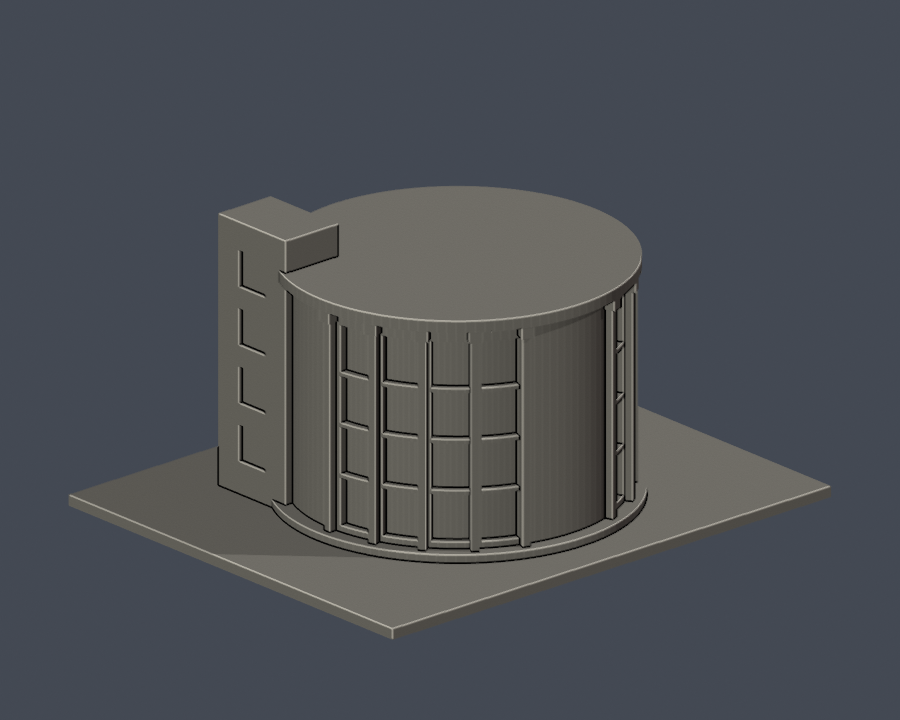
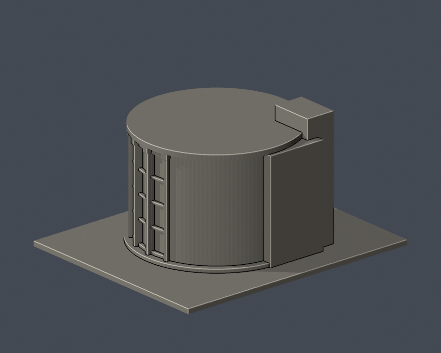

# 國立屏東大學｜屏師校區｜音樂館圓廳段

這是依公開完成照片自建的局部外觀模型，非全館測繪、全校模型或精確比例復原。所屬實體建物：**音樂館**。

| 實際 STL 正面 | 實際 STL 背面 |
|---|---|
|  |  |

## 外觀範圍

- 高圓廳的曲面玻璃凹槽、長立柱與放大柱頭
- 中央不開窗的招牌牆段
- 圓形頂緣、低台基與側接服務塔

## 未知與簡化

- 相連教學翼、室外樓梯及表演廳均不在本件範圍
- 圓廳背面與屋頂內部未有足夠照片，作簡化連續量體，沒有複製前方曲窗
- 平面半徑、深度、柱寬與塔高為照片估算；不是測繪模型
- 照片攝影日期未標；校圖名稱音樂館與表演廳為分列項，不合併計為本件完成

## 下載與重建

- [可列印 STL](model.stl)，單位為**毫米**；含底座 150.00 × 125.00 × 77.80 mm，最長150mm。各件獨立估算比例，不可直接拼成等比例全校。
- [可編輯 Blender 場景](scene.blend)：由交付STL匯入的一個網格，不是完整建築CAD/BIM；參數建模來源為 [build_model.py](build_model.py)。
- [套件版本](requirements.txt)、[渲染腳本](render_preview.py)、[來源與限制](sources.json)、[檔案SHA](SHA256SUMS.txt)。
- Python 3.12：pip install -r requirements.txt，接著 python build_model.py。
- Blender 4.3.2：blender -b -t 2 -P render_preview.py。圖像皆從實際交付STL渲染，沒有示意mesh替代。

## 列印與驗證

底座朝下放置。曲面立柱2.2mm以上並接底座、頂緣；柱頭與頂緣外挑仍須切片檢查，勿僅依數位QA判定免支撐。 使用0.4mm噴嘴、0.2mm層高只能作初始評估，仍要自行預覽工具路徑與支撐；數位驗證不等於Cura/Prusa實際切片或實體試印，沒有保證可印、強度或免支撐。

- [原始STL、獨立重建、Blend幾何驗證](validation.json)：全部checks為true；水密、每邊兩面、vertex link單一環、單一連通表面、原檔法向／繞序、正體積、底面與150mm尺寸均通過。
- [0.2mm逐層輪廓](contour-validity-check.json)：389層，起始z=0.071mm，degree2閉合、個別及合成Polygon valid均通過；invalid即失敗，不作repair。
- [canonical v3 0.8mm參考薄特徵篩檢](thin-feature-check.json)及[嚴格摘要](strict-thin-check.json)：1mm取樣，最大opening損失比例 0.0454%，每層均小於1%。這只是XY形態篩檢，非全面最小壁厚。
- [原檔驗證程式](validate_model.py)、[輪廓驗證程式](check_contour_validity.py)、[canonical v3](check_thin_features.py)、[strict執行程式](check_thin_strict.py)。依序執行python validate_model.py、python check_contour_validity.py、python check_thin_strict.py，任一非零退出都不能判通過。
- canonical v3 SHA256：059f7378c74a1400dcf010365ebf35df3027fd853f1c960462a233dc68ce8915。
- 原始與獨立重建STL SHA256：69696f3dc9233460a8d0410508628204b63c0e8b548848c4c161b7cd153a5cd3。

資料查核：2026-10-13。官方原照片版權屬各權利人，本包不重新散布。
