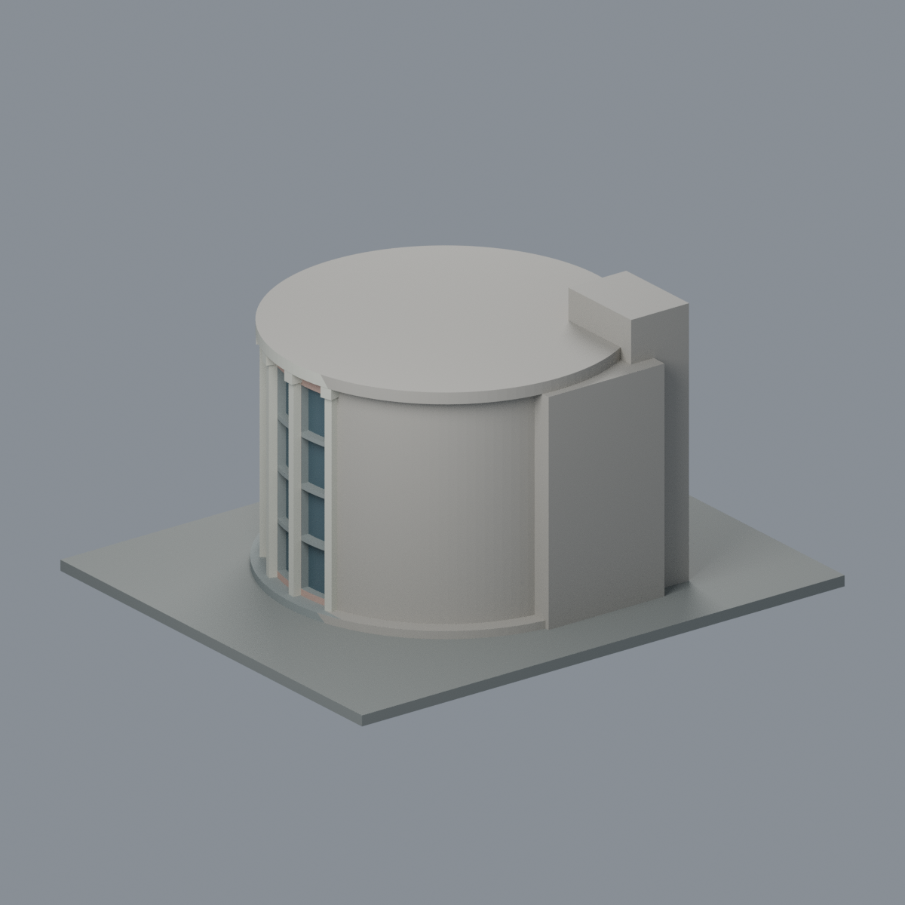
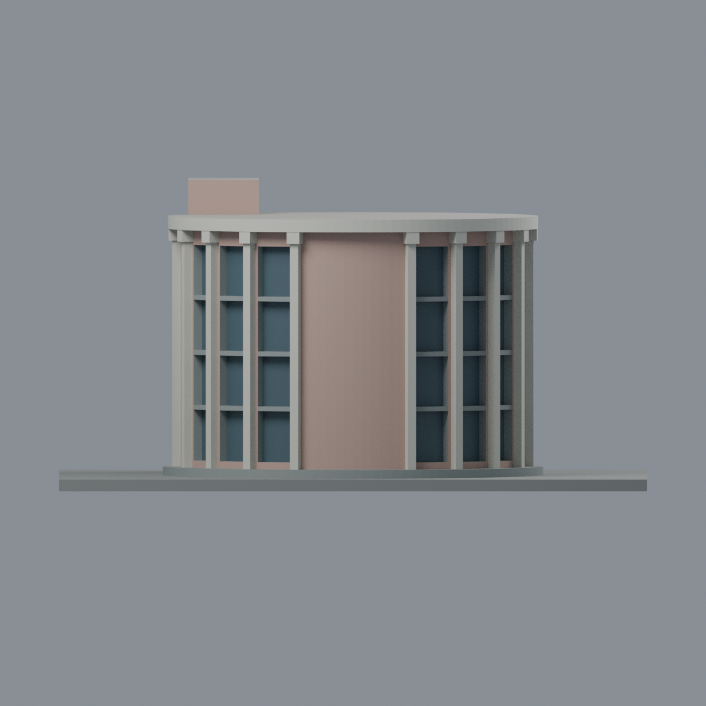
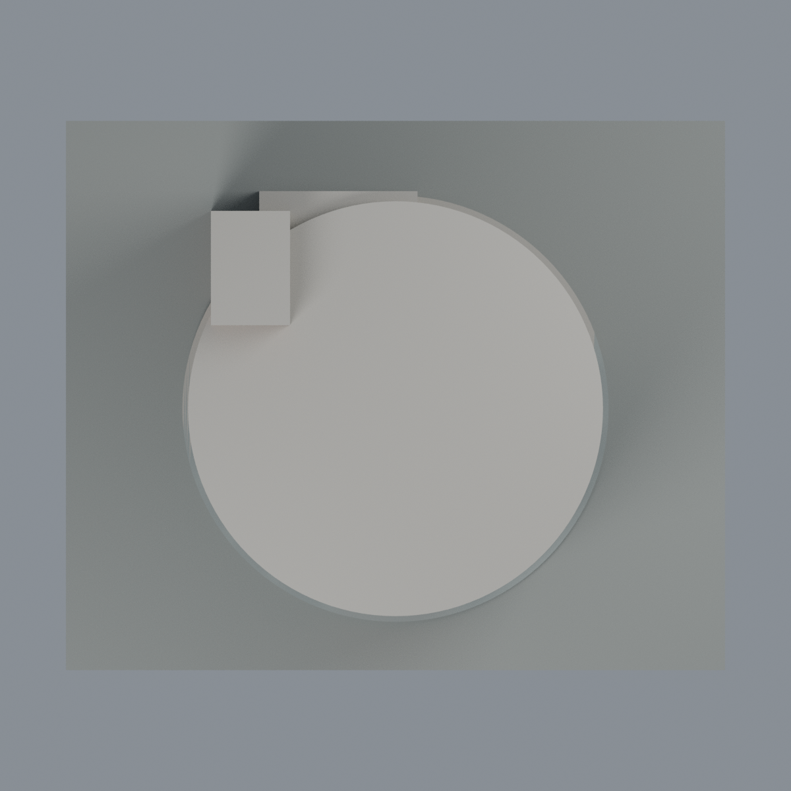

# 音樂館圓廳段：六材質外觀版

沿用原 **3,598 三角面／1,801 頂點**，不改原 STL 位元、座標、面序或幾何；這是既有模型外觀改版，不增加模型包數。

| 模型預覽 | 模型預覽 | 模型預覽 |
| :---: | :---: | :---: |
| 正面  | 背面保持中性  |  |
|  |  |  |

[表面色 3MF](nptu-appearance.3mf) · [可編輯 Blender](scene.blend) · [材質色表](palette.json) · [逐面指派與依據](face-materials.json) · [原 STL](../model.stl)

## 來源與配色邊界

親自查看屏東大學官方圖庫、總務處提供的[音樂館 2](https://gallery.nptu.edu.tw/var/file/37/1037/gallery/28/1928/gallery_1928_4214315_75118.jpg)及[音樂館 1](https://gallery.nptu.edu.tw/var/file/37/1037/gallery/28/1928/gallery_1928_9073369_41739.jpg)。本次另讀取內嵌 EXIF：兩圖 DateTimeOriginal 分別為 **2019-07-19 07:50:46** 與 **2016-10-30 09:36:33**；時區未載、未獨立驗證，不等同校方確認的拍攝日。Photoshop 修改時間另為 2019 年，不拿修改時間當原始拍攝時間。原 sources.json 的未明拍攝日記錄保留作歷史紀錄，本次 EXIF 覆核另列 QA；不宣稱 2026 現況。照片不隨模型或備份散布。

- 登錄圓廳前方：粉米色牆面、灰藍凹曲窗、灰色既有水平窗帶、米白長肋及放大的柱頭、米白圓形頂緣立面。色值未校正，不代表建材標準色。
- 中央原招牌牆是**連續粉米色實牆，不是玻璃**；沒有加入金色字樣、招牌文字或新紋飾。玻璃只給原凹格背面，不透明展示代理，不模擬室內或反射天空。
- 服務塔只登錄可見側面與短前面為粉米色，原側窗背面灰藍；其他塔面與相連短接塊保持中性。
- 圓廳後側、屋頂平面保留中性；白色只限頂緣可見立面，不把未見屋頂畫成白色或新增板縫、設備。
- 既有柱頭與曲窗尺度仍是原簡化，不補細窗梃、污漬、植栽或光影。低台基為灰色代理，展示底板不是現場草地／花圃。
- 模型仍只有圓廳與短服務塔段，不包含兩側教學翼、室外樓梯或獨立表演廳。

[原完整來源](../sources.json) · [原幾何與年代界線](../README.md) · [本次來源與 EXIF 覆核](qa/source-review.json)

## 重建與核驗

安裝 [依賴](source/requirements.txt)，Blender 使用 4.3.2。由本資料夾上層提供原 model.stl：

1. `python appearance/source/build_appearance.py`
2. `python appearance/source/verify_exchange.py`
3. `blender -b -t 3 --python-exit-code 1 -P appearance/source/render_appearance.py`
4. `blender -b -t 3 --python-exit-code 1 -P appearance/source/verify_scene.py`

[獨立重建 ZIP](rebuild-source.zip)含原 STL、四支程式及依賴，不含第三方照片；不取代原建模腳本。[逐檔 SHA256](SHA256SUMS)

[交換／拓撲 QA](qa/exchange-validation.json)核對原座標與面序、全部面材質、單連通、有向水密邊、頂點 link 單環、正體積與零退化／重複面；lib3mf 嚴格讀取零警告，實際編輯單材質再存讀，其他材質及面指派不變。SDK 六位小數量化誤差另列。

[Blender 存讀與編輯](qa/scene-validation.json) · [渲染記錄](qa/render-manifest.json) · [獨立重建](qa/rebuild-validation.json)

## 製造限制照舊

尺寸仍為 150 × 125 × 77.8 mm；原 STL、建模程式、場景及歷史 QA 保留。原層檢與薄特徵檢查本次未重跑，不能由材質 QA 代替。

3MF 是同一網格的表面色，不是六個封閉分色實體、切片專案、噴頭映射或 G-code。切片 GUI、多材料路徑與實體列印未測；長立肋、放大柱頭、曲面凹窗及圓形挑簷仍須評估材料、支撐及拆除風險，沒有保證可印或免支撐。
