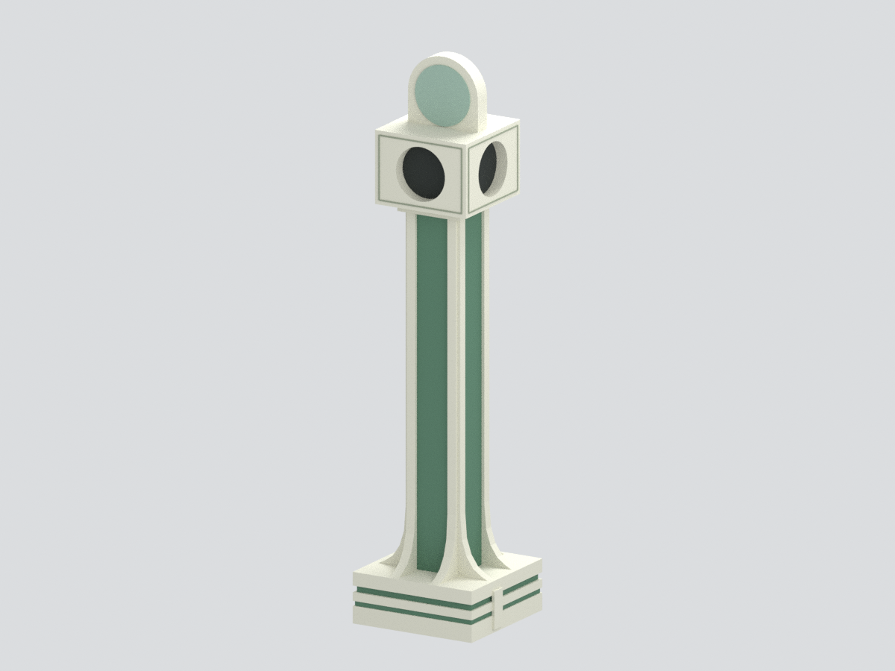
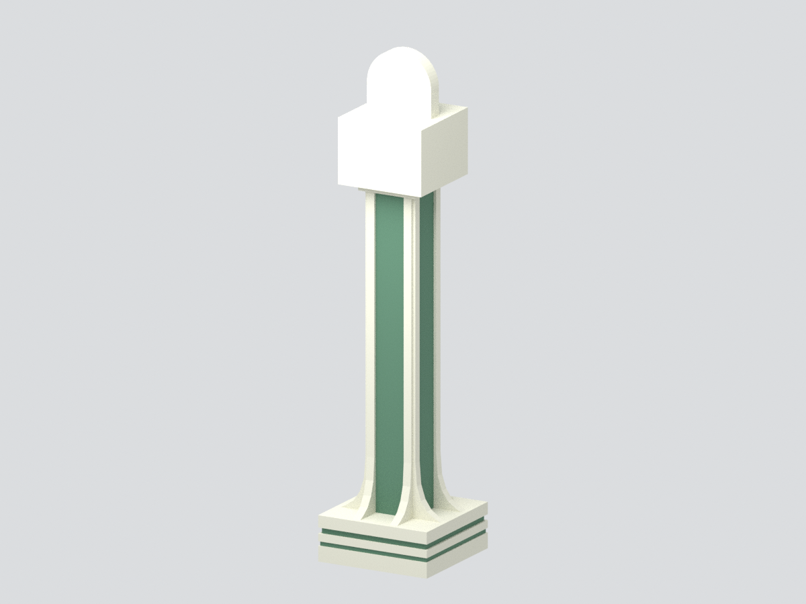
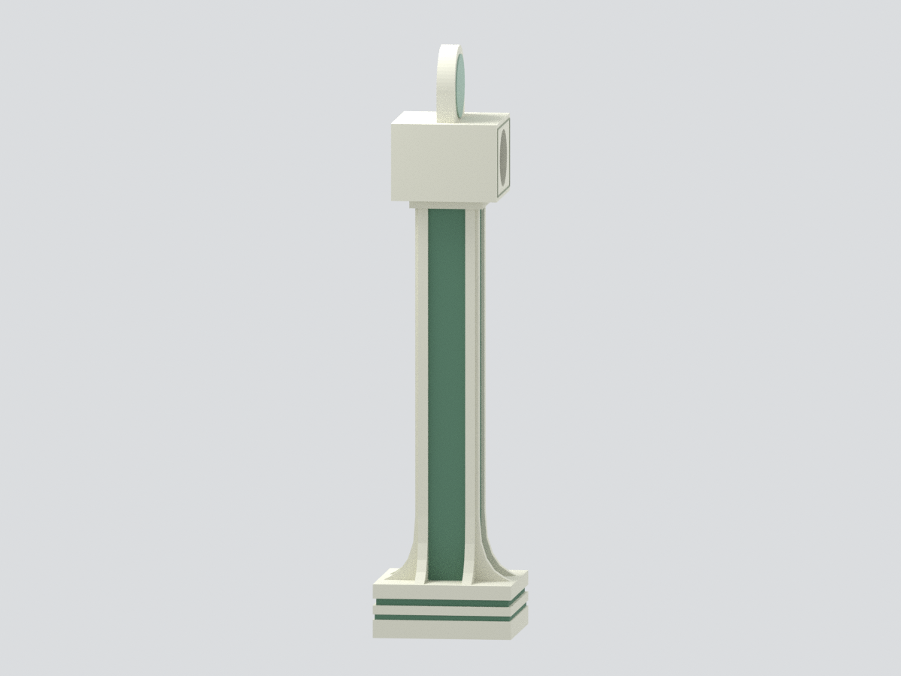
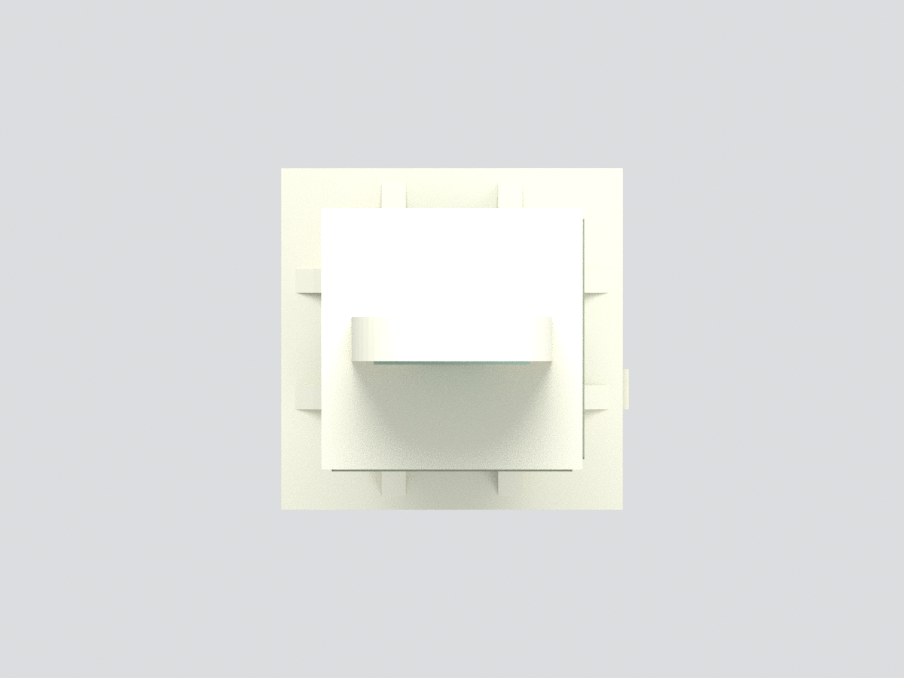
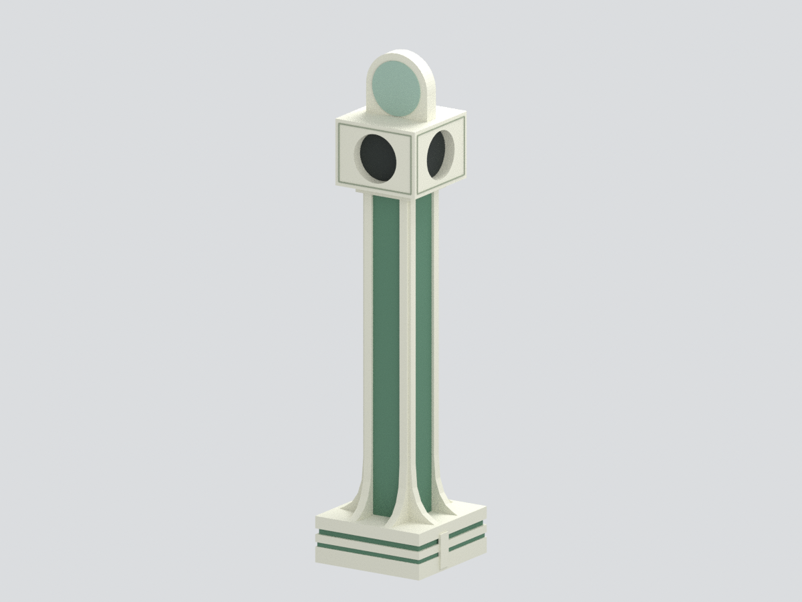

# 國立屏東大學屏師校區｜寶塔（播音塔）

完整主要量體的照片比例研究模型：層疊方基座、綠柱芯、白色外張角肋、兩個有照片依據的喇叭口與頂徽牌輪廓。官方照片亦題作「舊鐘塔」，但此處可見的是播音喇叭，不製作假鐘面。

## 範圍與誠實限制
- **未見後／左箱面為中性閉合補足，不表示實物無開孔。**
- 實物頂牌的木瓜葉圖案省略，以純色圓面代理；不是實物空白。細小鐵件、碑文與喇叭內部省略。
- 34.6 × 34 × 144 mm，名義照片比例，不是實測縮尺。曲線以多段輪廓近似；顏色未校色。
- 日期未核之官方照片狀態，不聲稱最新現況。兩張照片是不同程度的同面角度，非四面環拍。
- 未試印、未結構驗算；僅展示模型，不作工程或設備使用。

## 交付檔
`model.stl` 幾何、`model.3mf` 面色、`scene.blend`（成品及隱藏可編輯預布林零件）、建模／渲染／驗證腳本及六張實際 Blender 渲染。

| 正立面 | 後方（中性補足） | 側面 |
|---|---|---|
|  |  |  |

| 俯視 | 第二斜視 |
|---|---|
|  |  |

原始來源及限制見 [SOURCES.md](SOURCES.md)，重建見 [REBUILD.md](REBUILD.md)。參考照片沒有收進發佈包，沒有影像貼圖。
