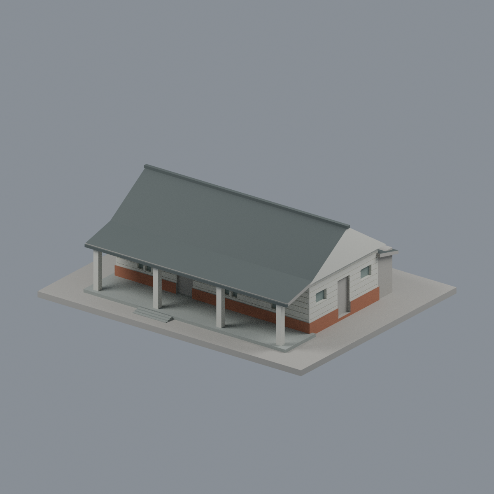
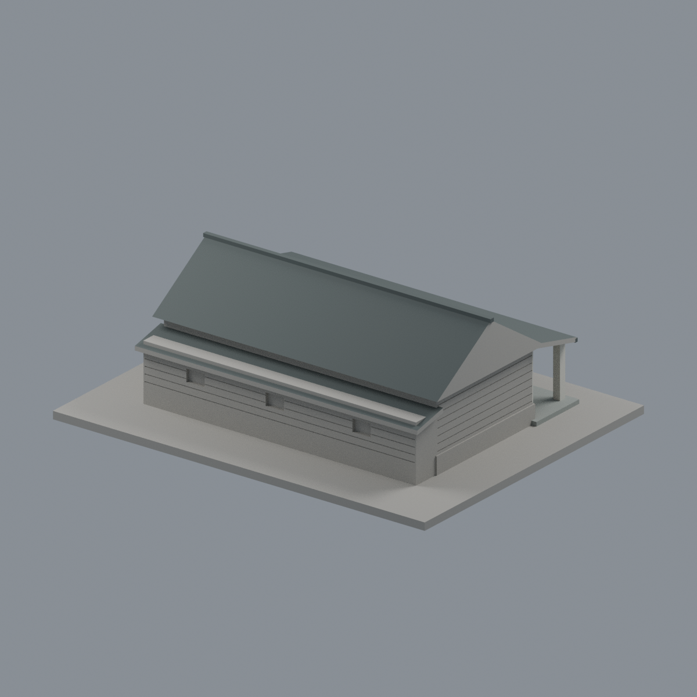
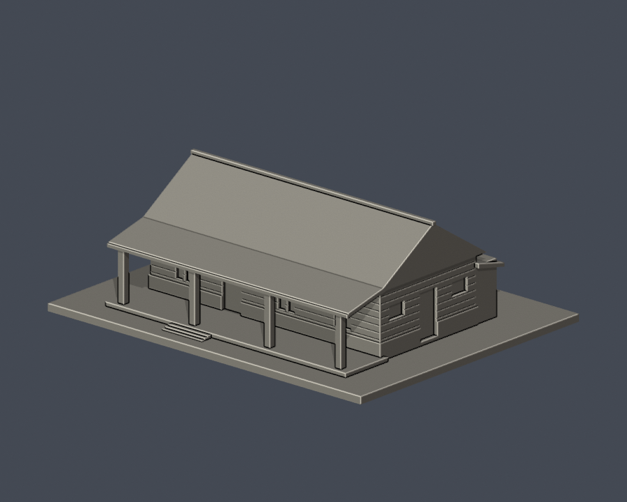
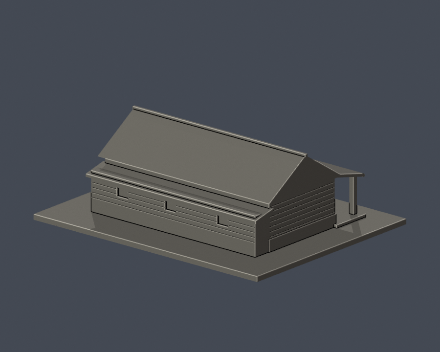
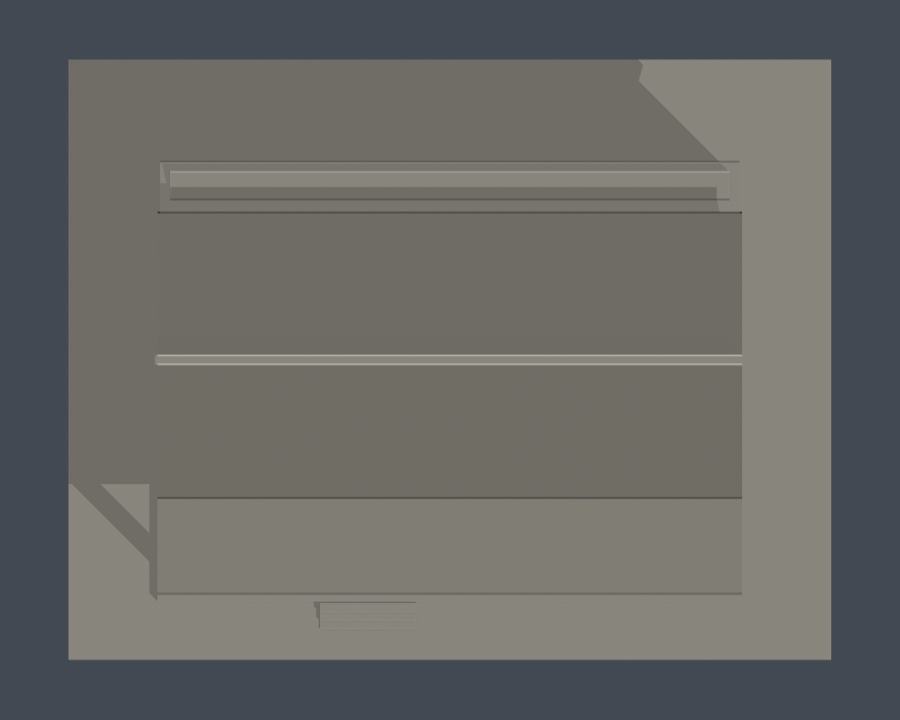

# 國立屏東大學｜民生校區｜學習輔助犬訓練教室主屋

## 模型預覽

| 模型預覽 | 模型預覽 | 模型預覽 |
| :---: | :---: | :---: |
| 正面與來源支持區域  | 背牆中性／來源支持屋坡  |  |

## 6 材質外觀版（2026-10-21）

[來源界線與四視角](appearance/README.md) · [表面色 3MF](appearance/nptudog-appearance.3mf) · [可編輯場景](appearance/scene.blend)

依官方2018–2019照片限定白側板、紅磚基腳與深灰屋坡；三角山牆不是屋面，混合門及受圍籬遮擋背牆中性，原後屋坡穿出的水平牆頂保留中性並揭露。 原 STL 與歷史 QA 不變；這是外觀改善，不是新增幾何。[原單色正面](previews/front.png)／[原單色背面](previews/rear.png)

依官方完成照片自建的外觀近似模型。實體建物為**學習輔助犬訓練教室**；不代表精確測繪、全校完成或所有附屬設施皆已收錄。

| 模型預覽 | 模型預覽 | 模型預覽 |
| :---: | :---: | :---: |
| 交付STL正面  | 交付STL背面  |  |

| 模型預覽 | 模型預覽 | 模型預覽 |
| :---: | :---: | :---: |
|  |  |  |

## 已保留的外觀

- 主屋長向山形屋頂、整合脊線、水平板牆與低台基
- 前側單斜屋簷、四柱門廊與入口階
- 已辨識端牆的中央門及兩側短窗；後側低附屋頂另依斜後方照片保留

## 未知與簡化

- 官方圖庫的學習輔助犬中心、犬舍、教室圖說依相同屋形及官方一棟建築介紹合併，不當成三棟
- 照片未能安全辨識另一端牆的完整配置，該端牆保持素面，不複製有門窗的已知端牆
- 圍籬遮擋之後側窗與附屋深度採可辨輪廓近似；細管線、鐵網犬欄、植栽及內裝未建
- 屋頂、門廊柱及窗框適度加厚，模型不是精確比例建築測量
- 2016建成的說明來自官方回顧；各圖庫照片本身攝影日期未標，無法保證2026所有細節相同

## 檔案與重建

- [model.stl](model.stl)：毫米，含底座 150.00 × 118.00 × 49.80 mm，最長150mm；各件獨立視覺估算比例，不能直接拼成等比例校園。
- [scene.blend](scene.blend)：由交付STL匯入的可編輯網格；參數來源另見 [build_model.py](build_model.py)。
- [requirements.txt](requirements.txt)、[render_preview.py](render_preview.py)、[sources.json](sources.json)、[逐檔SHA](SHA256SUMS.txt)。
- Python 3.12：pip install -r requirements.txt，接著 python build_model.py。
- Blender 4.3.2：blender -b -t 2 -P render_preview.py。所有預覽來自實際交付STL，沒有用其他示意模型替代。

## 列印與驗證

底座朝下。四柱門廊柱寬2.8mm並與廊頂及基座連接；單斜屋簷、屋頂出簷須自行檢查支撐。水平板牆為淺刻線，不是獨立薄片。 0.4mm噴嘴、0.2mm層高可作起始評估，仍須檢視切片工具路徑。數位QA不等於實體試印、Cura或Prusa切片驗證，也不保證免支撐或成品強度。

- [原STL／獨立重建／Blend](validation.json)：全部checks true；水密、原始法向與繞序、每邊兩面、vertex link單一環、單一連通表面、無分離封閉內殼、正體積、底座z=0及150mm均通過。
- [0.2mm逐層輪廓](contour-validity-check.json)：249層，起始z=0.071mm，degree2閉合，個別與合成Polygon均valid；invalid立即非零退出，無repair fallback。
- [canonical fail-closed v3薄特徵](thin-feature-check.json)及[strict摘要](strict-thin-check.json)：0.8mm參考寬度、1mm取樣，最高opening損失0.5654%，全層小於1%。僅XY形態篩檢，非全面最小壁厚。
- [validate_model.py](validate_model.py)、[check_contour_validity.py](check_contour_validity.py)、[check_thin_features.py](check_thin_features.py)、[check_thin_strict.py](check_thin_strict.py)、[QA總結](QA-summary.json)。依序執行python validate_model.py、python check_contour_validity.py、python check_thin_strict.py；任何一步非零退出均不通過。
- 原始STL與獨立重建SHA256：8d35b5f952938914a2b2615591195676ef953275ffa9bdb609e55a12811bff9e。
- 唯一canonical v3 SHA256：059f7378c74a1400dcf010365ebf35df3027fd853f1c960462a233dc68ce8915。

查核日：2026-10-13。照片權利歸原權利人，本公開包不重新散布原照片。
