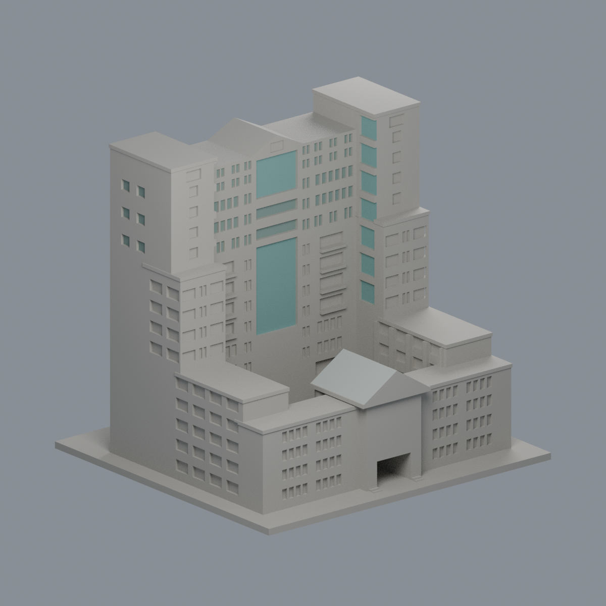
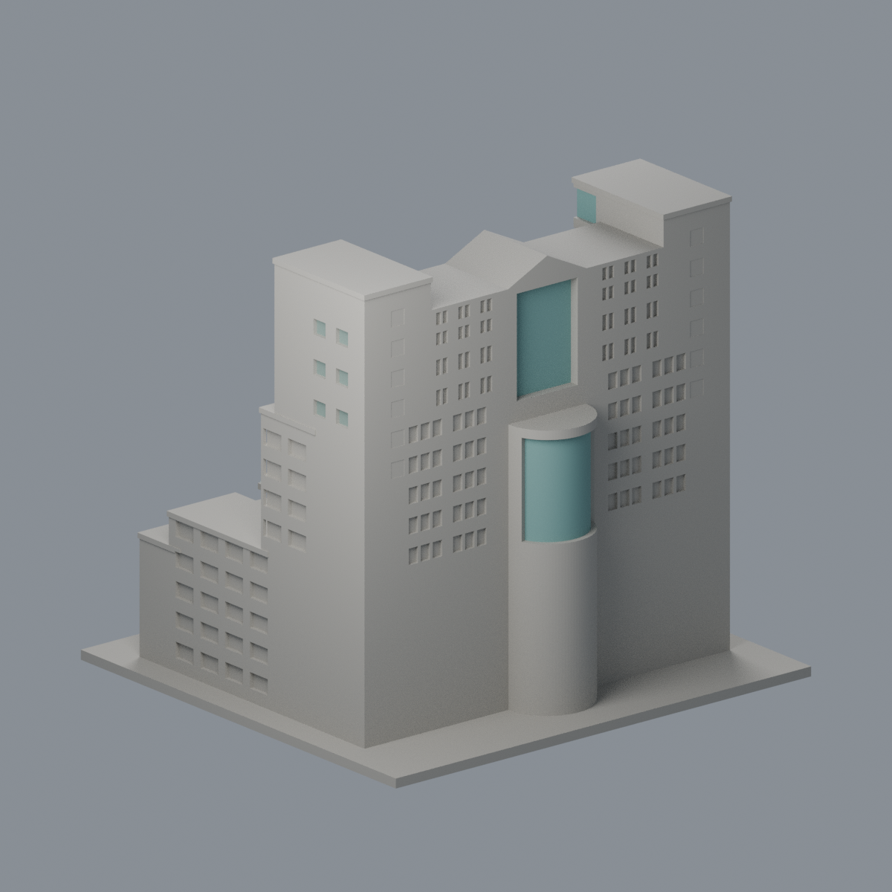
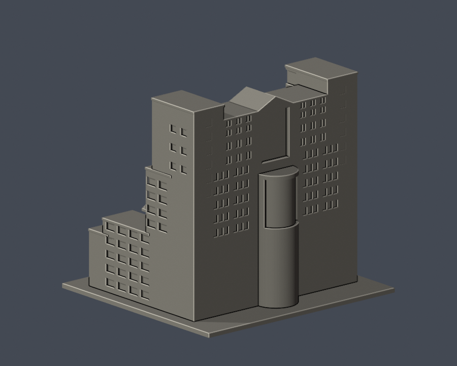
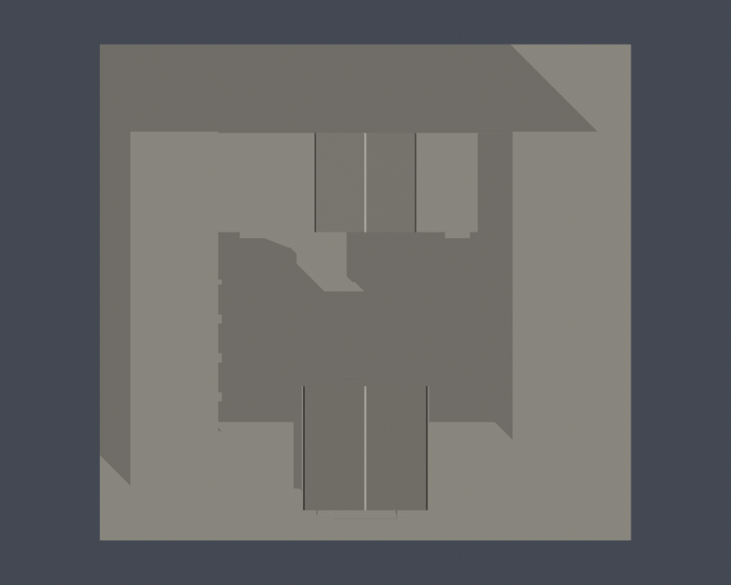

# 國立屏東大學｜民生校區｜五育樓主體與中庭

## 4 材質外觀版（2026-10-21）

| 模型預覽 | 模型預覽 | 模型預覽 |
| :---: | :---: | :---: |
| 正面與來源支持區域  | 來源支持後幕牆／其餘中性  |  |

[來源界線與四視角](appearance/README.md) · [表面色 3MF](appearance/nptuwuyu-appearance.3mf) · [可編輯場景](appearance/scene.blend)

僅來源支持中央前後幕牆、後弧窗、塔內側與上部離散窗凹，以及入口銀灰屋坡；主石牆、混合陽台、肩部通風百葉、低翼與未知區域中性。跨年來源研究，不宣稱完整現況還原。 原 STL 與歷史 QA 不變；這是外觀改善，不是新增幾何。[原單色正面](previews/front.png)／[原單色背面](previews/rear.png)

依官方完成照片自建的外觀近似模型。實體建物為**五育樓**；不代表精確測繪、全校完成或所有附屬設施皆已收錄。

| 模型預覽 | 模型預覽 | 模型預覽 |
| :---: | :---: | :---: |
| 交付STL正面  | 交付STL背面  |  |

| 模型預覽 | 模型預覽 | 模型預覽 |
| :---: | :---: | :---: |
|  |  |  |

## 已保留的外觀

- 雙端高塔、中段階梯式量體、中央山牆及玻璃帶
- 前方低翼、山牆門廳、真正向上開放的中庭與側翼
- 面中庭的低層開口、水平窄窗帶、深窗組與上層成對窗，按照片保留不同組型
- 另一面依獨立背面照片建中央曲面玻璃凸出，沒有鏡像複製中庭面

## 未知與簡化

- 照片可見主體及中庭；細部進深、塔身比例、窗框與不明屋頂設備仍為近似，非全棟精確測繪
- 樹木遮擋的背面低層保持簡化；不擅自補成正面的門窗排列
- 前翼與主樓同屬五育樓，圖書館民生總館、行政及系所是同棟用途，不另計建物
- 公共藝術雕塑、植栽及輕型景觀遮棚未重製；相鄰人文館、禮堂與體育館不在此模型
- 攝影日期未標，來源照片不能代表2026年所有屋頂設備與整修現況

## 檔案與重建

- [model.stl](model.stl)：毫米，含底座 150.00 × 140.00 × 137.90 mm，最長150mm；各件獨立視覺估算比例，不能直接拼成等比例校園。
- [scene.blend](scene.blend)：由交付STL匯入的可編輯網格；參數來源另見 [build_model.py](build_model.py)。
- [requirements.txt](requirements.txt)、[render_preview.py](render_preview.py)、[sources.json](sources.json)、[逐檔SHA](SHA256SUMS.txt)。
- Python 3.12：pip install -r requirements.txt，接著 python build_model.py。
- Blender 4.3.2：blender -b -t 2 -P render_preview.py。所有預覽來自實際交付STL，沒有用其他示意模型替代。

## 列印與驗證

入口穿堂、窗帶上緣、山牆出簷與側翼需在切片軟體檢查懸挑及支撐。中庭朝上保持開放，不填滿模型。 0.4mm噴嘴、0.2mm層高可作起始評估，仍須檢視切片工具路徑。數位QA不等於實體試印、Cura或Prusa切片驗證，也不保證免支撐或成品強度。

- [原STL／獨立重建／Blend](validation.json)：全部checks true；水密、原始法向與繞序、每邊兩面、vertex link單一環、單一連通表面、無分離封閉內殼、正體積、底座z=0及150mm均通過。
- [0.2mm逐層輪廓](contour-validity-check.json)：690層，起始z=0.071mm，degree2閉合，個別與合成Polygon均valid；invalid立即非零退出，無repair fallback。
- [canonical fail-closed v3薄特徵](thin-feature-check.json)及[strict摘要](strict-thin-check.json)：0.8mm參考寬度、1mm取樣，最高opening損失0.5535%，全層小於1%。僅XY形態篩檢，非全面最小壁厚。
- [validate_model.py](validate_model.py)、[check_contour_validity.py](check_contour_validity.py)、[check_thin_features.py](check_thin_features.py)、[check_thin_strict.py](check_thin_strict.py)、[QA總結](QA-summary.json)。依序執行python validate_model.py、python check_contour_validity.py、python check_thin_strict.py；任何一步非零退出均不通過。
- 原始STL與獨立重建SHA256：aa716930ffe333cd99e2adb6dc4f58ecb3bd3b1852a2ae96892a48b82b19aa6d。
- 唯一canonical v3 SHA256：059f7378c74a1400dcf010365ebf35df3027fd853f1c960462a233dc68ce8915。

查核日：2026-10-13。照片權利歸原權利人，本公開包不重新散布原照片。
