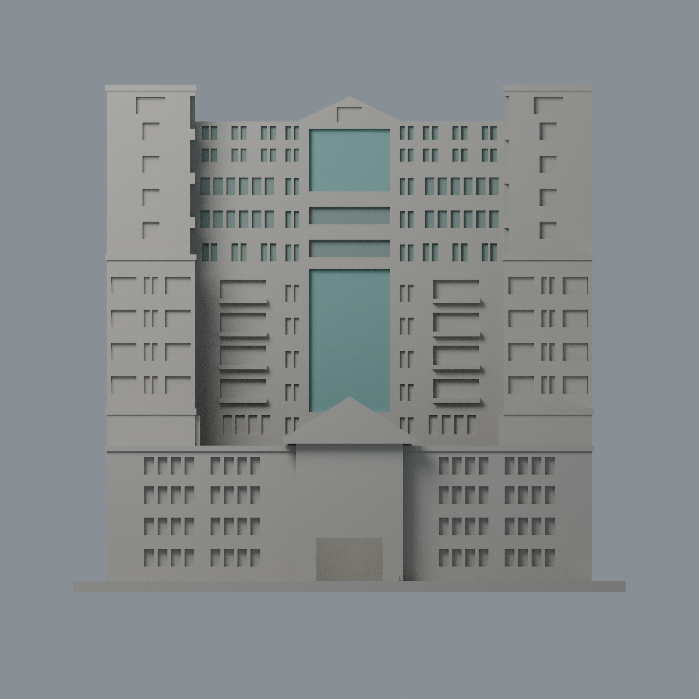
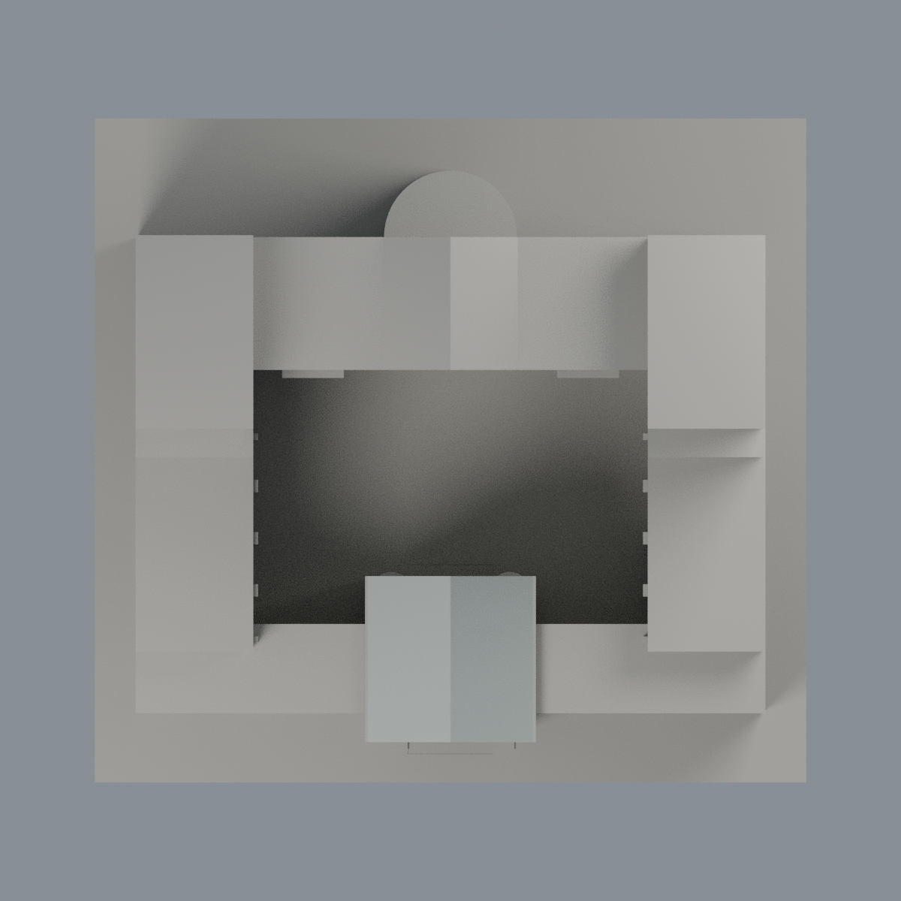

# 屏東大學五育樓玻璃與入口屋坡限定配色：四材質外觀版

沿用原 **10,738 三角面／5,353 頂點**，不改原 STL 位元、座標、面序或幾何；這是既有模型外觀改版，不增加模型包數。

| 正面 | 來源支持後幕牆／其餘中性 |
|---|---|
|  |  |
|  |  |

[表面色 3MF](nptuwuyu-appearance.3mf) · [可編輯 Blender](scene.blend) · [材質色表](palette.json) · [逐面指派與依據](face-materials.json) · [原 STL](../model.stl)

## 來源與配色邊界

這是**玻璃窗凹與入口屋坡限定配色**，不是全棟材質還原。親看屏東大學八張完整官方實拍、原單色網格與生成器。[各照精確 URL、SHA 與 Original／修改欄](qa/source-review.json)。兩張整體照相機 Original 為 2002-05-16，近中庭與高處屋頂照為 2016-10-23，另有照片修改欄為 2019 年；這是跨年來源研究，不把修改日當拍攝日，也不宣稱 2026 現況或單一日期重建。時間戳是相機檔案中繼資料，未獨立鑑定真實攝影時間。照片僅私有研究，不入公開包。

- 正中央上下兩大片、後中央高窗與後半圓鼓體上部原凹面採低飽和藍綠幕牆代理。前中央兩短排普通窗另採灰綠，不混作一大片幕牆。半圓鼓體只有 z54–85 的內曲面直立面著色，不延伸到實牆基腳或凹洞上下水平面。
- 兩塔朝中庭的真凹底採同類藍綠幕牆代理，包含來源可見不透明窗裙，並不宣稱整面透明。少量上層分離的前／側普通窗凹底灰綠，未新增細窗梃。前入口小屋雙坡頂依高處照片採銀灰金屬代理，三角山牆與屋底不染屋面色。
- 所有主石牆保留中性，避免原面跨色帶形成虛假的斜色界；並非聲稱石牆實景為此灰色。低前翼、側翼、底層開放走廊凹背、主樓中段陽台混牆與窗，全部中性。
- 肩部大凹格是百葉／通風與實面，不能全藍；塔頂大方框與中央山牆小框是通風或裝飾，保留中性。低窗、未註冊後窗、其他屋頂與庭院鋪面均未推色，不增草坪、雕塑或樹。
- 所有色面以原三角面完整頂點平面／半徑／角度／矩形範圍核對，不切面、不改外形、STL 或歷史 QA，未做實體列印測試。

[原幾何與歷史來源限制](../README.md)

## 重建與核驗

安裝 [依賴](source/requirements.txt)，Blender 使用 4.3.2。由本資料夾上層提供原 model.stl：

1. `python appearance/source/build_appearance.py`
2. `python appearance/source/verify_exchange.py`
3. `blender -b -t 3 --python-exit-code 1 -P appearance/source/render_appearance.py`
4. `blender -b -t 3 --python-exit-code 1 -P appearance/source/verify_scene.py`

[獨立重建 ZIP](rebuild-source.zip)含原 STL、四支程式及依賴，不含第三方照片；不取代原建模腳本。[逐檔 SHA256](SHA256SUMS)

[交換／拓撲 QA](qa/exchange-validation.json)核對原座標與面序、全部面材質、單連通、有向水密邊、頂點 link 單環、正體積與零退化／重複面；lib3mf 嚴格讀取零警告，實際編輯單材質再存讀，其他材質及面指派不變。SDK 六位小數量化誤差另列。

[Blender 存讀與編輯](qa/scene-validation.json) · [渲染記錄](qa/render-manifest.json) · [獨立重建](qa/rebuild-validation.json)

## 製造限制照舊

尺寸仍為 150 × 140 × 137.9 mm；原 STL、建模程式、場景及歷史 QA 保留。原層檢與薄特徵檢查本次未重跑，不能由材質 QA 代替。

3MF 是同一網格的表面色，不是各材質各自封閉的分色實體、切片專案、噴頭映射或 G-code。切片 GUI、多材料路徑與實體列印未測；柱頭、屋簷、窗框及薄邊仍須評估材料、支撐及拆除風險，沒有保證可印或免支撐。
