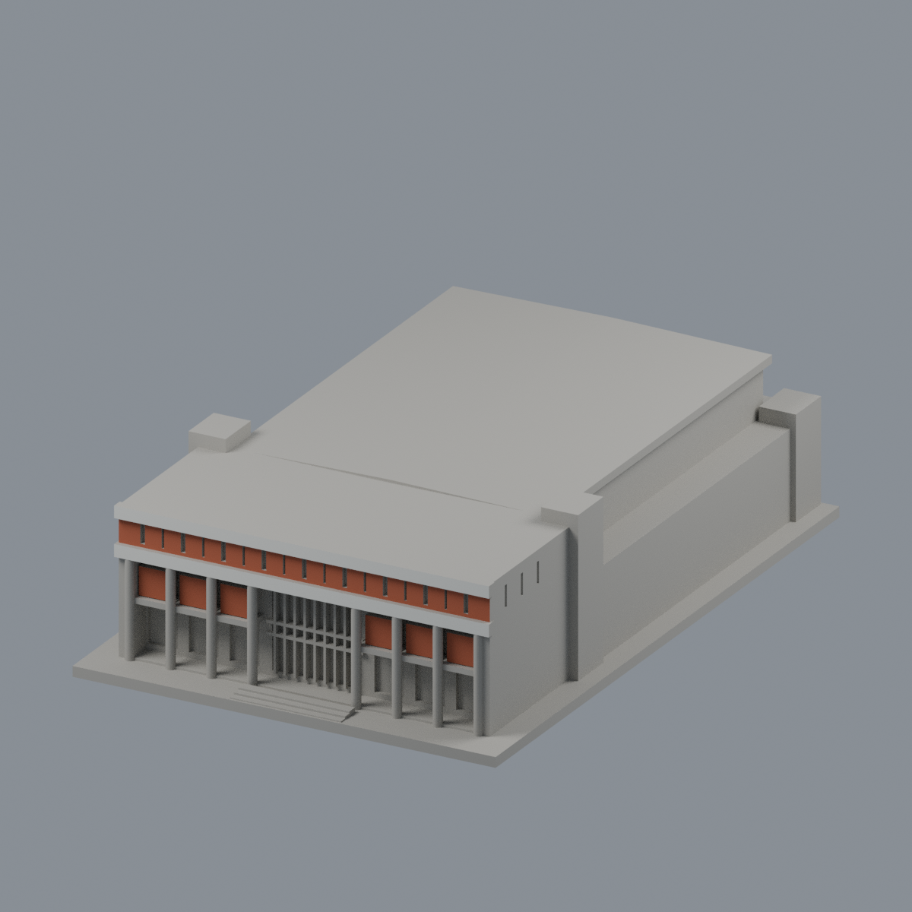
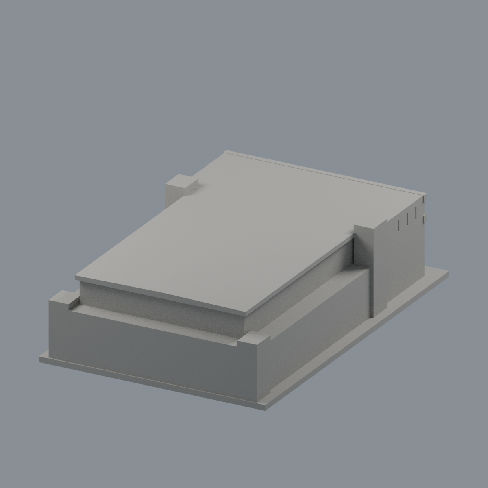
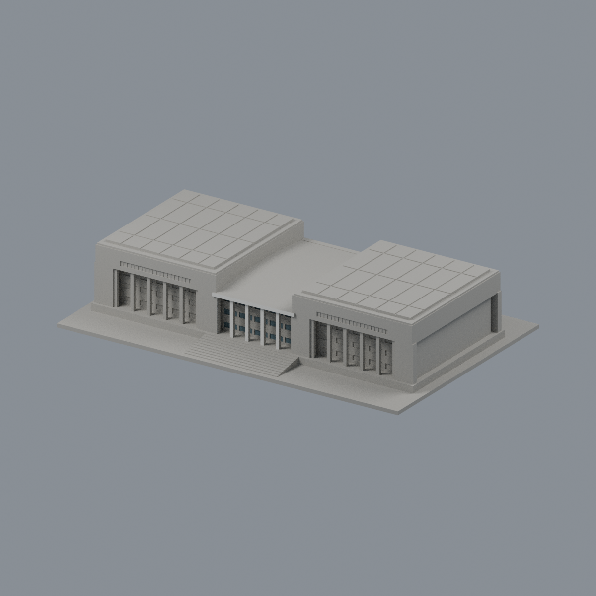
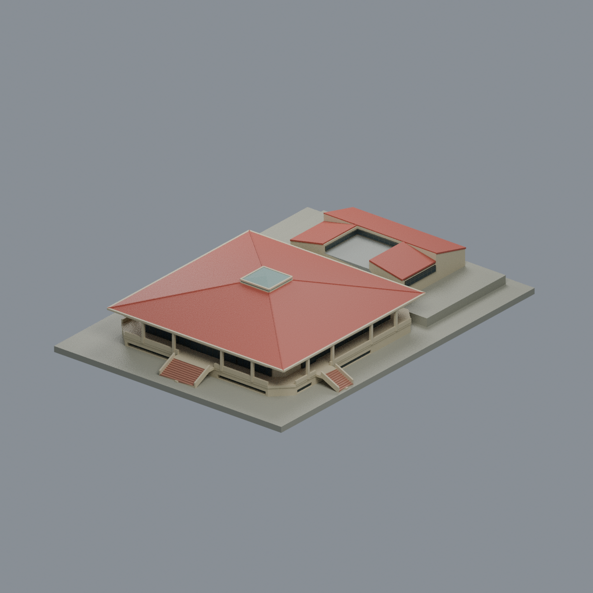

# 國立屏東科技大學

本校目前 **3 套**：述耘堂、玉崗紀念圖書館與新增第二餐廳；既有模型幾何維持原樣。各件為公開影像有界近似，非全校完成；未實體試印。審核紀錄見各模型QA，是否正式發布以統一發布清單為準。

## [述耘堂｜當代公開影像近似](內埔校本部/buildings/npust-shuyun-hall/README.md)

| 建築模型 | 建築模型 | 建築模型 |
| :---: | :---: | :---: |
| 正面  背面  |  **[玉崗紀念圖書館（前中央有限配色）](內埔校本部/buildings/npust-yukang-library/appearance/README.md)** |  **[第二餐廳](內埔校本部/buildings/npust-second-refectory/README.md)** |

## 第二餐廳

第二餐廳完整主要外觀近似：高單層四坡主方廳、中央方採光低四坡、削角外廊/局部半地下與非對稱外階，相連東三坡服務翼/中央有頂灰蓋/高側窗；不是第一餐廳或整校。依1989/1990設計圖、1997竣工記載、2012遊記實拍與拍攝年未知官方正射，非2026現況或竣工測繪。252×182×43.925mm、8色Blend/3MF/STL及5真mesh圖；12428三角單閉殼、220有效層、34空實點、strict材質/Blend頂點實改存讀、乾淨9件bytes一致與來源獨審通過。保留4層0.8mm薄島警告、0.56mm窗框，外廊/簷/階下需支撐，未實印；細窗近似、未知院內後加物省略。

[模型與來源](內埔校本部/buildings/npust-second-refectory/README.md) · [驗證與限制](內埔校本部/buildings/npust-second-refectory/QA.md)。既有兩套模型幾何與QA不變。

[述耘堂正面紅板與白帶限域配色／五視角](內埔校本部/buildings/npust-shuyun-hall/appearance/README.md)（94完整原面，其餘中性；非2026現況）。
