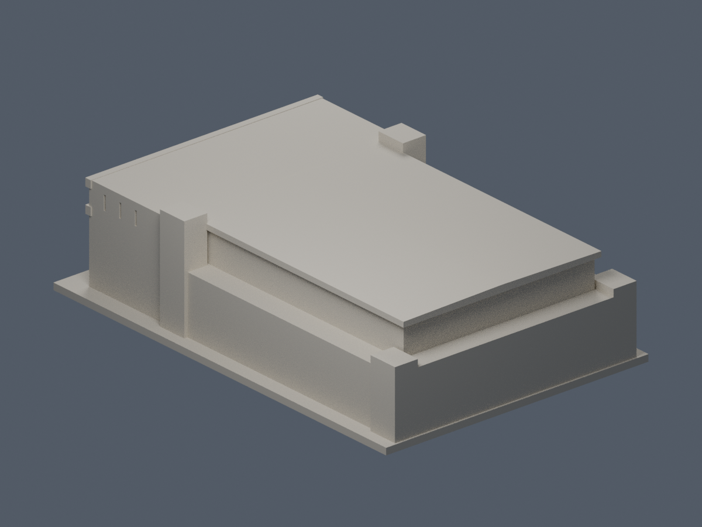
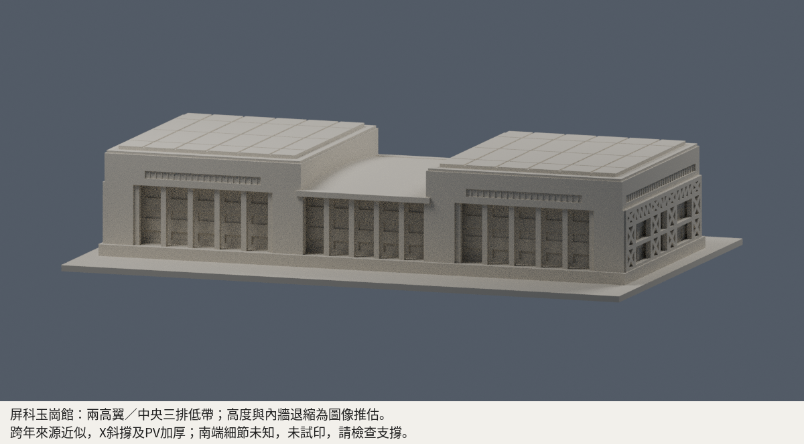

# 國立屏東科技大學

本批補入玉崗紀念圖書館，既有述耘堂模型維持原樣。各件為公開影像有界近似，非全校完成；未實體試印。審核紀錄見各模型QA，是否正式發布以統一發布清單為準。

## [述耘堂｜當代公開影像近似](內埔校本部/buildings/npust-shuyun-hall/README.md)

| 正面 | 背面 |
|---|---|
|  |  |

| 建築模型 | 建築模型 | 建築模型 |
| :---: | :---: | :---: |
|  **[玉崗紀念圖書館（圖書與會展館）](內埔校本部/buildings/npust-yukang-library/README.md)** |  |  |

## [玉崗紀念圖書館｜跨年有界近似](內埔校本部/buildings/npust-yukang-library/README.md)

| 正面 | 背面 |
|---|---|
|  |  |

玉崗館高度/分層推估、北框加粗、細窗背接、PV粗化；南短端細節未知，地下層露出不捏造。大柱廊及部分支承須另檢切片與支撐。
