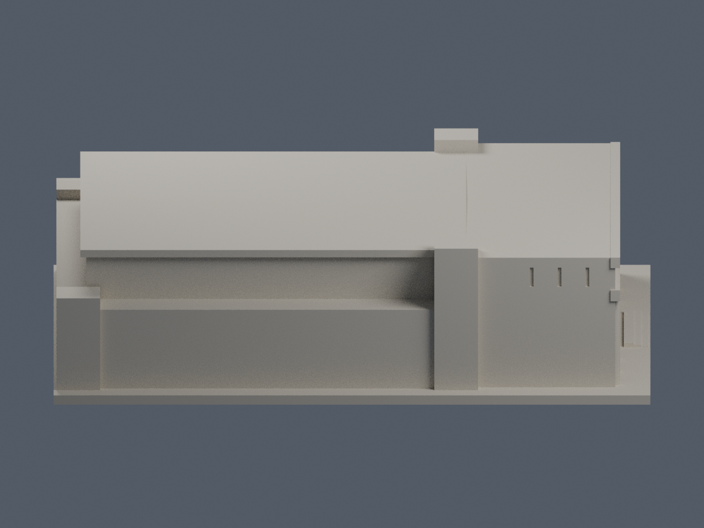
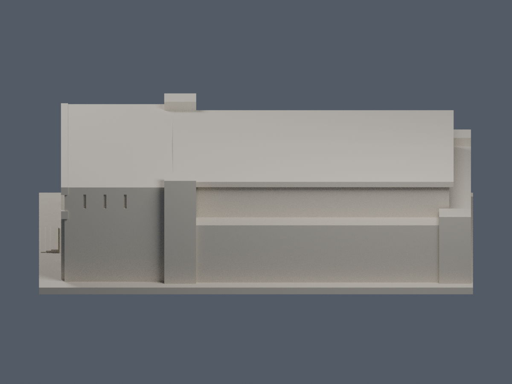
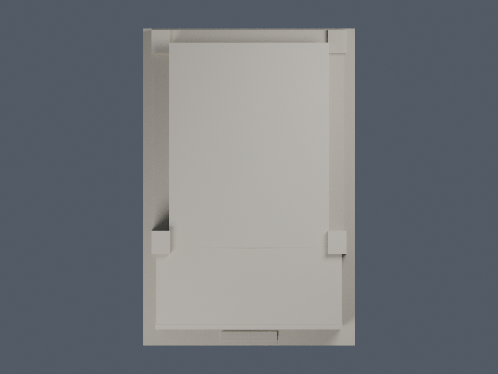
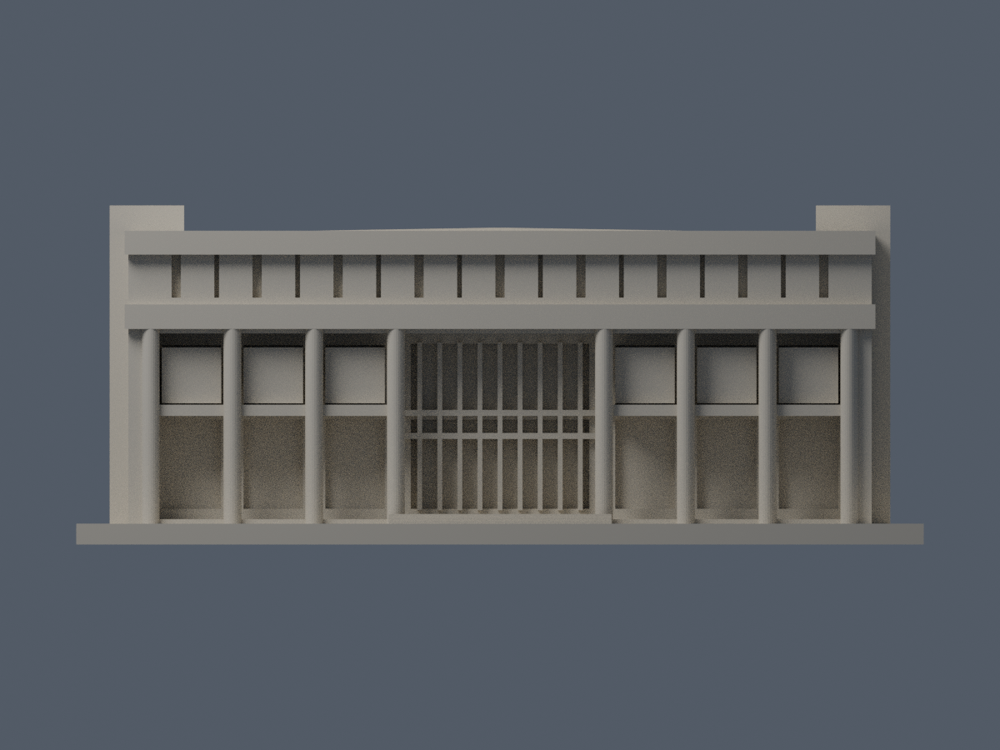

# 述耘堂｜當代公開影像外形近似

狀態：2026-10-14新版外觀已核准為有界推定近似版。作者完成原始驗證後封存v1，獨立數位幾何與公開附件審核已通過。尚未實體試印，是否已發布以統一發布清單為準。

國立屏東科技大學／內埔校本部。本批只做述耘堂，並非全校完成。
依NLSC2024水印航照及校方2024年上架正面照片；2026-10-23補核該正面原圖EXIF Original/Digitized為2014-04-19 10:56:53、XMP CreateDate一致，主DateTime空。校史竣工條目附圖的拍攝日未定，1990/10是竣工事件，不是確證拍攝日；它只協助辨識與2014可見區仍相符的構件。不是1990原貌復原，不是2026現況測繪。2022屋頂整修已見校方紀錄，但坡形變動未證實。

| 模型預覽 | 模型預覽 | 模型預覽 |
| :---: | :---: | :---: |
| 東側正面（actual STL）  | 西側背面（actual STL）  |  |

[左側](previews/left.png) · [右側](previews/right.png) · [頂視](previews/top.png) · [正立面](previews/elevation.png)

| 模型預覽 | 模型預覽 | 模型預覽 |
| :---: | :---: | :---: |
| 左側  | 右側  | 頂視  |
| 正立面  |  |  |

## 外形與推定界線
- 東側前廳與西側主屋面依航照相對位置，保留主屋面、窄邊帶與四角突出，不互換主廳與前廳。
- 正面為八根主柱形成「三跨＋中央寬跨＋三跨」，中央雙層玻璃入口與兩側上部紅色遮板分開。頂部依完整歷史正面實數18塊寬板，17條深縫寬窄交替；當代可見部分一致，未宣稱現場每條尺寸。
- 屋面採極低折坡近似。成品屋面起伏約0.62mm，研究邊界約0.18–1.06mm（源參數經0.88倍Z縮放）；皆不代表已知真實剖面。
- 主屋面簷高約36.87mm、正面頂帶37.14mm、前角凸體40.13mm。高度以同一建築柱廊、腰帶與端部相對比例互核；無可靠絕對標高，不換算虛構公尺尺寸。
- 後側窄帶採22mm附帶高度，19.36–24.64mm研究邊界；連續簷線支持主廳後部同高，不能證明後附帶精確高度。後牆無可靠窗列，所以沒有鏡射正面或任意造窗。
- 主柱XY橢圓截面約2.11×2.4mm。端柱與端牆根部重疊加厚，玻璃分格與懸板連接後牆，以列印尺度合理化；中央細框以加深根部連至後牆的浮雕表示，不是自由細柱。細小字、設備與欄杆不建模。

主屋面投影75.68×97mm，前廳88×38mm；原航照描點主屋面寬深約0.79、前廳進深/主屋面進深約0.397，模型分別0.780與0.392。各邊描點約2–5px不確定，未做視差校正。

## 檔案與重建
- [model.stl](model.stl)：毫米，含底座100.32 × 150 × 約40.13mm，最長150mm。底座朝下（Z=0），東正面為-Y、北為-X。
- [scene.blend](scene.blend)：從交付STL匯入的可編輯網格，並非另一套未比對幾何。
- [build_model.py](build_model.py) 與 [requirements.txt](requirements.txt)：參數源；Python重建STL。
- [render_preview.py](render_preview.py)：Blender從實際STL渲染所有PNG並儲存Blend。
- [sources.json](sources.json)：公開來源網址、支持特徵與年代限制。原照片／PDF未附於公開資料夾。NLSC2024只是航照水印標記，並不證明確切拍攝日期。
- [validation.json](validation.json)、[layer-component-check.json](layer-component-check.json)：實際模型與逐層檢查報告。

完整檢查：python run_all_checks.py（含獨立暫存重建STL、saved Blend、六張PNG逐檔SHA重現）。

執行：python build_model.py；blender -b -P render_preview.py；python validate_model.py；python check_thin_features.py；python check_all_layers.py；python check_layer_components.py。

## QA與列印警示
原始STL檢查水密、每邊兩面、vertex-link單環、單一表面殼、原始法向與繞序、正體積；獨立重建SHA與saved Blend三角幾何一致。0.2mm固定起始0.071mm逐層，輪廓degree2，原個別／合成Polygon有效，逐原Polygon經0.8mm參考寬度erosion/opening不消失、不分裂。不用repair吞錯。

上述為數位篩檢，非所有方向最小壁厚保證，未做Cura／Prusa實際工具路徑或實體試印。前廊頂、橫梁和懸板可能需支撐；請自行試切片並依材料、層高、噴嘴調整。不能宣稱免支撐或保證可印。

## 附加限域配色（2026-10-23）
[正面紅板與白帶外觀層](appearance/README.md)：94個完整原面，其餘中性；不改原幾何、面序、套數或歷史QA。
