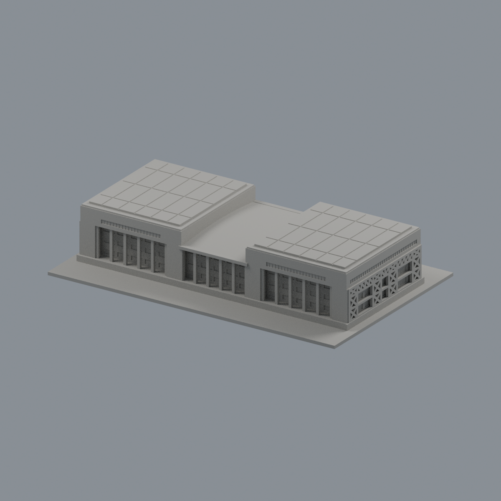

# 玉崗紀念圖書館｜前中央有限外觀層

僅 **30面中央凹窗背面＋14面前白柱／名牌梁**，共337.45678mm²；其餘7062面保持中性。正面中央小幅改善，不是全樓精準彩色或同年原貌復原。另四角度幾乎中性（左斜僅微弱差異）。灰色窗間牆跨界，不能整面染色；兩翼布幔遮擋處、後面、屋頂、未知玻璃及柱側／梁底不染。玻璃是深灰藍不透明近似；未加細框、反射、文字或貼圖。色彩未校準。

[三材質3MF](npust-yukang-library-appearance.3mf) · [可編輯Blend](scene.blend) · [原STL](../model.stl) · [重建源碼ZIP](rebuild-source.zip)

|正面|背面|
|---|---|
|||

[左](previews/left.png) · [右](previews/right.png) · [頂](previews/top.png) · [同角中性對照](qa/mono-front.png)

全7106原三角／面序不變，沒有增建或切割面。原模型跨1991、2012、105學年度、2024正射及2026照片的有界外觀近似、尺寸／薄件／支承限制均繼承原README與QA。本次只改材料，未實體試印、未產生切片工具路徑、不保證無支撐可印。模型外觀層不是校方色碼、結構或製造認證。

## 重建
Python 3.12、numpy與lib3mf（見source/requirements.txt），Blender 4.3.2：在原STL旁建立appearance/source結構後，依次執行：

```
python appearance/source/build_appearance.py
python appearance/source/verify_exchange.py
blender -b -t 4 -P appearance/source/render_appearance.py
blender -b -t 4 -P appearance/source/verify_scene.py
```

乾淨重建比較3MF、palette、face maps、五PNG bytes；Blend只宣告幾何／材料語義一致，不宣告二進位相同。[來源](SOURCES.md) · [授權](LICENSE-NOTICE.md) · [檢核](qa/) · [SHA256](SHA256SUMS.txt)
