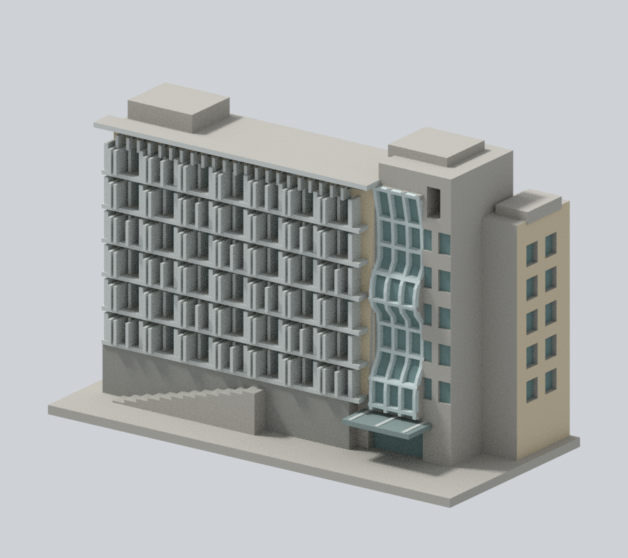

# 師大校區

[回學校圖鑑](../README.md) · [全校續接清單](../CONTINUATION.md)

本批只有下列局部模型，校區其餘建物仍待研究建模。 本校區舊稱寶山，正式資料夾使用師大。

### [工學院大樓主立面段](buildings/ncue-engineering-front-segment/)

| 模型預覽 | 模型預覽 | 模型預覽 |
| :---: | :---: | :---: |
|  |  |  |

