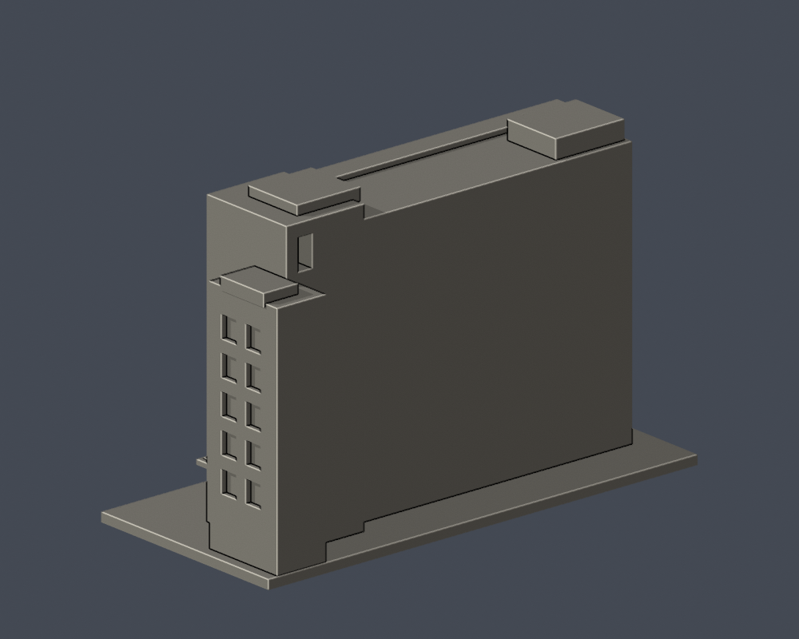

# 工學院大樓主立面段

國立彰化師範大學・師大校區。依公開實拍自建的局部外觀近似模型，非全館測繪；每館獨立比例，無法以本件直接推算現地尺寸。

| 模型預覽 | 模型預覽 | 模型預覽 |
| :---: | :---: | :---: |
| 正面（實際 STL）<br> | 背側收邊（實際 STL）<br> |  |

[下載 STL](model.stl) · [可編輯 Blender 網格](scene.blend) · [參數重建](build_model.py) · [頂視圖](previews/top.png) · [來源紀錄](sources.json)

| 模型預覽 | 模型預覽 | 模型預覽 |
| :---: | :---: | :---: |
| 頂視圖<br> |  |  |

## 保留的外觀

- 大型遮陽格柵立面、不同疏密直肋及挑出屋頂眉簷。
- 沿高度兩次退進的幕牆；窗格跟隨曲面，非平面貼圖。
- 高塔上部真矩形開槽、低樓塊、入口棚與傾斜階梯台座。

## 範圍與未知

- 僅主立面和短側轉角，主體28 mm進深為刻意截段；背後平牆不是原背立面。
- 曲幕牆在模型中前方為 -Y，兩次朝 +Y 退入；最大退縮4.2 mm僅為可辨識的照片估值，不宣稱測量曲率。
- 地上7層地下3層依官方清冊，但模型不做地下層；平台高度和樓塊比例為照片估計。
- 建築師作品頁的完成日期2008-11與後續校方使用/啟用活動不是同一件事，未把活動日改寫為建築完工日。

## 列印與單位

- 毫米；含底座 150 × 69 × 99 mm，最長邊150 mm，底座朝下。
- 單一連通實心外觀模型；不含真實室內。STL 不含單位，匯入切片器時指定 mm。
- 屋簷、入口罩、深凹窗、柱廊/頂蓋開放處可能需要支撐；以實際切片預覽決定支撐與方向。0.4 mm噴嘴、0.2 mm層高僅是數位參考設定。
- 窗框和細肋已近似加粗，仍需小心清理支撐。沒有 Cura/Prusa 工具路徑驗證或實體試印；不保證一次列印成功或免支撐。

## 重建與檢查

Python 3.12，Blender 4.3.2；依 `requirements.txt` 安裝固定套件版本。在本件資料夾執行：

```sh
python build_model.py
blender -b -t 4 -P render_preview.py
python validate_model.py
python validate_sections.py
```

`scene.blend` 是由交付 STL 匯入的可編修網格；參數來源是獨立的 `build_model.py`。所有預覽來自同一 STL，未另造美化網格。

- [原始網格、重建、Blend 同形檢查](validation.json)：所有 checks 為 true。
- [逐層輪廓和薄件輔助檢查](section-validation.json)：495 個有效切片，z=0.071+0.2n mm；每層 degree-2 閉合，單個及組合 polygon 全有效，不 repair、不捨棄。
- 0.8 mm參考寬度的形態 opening採共享邊精確插值與1e-6 mm節點量化的 canonical方法；無截面組件消失，最大面積損失 0.1995%。這不是完整最小壁厚證明，也不等於切片器工具路徑。
- [逐檔 SHA-256](SHA256SUMS)；STL SHA-256：`01cb7be299ca6d9d935ff0863133d1ff16620e8506daf3da42127e0a1792344f`。

## 來源與年代

研究查閱日期：2026-10-13。僅公開來源URL、日期和支持的特徵；第三方照片/PDF不放入交付包。照片上傳日期不視為攝影日期。

- [宗邁建築師：彰化師範大學寶山校區綜合教學大樓](https://fca.com.tw/portfolio/彰化師範大學寶山校區綜合教學大樓/)：作品頁標示2008-11；實拍攝影日未知；主要樓塊、台座及階梯、遮陽格柵節奏、上下退進的曲面幕牆和上部矩形開槽。
- [宗邁主立面遠景](https://fca.com.tw/wordpress/wp-content/uploads/2016/04/MG_3724.jpg)：攝影日未知；塔樓、低樓塊、主遮陽立面與平台；2016為URL路徑，不當攝影日。
- [宗邁入口幕牆實拍](https://fca.com.tw/wordpress/wp-content/uploads/2016/04/MG_3730.jpg)：攝影日未知；幕牆沿高度兩次進退、連續窗框跟隨曲折、入口小棚。
- [宗邁遮陽近景](https://fca.com.tw/wordpress/wp-content/uploads/2016/04/MG_3694.jpg)：攝影日未知；每格不同疏密的遮陽直肋。
- [官方校園介紹工學院與教學一館實拍拼版](https://freshman.ncue.edu.tw/var/file/47/1047/img/654/529466978.jpg)：工學院照片未標日期；教學一館圖內印2024-05-20；上半工學院主立面之識別；下半是不同建物教學一館，不合併計棟。

詳見 [sources.json](sources.json) 的校图來源及限制。自建程式與網格採 [CC0-1.0](LICENSE)；來源照片權利屬原作者，未包含在此授權內。
