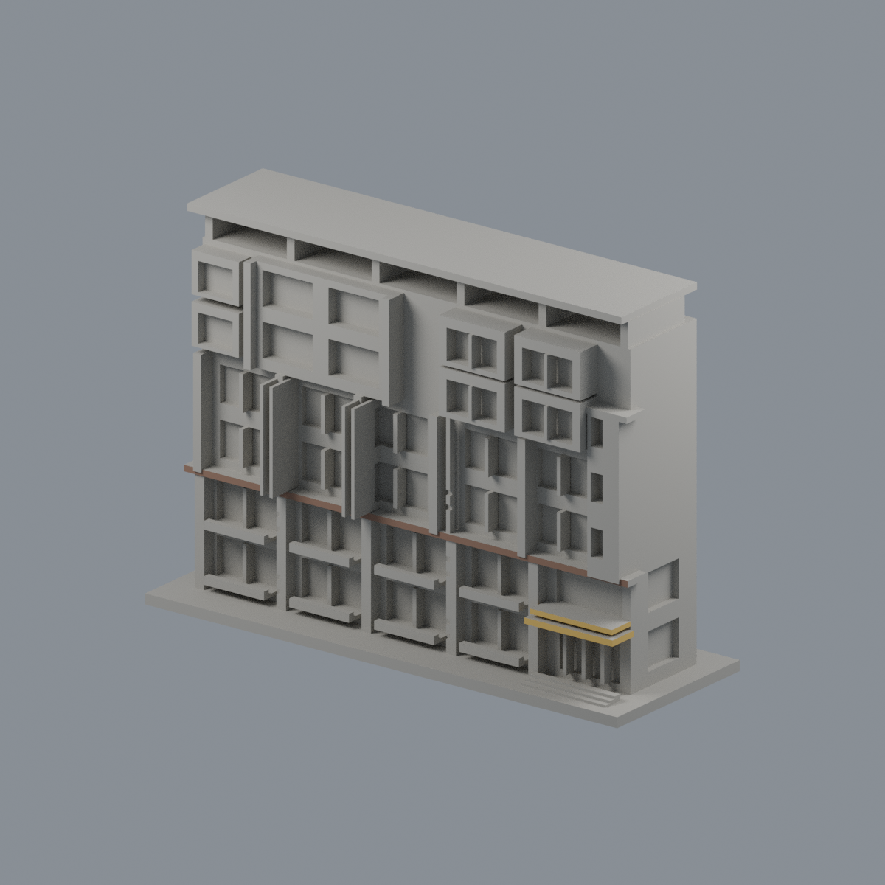
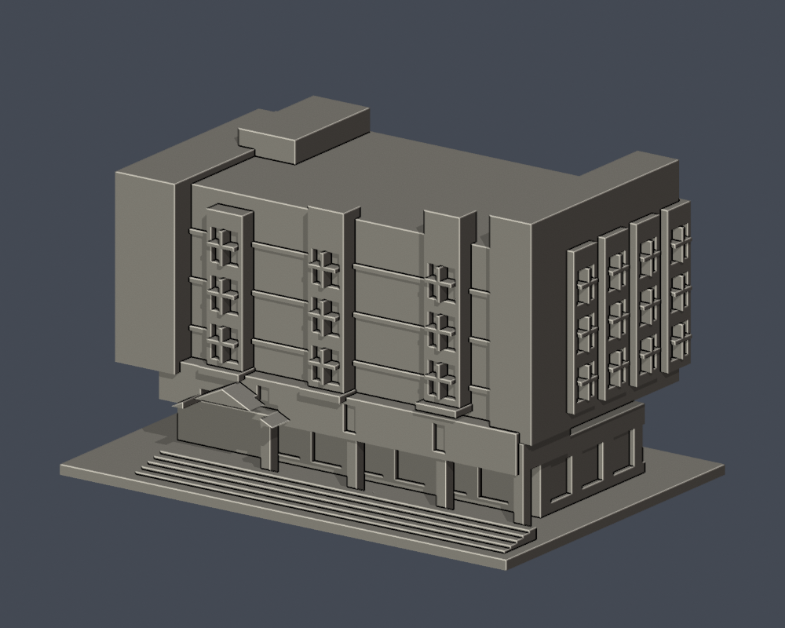
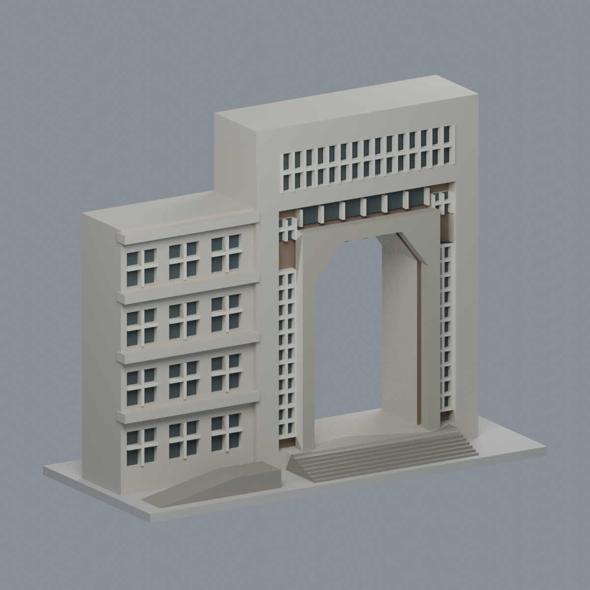
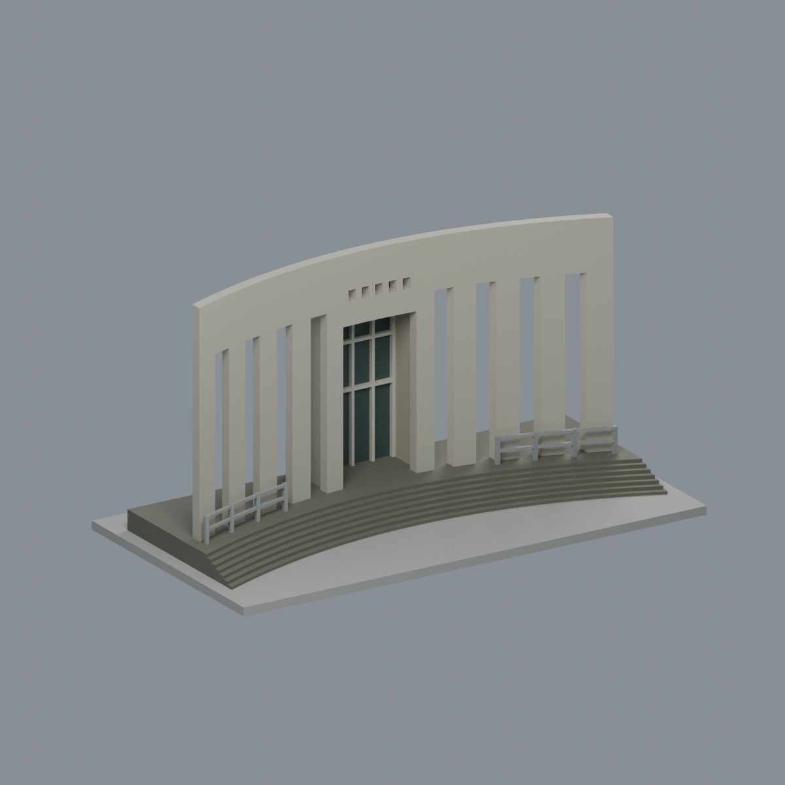
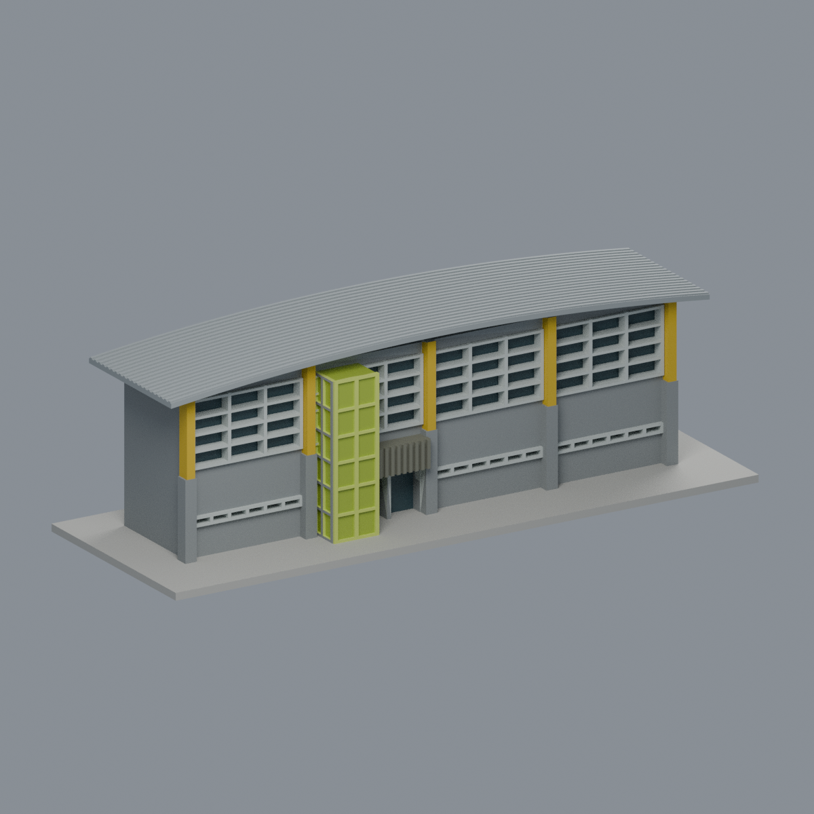
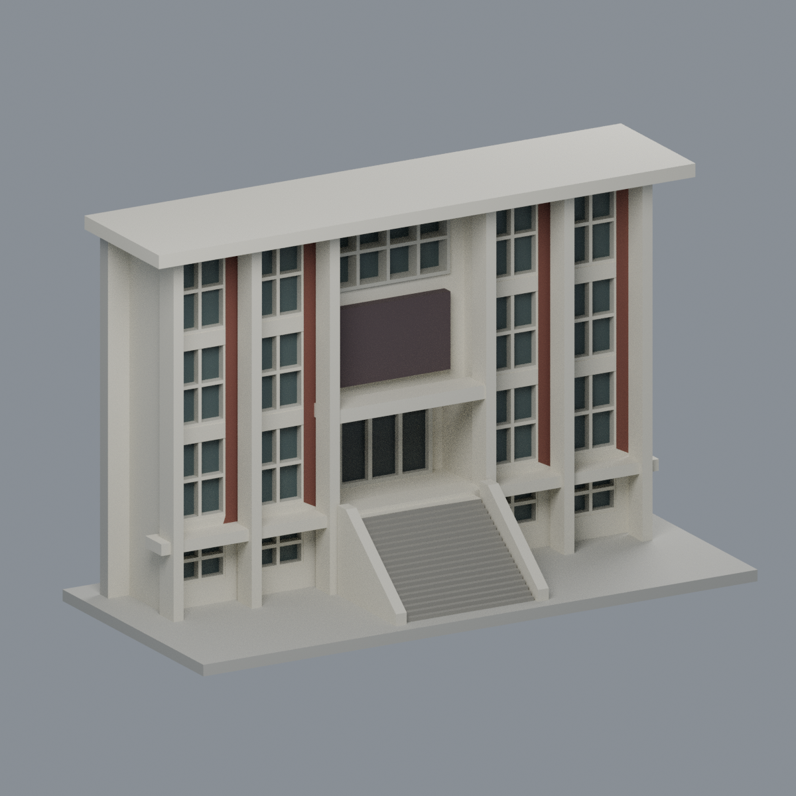

# 進德校區

[回學校圖鑑](../README.md) · [全校續接清單](../CONTINUATION.md)

本批只有下列局部模型，校區其餘建物仍待研究建模。

### [理學一館正立面段](buildings/ncue-science1-front-segment/)

### [圖資大樓入口轉角段](buildings/ncue-library-entry-corner-segment/)

### [白沙大樓入口正面片段](buildings/ncue-baisha-entry-front-segment/)

歷史影像限定入口與短左翼，非全棟或2026現況；未知右翼、後側與屋頂不補建。

### [王金平活動中心湖面側立面與淺拱屋頂局部](buildings/ncue-wang-jin-pyng-lakeside-roof-segment/)

官方照片限定的局部展示模型，任意正規化尺寸；兩個斜收口真窗洞、內退玻璃帶、成對柱與淺拱屋頂。後封板／底座是展示連接，規劃PV未建入；薄屋頂肋尖有局部0.8 mm篩查損失，非全棟、實測或實體列印驗證。

### [綜合中心弧形入口屏牆與階梯段](buildings/ncue-comprehensive-curved-entry-segment/)

曲屏、8道長縫、5小孔、中央後退玻璃及弧形前階；歷史照片的未測量局部，不是全棟。細節開運算損失與跨空支撐需求保留，未實際列印。

### [王金平游泳館入口立面與淺弧屋簷前段](buildings/ncue-wang-jin-pyng-swimming-entry-segment/)

官方空拍版本的四跨五黃柱與黃綠入口塔，2017近景補充格線／色彩。任意展示尺寸，後側封口；規則窗框與直方黃柱是明示代理。0.75 mm橫框和0.375 mm屋縫保留局部細節侵蝕警告，非全棟、2026現況或實印驗證。

### [弘道館入口柱廊片段](buildings/ncue-hongdao-entry-colonnade-segment/)

2018 正面照片及官方航拍約束的中央入口與兩側各兩跨；實體階梯、白斜扶壁、高細柱、紅褐直帶與退縮入口。8 色 3MF／Blend／STL，503 層數位 QA；窗框、比例和樹遮窗格近似，後板為展示封口，非全棟或 2026 現況，未實印。
