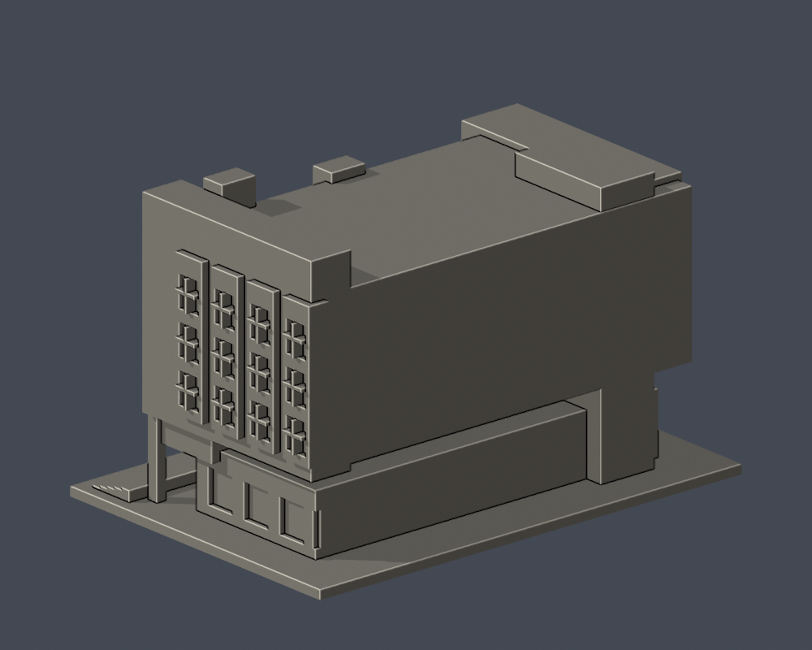

# 圖資大樓入口轉角段

國立彰化師範大學・進德校區。依公開實拍自建的局部外觀近似模型，非全館測繪；每館獨立比例，無法以本件直接推算現地尺寸。

| 正面（實際 STL） | 背側收邊（實際 STL） |
|---|---|
|  |  |

[下載 STL](model.stl) · [可編輯 Blender 網格](scene.blend) · [參數重建](build_model.py) · [頂視圖](previews/top.png) · [來源紀錄](sources.json)

## 保留的外觀

- 三個前側突出窗列各保留3層凹窗，下方另有窄窗層。
- 轉角側4列上部窗、厚側牆、較高端牆。
- 偏置斜屋入口罩、真實柱廊淨空、連續入口階梯。

## 範圍與未知

- 以M+完工照片的入口轉角為主，官方2016近照及2018另一側照片交叉核對；不是2026全棟測繪。
- 後部為收邊切面，不宣稱完整外形、精準進深或原背立面；不賦予未確定的羅盤朝向。
- 地上5層的入口/中間窄窗/上部3層視覺節奏保留；細字、欄杆與磚縫省略。
- 真淨空：柱後緣 y=-27.1 mm，本體前緣 y=-16 mm，間距11.1 mm。

## 列印與單位

- 毫米；含底座 150 × 105 × 93 mm，最長邊150 mm，底座朝下。
- 單一連通實心外觀模型；不含真實室內。STL 不含單位，匯入切片器時指定 mm。
- 屋簷、入口罩、深凹窗、柱廊/頂蓋開放處可能需要支撐；以實際切片預覽決定支撐與方向。0.4 mm噴嘴、0.2 mm層高僅是數位參考設定。
- 窗框和細肋已近似加粗，仍需小心清理支撐。沒有 Cura/Prusa 工具路徑驗證或實體試印；不保證一次列印成功或免支撐。

## 重建與檢查

Python 3.12，Blender 4.3.2；依 `requirements.txt` 安裝固定套件版本。在本件資料夾執行：

```sh
python build_model.py
blender -b -t 4 -P render_preview.py
python validate_model.py
python validate_sections.py
```

`scene.blend` 是由交付 STL 匯入的可編修網格；參數來源是獨立的 `build_model.py`。所有預覽來自同一 STL，未另造美化網格。

- [原始網格、重建、Blend 同形檢查](validation.json)：所有 checks 為 true。
- [逐層輪廓和薄件輔助檢查](section-validation.json)：465 個有效切片，z=0.071+0.2n mm；每層 degree-2 閉合，單個及組合 polygon 全有效，不 repair、不捨棄。
- 0.8 mm參考寬度的形態 opening採共享邊精確插值與1e-6 mm節點量化的 canonical方法；無截面組件消失，最大面積損失 0.2235%。這不是完整最小壁厚證明，也不等於切片器工具路徑。
- [逐檔 SHA-256](SHA256SUMS)；STL SHA-256：`718efc89bfcbf19b5dcc1c3668b16cd4a6be7068814592f636bc6a2c68e6abfe`。

## 來源與年代

研究查閱日期：2026-10-13。僅公開來源URL、日期和支持的特徵；第三方照片/PDF不放入交付包。照片上傳日期不視為攝影日期。

- [M+：國立彰化師範大學圖書館項目檔案](https://www.mplus.org.hk/tc/collection/objects/project-file-main-library-national-changhua-university-of-education-19861989-chang-hua-changhua-taiwan-ca39-4-6-1/)：典藏項目1986–1989；完成照片攝影日未知；典藏項目1986–1989，王秋華作品；完工照片中三列直向凸窗、鋸齒窗角、柱廊、偏置斜屋入口。
- [M+典藏完工實拍](https://res.cloudinary.com/mplustms/image/upload/w_1000/v1627899124/v2/prod/small/014001_014500/014189_001.jpg)：攝影日未知；URL上傳時間不當攝影日；主立面和入口側轉角的實際外觀；三層上部凸窗，另有下方窄窗層。
- [2016年度第2次圖書諮詢委員會會議紀錄](https://olis.ncue.edu.tw/public/Data/61230675571.pdf)：2016-06-16會議；照片至遲收錄於會議附件；2016-06-16會議討論圖資大樓命名；附當時入口柱廊照片，證明柱廊真淨空。
- [NCUE library 另一轉角實拍](https://commons.wikimedia.org/wiki/File:NCUE_library.JPG)：2018-03-14；超恐ろしい；CC BY-SA 4.0；另一側高實牆與鋸齒窗群，用以核對整體造型，未把未觀測完整進深擅自補成全棟。

詳見 [sources.json](sources.json) 的校图來源及限制。自建程式與網格採 [CC0-1.0](LICENSE)；來源照片權利屬原作者，未包含在此授權內。
