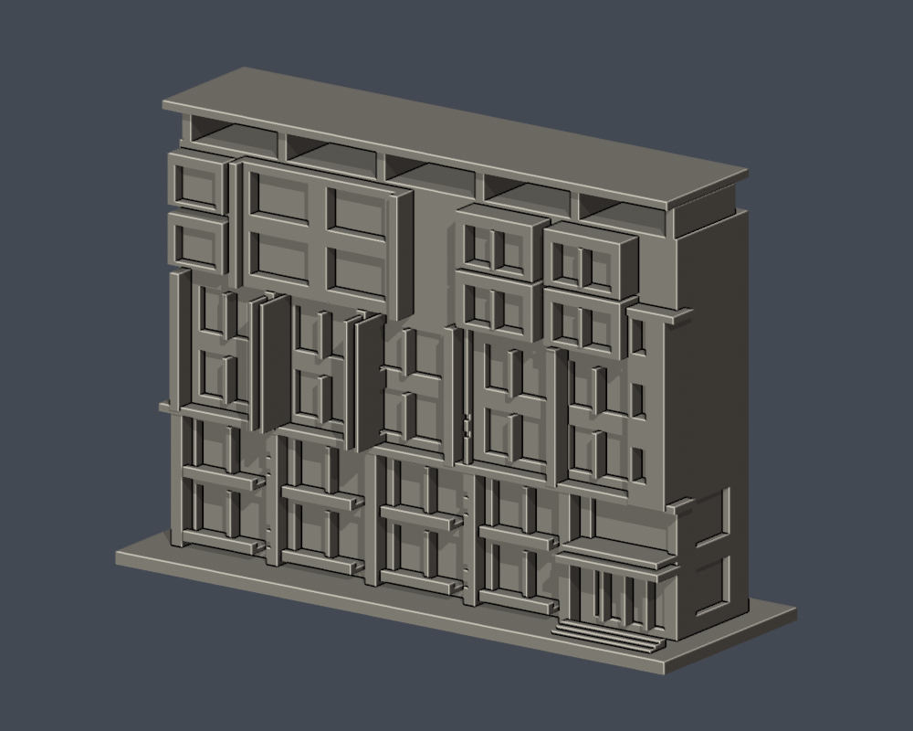
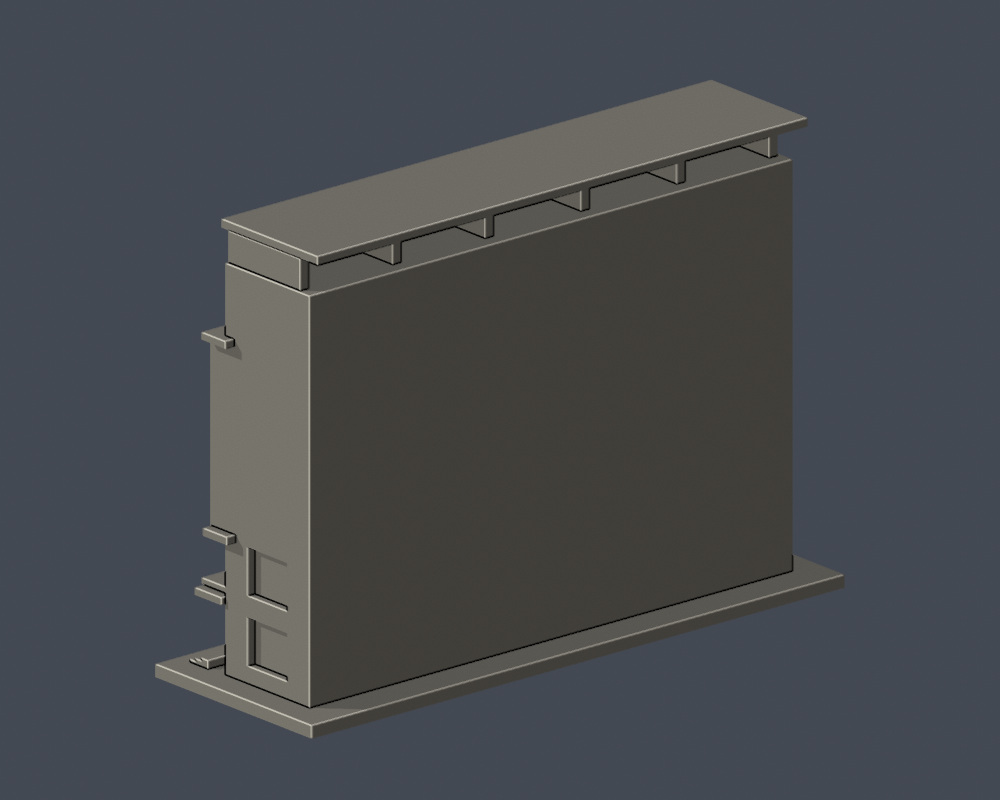

# 理學一館正立面段

國立彰化師範大學・進德校區。依公開實拍自建的局部外觀近似模型，非全館測繪；每館獨立比例，無法以本件直接推算現地尺寸。

| 正面（實際 STL） | 背側收邊（實際 STL） |
|---|---|
|  |  |

[下載 STL](model.stl) · [可編輯 Blender 網格](scene.blend) · [參數重建](build_model.py) · [頂視圖](previews/top.png) · [來源紀錄](sources.json)

## 保留的外觀

- 下兩層退縮凹窗/陽台、厚柱與水平腰帶。
- 右偏雙挑簷入口和短階梯。
- 中上部不等寬窗群、左側大框及右側獨立突出窗罩。
- 屋蓋下開放帶與支柱，不以實心箱封平。

## 範圍與未知

- 只建立主立面及可見入口側角，28 mm 本體進深是截段估值。背面是模型收邊，並非原建築背立面。
- 未取得精確測繪；窗寬、進深、樓高、比例及配色皆為視覺估計。
- 穿孔遮陽屏、樹形裝飾以少量淺凹/加粗肋近似；未模擬室內、地下層及未看見的屋頂設備。

## 列印與單位

- 毫米；含底座 150 × 52 × 106 mm，最長邊150 mm，底座朝下。
- 單一連通實心外觀模型；不含真實室內。STL 不含單位，匯入切片器時指定 mm。
- 屋簷、入口罩、深凹窗、柱廊/頂蓋開放處可能需要支撐；以實際切片預覽決定支撐與方向。0.4 mm噴嘴、0.2 mm層高僅是數位參考設定。
- 窗框和細肋已近似加粗，仍需小心清理支撐。沒有 Cura/Prusa 工具路徑驗證或實體試印；不保證一次列印成功或免支撐。

## 重建與檢查

Python 3.12，Blender 4.3.2；依 `requirements.txt` 安裝固定套件版本。在本件資料夾執行：

```sh
python build_model.py
blender -b -t 4 -P render_preview.py
python validate_model.py
python validate_sections.py
```

`scene.blend` 是由交付 STL 匯入的可編修網格；參數來源是獨立的 `build_model.py`。所有預覽來自同一 STL，未另造美化網格。

- [原始網格、重建、Blend 同形檢查](validation.json)：所有 checks 為 true。
- [逐層輪廓和薄件輔助檢查](section-validation.json)：530 個有效切片，z=0.071+0.2n mm；每層 degree-2 閉合，單個及組合 polygon 全有效，不 repair、不捨棄。
- 0.8 mm參考寬度的形態 opening採共享邊精確插值與1e-6 mm節點量化的 canonical方法；無截面組件消失，最大面積損失 0.2466%。這不是完整最小壁厚證明，也不等於切片器工具路徑。
- [逐檔 SHA-256](SHA256SUMS)；STL SHA-256：`411378a2928baeae22fee669c309d96f81dc73bc3f9984882decc54fdd26270d`。

## 來源與年代

研究查閱日期：2026-10-13。僅公開來源URL、日期和支持的特徵；第三方照片/PDF不放入交付包。照片上傳日期不視為攝影日期。

- [理學一館獲獎及無障礙設施官方報導](https://www.ncue.edu.tw/p/406-1000-34740,r93.php?Lang=zh-tw)：2026年報導；相片攝影日未載；地上6層地下1層；2025-05-01取得使用執照；主立面與入口側角實拍。
- [官方報導主立面照片](https://www.ncue.edu.tw/var/file/0/1000/img/86/1150914-2.jpg)：未提供攝影日期；兩層深窗與厚柱、偏右雙挑簷入口、上部錯落窗框、樓層數。
- [官方入口側角照片](https://www.ncue.edu.tw/var/file/0/1000/img/86/1150908-4.jpg)：未提供攝影日期；低樓層側向開口、入口外側坡道。
- [官方入口近景](https://www.ncue.edu.tw/var/file/0/1000/img/86/1150908-9.jpg)：未提供攝影日期；錯層雙挑簷与側面門窗。
- [理學院理學一館照片集](https://science.ncue.edu.tw/news_detail/152/)：文章標示2024-03-01，但現行照片含完工場景；不得把文章日期當攝影日；較遠及較近的真實正立面照片；頂蓋下通透帶與立柱。
- [理學院遠景照片](https://science.ncue.edu.tw/upload/news_more/thumb_e96791ca5f49d2c2e992ecc6ed6b6b7f.jpg)：未提供攝影日期；大屋蓋下的真正通透帶與六支簡化支柱。

詳見 [sources.json](sources.json) 的校图來源及限制。自建程式與網格採 [CC0-1.0](LICENSE)；來源照片權利屬原作者，未包含在此授權內。
