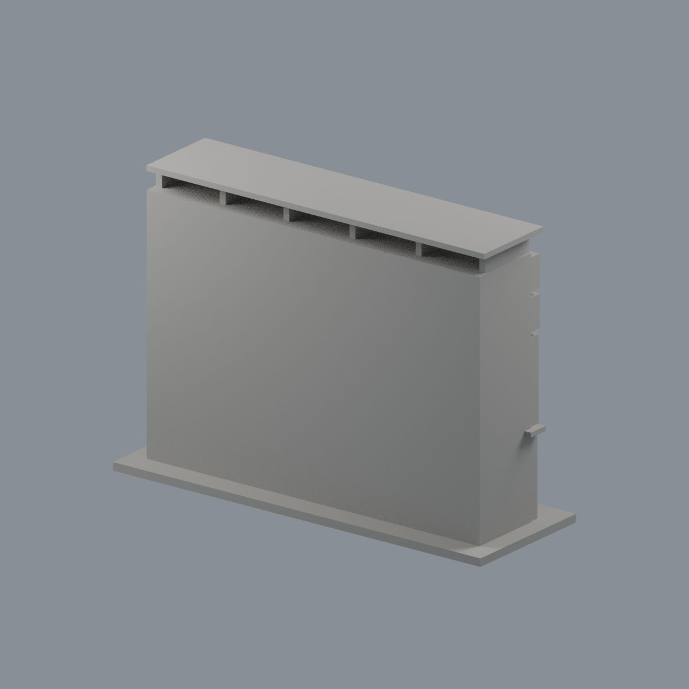
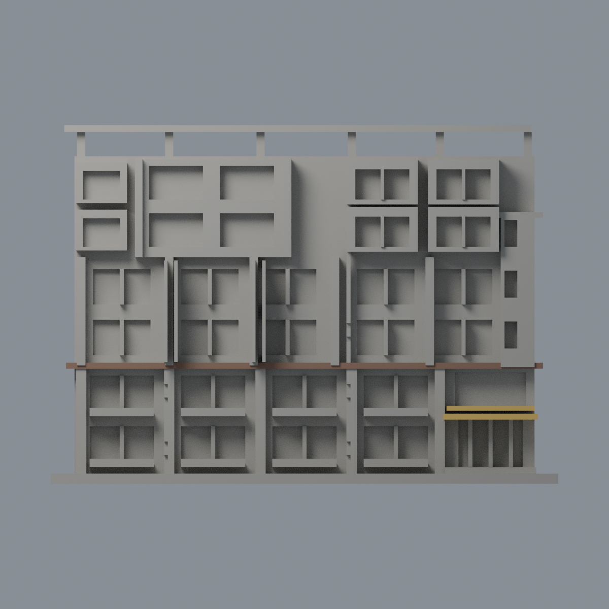
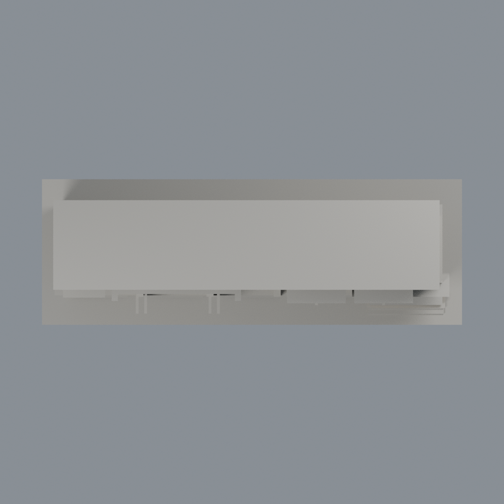

# 彰師理學一館主立面段黃棚與棕帶點色：三材質外觀版

沿用原 **2,450 三角面／1,171 頂點**，不改原 STL 位元、座標、面序或幾何；這是既有模型外觀改版，不增加模型包數。

| 正面 | 背面保持中性 |
|---|---|
|  |  |
|  |  |

[表面色 3MF](ncuescience-appearance.3mf) · [可編輯 Blender](scene.blend) · [材質色表](palette.json) · [逐面指派與依據](face-materials.json) · [原 STL](../model.stl)

## 來源與配色邊界

這是**黃雙挑棚與棕橫帶的局部點色研究**，不是全棟或全立面配色還原。親看彰師大兩張完整官方完成立面與入口近照，以及原網格、生成器。[精確 URL、SHA、日期](qa/source-review.json)。正面照無 EXIF 拍攝日期；入口近照 Original／Digitized 為 2026-06-03 08:47:11，不能以網址的 1150908／1150914 當拍攝日。不宣稱拍攝之後的現況。原照片僅私有研究，不入公開包。

- 原兩層獨立挑棚的前緣、側端與底面依近照採暖黃；未見頂面保留中性，兩棚間陰影不另塗褐色。這仍是既有厚化簡化方形棚，不補實景折角細節。
- 原 z34–35.8 獨立橫帶僅向前垂直面採低飽和棕色。實景其底面白色，不能將整條橫帶全染棕；底面中性也不宣稱已還原白色。較高另一條實景棕帶沒有獨立原幾何，明確省略，不畫橫向假色界。
- 灰柱上的白樹枝紋無材質分面，全部中性；樓上窗背混黃簾頭、玻璃、窗裙，樓下陽台混磚牆、窗、欄杆及空調，也全部中性。入口門含藍色安全帶未分面，不能整片塗藍玻璃。上窗有白簾，不把亮色當本體玻璃色。
- 原主屋頂、未知側後截面、標字、白牆及其餘窗不推測著色，不增文字或穿孔花紋。中性不是實景灰色還原；本件只有 59 個原三角面的局部色彩重點，其他原面維持中性。
- 不使用施工中吊車照片作完成色彩證據。不改原 STL、面序、外形或歷史 QA；未做實體列印測試。

[原幾何與歷史來源限制](../README.md)

## 重建與核驗

安裝 [依賴](source/requirements.txt)，Blender 使用 4.3.2。由本資料夾上層提供原 model.stl：

1. `python appearance/source/build_appearance.py`
2. `python appearance/source/verify_exchange.py`
3. `blender -b -t 3 --python-exit-code 1 -P appearance/source/render_appearance.py`
4. `blender -b -t 3 --python-exit-code 1 -P appearance/source/verify_scene.py`

[獨立重建 ZIP](rebuild-source.zip)含原 STL、四支程式及依賴，不含第三方照片；不取代原建模腳本。[逐檔 SHA256](SHA256SUMS)

[交換／拓撲 QA](qa/exchange-validation.json)核對原座標與面序、全部面材質、單連通、有向水密邊、頂點 link 單環、正體積與零退化／重複面；lib3mf 嚴格讀取零警告，實際編輯單材質再存讀，其他材質及面指派不變。SDK 六位小數量化誤差另列。

[Blender 存讀與編輯](qa/scene-validation.json) · [渲染記錄](qa/render-manifest.json) · [獨立重建](qa/rebuild-validation.json)

## 製造限制照舊

尺寸仍為 150 × 52 × 106 mm；原 STL、建模程式、場景及歷史 QA 保留。原層檢與薄特徵檢查本次未重跑，不能由材質 QA 代替。

3MF 是同一網格的表面色，不是各材質各自封閉的分色實體、切片專案、噴頭映射或 G-code。切片 GUI、多材料路徑與實體列印未測；柱頭、屋簷、窗框及薄邊仍須評估材料、支撐及拆除風險，沒有保證可印或免支撐。
