# 國立成功大學｜30 件可列印外觀近似模型

本整合包收錄首批至第十批通過外觀與幾何檢查的 **30 件模型**。部分是同一財產的高低棟或局部量體，不等於 30 棟完整建築，也不是全校完成。每件含底座最長邊 150 mm，各自獨立比例。

每件提供 STL、可攜 Python 原始程式、可編輯 Blender、由實際 STL 產生的正面／背面／立面預覽、來源與近似之處、支撐需求及驗證報告。原始參考照片及 GIS 地圖影像不隨包散布；請循各件來源 URL 核對。未實體試印、未切片驗證。

## 三欄模型圖鑑

每格是一件不同模型；正背圖及完整說明均為相對連結。

| 模型 | 模型 | 模型 |
|---|---|---|
| **光復校區・禮賢樓**  [正面原圖](光復校區/buildings/lixian-building/previews/front.png) · [背面原圖](光復校區/buildings/lixian-building/previews/rear.png) [說明與來源](光復校區/buildings/lixian-building/README.md) · [STL](光復校區/buildings/lixian-building/model.stl) · [Blender](光復校區/buildings/lixian-building/scene.blend) | **成功校區・格致堂** [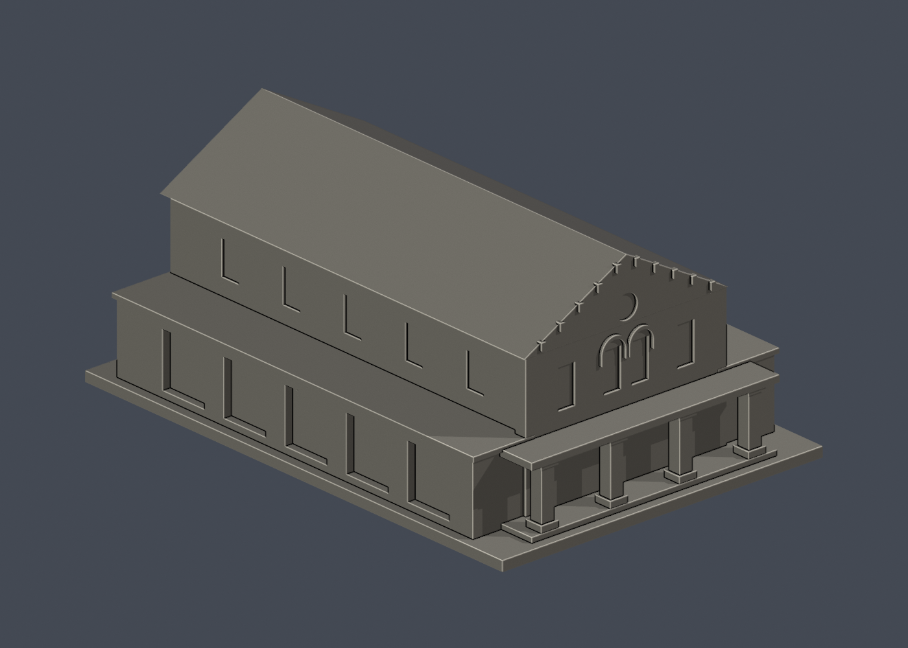](成功校區/buildings/gechi-hall/README.md) [正面原圖](成功校區/buildings/gechi-hall/previews/front.png) · [背面原圖](成功校區/buildings/gechi-hall/previews/rear.png) [說明與來源](成功校區/buildings/gechi-hall/README.md) · [STL](成功校區/buildings/gechi-hall/model.stl) · [Blender](成功校區/buildings/gechi-hall/scene.blend) | **成功校區・成大博物館** [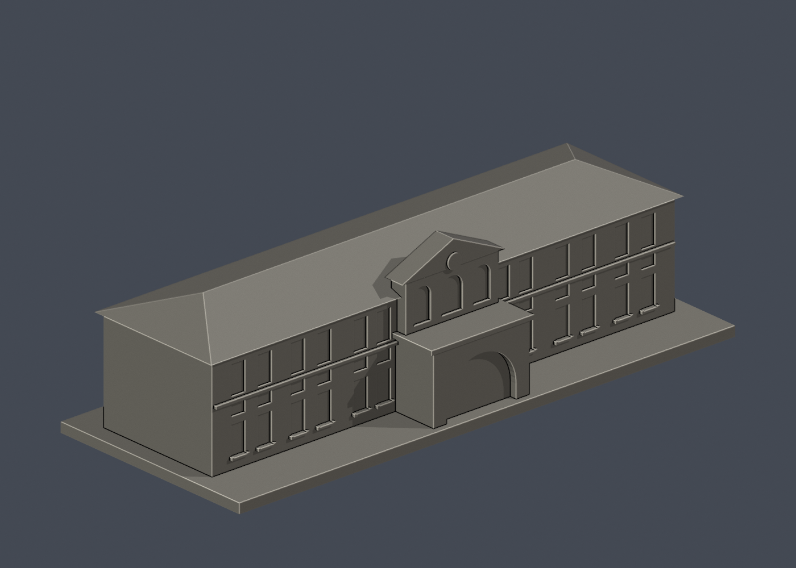](成功校區/buildings/museum/README.md) [正面原圖](成功校區/buildings/museum/previews/front.png) · [背面原圖](成功校區/buildings/museum/previews/rear.png) [說明與來源](成功校區/buildings/museum/README.md) · [STL](成功校區/buildings/museum/model.stl) · [Blender](成功校區/buildings/museum/scene.blend) |
| **光復校區・大成館**  [正面原圖](光復校區/buildings/dacheng-hall/previews/front.png) · [背面原圖](光復校區/buildings/dacheng-hall/previews/rear.png) [說明與來源](光復校區/buildings/dacheng-hall/README.md) · [STL](光復校區/buildings/dacheng-hall/model.stl) · [Blender](光復校區/buildings/dacheng-hall/scene.blend) | **光復校區・歷史文物館** [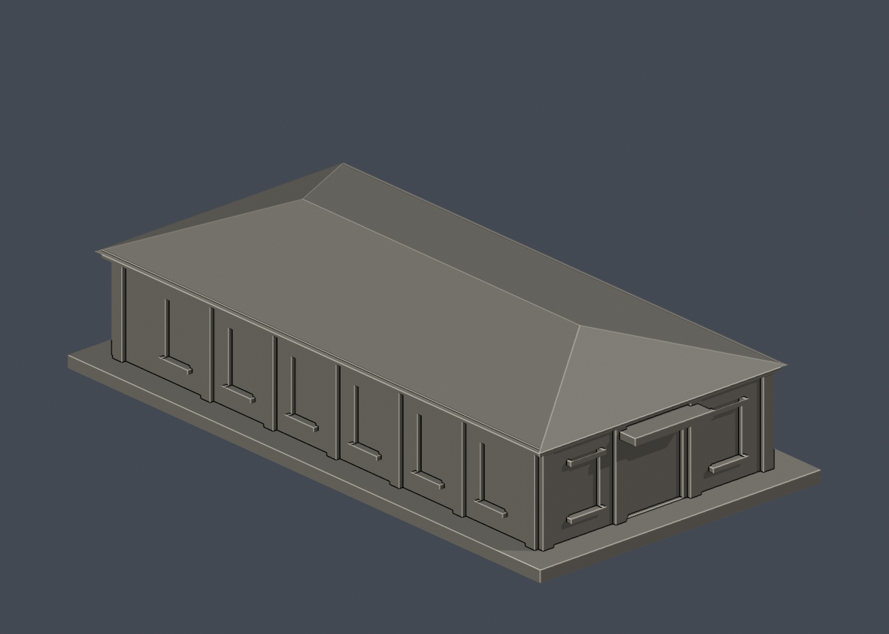](光復校區/buildings/historical-artifacts-museum/README.md) [正面原圖](光復校區/buildings/historical-artifacts-museum/previews/front.png) · [背面原圖](光復校區/buildings/historical-artifacts-museum/previews/rear.png) [說明與來源](光復校區/buildings/historical-artifacts-museum/README.md) · [STL](光復校區/buildings/historical-artifacts-museum/model.stl) · [Blender](光復校區/buildings/historical-artifacts-museum/scene.blend) | **勝利校區・未來館前棟（舊總圖書館前棟）**  [正面原圖](勝利校區/buildings/future-venue-front/previews/front.png) · [背面原圖](勝利校區/buildings/future-venue-front/previews/rear.png) [說明與來源](勝利校區/buildings/future-venue-front/README.md) · [STL](勝利校區/buildings/future-venue-front/model.stl) · [Blender](勝利校區/buildings/future-venue-front/scene.blend) |
| **光復校區・中正堂** [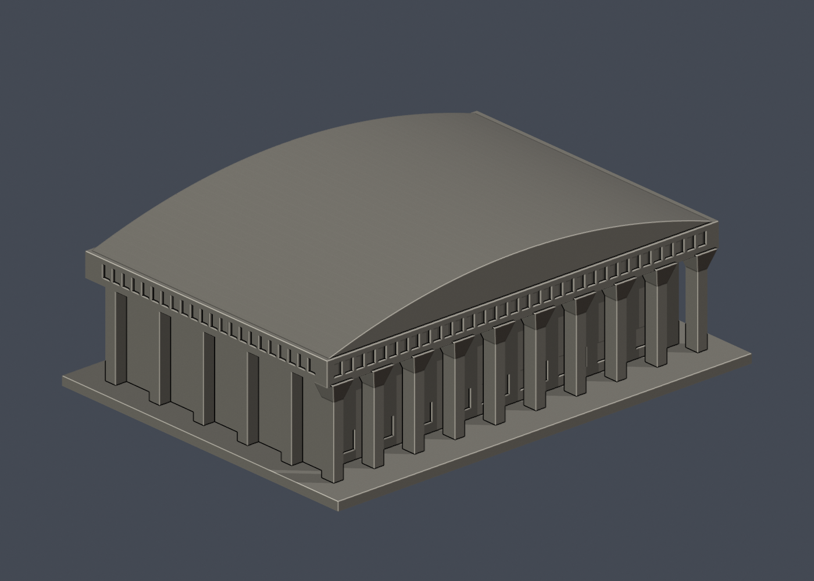](光復校區/buildings/chung-cheng-gym/README.md) [正面原圖](光復校區/buildings/chung-cheng-gym/previews/front.png) · [背面原圖](光復校區/buildings/chung-cheng-gym/previews/rear.png) [說明與來源](光復校區/buildings/chung-cheng-gym/README.md) · [STL](光復校區/buildings/chung-cheng-gym/model.stl) · [Blender](光復校區/buildings/chung-cheng-gym/scene.blend) | **力行校區・孫運璿綠建築研究大樓（綠色魔法學校）**  [正面原圖](力行校區/buildings/magic-school-green-technologies/previews/front.png) · [背面原圖](力行校區/buildings/magic-school-green-technologies/previews/rear.png) [說明與來源](力行校區/buildings/magic-school-green-technologies/README.md) · [STL](力行校區/buildings/magic-school-green-technologies/model.stl) · [Blender](力行校區/buildings/magic-school-green-technologies/scene.blend) | **成功校區・總圖書館**  [正面原圖](成功校區/buildings/main-library/previews/front.png) · [背面原圖](成功校區/buildings/main-library/previews/rear.png) [說明與來源](成功校區/buildings/main-library/README.md) · [STL](成功校區/buildings/main-library/model.stl) · [Blender](成功校區/buildings/main-library/scene.blend) |
| **勝利校區・太子文旅（原成大會館）**  [正面原圖](勝利校區/buildings/prince-hotel/previews/front.png) · [背面原圖](勝利校區/buildings/prince-hotel/previews/rear.png) [說明與來源](勝利校區/buildings/prince-hotel/README.md) · [STL](勝利校區/buildings/prince-hotel/model.stl) · [Blender](勝利校區/buildings/prince-hotel/scene.blend) | **成杏校區・生醫卓群大樓**  [正面原圖](成杏校區/buildings/biomedical-excellency/previews/front.png) · [背面原圖](成杏校區/buildings/biomedical-excellency/previews/rear.png) [說明與來源](成杏校區/buildings/biomedical-excellency/README.md) · [STL](成杏校區/buildings/biomedical-excellency/model.stl) · [Blender](成杏校區/buildings/biomedical-excellency/scene.blend) | **自強校區・啟端館**  [正面原圖](自強校區/buildings/chi-duan-building/previews/front.png) · [背面原圖](自強校區/buildings/chi-duan-building/previews/rear.png) [說明與來源](自強校區/buildings/chi-duan-building/README.md) · [STL](自強校區/buildings/chi-duan-building/model.stl) · [Blender](自強校區/buildings/chi-duan-building/scene.blend) |
| **南科校區・南科研發大樓（台達大樓）**  [正面原圖](南科校區/buildings/delta-building/previews/front.png) · [背面原圖](南科校區/buildings/delta-building/previews/rear.png) [說明與來源](南科校區/buildings/delta-building/README.md) · [STL](南科校區/buildings/delta-building/model.stl) · [Blender](南科校區/buildings/delta-building/scene.blend) | **安南校區・研究總中心大樓｜大門側低翼部分**  [正面原圖](安南校區/buildings/research-center-entry-wing/previews/front.png) · [背面原圖](安南校區/buildings/research-center-entry-wing/previews/rear.png) [說明與來源](安南校區/buildings/research-center-entry-wing/README.md) · [STL](安南校區/buildings/research-center-entry-wing/model.stl) · [Blender](安南校區/buildings/research-center-entry-wing/scene.blend) | **安南校區・研究總中心大樓｜高翼部分**  [正面原圖](安南校區/buildings/research-center-high-wing/previews/front.png) · [背面原圖](安南校區/buildings/research-center-high-wing/previews/rear.png) [說明與來源](安南校區/buildings/research-center-high-wing/README.md) · [STL](安南校區/buildings/research-center-high-wing/model.stl) · [Blender](安南校區/buildings/research-center-high-wing/scene.blend) |
| **光復校區・歷史學系館** [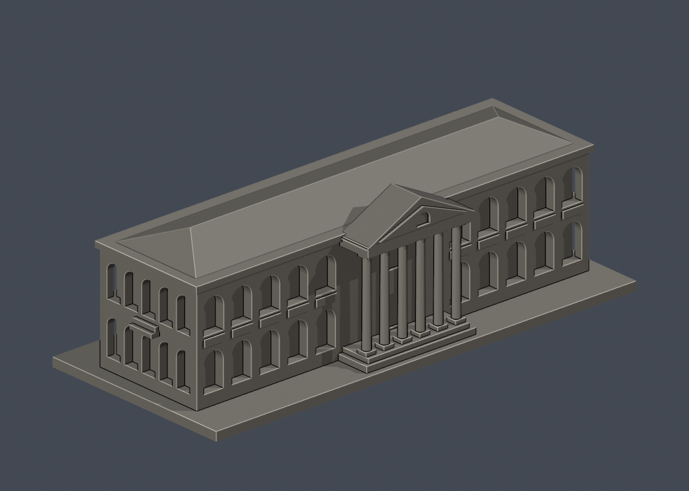](光復校區/buildings/history-department/README.md) [正面原圖](光復校區/buildings/history-department/previews/front.png) · [背面原圖](光復校區/buildings/history-department/previews/rear.png) [說明與來源](光復校區/buildings/history-department/README.md) · [STL](光復校區/buildings/history-department/model.stl) · [Blender](光復校區/buildings/history-department/scene.blend) | **成功校區・大新園西棟（新園春室）**  [正面原圖](成功校區/buildings/new-garden-west-pavilion/previews/front.png) · [背面原圖](成功校區/buildings/new-garden-west-pavilion/previews/rear.png) [說明與來源](成功校區/buildings/new-garden-west-pavilion/README.md) · [STL](成功校區/buildings/new-garden-west-pavilion/model.stl) · [Blender](成功校區/buildings/new-garden-west-pavilion/scene.blend) | **成功校區・舊物理系館南棟（原理化學實驗室）** [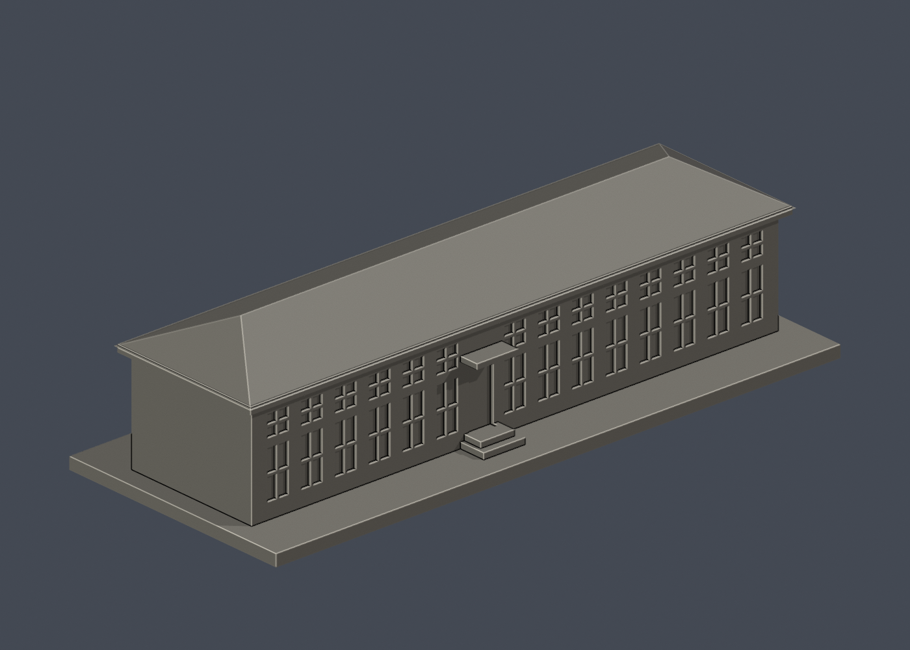](成功校區/buildings/old-physics-south-hall/README.md) [正面原圖](成功校區/buildings/old-physics-south-hall/previews/front.png) · [背面原圖](成功校區/buildings/old-physics-south-hall/previews/rear.png) [說明與來源](成功校區/buildings/old-physics-south-hall/README.md) · [STL](成功校區/buildings/old-physics-south-hall/model.stl) · [Blender](成功校區/buildings/old-physics-south-hall/scene.blend) |
| **光復校區・雲平大樓東棟**  [正面原圖](光復校區/buildings/yunping-east/previews/front.png) · [背面原圖](光復校區/buildings/yunping-east/previews/rear.png) [說明與來源](光復校區/buildings/yunping-east/README.md) · [STL](光復校區/buildings/yunping-east/model.stl) · [Blender](光復校區/buildings/yunping-east/scene.blend) | **光復校區・雲平大樓西棟**  [正面原圖](光復校區/buildings/yunping-west/previews/front.png) · [背面原圖](光復校區/buildings/yunping-west/previews/rear.png) [說明與來源](光復校區/buildings/yunping-west/README.md) · [STL](光復校區/buildings/yunping-west/model.stl) · [Blender](光復校區/buildings/yunping-west/scene.blend) | **成功校區・資訊大樓高棟**  [正面原圖](成功校區/buildings/information-building/previews/front.png) · [背面原圖](成功校區/buildings/information-building/previews/rear.png) [說明與來源](成功校區/buildings/information-building/README.md) · [STL](成功校區/buildings/information-building/model.stl) · [Blender](成功校區/buildings/information-building/scene.blend) |
| **敬業校區・敬業校區教職員單舍**  [正面原圖](敬業校區/buildings/ching-yeh-faculty-dormitory/previews/front.png) · [背面原圖](敬業校區/buildings/ching-yeh-faculty-dormitory/previews/rear.png) [說明與來源](敬業校區/buildings/ching-yeh-faculty-dormitory/README.md) · [STL](敬業校區/buildings/ching-yeh-faculty-dormitory/model.stl) · [Blender](敬業校區/buildings/ching-yeh-faculty-dormitory/scene.blend) | **敬業校區・敬業第一宿舍**  [正面原圖](敬業校區/buildings/ching-yeh-first-dormitory/previews/front.png) · [背面原圖](敬業校區/buildings/ching-yeh-first-dormitory/previews/rear.png) [說明與來源](敬業校區/buildings/ching-yeh-first-dormitory/README.md) · [STL](敬業校區/buildings/ching-yeh-first-dormitory/model.stl) · [Blender](敬業校區/buildings/ching-yeh-first-dormitory/scene.blend) | **歸仁校區・航太中心辦公大樓** [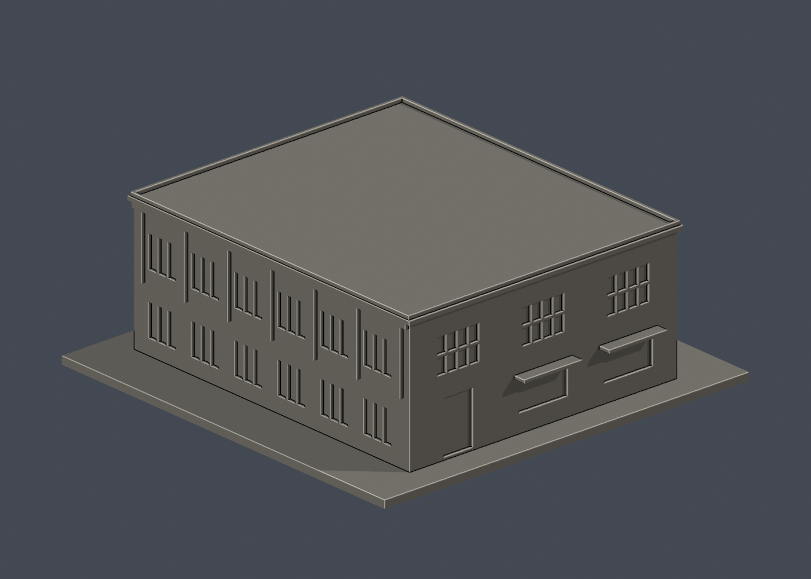](歸仁校區/buildings/aerospace-center-office/README.md) [正面原圖](歸仁校區/buildings/aerospace-center-office/previews/front.png) · [背面原圖](歸仁校區/buildings/aerospace-center-office/previews/rear.png) [說明與來源](歸仁校區/buildings/aerospace-center-office/README.md) · [STL](歸仁校區/buildings/aerospace-center-office/model.stl) · [Blender](歸仁校區/buildings/aerospace-center-office/scene.blend) |
| **力行校區・統一健康研究大樓（國衛院共用）** [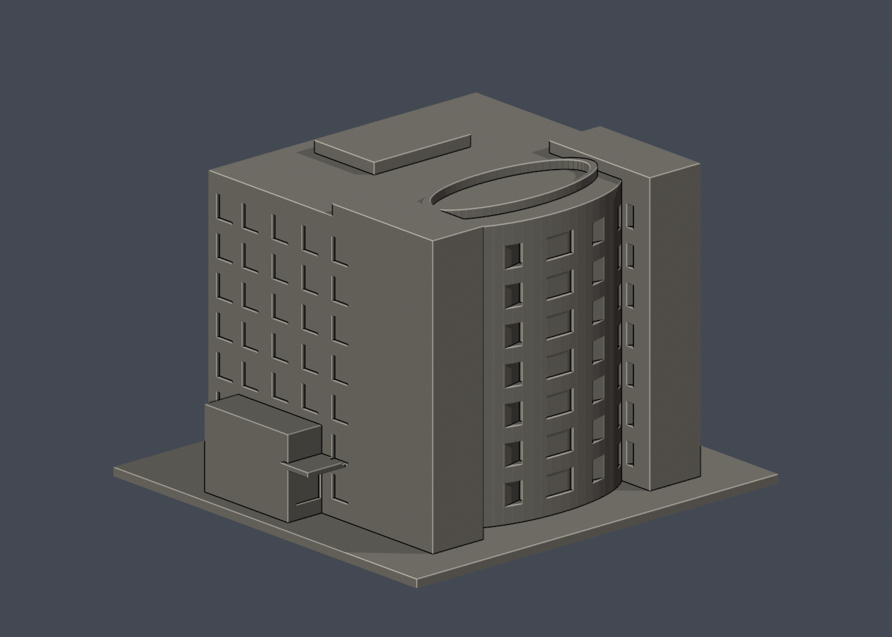](力行校區/buildings/uni-president-health-building/README.md) [正面原圖](力行校區/buildings/uni-president-health-building/previews/front.png) · [背面原圖](力行校區/buildings/uni-president-health-building/previews/rear.png) [說明與來源](力行校區/buildings/uni-president-health-building/README.md) · [STL](力行校區/buildings/uni-president-health-building/model.stl) · [Blender](力行校區/buildings/uni-president-health-building/scene.blend) | **成功校區・理學教學大樓北棟高層量體（化學棟）**  [正面原圖](成功校區/buildings/science-north-high-wing/previews/front.png) · [背面原圖](成功校區/buildings/science-north-high-wing/previews/rear.png) [說明與來源](成功校區/buildings/science-north-high-wing/README.md) · [STL](成功校區/buildings/science-north-high-wing/model.stl) · [Blender](成功校區/buildings/science-north-high-wing/scene.blend) | **成功校區・理學教學大樓南棟高層量體（物理棟）** [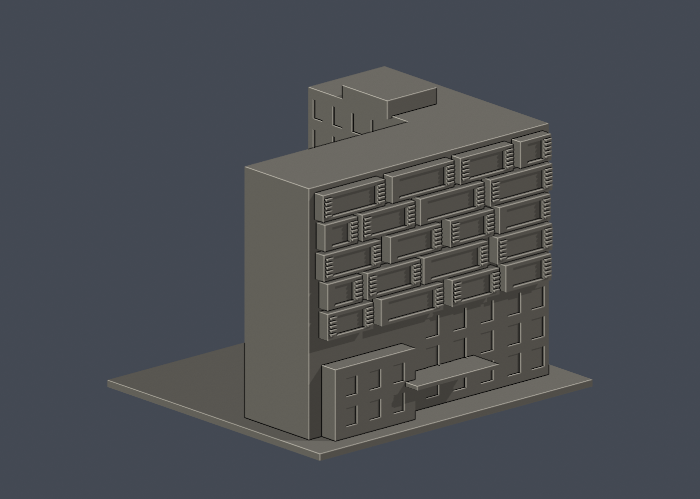](成功校區/buildings/science-south-high-wing/README.md) [正面原圖](成功校區/buildings/science-south-high-wing/previews/front.png) · [背面原圖](成功校區/buildings/science-south-high-wing/previews/rear.png) [說明與來源](成功校區/buildings/science-south-high-wing/README.md) · [STL](成功校區/buildings/science-south-high-wing/model.stl) · [Blender](成功校區/buildings/science-south-high-wing/scene.blend) |
| **力行校區・臺灣文學系E101棟（原軍方辦公室048）** [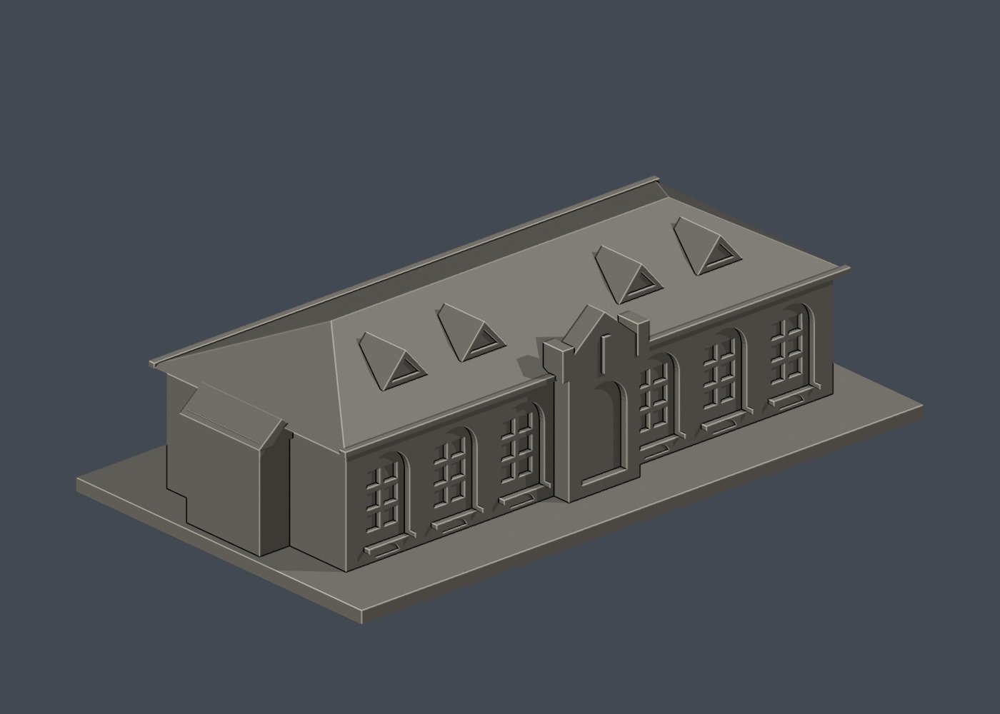](力行校區/buildings/taiwan-literature-e101/README.md) [正面原圖](力行校區/buildings/taiwan-literature-e101/previews/front.png) · [背面原圖](力行校區/buildings/taiwan-literature-e101/previews/rear.png) [說明與來源](力行校區/buildings/taiwan-literature-e101/README.md) · [STL](力行校區/buildings/taiwan-literature-e101/model.stl) · [Blender](力行校區/buildings/taiwan-literature-e101/scene.blend) | **力行校區・臺灣文學系E102棟（原軍方兵舍042）** [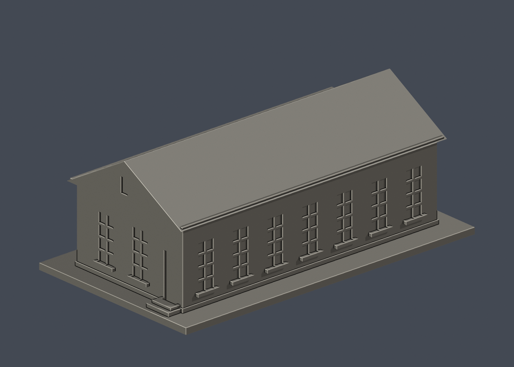](力行校區/buildings/taiwan-literature-e102/README.md) [正面原圖](力行校區/buildings/taiwan-literature-e102/previews/front.png) · [背面原圖](力行校區/buildings/taiwan-literature-e102/previews/rear.png) [說明與來源](力行校區/buildings/taiwan-literature-e102/README.md) · [STL](力行校區/buildings/taiwan-literature-e102/model.stl) · [Blender](力行校區/buildings/taiwan-literature-e102/scene.blend) | **力行校區・台文講堂E107棟（原軍方中山室035）** [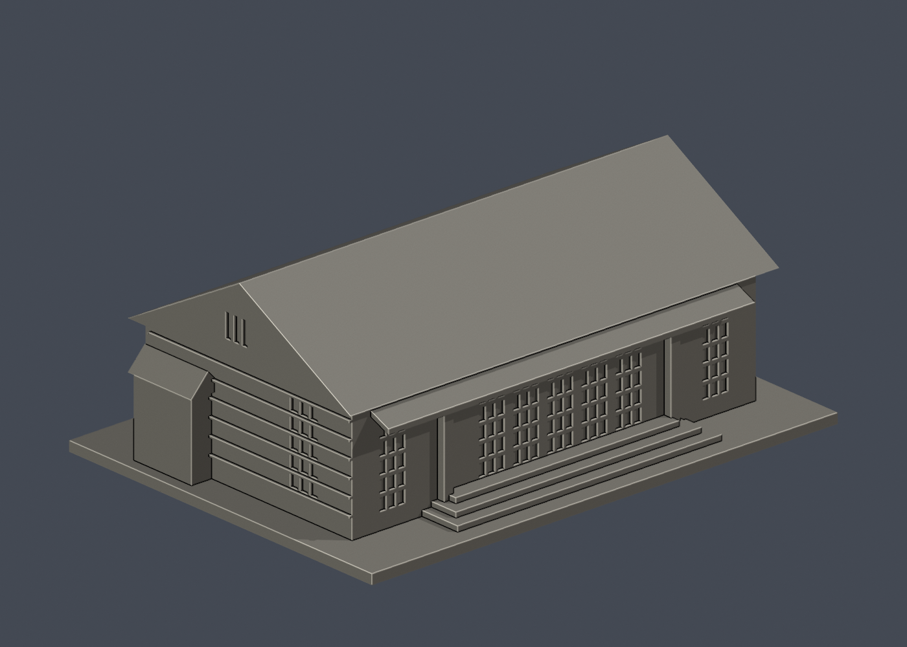](力行校區/buildings/taiwan-literature-lecture-hall/README.md) [正面原圖](力行校區/buildings/taiwan-literature-lecture-hall/previews/front.png) · [背面原圖](力行校區/buildings/taiwan-literature-lecture-hall/previews/rear.png) [說明與來源](力行校區/buildings/taiwan-literature-lecture-hall/README.md) · [STL](力行校區/buildings/taiwan-literature-lecture-hall/model.stl) · [Blender](力行校區/buildings/taiwan-literature-lecture-hall/scene.blend) |

## 幾何與驗證

各件原始 STL 已檢查法線、封閉性、邊與頂點流形、單一連通表面、無額外內部空腔殼、正體積、乾淨重建雜湊及 Blender 幾何一致性；細節見各件 validation.json。新版 0.2 mm 截面以固定共同邊方向計算，並拒絕不閉合輪廓；新增 0.8 mm 薄特徵篩查先驗證輪廓再計算面積。薄篩不是切片或列印保證。博物館、大成館窄屋頂最高取樣層損失約 0.1382 mm²，比例略逾 1%，詳各件報告。

## 範圍、清冊與未完成工作

[2026-01-30 校方財產表抽取及來源](research/README.md)含 206 筆、13 個分組；這是財產筆數，不是最新實體建物總數，也不能拿來算模型完成率。
[財產與模型對照](research/property-model-working-crosswalk.json)保留局部量體及未匹配項目；[已知具體證據缺口](research/evidence-gaps-working.json)不代表其餘待研究者皆已確認受阻。東寧、台北、斗六及宿舍區等仍在全校研究範圍內。

## 批次記錄

[第 1 批](README_BATCH1.md) · [第 2 批](README_BATCH2.md) · [第 3 批](README_BATCH3.md) · [第 4 批](README_BATCH4.md) · [第 5 批](README_BATCH5.md) · [第 6 批](README_BATCH6.md) · [第 7 批](README_BATCH7.md) · [第 8 批](README_BATCH8.md) · [第 9 批](README_BATCH9.md) · [第 10 批](README_BATCH10.md)

## 檔案與發布路徑

[模型映射](model-manifest.json)列出各件來源 freeze、校區、精確 repo 目錄及 STL SHA-256；[全檔案映射](publication-manifest.json)列出包內相對路徑及精確 repo 目的地。[SHA256SUMS.txt](SHA256SUMS.txt)涵蓋全部交付檔案（雜湊表自身除外）。公開根路徑為 `國立成功大學/`。

### 發布硬性檢查與總圖修訂

`python validate_bundle.py` 會逐件重跑原始 STL、乾淨原始程式重建、Blender 幾何比對、截面和薄篩；任一退出碼或檢查值失敗即中止整包。此整合已直接重跑30件原始驗證，不只讀舊摘要。

總圖書館舊版本有36根懸浮遮陽橫條而形成37殼，現已逐條接回框柱並同步重建STL、Blender與預覽；本包只收修訂版。統一大樓屋頂環框另作加厚修訂；其餘28件STL與原凍結來源雜湊一致。

統一健康大樓原屋頂橢圓環框最窄約0.714 mm，已保持外輪廓加厚至實測1.25973 mm。原3層薄篩1.433%損失在修版降至全件最大0.02384%；詳[該件說明及量測](力行校區/buildings/uni-president-health-building/README.md)。本包只收修訂版，未實體試印或切片驗證。
