# 國立成功大學｜46 件數位外觀近似模型

本整合包收錄原首批至第十三批、大新園更新、紀念校門、共享弧棚、波簷尖峰片段、小西門完整門樓及成功校區56亭新增的 **46 件模型**。部分是同一財產的高低棟或局部量體，不等於 46 棟完整建築，也不是全校完成。既有41件含底座最長邊150mm；紀念校門為160mm展示寬，新增弧棚為164mm展示寬，波簷尖峰片段為104mm展示底座寬，小西門為108mm展示寬，56亭含局部兩端收尾為228mm展示長；各自獨立比例，不能直接拼接。

每件提供 STL、可攜 Python 原始程式、可編輯 Blender、由實際 STL 產生的正面／背面／立面預覽、來源與近似之處、支撐需求及驗證報告。原始參考照片及 GIS 地圖影像不隨包散布；請循各件來源 URL 核對。未實體試印、未切片驗證。

## 三欄模型圖鑑

每格是一件不同模型；正背圖及完整說明均為相對連結。

| 建築模型 | 建築模型 | 建築模型 |
| :---: | :---: | :---: |
| **國立成功大學｜建築科技大樓**  [正面](光復校區/buildings/architecture-technology-building/previews/front.png) · [背面](光復校區/buildings/architecture-technology-building/previews/rear.png) [說明與來源](光復校區/buildings/architecture-technology-building/README.md) · [STL](光復校區/buildings/architecture-technology-building/model.stl) | **國立成功大學｜C-Hub成大創意基地高量體**  [正面](光復校區/buildings/c-hub-high-volume/appearance/previews/front.png) · [背面](光復校區/buildings/c-hub-high-volume/appearance/previews/rear.png) [說明與來源](光復校區/buildings/c-hub-high-volume/README.md) · [STL](光復校區/buildings/c-hub-high-volume/model.stl) | **國立成功大學｜中文系館** [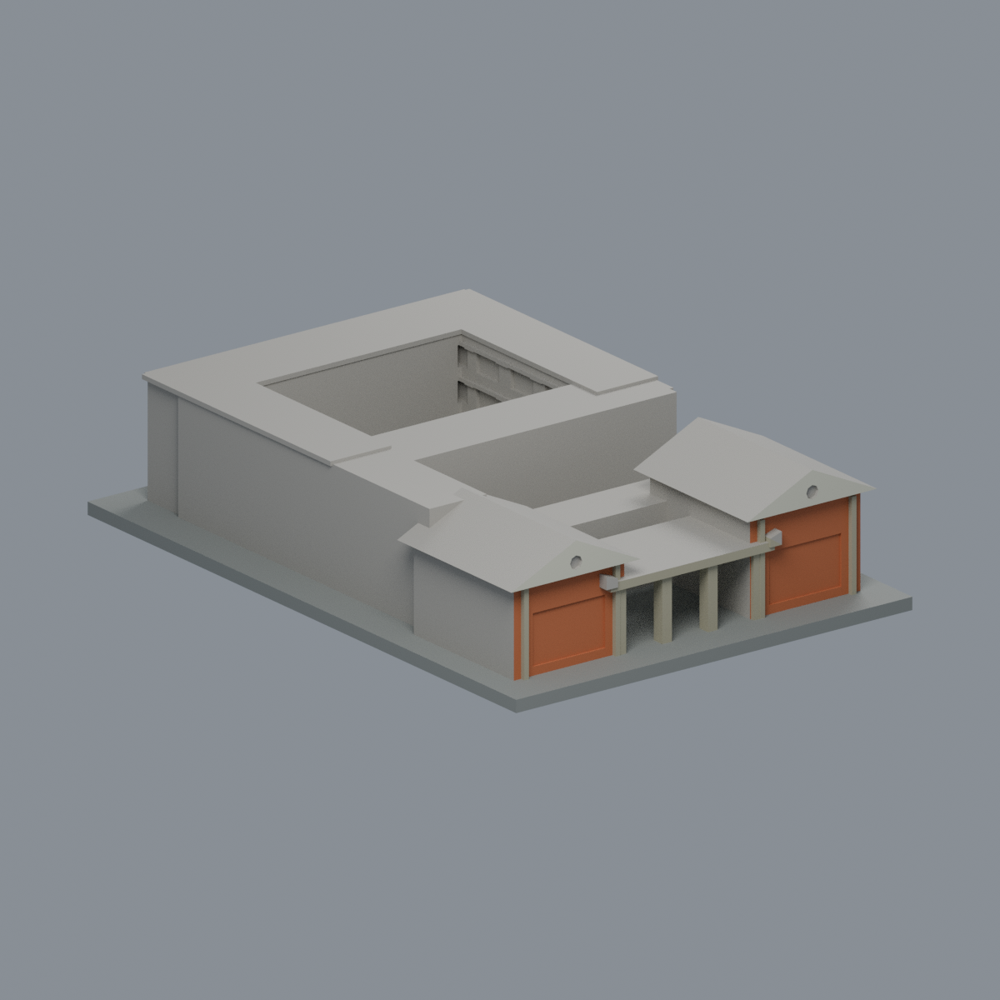](光復校區/buildings/chinese-department-building/README.md) [正面](光復校區/buildings/chinese-department-building/appearance/previews/front.png) · [背面](光復校區/buildings/chinese-department-building/appearance/previews/rear.png) [說明與來源](光復校區/buildings/chinese-department-building/README.md) · [STL](光復校區/buildings/chinese-department-building/model.stl) |
| **國立成功大學｜中正堂**  [正面](光復校區/buildings/chung-cheng-gym/appearance/previews/front.png) · [背面](光復校區/buildings/chung-cheng-gym/appearance/previews/rear.png) [說明與來源](光復校區/buildings/chung-cheng-gym/README.md) · [STL](光復校區/buildings/chung-cheng-gym/model.stl) | **國立成功大學｜大成館** [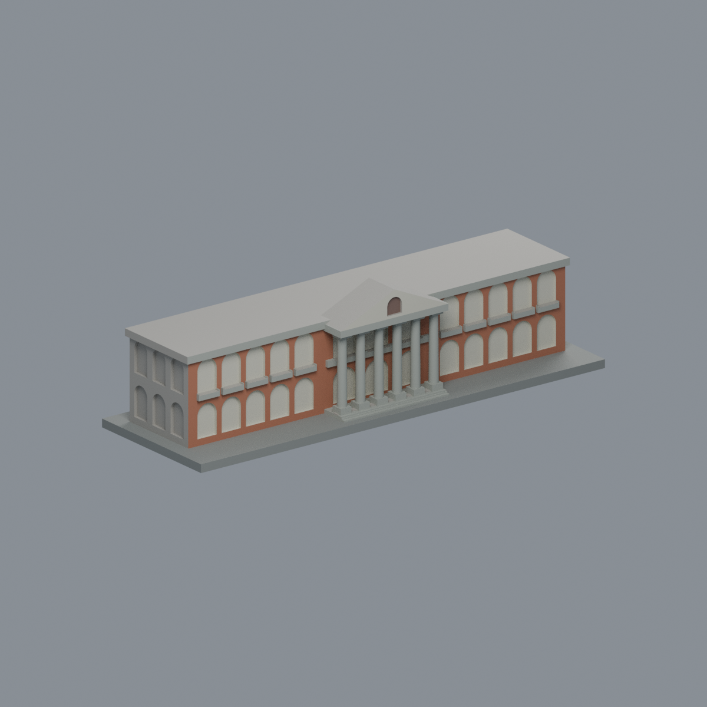](光復校區/buildings/dacheng-hall/README.md) [正面](光復校區/buildings/dacheng-hall/appearance/previews/front.png) · [背面](光復校區/buildings/dacheng-hall/appearance/previews/rear.png) [說明與來源](光復校區/buildings/dacheng-hall/README.md) · [STL](光復校區/buildings/dacheng-hall/model.stl) | **國立成功大學｜歷史文物館**  [正面](光復校區/buildings/historical-artifacts-museum/appearance/previews/front.png) · [背面](光復校區/buildings/historical-artifacts-museum/appearance/previews/rear.png) [說明與來源](光復校區/buildings/historical-artifacts-museum/README.md) · [STL](光復校區/buildings/historical-artifacts-museum/model.stl) |
| **國立成功大學｜歷史學系館** [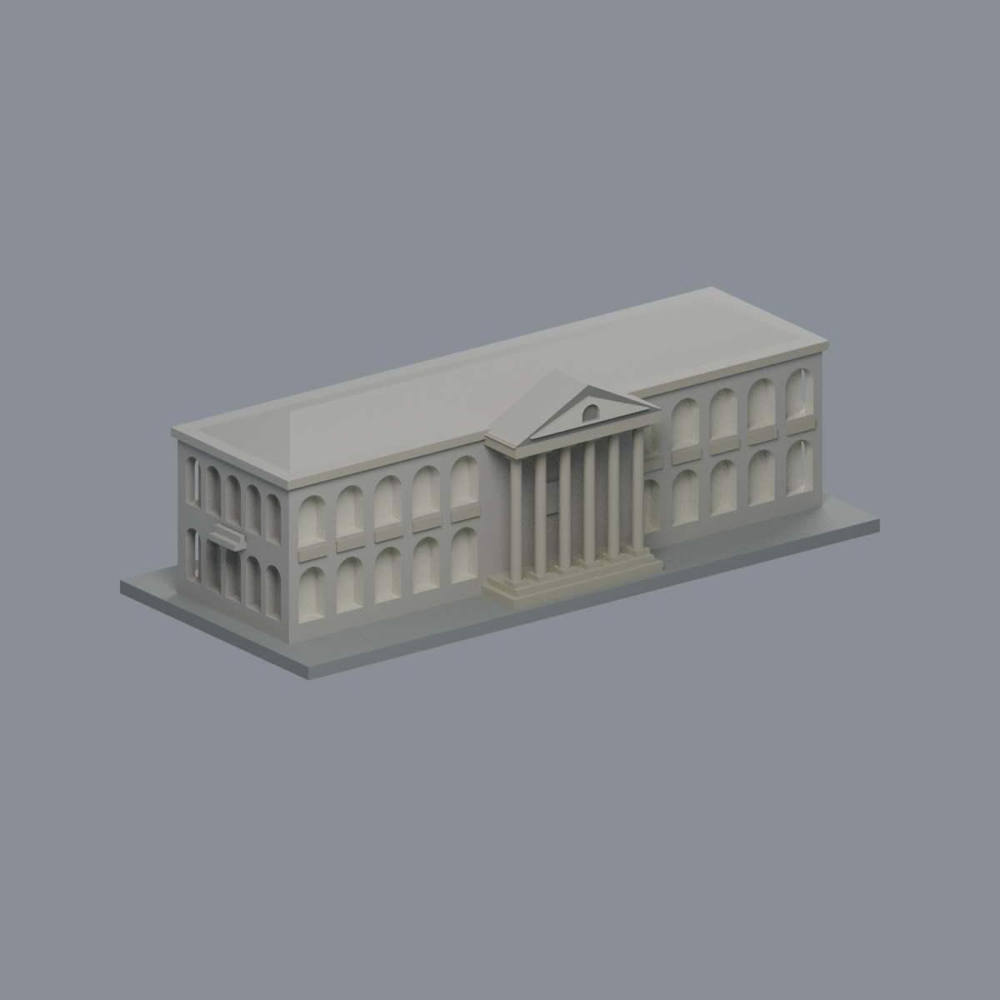](光復校區/buildings/history-department/README.md) [正面](光復校區/buildings/history-department/appearance/previews/front.png) · [背面](光復校區/buildings/history-department/appearance/previews/rear.png) [說明與來源](光復校區/buildings/history-department/README.md) · [STL](光復校區/buildings/history-department/model.stl) | **國立成功大學｜修齊大樓（文學院暨語言中心大樓）** [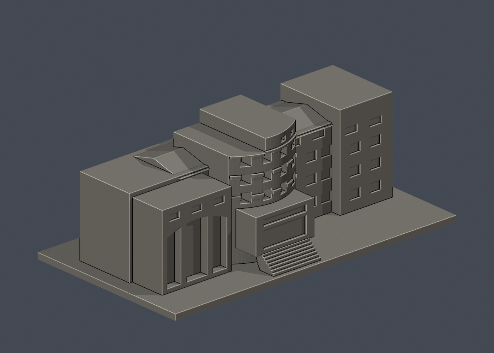](光復校區/buildings/hsiu-chi-building/README.md) [正面](光復校區/buildings/hsiu-chi-building/previews/front.png) · [背面](光復校區/buildings/hsiu-chi-building/previews/rear.png) [說明與來源](光復校區/buildings/hsiu-chi-building/README.md) · [STL](光復校區/buildings/hsiu-chi-building/model.stl) | **國立成功大學｜工業與資訊管理系館大樓** [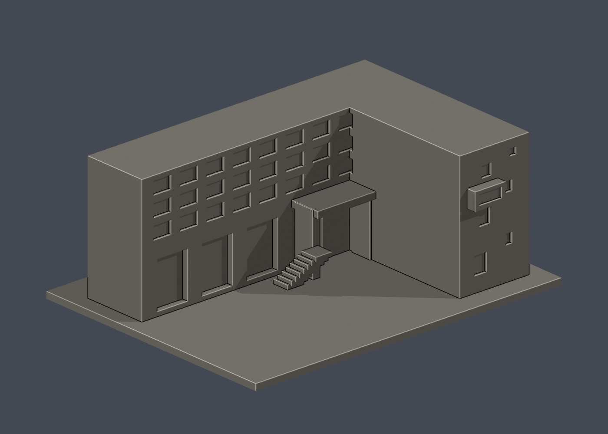](光復校區/buildings/industrial-information-management-building/README.md) [正面](光復校區/buildings/industrial-information-management-building/previews/front.png) · [背面](光復校區/buildings/industrial-information-management-building/previews/rear.png) [說明與來源](光復校區/buildings/industrial-information-management-building/README.md) · [STL](光復校區/buildings/industrial-information-management-building/model.stl) |
| **國立成功大學｜禮賢樓** [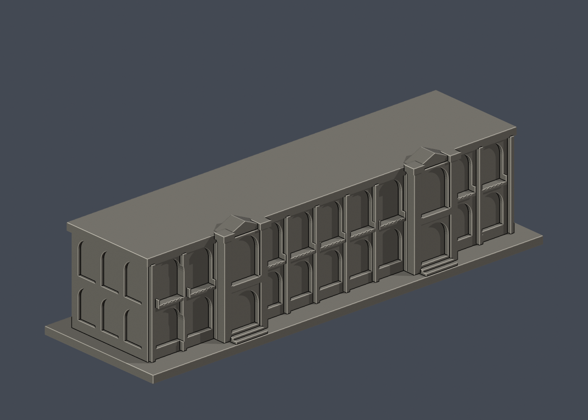](光復校區/buildings/lixian-building/README.md) [正面](光復校區/buildings/lixian-building/previews/front.png) · [背面](光復校區/buildings/lixian-building/previews/rear.png) [說明與來源](光復校區/buildings/lixian-building/README.md) · [STL](光復校區/buildings/lixian-building/model.stl) | **國立成功大學｜管理學院綜合大樓**  [正面](光復校區/buildings/management-college-building/previews/front.png) · [背面](光復校區/buildings/management-college-building/previews/rear.png) [說明與來源](光復校區/buildings/management-college-building/README.md) · [STL](光復校區/buildings/management-college-building/model.stl) | **國立成功大學｜軍訓大樓** [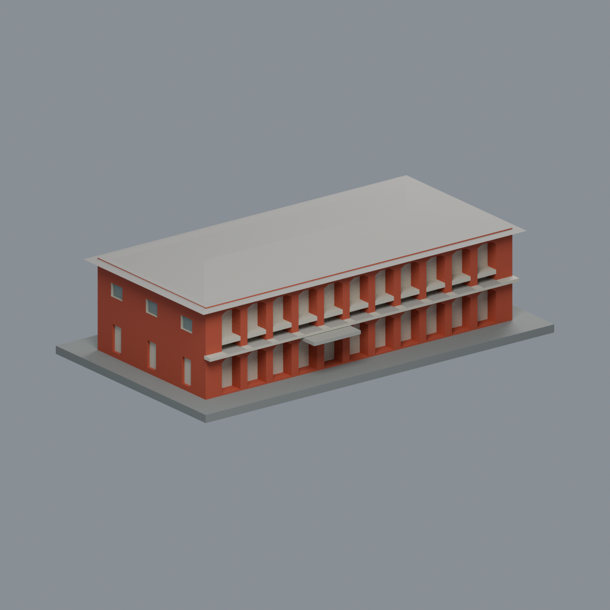](光復校區/buildings/military-training-building/README.md) [正面](光復校區/buildings/military-training-building/appearance/previews/front.png) · [背面](光復校區/buildings/military-training-building/appearance/previews/rear.png) [說明與來源](光復校區/buildings/military-training-building/README.md) · [STL](光復校區/buildings/military-training-building/model.stl) |
| **國立成功大學｜學生活動中心（連續L形建築）** [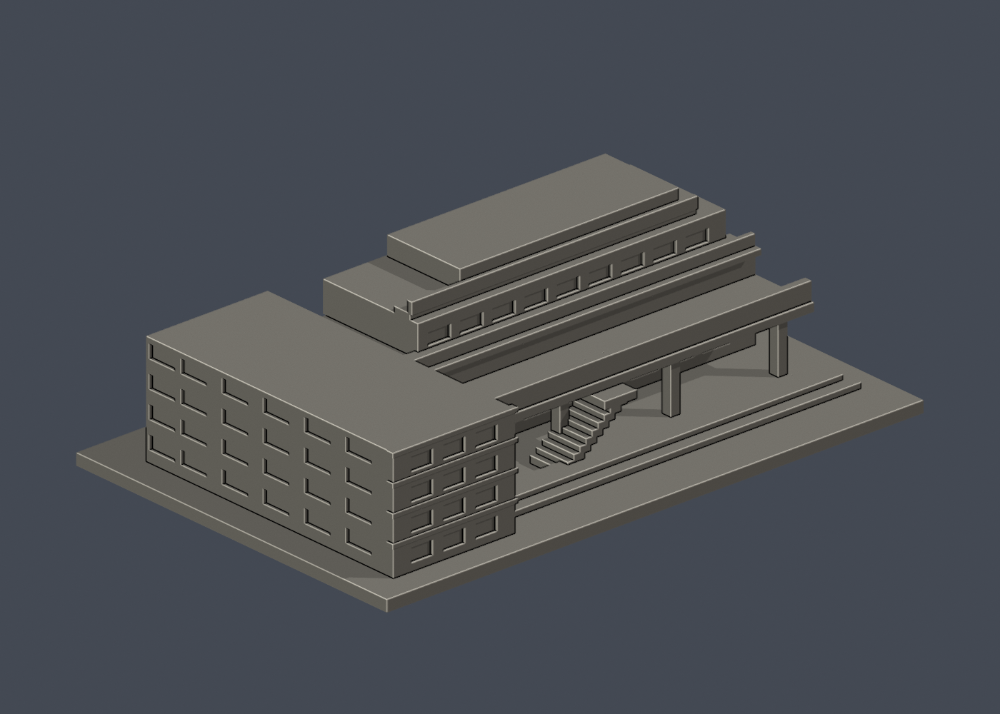](光復校區/buildings/student-activity-center/README.md) [正面](光復校區/buildings/student-activity-center/previews/front.png) · [背面](光復校區/buildings/student-activity-center/previews/rear.png) [說明與來源](光復校區/buildings/student-activity-center/README.md) · [STL](光復校區/buildings/student-activity-center/model.stl) | **國立成功大學｜唯農大樓** [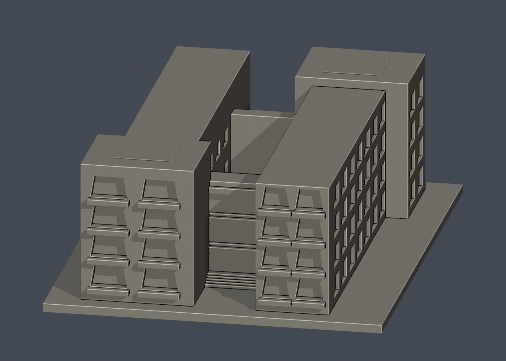](光復校區/buildings/wei-nong-building/README.md) [正面](光復校區/buildings/wei-nong-building/previews/front.png) · [背面](光復校區/buildings/wei-nong-building/previews/rear.png) [說明與來源](光復校區/buildings/wei-nong-building/README.md) · [STL](光復校區/buildings/wei-nong-building/model.stl) | **國立成功大學｜雲平大樓東棟** [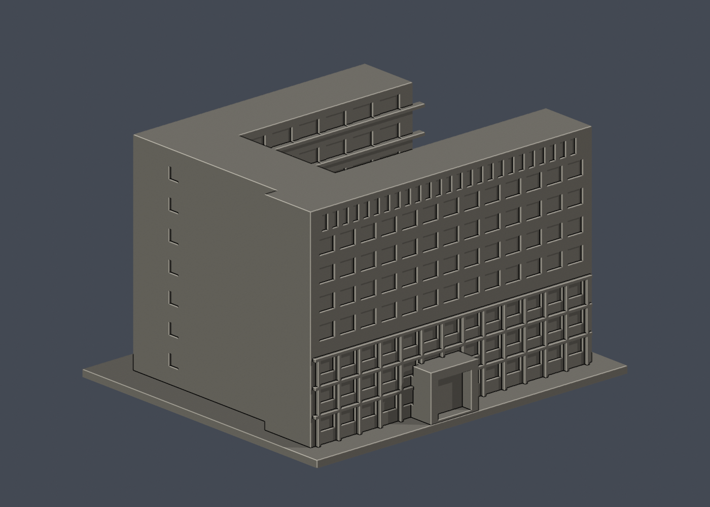](光復校區/buildings/yunping-east/README.md) [正面](光復校區/buildings/yunping-east/previews/front.png) · [背面](光復校區/buildings/yunping-east/previews/rear.png) [說明與來源](光復校區/buildings/yunping-east/README.md) · [STL](光復校區/buildings/yunping-east/model.stl) |
| **國立成功大學｜雲平大樓西棟** [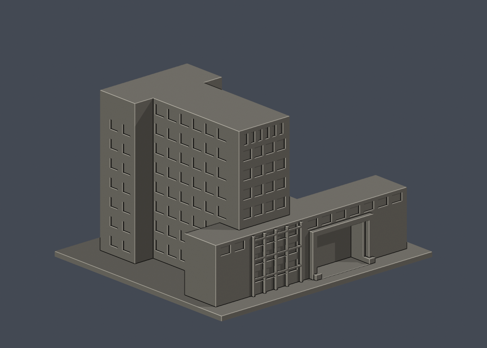](光復校區/buildings/yunping-west/README.md) [正面](光復校區/buildings/yunping-west/previews/front.png) · [背面](光復校區/buildings/yunping-west/previews/rear.png) [說明與來源](光復校區/buildings/yunping-west/README.md) · [STL](光復校區/buildings/yunping-west/model.stl) | **國立成功大學｜孫運璿綠建築研究大樓（綠色魔法學校）**  [正面](力行校區/buildings/magic-school-green-technologies/appearance/previews/front.png) · [背面](力行校區/buildings/magic-school-green-technologies/appearance/previews/rear.png) [說明與來源](力行校區/buildings/magic-school-green-technologies/README.md) · [STL](力行校區/buildings/magic-school-green-technologies/model.stl) | **國立成功大學｜臺灣文學系E101棟（原軍方辦公室048）**  [正面](力行校區/buildings/taiwan-literature-e101/appearance/previews/front.png) · [背面](力行校區/buildings/taiwan-literature-e101/appearance/previews/rear.png) [說明與來源](力行校區/buildings/taiwan-literature-e101/README.md) · [STL](力行校區/buildings/taiwan-literature-e101/model.stl) |
| **國立成功大學｜臺灣文學系E102棟（原軍方兵舍042）**  [正面](力行校區/buildings/taiwan-literature-e102/appearance/previews/front.png) · [背面](力行校區/buildings/taiwan-literature-e102/appearance/previews/rear.png) [說明與來源](力行校區/buildings/taiwan-literature-e102/README.md) · [STL](力行校區/buildings/taiwan-literature-e102/model.stl) | **國立成功大學｜台文講堂E107棟（原軍方中山室035）**  [正面](力行校區/buildings/taiwan-literature-lecture-hall/appearance/previews/front.png) · [背面](力行校區/buildings/taiwan-literature-lecture-hall/appearance/previews/rear.png) [說明與來源](力行校區/buildings/taiwan-literature-lecture-hall/README.md) · [STL](力行校區/buildings/taiwan-literature-lecture-hall/model.stl) | **國立成功大學｜統一健康研究大樓（國衛院共用）**  [正面](力行校區/buildings/uni-president-health-building/appearance/previews/front.png) · [背面](力行校區/buildings/uni-president-health-building/appearance/previews/rear.png) [說明與來源](力行校區/buildings/uni-president-health-building/README.md) · [STL](力行校區/buildings/uni-president-health-building/model.stl) |
| **國立成功大學｜未來館前棟（舊總圖書館前棟）** [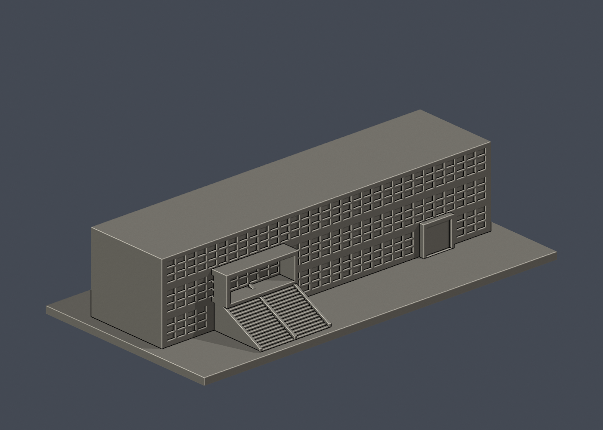](勝利校區/buildings/future-venue-front/README.md) [正面](勝利校區/buildings/future-venue-front/previews/front.png) · [背面](勝利校區/buildings/future-venue-front/previews/rear.png) [說明與來源](勝利校區/buildings/future-venue-front/README.md) · [STL](勝利校區/buildings/future-venue-front/model.stl) | **國立成功大學｜太子文旅（原成大會館）** [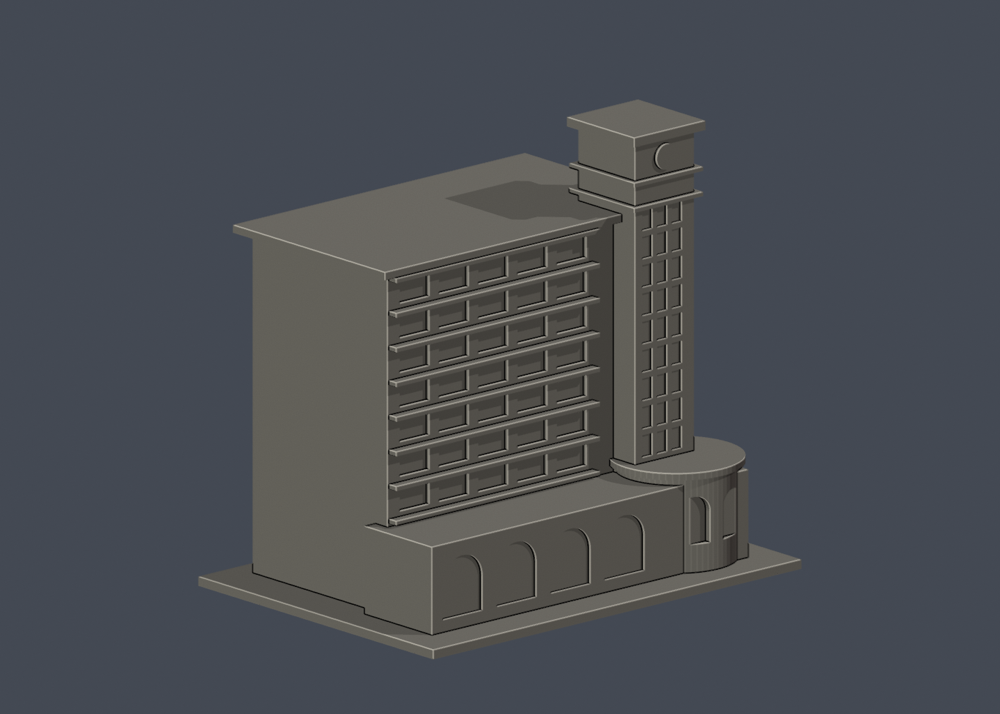](勝利校區/buildings/prince-hotel/README.md) [正面](勝利校區/buildings/prince-hotel/previews/front.png) · [背面](勝利校區/buildings/prince-hotel/previews/rear.png) [說明與來源](勝利校區/buildings/prince-hotel/README.md) · [STL](勝利校區/buildings/prince-hotel/model.stl) | **國立成功大學｜游泳池暨球類場館** [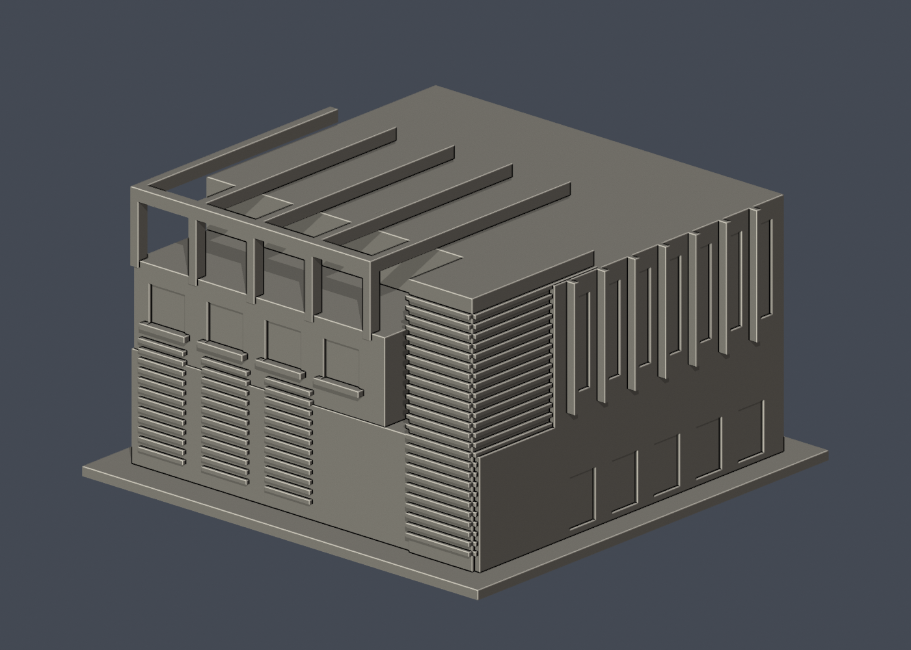](勝利校區/buildings/swimming-ball-sports-building/README.md) [正面](勝利校區/buildings/swimming-ball-sports-building/previews/front.png) · [背面](勝利校區/buildings/swimming-ball-sports-building/previews/rear.png) [說明與來源](勝利校區/buildings/swimming-ball-sports-building/README.md) · [STL](勝利校區/buildings/swimming-ball-sports-building/model.stl) |
| **國立成功大學｜南科研發大樓（台達大樓）** [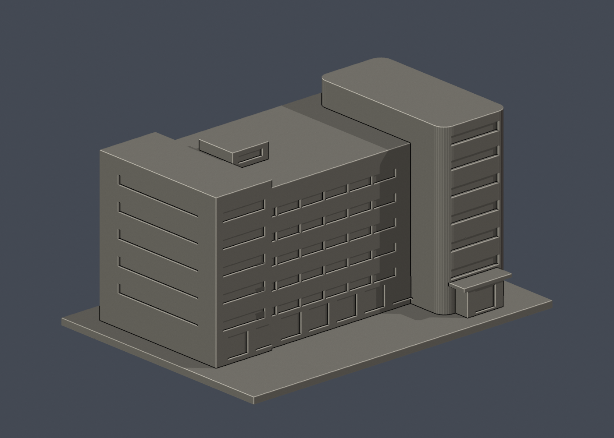](南科校區/buildings/delta-building/README.md) [正面](南科校區/buildings/delta-building/previews/front.png) · [背面](南科校區/buildings/delta-building/previews/rear.png) [說明與來源](南科校區/buildings/delta-building/README.md) · [STL](南科校區/buildings/delta-building/model.stl) | **國立成功大學｜研究總中心大樓｜大門側低翼部分** [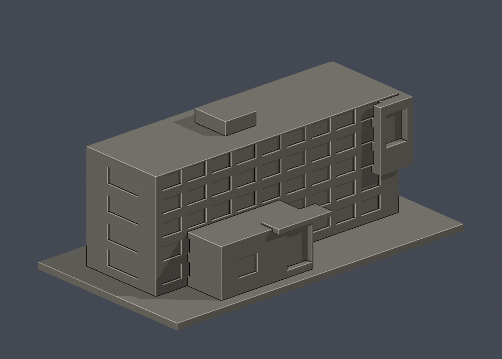](安南校區/buildings/research-center-entry-wing/README.md) [正面](安南校區/buildings/research-center-entry-wing/previews/front.png) · [背面](安南校區/buildings/research-center-entry-wing/previews/rear.png) [說明與來源](安南校區/buildings/research-center-entry-wing/README.md) · [STL](安南校區/buildings/research-center-entry-wing/model.stl) | **國立成功大學｜研究總中心大樓｜高翼部分** [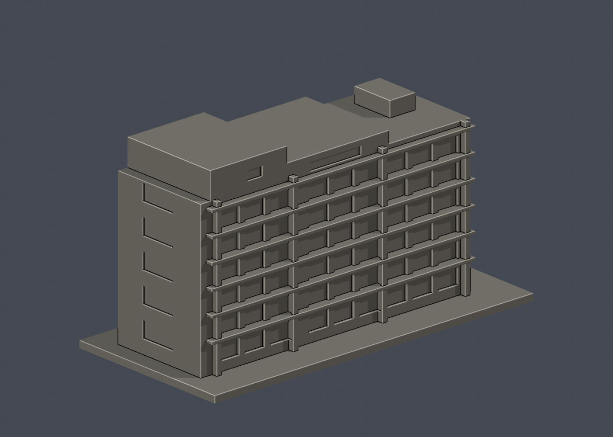](安南校區/buildings/research-center-high-wing/README.md) [正面](安南校區/buildings/research-center-high-wing/previews/front.png) · [背面](安南校區/buildings/research-center-high-wing/previews/rear.png) [說明與來源](安南校區/buildings/research-center-high-wing/README.md) · [STL](安南校區/buildings/research-center-high-wing/model.stl) |
| **國立成功大學｜格致堂**  [正面](成功校區/buildings/gechi-hall/appearance/previews/front.png) · [背面](成功校區/buildings/gechi-hall/appearance/previews/rear.png) [說明與來源](成功校區/buildings/gechi-hall/README.md) · [STL](成功校區/buildings/gechi-hall/model.stl) | **國立成功大學｜資訊大樓高棟**  [正面](成功校區/buildings/information-building/previews/front.png) · [背面](成功校區/buildings/information-building/previews/rear.png) [說明與來源](成功校區/buildings/information-building/README.md) · [STL](成功校區/buildings/information-building/model.stl) | **國立成功大學｜總圖書館**  [正面](成功校區/buildings/main-library/appearance/previews/front.png) · [背面](成功校區/buildings/main-library/appearance/previews/rear.png) [說明與來源](成功校區/buildings/main-library/README.md) · [STL](成功校區/buildings/main-library/model.stl) |
| **國立成功大學｜成大博物館**  [正面](成功校區/buildings/museum/appearance/previews/front.png) · [背面](成功校區/buildings/museum/appearance/previews/rear.png) [說明與來源](成功校區/buildings/museum/README.md) · [STL](成功校區/buildings/museum/model.stl) | **國立成功大學｜大新園西棟（校友會館・幾何修正版）**  [正面](成功校區/buildings/new-garden-west-pavilion/previews/front.png) · [背面](成功校區/buildings/new-garden-west-pavilion/previews/rear.png) [說明與來源](成功校區/buildings/new-garden-west-pavilion/README.md) · [STL](成功校區/buildings/new-garden-west-pavilion/model.stl) | **國立成功大學｜舊物理系館南棟（原理化學實驗室）**  [正面](成功校區/buildings/old-physics-south-hall/appearance/previews/front.png) · [背面](成功校區/buildings/old-physics-south-hall/appearance/previews/rear.png) [說明與來源](成功校區/buildings/old-physics-south-hall/README.md) · [STL](成功校區/buildings/old-physics-south-hall/model.stl) |
| **國立成功大學｜理學教學大樓北棟高層量體（化學棟）**  [正面](成功校區/buildings/science-north-high-wing/previews/front.png) · [背面](成功校區/buildings/science-north-high-wing/previews/rear.png) [說明與來源](成功校區/buildings/science-north-high-wing/README.md) · [STL](成功校區/buildings/science-north-high-wing/model.stl) | **國立成功大學｜理學教學大樓南棟高層量體（物理棟）**  [正面](成功校區/buildings/science-south-high-wing/appearance/previews/front.png) · [背面](成功校區/buildings/science-south-high-wing/appearance/previews/rear.png) [說明與來源](成功校區/buildings/science-south-high-wing/README.md) · [STL](成功校區/buildings/science-south-high-wing/model.stl) | **國立成功大學｜生醫卓群大樓** [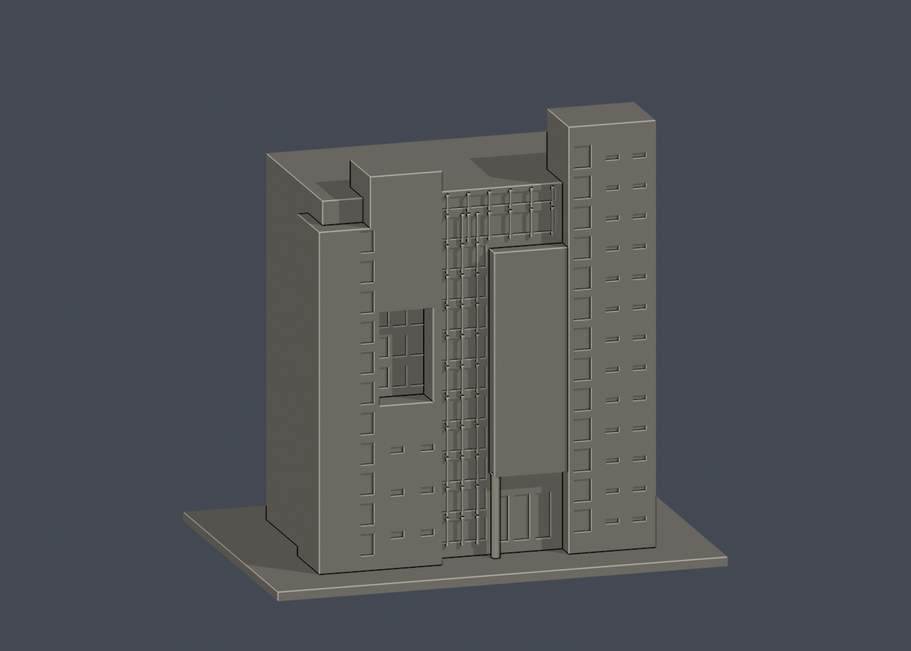](成杏校區/buildings/biomedical-excellency/README.md) [正面](成杏校區/buildings/biomedical-excellency/previews/front.png) · [背面](成杏校區/buildings/biomedical-excellency/previews/rear.png) [說明與來源](成杏校區/buildings/biomedical-excellency/README.md) · [STL](成杏校區/buildings/biomedical-excellency/model.stl) |
| **國立成功大學｜敬業校區教職員單舍**  [正面](敬業校區/buildings/ching-yeh-faculty-dormitory/previews/front.png) · [背面](敬業校區/buildings/ching-yeh-faculty-dormitory/previews/rear.png) [說明與來源](敬業校區/buildings/ching-yeh-faculty-dormitory/README.md) · [STL](敬業校區/buildings/ching-yeh-faculty-dormitory/model.stl) | **國立成功大學｜敬業第一宿舍** [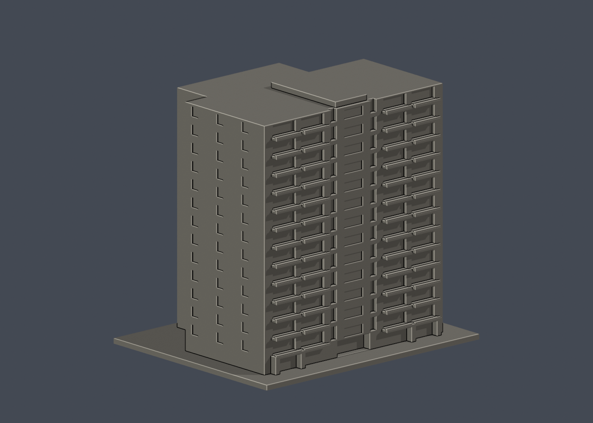](敬業校區/buildings/ching-yeh-first-dormitory/README.md) [正面](敬業校區/buildings/ching-yeh-first-dormitory/previews/front.png) · [背面](敬業校區/buildings/ching-yeh-first-dormitory/previews/rear.png) [說明與來源](敬業校區/buildings/ching-yeh-first-dormitory/README.md) · [STL](敬業校區/buildings/ching-yeh-first-dormitory/model.stl) | **國立成功大學｜航太中心辦公大樓** [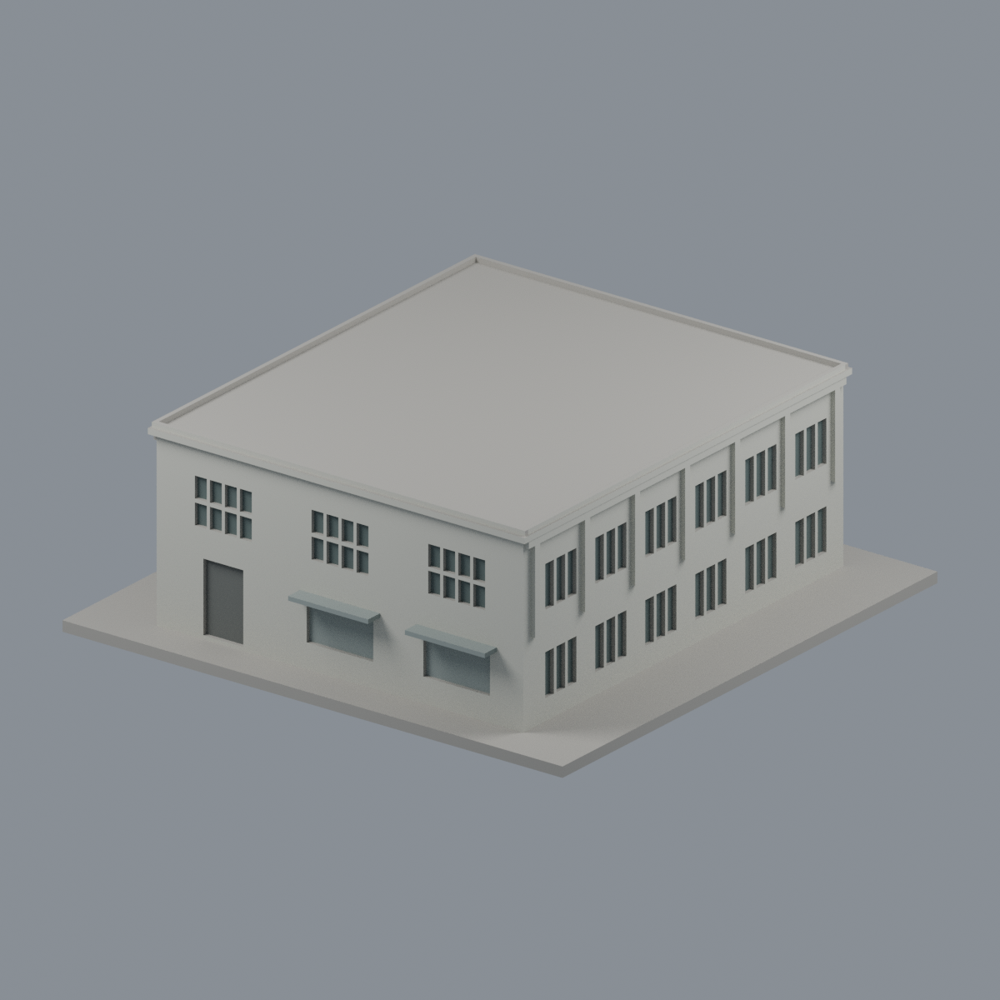](歸仁校區/buildings/aerospace-center-office/README.md) [正面](歸仁校區/buildings/aerospace-center-office/appearance/previews/front.png) · [背面](歸仁校區/buildings/aerospace-center-office/appearance/previews/rear.png) [說明與來源](歸仁校區/buildings/aerospace-center-office/README.md) · [STL](歸仁校區/buildings/aerospace-center-office/model.stl) |
| **國立成功大學｜啟端館** [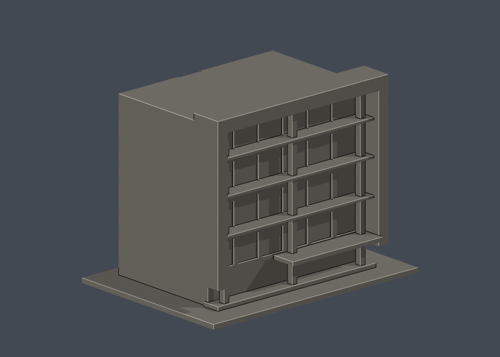](自強校區/buildings/chi-duan-building/README.md) [正面](自強校區/buildings/chi-duan-building/previews/front.png) · [背面](自強校區/buildings/chi-duan-building/previews/rear.png) [說明與來源](自強校區/buildings/chi-duan-building/README.md) · [STL](自強校區/buildings/chi-duan-building/model.stl) | **國立成功大學｜大新園東棟（學生藝文沙龍）**  [正面](成功校區/buildings/new-garden-east-pavilion/previews/front.png) · [背面](成功校區/buildings/new-garden-east-pavilion/previews/rear.png) [說明與限定覆核](成功校區/buildings/new-garden-east-pavilion/README.md) · [STL](成功校區/buildings/new-garden-east-pavilion/model.stl) | [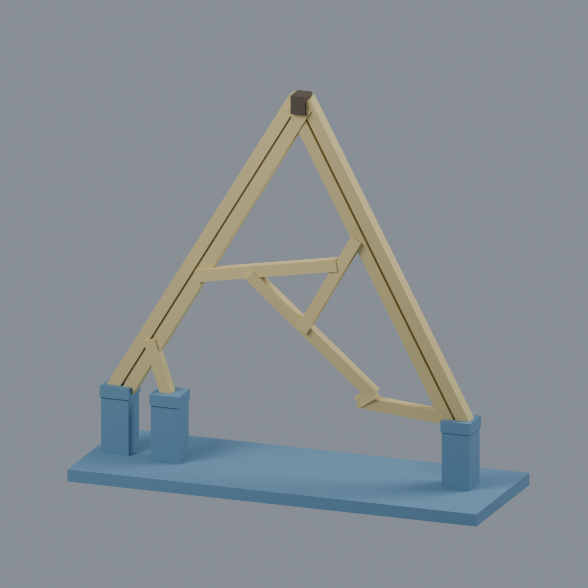](光復校區/buildings/ncku-wave-eaves-apex-fragment-2021/README.md) **[國立成功大學｜光復校區｜波簷高尖峰上部木格片段（2021）](光復校區/buildings/ncku-wave-eaves-apex-fragment-2021/README.md)** |
|  **[國立成功大學｜紀念校門（窮理致知牌坊）](勝利校區/buildings/ncku-commemorative-gate-1956/README.md)** | [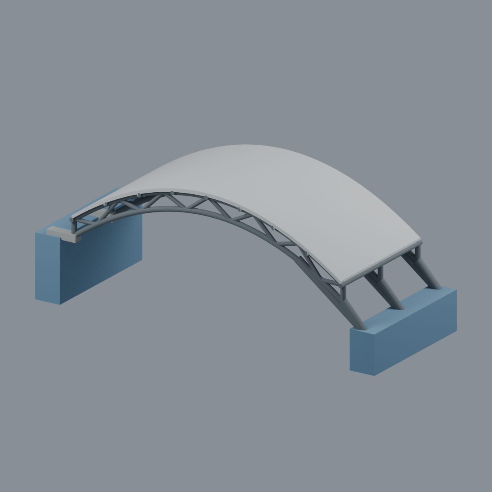](安南校區/buildings/research-center-atrium-canopy-two-bay-segment/README.md) **[國立成功大學｜安南校區｜研究總中心共享中庭弧棚雙跨構架段](安南校區/buildings/research-center-atrium-canopy-two-bay-segment/README.md)** | [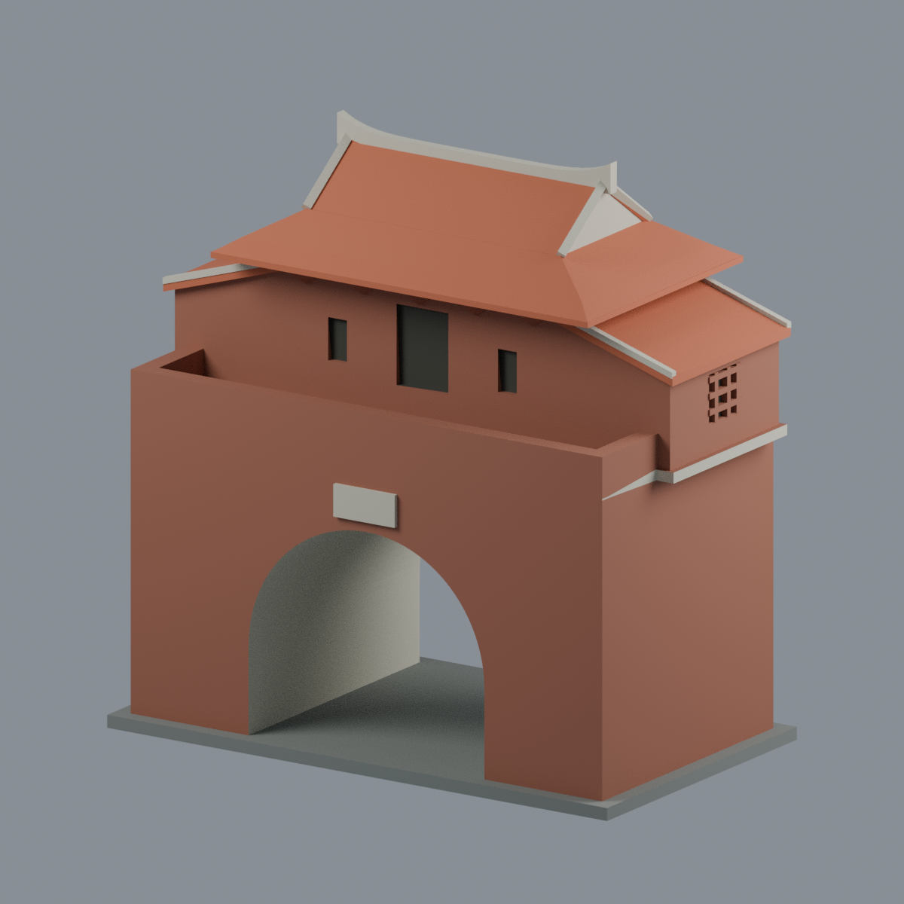](光復校區/buildings/ncku-minor-west-gate/README.md) **[國立成功大學・光復校區小西門（靖波門）](光復校區/buildings/ncku-minor-west-gate/README.md)** |
|  **[國立成功大學｜成功校區｜56亭（Rotate Truss Pavilion）](成功校區/buildings/ncku-56-rotate-truss-pavilion/README.md)** |  |  |

## 幾何與驗證

既有各件原始 STL 已檢查法線、封閉性、邊與頂點流形、單一連通表面、無額外內部空腔殼、正體積、乾淨重建雜湊及 Blender 幾何一致性；細節見各件 validation.json。新版 0.2 mm 截面以固定共同邊方向計算，並拒絕不閉合輪廓；新增 0.8 mm 薄特徵篩查先驗證輪廓再計算面積。薄篩不是切片或列印保證。博物館、大成館窄屋頂最高取樣層損失約 0.1382 mm²，比例略逾 1%，詳各件報告。

56亭使用獨立的 [QA與保留警告](成功校區/buildings/ncku-56-rotate-truss-pavilion/QA.md)；732個全局切層保留13層／23個薄成分與1169個懸挑面，未實印，不保證免支撐。[此次新增清冊](inventory_updates_56_pavilion_20261022.json)不改寫舊批次快照。

## 範圍、清冊與未完成工作

[2026-01-30 校方財產表抽取及來源](research/README.md)含 206 筆、13 個分組；這是財產筆數，不是最新實體建物總數，也不能拿來算模型完成率。
[財產與模型對照](research/property-model-working-crosswalk.json)保留局部量體及未匹配項目；[已知具體證據缺口](research/evidence-gaps-working.json)不代表其餘待研究者皆已確認受阻。東寧、台北、斗六及宿舍區等仍在全校研究範圍內。

## 批次記錄

[第 1 批](README_BATCH1.md) · [第 2 批](README_BATCH2.md) · [第 3 批](README_BATCH3.md) · [第 4 批](README_BATCH4.md) · [第 5 批](README_BATCH5.md) · [第 6 批](README_BATCH6.md) · [第 7 批](README_BATCH7.md) · [第 8 批](README_BATCH8.md) · [第 9 批](README_BATCH9.md) · [第 10 批](README_BATCH10.md)

## 檔案與發布路徑

[模型映射](model-manifest.json)列出各件來源 freeze、校區、精確 repo 目錄及 STL SHA-256；[全檔案映射](publication-manifest.json)列出包內相對路徑及精確 repo 目的地。[SHA256SUMS.txt](SHA256SUMS.txt)涵蓋全部交付檔案（雜湊表自身除外）。公開根路徑為 `國立成功大學/`。

### 發布硬性檢查與總圖修訂

`python validate_bundle.py` 會逐件重跑原始 STL、乾淨原始程式重建、Blender 幾何比對、截面和薄篩；任一退出碼或檢查值失敗即中止整包。此整合已直接重跑30件原始驗證，不只讀舊摘要。

總圖書館舊版本有36根懸浮遮陽橫條而形成37殼，現已逐條接回框柱並同步重建STL、Blender與預覽；本包只收修訂版。統一大樓屋頂環框另作加厚修訂；其餘28件STL與原凍結來源雜湊一致。

統一健康大樓原屋頂橢圓環框最窄約0.714 mm，已保持外輪廓加厚至實測1.25973 mm。原3層薄篩1.433%損失在修版降至全件最大0.02384%；詳[該件說明及量測](力行校區/buildings/uni-president-health-building/README.md)。本包只收修訂版，未實體試印或切片驗證。

## 大新園東西棟更新

新增[東棟／學生藝文沙龍](成功校區/buildings/new-garden-east-pavilion/README.md)，並以[西棟／校友會館幾何修正版](成功校區/buildings/new-garden-west-pavilion/README.md)替換舊版；西棟替換不重複計數。兩棟依各自公開圖面分別建模，不共用尺寸。

東棟保留 1,430 筆原始法向短弦與逐例背襯證據；西棟的有限採樣與重現檢查通過，均不是全域壁厚或實體試印保證。兩件獨立覆核摘要、未見部位和列印限制均在各自模型包內。舊批次清單與校驗檔保留其歷史內容；本次替換請以模型內的最新 SHA256SUMS 及[此次更新紀錄](inventory_updates_garden_20261015.json)為準。

歷史發布註記：紀念校門發布後本校為 42 套、勝利分類為 4 套；這是當次快照，不是現行全校件數，現行以本頁主圖鑑為準。

[現行46套索引](model-index.json) · [本次新增清冊](inventory_updates_gate_20261020.json) · [本次檔案校驗](SHA256SUMS_GATE_20261020.txt)。舊 inventory／批次 manifest 及校驗檔保留歷史快照，不冒充現況總表。

[C-Hub 高量體有限配色外觀與來源界線](光復校區/buildings/c-hub-high-volume/appearance/README.md)

[中正堂正面與屋頂有限配色外觀與來源界線](光復校區/buildings/chung-cheng-gym/appearance/README.md)

[總圖書館有限配色外觀與來源界線](成功校區/buildings/main-library/appearance/README.md)

[航太中心辦公大樓歷史有限配色外觀與來源界線](歸仁校區/buildings/aerospace-center-office/appearance/README.md)

[綠色魔法學校入口紅構件與藍簷限定配色外觀與來源界線](力行校區/buildings/magic-school-green-technologies/appearance/README.md)

[統一健康大樓前弧窗背限定配色外觀與來源界線](力行校區/buildings/uni-president-health-building/appearance/README.md)

[理學南高棟原百葉構件限定配色外觀與來源界線](成功校區/buildings/science-south-high-wing/appearance/README.md)

[現行46套索引](model-index.json) · [本次新增清冊](inventory_updates_canopy_20261021.json) · [本次校驗](SHA256SUMS_CANOPY_20261021.txt)。舊清冊及批次校驗維持歷史快照；本件另用 QA.md 與 qa/ 報告，不套用舊 validation.json 全通過敘述。
