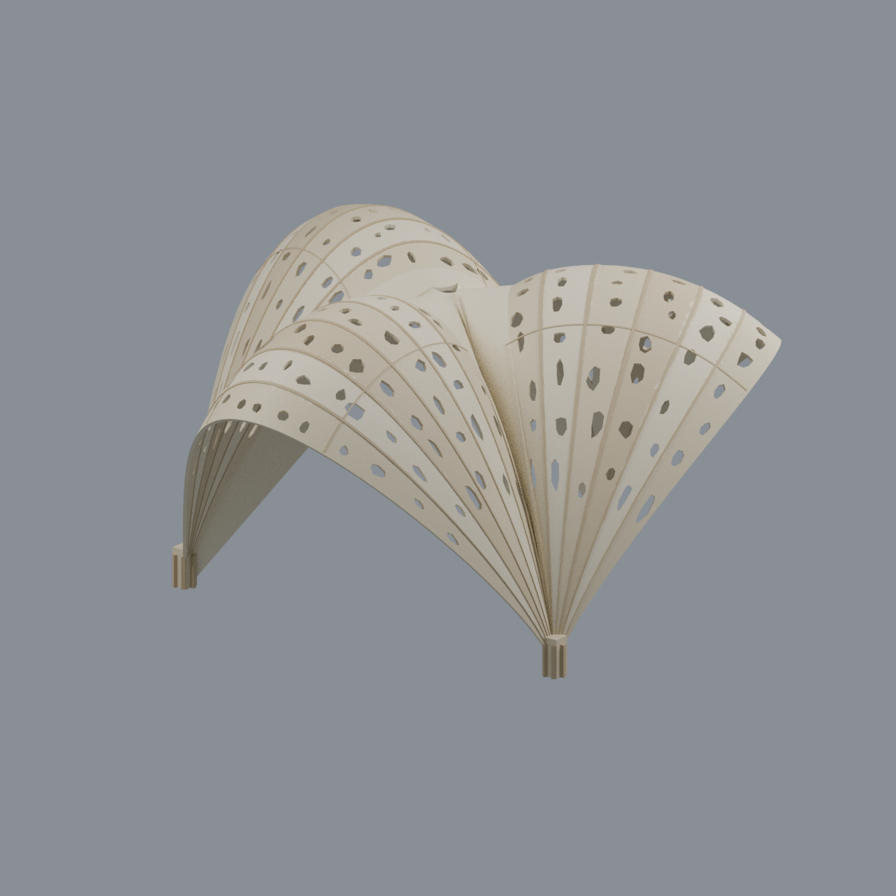

# 國立成功大學・光復校區

[返回學校總覽](../README.md)

本校區目前收錄 19 件數位外觀近似模型；包含局部段或同一財產不同量體，件數不等於完整建物棟數。原16件含底座最長150mm；波簷尖峰片段為104mm展示底座寬，小西門為108mm展示寬，懸鏈・榭歷史實作亭為約157mm展示寬，各件獨立縮尺；懸鏈・榭場址為成品與校方院照交叉定位推論，不表示目前仍存。尚未完成全校，未實體試印或進行印表機切片驗證。

## 三欄模型圖鑑

每格是一件不同模型。範圍、來源年代、近似與薄件警示以各件詳頁為準。

| 建築模型 | 建築模型 | 建築模型 |
| :---: | :---: | :---: |
| **國立成功大學｜建築科技大樓**  [正面](buildings/architecture-technology-building/previews/front.png) · [背面](buildings/architecture-technology-building/previews/rear.png) [說明與來源](buildings/architecture-technology-building/README.md) · [STL](buildings/architecture-technology-building/model.stl) | **國立成功大學｜C-Hub成大創意基地高量體**  [正面](buildings/c-hub-high-volume/appearance/previews/front.png) · [背面](buildings/c-hub-high-volume/appearance/previews/rear.png) [說明與來源](buildings/c-hub-high-volume/README.md) · [STL](buildings/c-hub-high-volume/model.stl) | **國立成功大學｜中文系館**  [正面](buildings/chinese-department-building/appearance/previews/front.png) · [背面](buildings/chinese-department-building/appearance/previews/rear.png) [說明與來源](buildings/chinese-department-building/README.md) · [STL](buildings/chinese-department-building/model.stl) |
| **國立成功大學｜中正堂**  [正面](buildings/chung-cheng-gym/appearance/previews/front.png) · [背面](buildings/chung-cheng-gym/appearance/previews/rear.png) [說明與來源](buildings/chung-cheng-gym/README.md) · [STL](buildings/chung-cheng-gym/model.stl) | **國立成功大學｜大成館**  [正面](buildings/dacheng-hall/appearance/previews/front.png) · [背面](buildings/dacheng-hall/appearance/previews/rear.png) [說明與來源](buildings/dacheng-hall/README.md) · [STL](buildings/dacheng-hall/model.stl) | **國立成功大學｜歷史文物館**  [正面](buildings/historical-artifacts-museum/appearance/previews/front.png) · [背面](buildings/historical-artifacts-museum/appearance/previews/rear.png) [說明與來源](buildings/historical-artifacts-museum/README.md) · [STL](buildings/historical-artifacts-museum/model.stl) |
| **國立成功大學｜歷史學系館**  [正面](buildings/history-department/appearance/previews/front.png) · [背面](buildings/history-department/appearance/previews/rear.png) [說明與來源](buildings/history-department/README.md) · [STL](buildings/history-department/model.stl) | **國立成功大學｜修齊大樓（文學院暨語言中心大樓）**  [正面](buildings/hsiu-chi-building/previews/front.png) · [背面](buildings/hsiu-chi-building/previews/rear.png) [說明與來源](buildings/hsiu-chi-building/README.md) · [STL](buildings/hsiu-chi-building/model.stl) | **國立成功大學｜工業與資訊管理系館大樓**  [正面](buildings/industrial-information-management-building/previews/front.png) · [背面](buildings/industrial-information-management-building/previews/rear.png) [說明與來源](buildings/industrial-information-management-building/README.md) · [STL](buildings/industrial-information-management-building/model.stl) |
| **國立成功大學｜禮賢樓**  [正面](buildings/lixian-building/previews/front.png) · [背面](buildings/lixian-building/previews/rear.png) [說明與來源](buildings/lixian-building/README.md) · [STL](buildings/lixian-building/model.stl) | **國立成功大學｜管理學院綜合大樓**  [正面](buildings/management-college-building/previews/front.png) · [背面](buildings/management-college-building/previews/rear.png) [說明與來源](buildings/management-college-building/README.md) · [STL](buildings/management-college-building/model.stl) | **國立成功大學｜軍訓大樓**  [正面](buildings/military-training-building/appearance/previews/front.png) · [背面](buildings/military-training-building/appearance/previews/rear.png) [說明與來源](buildings/military-training-building/README.md) · [STL](buildings/military-training-building/model.stl) |
| **國立成功大學｜學生活動中心（連續L形建築）**  [正面](buildings/student-activity-center/previews/front.png) · [背面](buildings/student-activity-center/previews/rear.png) [說明與來源](buildings/student-activity-center/README.md) · [STL](buildings/student-activity-center/model.stl) | **國立成功大學｜唯農大樓**  [正面](buildings/wei-nong-building/previews/front.png) · [背面](buildings/wei-nong-building/previews/rear.png) [說明與來源](buildings/wei-nong-building/README.md) · [STL](buildings/wei-nong-building/model.stl) | **國立成功大學｜雲平大樓東棟**  [正面](buildings/yunping-east/previews/front.png) · [背面](buildings/yunping-east/previews/rear.png) [說明與來源](buildings/yunping-east/README.md) · [STL](buildings/yunping-east/model.stl) |
| **國立成功大學｜雲平大樓西棟**  [正面](buildings/yunping-west/previews/front.png) · [背面](buildings/yunping-west/previews/rear.png) [說明與來源](buildings/yunping-west/README.md) · [STL](buildings/yunping-west/model.stl) |  **[國立成功大學｜光復校區｜波簷高尖峰上部木格片段（2021）](buildings/ncku-wave-eaves-apex-fragment-2021/README.md)** |  **[國立成功大學・光復校區小西門（靖波門）](buildings/ncku-minor-west-gate/README.md)** |
|  **[國立成功大學｜光復校區｜懸鏈・榭（Sewn Pavilion）](buildings/ncku-sewn-pavilion/README.md)** |  |  |

[六材質外觀與來源界線](buildings/dacheng-hall/appearance/README.md)

[六材質外觀與來源界線](buildings/military-training-building/appearance/README.md)

[七材質外觀與來源界線](buildings/historical-artifacts-museum/appearance/README.md)

[六材質外觀與來源界線](buildings/history-department/appearance/README.md)

[五材質外觀與來源界線](buildings/chinese-department-building/appearance/README.md)

