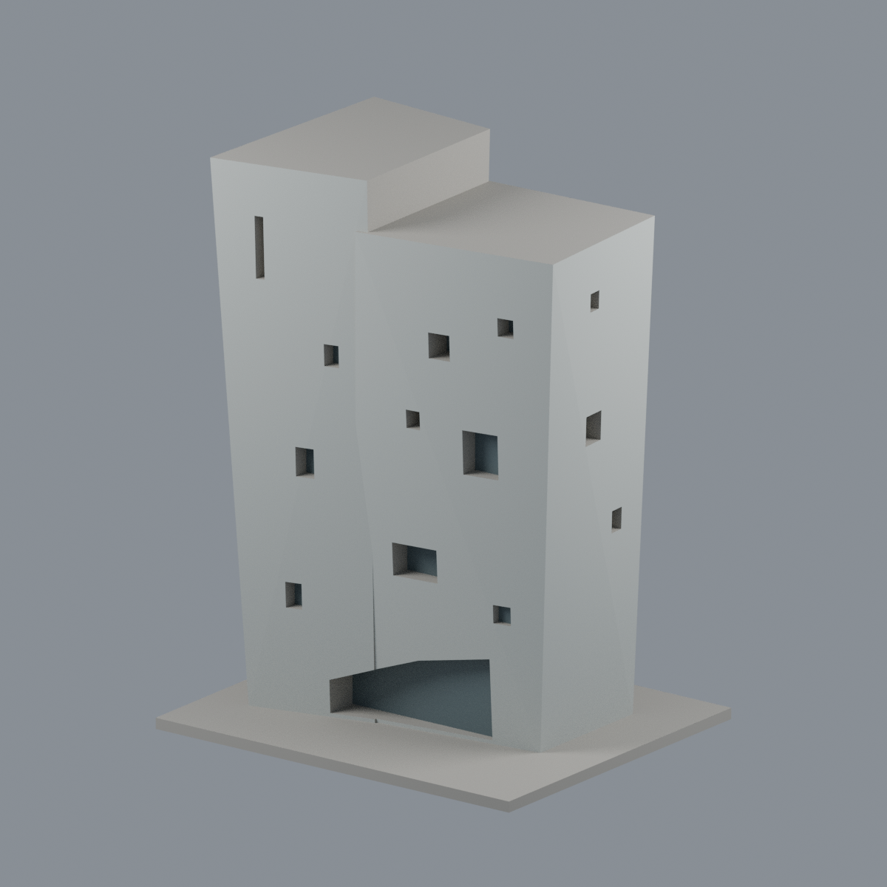
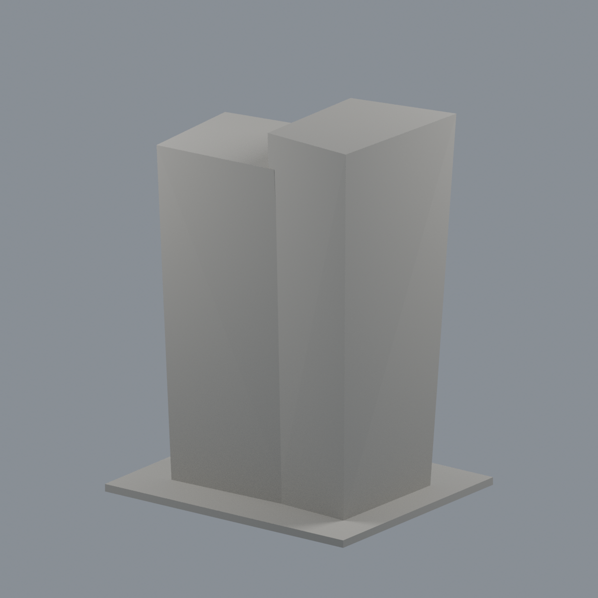
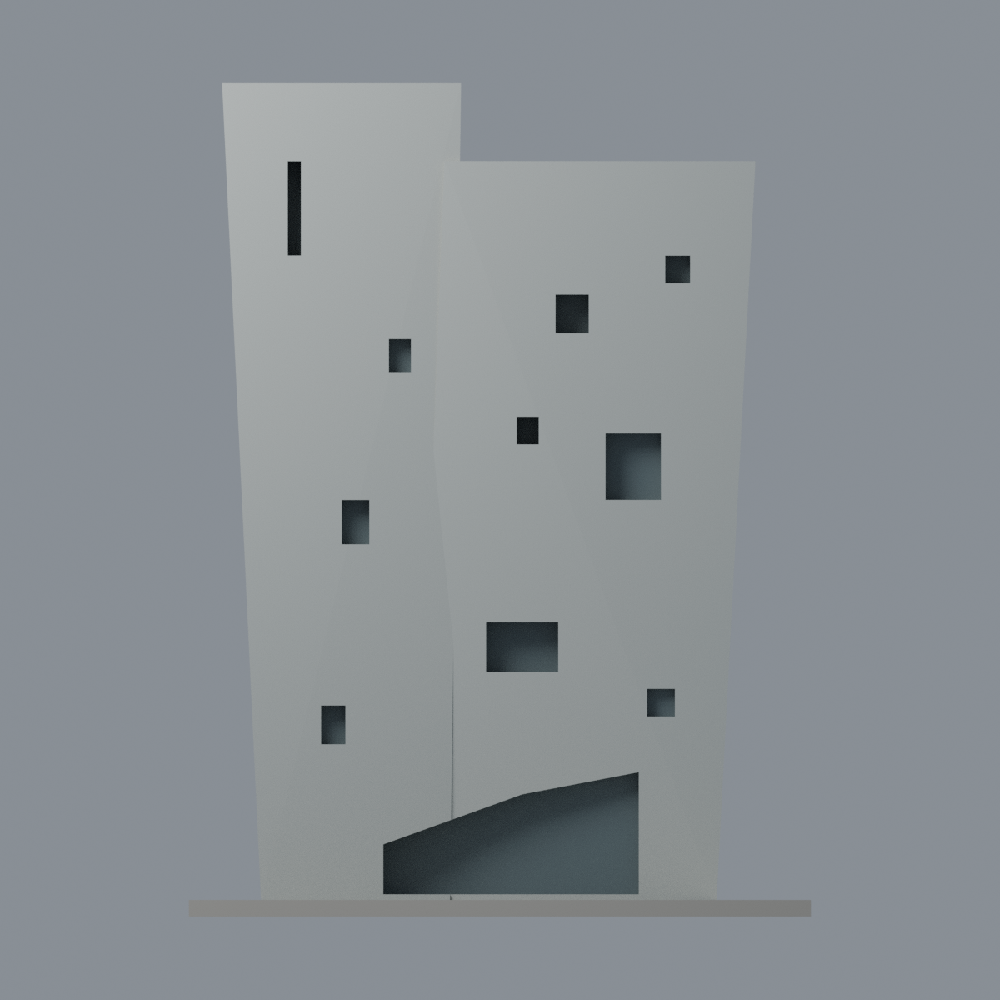
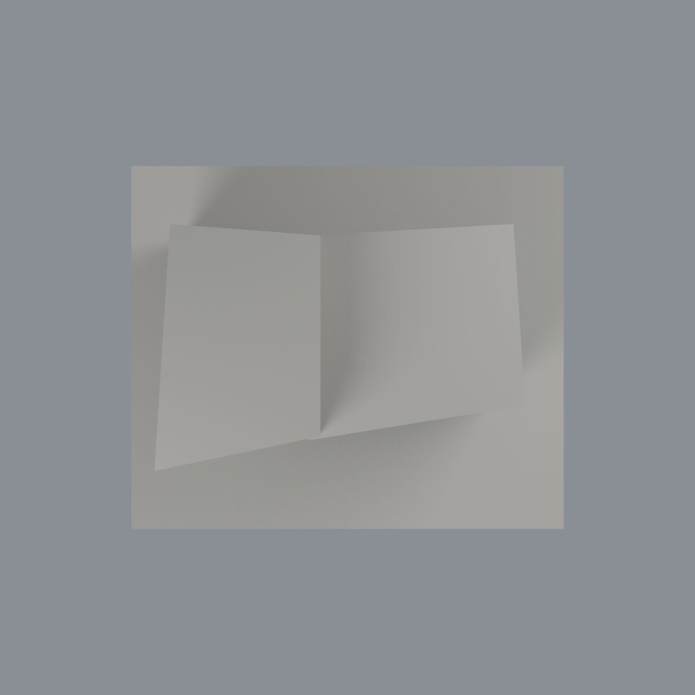

# 成大 C-Hub 高量體有限配色：三材質外觀版

沿用原 **320 三角面／162 頂點**，不改原 STL 位元、座標、面序或幾何；這是既有模型外觀改版，不增加模型包數。

| 正面 | 背面保持中性 |
|---|---|
|  |  |
|  |  |

[表面色 3MF](nckuchub-appearance.3mf) · [可編輯 Blender](scene.blend) · [材質色表](palette.json) · [逐面指派與依據](face-materials.json) · [原 STL](../model.stl)

## 來源與配色邊界

本件只含 **C-Hub 高折面量體**，不含前景低連接屋頂與鄰棟。親看成大官方素材庫六張完整實拍、原單色網格及生成器；[精確 URL、SHA 與分列日期](qa/source-review.json)。3004 照 nested EXIF Original 為 2024-06-05 10:21:17（相機自報、未獨立認證），其他選用照片沒有拍攝日期；2025 上傳路徑不等於拍攝時間，不宣稱 2026 現況。未使用舊效果圖；原照不入包。

- 正面與右側可註冊折面殼採低飽和淡灰清水混凝土代理，折面陰影不是不同塗裝。不烘焙藍天反光、黃色樹葉、樹影、板模接縫或風化斑。
- 左正面四、右正面六、右側三個原窗背，加下方斜頂不規則凹背，以暗灰整組玻璃代理。原網格沒有照片細鋁框／中梃，不在單個大面上臆切銀線；不聲稱逐片窗玻璃、室內或反射還原。
- 右側定位由正右斜照支持；樹遮其他角度只確認身份。未註冊背牆、左側、屋頂與底板中性；窗洞內未精確分材的接面也保守處理。
- 原比例、折角、不同上緣高度與粗化窗洞完全保留。低連接屋頂、招牌、文字、管線與植栽不存在原模型，不為配色新增；此版非新增幾何，也不是實體列印驗證。

[原幾何與歷史來源限制](../README.md)

## 重建與核驗

安裝 [依賴](source/requirements.txt)，Blender 使用 4.3.2。由本資料夾上層提供原 model.stl：

1. `python appearance/source/build_appearance.py`
2. `python appearance/source/verify_exchange.py`
3. `blender -b -t 3 --python-exit-code 1 -P appearance/source/render_appearance.py`
4. `blender -b -t 3 --python-exit-code 1 -P appearance/source/verify_scene.py`

[獨立重建 ZIP](rebuild-source.zip)含原 STL、四支程式及依賴，不含第三方照片；不取代原建模腳本。[逐檔 SHA256](SHA256SUMS)

[交換／拓撲 QA](qa/exchange-validation.json)核對原座標與面序、全部面材質、單連通、有向水密邊、頂點 link 單環、正體積與零退化／重複面；lib3mf 嚴格讀取零警告，實際編輯單材質再存讀，其他材質及面指派不變。SDK 六位小數量化誤差另列。

[Blender 存讀與編輯](qa/scene-validation.json) · [渲染記錄](qa/render-manifest.json) · [獨立重建](qa/rebuild-validation.json)

## 製造限制照舊

尺寸仍為 112 × 94 × 150 mm；原 STL、建模程式、場景及歷史 QA 保留。原層檢與薄特徵檢查本次未重跑，不能由材質 QA 代替。

3MF 是同一網格的表面色，不是各材質各自封閉的分色實體、切片專案、噴頭映射或 G-code。切片 GUI、多材料路徑與實體列印未測；柱頭、屋簷、窗框及薄邊仍須評估材料、支撐及拆除風險，沒有保證可印或免支撐。
