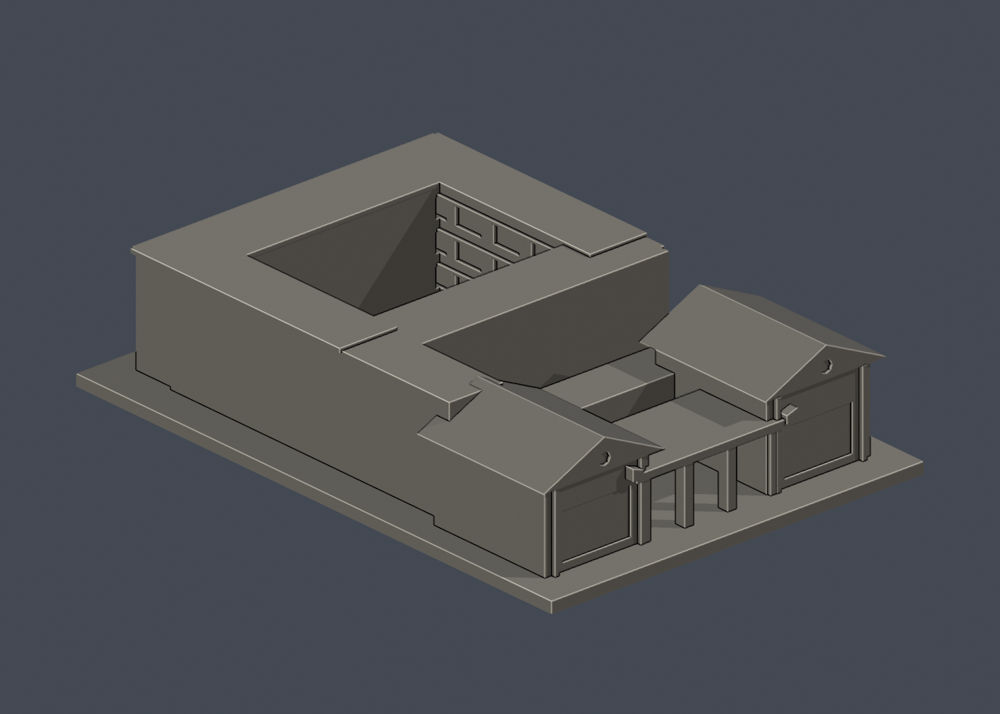
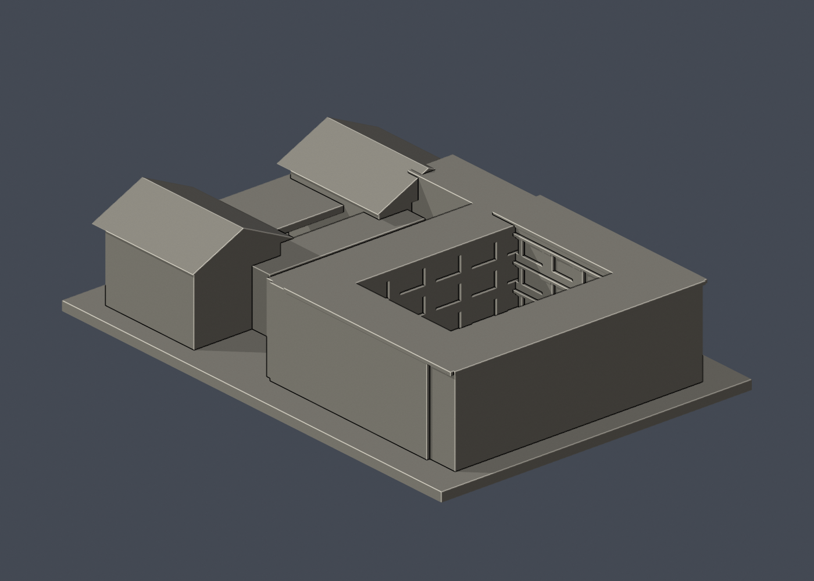

# 國立成功大學｜中文系館

第十一批，光復校區。尺寸 104 × 150 × 34 mm，含底座最長邊150 mm；每件獨立比例。





## 來源與像素檢視

- [校方GIS：正門](https://db.nckumap.ncku.edu.tw/nckugis/public/uploadfiles.htm?action=listImg&q=38147)：已檢視兩側不等高山牆、中央四柱門棚、紅磚實牆及八角小孔。
- [校方GIS：入口轉角](https://db.nckumap.ncku.edu.tw/nckugis/public/uploadfiles.htm?action=listImg&q=38146)：已檢視不對稱山牆、入口上翹直線邊及後接高低量體。
- [校方GIS：舊入口角度](https://db.nckumap.ncku.edu.tw/nckugis/public/uploadfiles.htm?action=listImg&q=36357)：交叉檢視側翼露明柱樑和長向接合。
- [校方文史脈流：中文系館](https://deh.csie.ncku.edu.tw/extn/poi_detail/32194)：核實中文系館1984年落成、王大閎作品。已檢視公開照片0/1入口、2露天中庭三層立面；沒有採室內照片4。
- [校刊建築研究文字](https://nckur.lib.ncku.edu.tw/retrieve/148372/5010113001-000002.pdf)：以可讀文字核實是一棟不規則組合、兩個合院及不對稱入口山牆；PDF原圖下載502、舊連結404，未聲稱檢視其中照片/圖面。
- [校方公開GIS建物外框](https://nckumap.ncku.edu.tw/map.php)：只採A024及gis_base外部輪廓，不採樓層室內配置。
- [校方2026/1/30財產清冊](https://prop-oga.ncku.edu.tw/var/file/59/1059/img/4743/218075103.pdf)：光復校區R1A-15-0名稱對照。

## 範圍與近似

模型為中文系館相連外殼與露天庭院的粗化組合，依校方文字辨識為同一不規則建築，不含旁邊已另製的歷史文物館。前方保留不等高雙山牆、八角通風小孔、四柱門棚及直線上翹邊；後方保留公開外框的退縮與兩處露天空間。中庭立面依可見照片三層柱樑/窗帶概化，庭院尺寸、各翼深度與後屋面高度未測繪。沒有背面像素的外牆留素面；前面大片淺凹表示磚牆板面，不是玻璃窗或通洞。文字中的室內配置不使用，亦未使用室內平面圖或設備資料。

## 交付與重建

- `model.stl`：毫米單位，與底座合成的單一實體。最長邊為 150 mm（含底座）；各棟獨立縮放，不適合直接拼成等比例校園。
- `build_model.py`：完整可攜參數化原始程式，無外部貼圖、私有路徑或參考照片依賴。
- `scene.blend`：由交付 STL 匯入，只有一個建築網格，可在 Blender 編輯頂點；細部參數請修改 Python 後重建。
- `previews/front.png`、`rear.png`、`elevation.png`：由實際交付 STL 產生。
- `validate_model.py`、`validation.json`：可重跑的幾何與重建驗證。

建議 Python 3.12，在虛擬環境執行：

```sh
python -m pip install -r requirements.txt
python build_model.py
blender -b -t 2 -P render_preview.py
python validate_model.py
```

已使用 Blender 4.3.2。驗證器在獨立臨時目錄重建 STL 並比較 SHA-256，讀取 Blender 場景的網格後比較三角形幾何。它檢查原始二進位 STL 儲存法線、面積、封閉性、邊恰有兩面、頂點連結為單一環、表面只有一個連通分量、正體積、底面位於 Z=0、最長邊 150 mm。單一封閉表面也排除獨立藏在內部的空腔殼；沒有宣稱完成所有自交的窮舉檢測。

## 製作原則與限制

這是依公開照片觀察製作的外觀近似收藏模型，不是測繪、修復、工程或精確 BIM 資料。牆身為實體，門窗、拱廊通常改成淺凹浮雕；不含室內、設備或安全配置。屋頂、深度、窗距及後側比例沒有測量基準，不能視為實際尺寸。原始參考照片未收錄、未重新授權或隨套件發布。來源權利屬原作者／校方；原創模型與程式可沿用儲存庫授權，不涵蓋外部參考照片。

## 列印說明

底座平貼平台，Z 軸向上。可從 0.4 mm 噴嘴、0.16–0.20 mm 層高、3 道外牆與 12–18% 填充開始試切片；這是設定建議，並非已測參數。小於約 0.8 mm 的淺浮雕可能因噴嘴或縮放消失。STL 是封閉實體，切片器仍會依填充率產生內部填充。

未實體試印、未執行切片器列印驗證，沒有保證免支撐。請依下列模型特有支撐需求檢查切片預覽。

中央入口棚和露天庭院上方橫帶可能需局部支撐，八角小孔已放大，細節在0.4mm噴嘴下仍可能鈍化。

## 幾何輔助檢查

`validate_sections.py`固定共享邊方向求交，0.20mm抽樣閉合；見`cross_sections.json`。`check_thin.py`斷言1.0mm截面閉合有效後作0.8mm參考寬度形態開運算；見`thin-feature-check.json`。尖角也會產生面積差，不能直接當壁厚失敗或可列印保證。這兩項不是實際切片器、支撐拆除或實體試印驗證。

查核日期2026-10-13；GIS照片未標最近攝影日期，不宣稱現況逐細節一致。


### 名稱核對

校方GIS A024與財產校碼R1A-15-0均指中文系館。GIS正面實拍q38147門廊金字由右向左讀為「中國文學系」，不是「成功大學圖書館」；不據此臆測圖書館舊用途。
