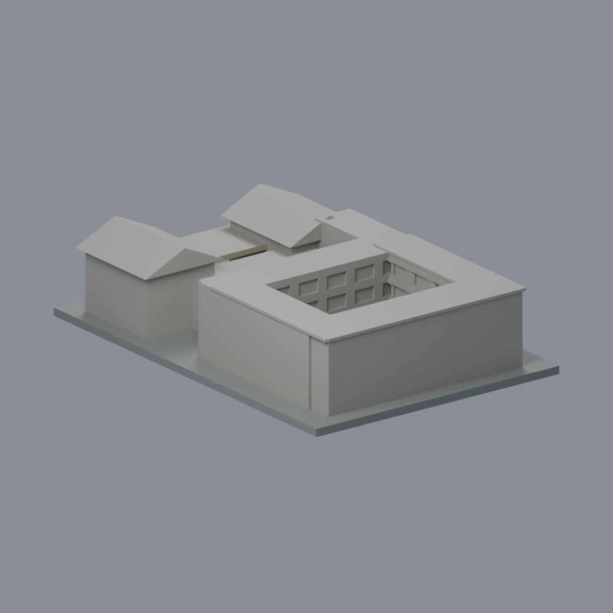
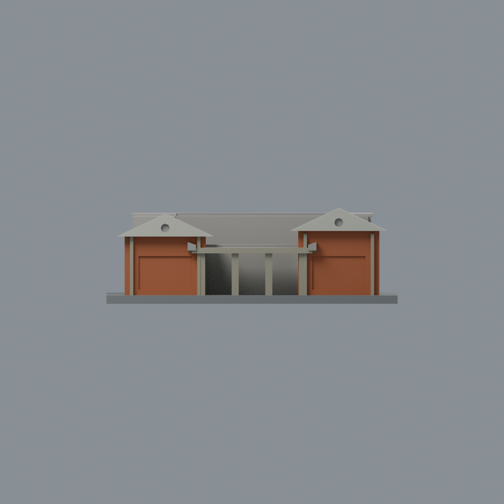
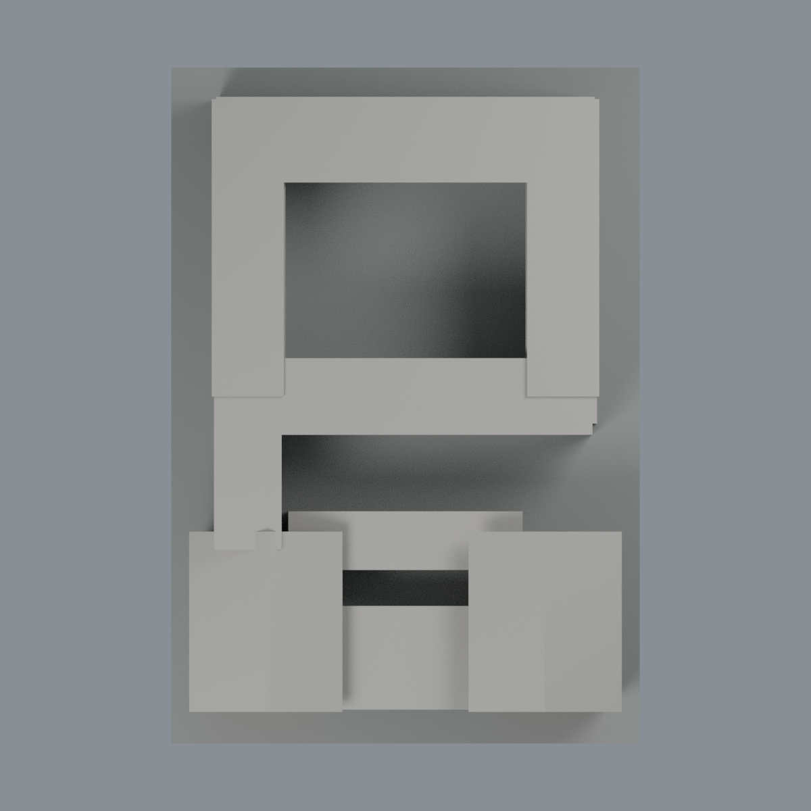

# 成大中文系館：五材質外觀版

沿用原 **1,604 三角面／798 頂點**，不改原 STL 位元、座標、面序或幾何；這是既有模型外觀改版，不增加模型包數。

| 正面 | 背面保持中性 |
|---|---|
|  |  |
|  |  |

[表面色 3MF](chinese-appearance.3mf) · [可編輯 Blender](scene.blend) · [材質色表](palette.json) · [逐面指派與依據](face-materials.json) · [原 STL](../model.stl)

## 來源與配色邊界

親自查看成大校園地圖官方[正面照片 38147](https://db.nckumap.ncku.edu.tw/nckugis/public/uploadfiles.htm?action=listImg&q=38147)及[斜角照片 38146](https://db.nckumap.ncku.edu.tw/nckugis/public/uploadfiles.htm?action=listImg&q=38146)。未提供可確證的拍攝日期／攝影者，不使用下載時間推定年代，不宣稱 2026 現況；不隨包附來源影像。

- 僅正面兩座山牆量體的原立面與淺矩形凹面採橙紅磚色；**這些面是磚牆，不是玻璃窗**，本色表沒有玻璃材質。牆面沒有新磚縫貼圖或格線。
- 原前牆立框、入口四根柱及雨棚可登錄立緣採暖灰混凝土；原山牆正面與雨棚底面淡白色。原窗格、橫梁和山牆深色外圈沒有完整獨立面域，不用整片三角面製造假材料邊界。
- 原八角凹洞是單孔簡化；不新增照片中的多孔紋飾、金字、英文、燈具或設備。入口暗處不作黑玻璃或黑牆。
- **保持原左右不等高量體，不鏡像模型或照片。** 來源照片呈現的高低側與原模型投影不完全一致，本次只將兩側共有、可支持的磚／灰框／白山牆材質類別登錄，並非修正或證明其精確朝向與比例。
- 後翼、中庭、背面與側牆沒有在這兩張照片中完整登錄；原後院凹格和屋頂邊不因存在幾何就延伸正面材料。所有屋面、平頂與雨棚頂維持中性。展示底板不是現地鋪面。
- 色值未經色卡校正，構造和尺度仍為原模型近似；不加入樹木、樹影、污漬、空調、鄰棟或場地配置。

[原幾何與來源界線](../README.md) · [本次來源覆核](qa/source-review.json)

## 重建與核驗

安裝 [依賴](source/requirements.txt)，Blender 使用 4.3.2。由本資料夾上層提供原 model.stl：

1. `python appearance/source/build_appearance.py`
2. `python appearance/source/verify_exchange.py`
3. `blender -b -t 3 --python-exit-code 1 -P appearance/source/render_appearance.py`
4. `blender -b -t 3 --python-exit-code 1 -P appearance/source/verify_scene.py`

[獨立重建 ZIP](rebuild-source.zip)含原 STL、四支程式及依賴，不含第三方照片；不取代原建模腳本。[逐檔 SHA256](SHA256SUMS)

[交換／拓撲 QA](qa/exchange-validation.json)核對原座標與面序、全部面材質、單連通、有向水密邊、頂點 link 單環、正體積與零退化／重複面；lib3mf 嚴格讀取零警告，實際編輯單材質再存讀，其他材質及面指派不變。SDK 六位小數量化誤差另列。

[Blender 存讀與編輯](qa/scene-validation.json) · [渲染記錄](qa/render-manifest.json) · [獨立重建](qa/rebuild-validation.json)

## 製造限制照舊

尺寸仍為 104 × 150 × 34 mm；原 STL、建模程式、場景及歷史 QA 保留。原層檢與薄特徵檢查本次未重跑，不能由材質 QA 代替。

3MF 是同一網格的表面色，不是五個封閉分色實體、切片專案、噴頭映射或 G-code。切片 GUI、多材料路徑與實體列印未測；柱頭、屋簷、窗框及薄邊仍須評估材料、支撐及拆除風險，沒有保證可印或免支撐。
