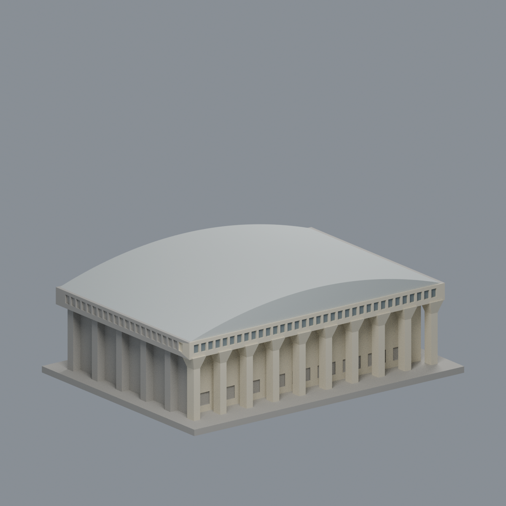
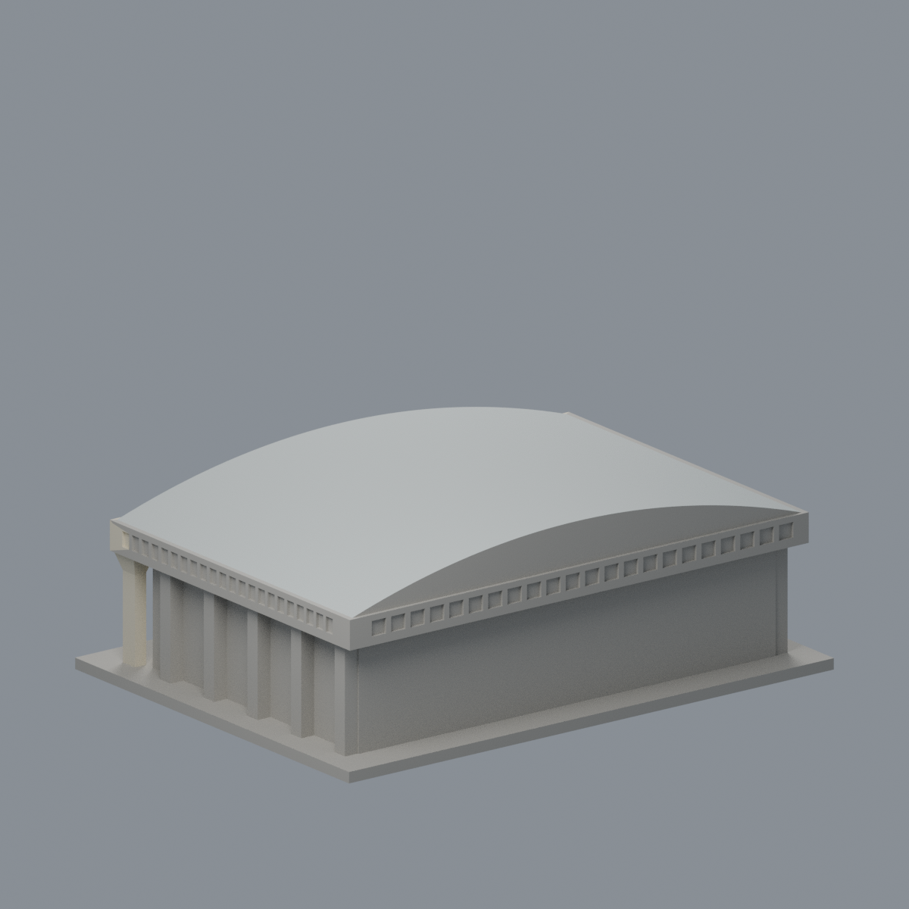

# 國立成功大學｜中正堂

## 模型預覽


| 模型預覽 | 模型預覽 | 模型預覽 |
| :---: | :---: | :---: |
| 正面與來源支持區域<br> | 背牆中性／屋面同系統延伸<br> |  |

## 4 材質外觀版（2026-10-21）


[來源界線與四視角](appearance/README.md) · [表面色 3MF](appearance/nckugym-appearance.3mf) · [可編輯場景](appearance/scene.blend)

依官方照片辨識奶油正面、灰窗與銀灰拱屋面；側後牆及跨越材料界線的原三角面保留中性，屋面採同系統有界延伸，不宣稱完整現況還原。 原 STL 與歷史 QA 不變；這是外觀改善，不是新增幾何。原單色正面（歷史檔案留存，不作本頁預覽）／原單色背面（歷史檔案留存，不作本頁預覽）


第三批外觀近似模型；校區：光復校區。最長邊150 mm（含底座），各模型獨立比例。尺寸：150 × 113 × 52 mm。


## 公開來源及像素查核

- [校方素材網：中正堂2025照片一](https://material.ncku.edu.tw/picture.php?/3741)：已檢視前面斜角像素，辨識淺弧屋頂、高柱及擴張柱頭、上層連續窄窗帶。
- [校方素材網：中正堂2025照片二](https://material.ncku.edu.tw/picture.php?/3743)：已檢視另一方向側面像素，可見柱列、窗帶及外部樓梯。
- [校方素材網：中正堂2025照片三](https://material.ncku.edu.tw/picture.php?/3750)：已檢視轉角像素，核對兩向外挑與柱列。
- [校方工程公告](https://main-oga.ncku.edu.tw/p/404-1060-212536.php?Lang=zh-tw)：校方標題確認中正堂位於光復校區。

## 本件範圍、保留與近似

保留大跨度淺拱形屋頂、上層連續窗帶、高柱與擴張柱頭。屋頂用拋物線近似，不是原結構曲率；弧面以48段線性化。柱列數、建物深度和窗格為照片節奏估算，地面層以實體牆填實，只保留可見淺凹。後側照片是斜角且局部受樹遮擋，後方簡化窗帶為近似，外部樓梯因位置與輪廓不完整而省略，並非立面測繪。沒有場館內部、運動設備、空調或安防配置。

## 交付與重建

- `model.stl`：毫米單位，與底座合成的單一實體。最長邊為 150 mm（含底座）；各棟獨立縮放，不適合直接拼成等比例校園。
- `build_model.py`：完整可攜參數化原始程式，無外部貼圖、私有路徑或參考照片依賴。
- `scene.blend`：由交付 STL 匯入，只有一個建築網格，可在 Blender 編輯頂點；細部參數請修改 Python 後重建。
- `previews/front.png`、`rear.png`、`elevation.png`：由實際交付 STL 產生。
- `validate_model.py`、`validation.json`：可重跑的幾何與重建驗證。

建議 Python 3.12，在虛擬環境執行：

```sh
python -m pip install -r requirements.txt
python build_model.py
blender -b -t 2 -P render_preview.py
python validate_model.py
```

已使用 Blender 4.3.2。驗證器在獨立臨時目錄重建 STL 並比較 SHA-256，讀取 Blender 場景的網格後比較三角形幾何。它檢查原始二進位 STL 儲存法線、面積、封閉性、邊恰有兩面、頂點連結為單一環、表面只有一個連通分量、正體積、底面位於 Z=0、最長邊 150 mm。單一封閉表面也排除獨立藏在內部的空腔殼；沒有宣稱完成所有自交的窮舉檢測。

## 製作原則與限制

這是依公開照片觀察製作的外觀近似收藏模型，不是測繪、修復、工程或精確 BIM 資料。牆身為實體，門窗、拱廊通常改成淺凹浮雕；不含室內、設備或安全配置。屋頂、深度、窗距及後側比例沒有測量基準，不能視為實際尺寸。原始參考照片未收錄、未重新授權或隨套件發布。來源權利屬原作者／校方；原創模型與程式可沿用儲存庫授權，不涵蓋外部參考照片。

## 列印說明

底座平貼平台，Z 軸向上。可從 0.4 mm 噴嘴、0.16–0.20 mm 層高、3 道外牆與 12–18% 填充開始試切片；這是設定建議，並非已測參數。小於約 0.8 mm 的淺浮雕可能因噴嘴或縮放消失。STL 是封閉實體，切片器仍會依填充率產生內部填充。

未實體試印、未執行切片器列印驗證，沒有保證免支撐。請依下列模型特有支撐需求檢查切片預覽。

高柱與上層外挑形成約5–12 mm局部跨距，建議外挑梁底、柱間頂板使用支撐；弧屋頂是實體封閉表面，非薄殼。窗帶浮雕需切片確認。

## 抽樣逐層截面檢查

新增 `validate_sections.py` 與 `cross_sections.json`，對實際STL每0.20 mm高度抽樣一次平面交線，檢查每節點度數為2及無零長線段；恰遇頂點平面時向下避開0.0173 mm，細節記錄於JSON。這是截面閉合檢查，不是切片器工具路徑、支撐或擠出驗證。執行 `python validate_sections.py` 可重跑。

查核日期：2026-10-13。


## 整合版截面與薄特徵補充驗證

本整合版使用固定共同邊方向後插值的 `validate_sections.py` 與 [0.2 mm 截面結果](cross_sections.json)，避免同一邊浮點方向差異造成假斷環。原始 STL 幾何未修改。舊截面程式有閉合斷言，既有通過結果不代表曾有破面；此處以新版重跑結果為準。

另提供 `check_thin.py` 與 [新增 0.8 mm 薄特徵輔助篩查](thin-feature-check.json)：每 1 mm 水平取樣，先確認輪廓閉合與有效，再作半徑 0.4 mm 形態開運算。這不是切片器、完整壁厚分析或實體試印，尖屋頂、銳角也會造成損失，不能據此宣稱無支撐或列印成功。執行前請安裝 requirements.txt。
