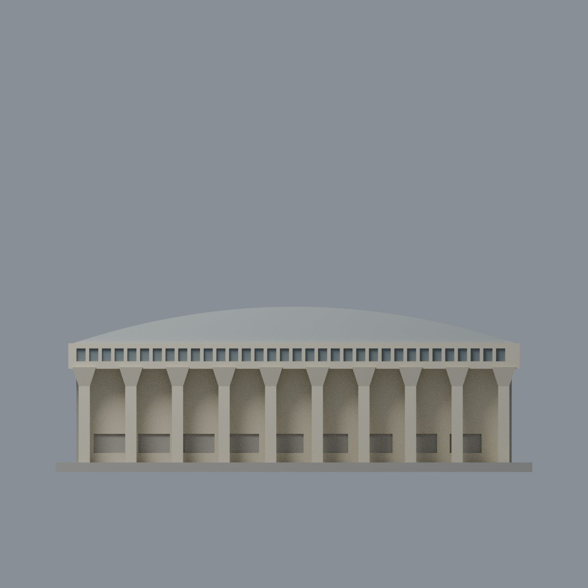
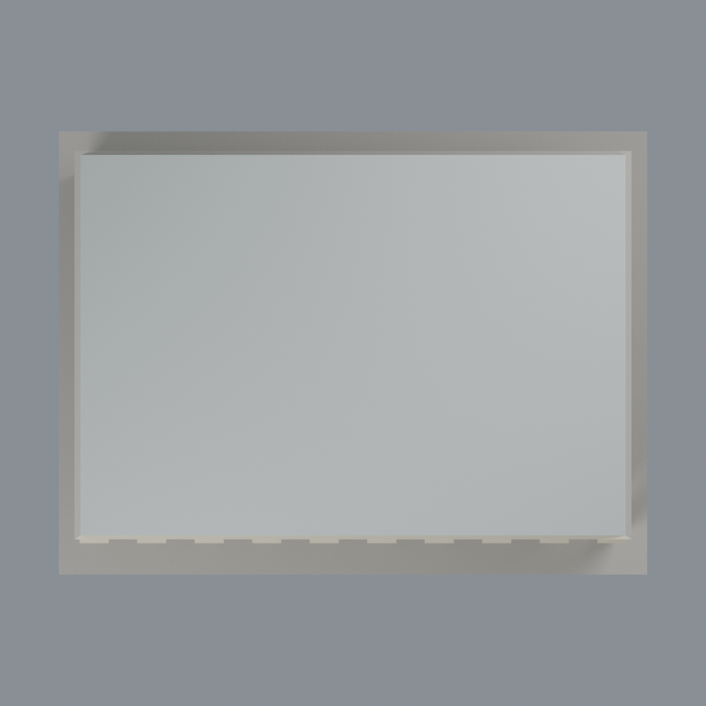

# 成大中正堂正面與屋頂有限配色：四材質外觀版

沿用原 **2,524 三角面／1,244 頂點**，不改原 STL 位元、座標、面序或幾何；這是既有模型外觀改版，不增加模型包數。

| 正面 | 背牆中性／屋面同系統延伸 |
|---|---|
|  |  |
|  |  |

[表面色 3MF](nckugym-appearance.3mf) · [可編輯 Blender](scene.blend) · [材質色表](palette.json) · [逐面指派與依據](face-materials.json) · [原 STL](../model.stl)

## 來源與配色邊界

親看成大官方素材庫 3741、3743 的完整實拍、原單色網格與生成器；[精確 URL、SHA 與日期](qa/source-review.json)。兩頁上傳 2025-02-05，不是拍攝日；照片無 Original 拍攝日期，不聲稱 2025 拍攝或 2026 現況。照片私有研究，不入包。

- 可註冊正面牆、柱、外擴柱頭及寬簷帶採淡奶油，原構件側面同材料有界延伸；上緣原離散窄窗凹背採低飽和灰藍代理，紫色窗簾不是紫色牆板或固定玻璃色。
- 可見拱形山牆與屋面採銀灰金屬，同系統向後延伸屋面，但後端山牆與後牆中性。所有三角面須完整落在金屬區；跨屋面／簷體交界面保持中性，不以重心切出錯誤斜色界。
- 正面上方薄暗百葉／透光條及細直金屬縫原未分，明確省略，不在大面上臆畫。下方被車遮擋、混門窗的原粗凹背保守中性，不一律當玻璃。
- 第二張斜照未充分獨立定位到原左右側，故兩側窗與主牆也中性，不以對稱猜出背面；原柱頭簡化、窗格比例、後部近似照舊。
- 不增加文字、標誌、空調、車、人、樹或原未建階梯。此為既有外觀改版，不是新幾何或製造放行。

[原幾何與歷史來源限制](../README.md)

## 重建與核驗

安裝 [依賴](source/requirements.txt)，Blender 使用 4.3.2。由本資料夾上層提供原 model.stl：

1. `python appearance/source/build_appearance.py`
2. `python appearance/source/verify_exchange.py`
3. `blender -b -t 3 --python-exit-code 1 -P appearance/source/render_appearance.py`
4. `blender -b -t 3 --python-exit-code 1 -P appearance/source/verify_scene.py`

[獨立重建 ZIP](rebuild-source.zip)含原 STL、四支程式及依賴，不含第三方照片；不取代原建模腳本。[逐檔 SHA256](SHA256SUMS)

[交換／拓撲 QA](qa/exchange-validation.json)核對原座標與面序、全部面材質、單連通、有向水密邊、頂點 link 單環、正體積與零退化／重複面；lib3mf 嚴格讀取零警告，實際編輯單材質再存讀，其他材質及面指派不變。SDK 六位小數量化誤差另列。

[Blender 存讀與編輯](qa/scene-validation.json) · [渲染記錄](qa/render-manifest.json) · [獨立重建](qa/rebuild-validation.json)

## 製造限制照舊

尺寸仍為 150 × 113 × 52 mm；原 STL、建模程式、場景及歷史 QA 保留。原層檢與薄特徵檢查本次未重跑，不能由材質 QA 代替。

3MF 是同一網格的表面色，不是各材質各自封閉的分色實體、切片專案、噴頭映射或 G-code。切片 GUI、多材料路徑與實體列印未測；柱頭、屋簷、窗框及薄邊仍須評估材料、支撐及拆除風險，沒有保證可印或免支撐。
